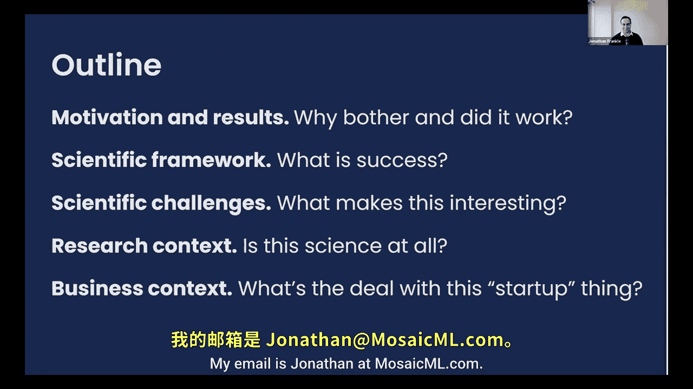
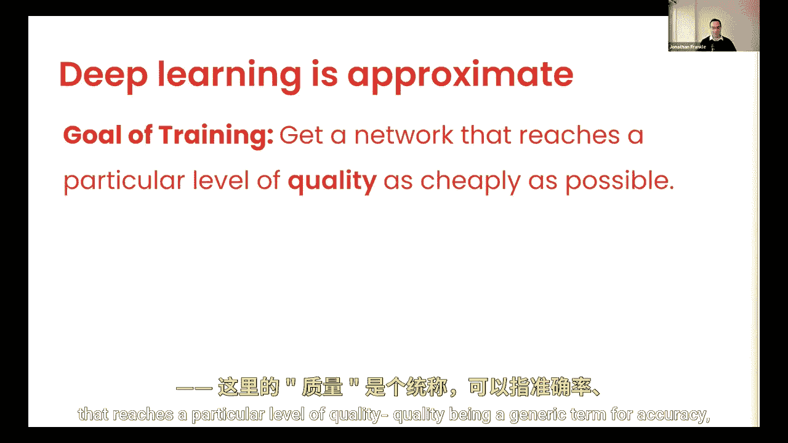

# 马里兰大学【中英⚡深度学习基础｜CMSC828W-2020-Foundations-of-Deep-Learning】-p34-P34-Deep-Learning-Foundations：-Jonathan-Frankle-talk-on-Faster-Neural-Network-Tr--BV15rpCz9Ed8_p34-

So thank you so much for having me I just want to double check everybody can hear me okay， right。

 can I get a thumbs up from the audience？Awesome thank you ground rules very quickly please interrupt me if you can't get my attention just shout really loudly or raise your hand or wave around but please interrupt me what i'm going to present to you is really work in progress and science and progress you're allowed to be skeptical you're allowed to disagree a lot of it's going to be very high level that's the fun of it but I hope by the end you'll have some interesting new research ideas you'll have some new thoughts on you know what really matters when it comes to doing training。

So let's go。So essentially to give you the outline at a high level。

 I'm going to try to talk about five things I know we only have an hour together and I hope you'll interrupt me a lot so we'll get to as many as we can but I'll start with some motivation and you know some results you know did it work I hope it did otherwise I wouldn't be here talking to you how we think about the science and why this is actually an interesting set of problems to work on and then we should really ask the question is the science is what I'm going to tell you about science or is this just you know an industry person coming and telling you about some cool project they worked on that's really engineering and I do want to save some time at the end of folks want to chat about kind the business perspective here or the startup perspective I know that's interesting I know it's something I never got to learn about in school so to the extent that people are interested in that question it's also a conversation that I'm happy to have and the last thing that I believe I'm legally obligated to say is that mosaic is hiring interns and full-timers in both research and engineering roles I'm legally obligated to say that I'd get in trouble if I didn't so you're welcome。

Okay， so let's go ahead and get started something like I can work something out i'll talk to you know the leadership of the company and you know see if we can work something out so let's chat。

😊，But you know， we have lots of opportunities happy to chat about that offline my email is Jonathan@mosaicemel。

com it's really easy so you know you know how to be in touch if you want to。

Okay so I'm going to show you I'm going to start with a chart and this is the chart that basically starts like half the machine learning talks these days I'm guessing that if you haven't already you'll see this chart like five times or something like it during all the presentations in this class。

 this is a chart that's in folks put together in a paper called the three eras of machine learning and what it shows is essentially the compute cost in terms of flops by the publication date when you know a bunch of important papers came out a lot of papers that set where within state of the art results and this is on log axes and so you can look and kind of fit this and see that essentially the conclusion the authors come to us at the cost of training state of the art and neural networks and whatever the current state of the art is is increasing by about 400% per year and to put this in context you know and keep in mind this is a state of the art not everyone is using the state of the art in fact no one is using the state of the art to be completely fair how many of you have trained GPT3 from scratch raise your hand if you have。

That's what I thought， so you know take this from what you will we take this with a grain of salt but it's it's a key problem。

 I think cost is becoming a big issue for anyone industry or especially for us academic researchers who want to be able to keep up and work on interesting problems in this space。

And to give that 400% number some perspective， Moore's law at its peak was giving us about you know 200% every 18 months。

 which I think comes down to about 60% per year， something like that。

 you know something along or 160% per year， something along those lines so。You know。

 we're way outpacing whatever Moore's law had given us back then， let alone what it's giving us now。

The other question I usually get asked when I start talking about training costs is does anyone care about training costs after all like you know all we're doing is inference right like Google trains one giant model and they serve it to a bajillion people and so nobody cares about training anyway that doesn't seem to be true finding real industry hard numbers on training is actually pretty difficult this is the one place where I've really seen some good numbers to work with but the claim here and this is a paper that's intended to be wildly optimistic about Google's energy use for machine learning it was part of the little timnit gare situation at Google a couple years ago but that's a whole other conversation。

Was that， you know。Across the three years that they looked at and they looked across a pretty wide variety of machine learning workloads at Google about three fifthths of the energy usage was for inference and two fifths was for training。

 I find those numbers to be actually pretty interesting it's higher on the training side than I would have expected。

 keeping in mind that training accelerators tend to be more expensive per dollar than inference accelerators and this gives us a good bet that perhaps at least according to these numbers training and inference might cost about equal amounts at Google so whether Google's representative is a whole other can wormms but enough people have come to me in this capacity saying hey you said you could reduce training costs training is too expensive that it does seem to be a bit of a problem。

Okay， so let's get to the meat of the real research question that I'm concerned about。

In the days of Moore's law， which was quite frankly know the glory days of Moore's law were early in my life or before I was born。

 probably before many of the people in this class were born to be fair， you know the 1980s。

 the old phrase that I heard people say was that Intel gives and Bill Gates takes away that is to say our processors were getting twice as fast every 18 months and our software was getting more demanding by about 2x every 18 months and we were in this really happy position where costs were basically in check from the 80s until the 2000s what it cost to inflation adjusted to get a processor was about the same and you know the amount you could do with it increased dramatically in terms of both software and in terms of the actual processing capabilities and we'd love to be in that happy place and deep learning we'd love to be in a very happy place where you know our costs of actually training。

 the state of the art models are decreasing so quickly that it balances out the increases in our ambitions we're not there we're nowhere near it we would need to somehow decrease costs by 400%。

Per year to counteract this trend。Okay， so I'm at a startup and suppose I gave you some large amount of money from some venture capitalists and said。

 go solve this problem， go find a way to keep costs in check。

What are you going to do with that money and the first thing you might do is you might build a chip。

 you might build a neural network specific accelerator and you me and our million friends in industry have all had that great idea and there are a ton of really exciting accelerators out there。

😊，Now one thing to say about accelerators is you're really relying on two things here。

 one is better accelerators， one is Moore's law and these numbers come from my CEO who's a hardware architecture guy he spent a lot of time at until undedesigned one of the first know modern neural network accelerators and he says that it'll get you about 50% of this 400% that you need to get to and if you want some numbers here here are some numbers that I calculated these are based on real numbers that I've seen online these were numbers you know the a100 numbers are before the price increases and these are based on the reported gigapflps per second I believe at floating point 16 for the a100 versus the a100 but we're basically looking at a 16% increase in performance per dollar per year from a100 to H100 if that gives you some context we're being even a little more generous by saying 50%。

Okay。The next thing you might do is say， you know， what if we pick the right operations to run？

These neural networks on the actual chip raise your hand if you've heard of this thing called flash attention。

 So anyone heard of flash attention or seen that paper。

 If not it's a cool paper to read but some really smart folks at Stanford went through and figured out how to get the attention operation and transformer networks to run really efficiently given the cache hierarchies and caching behavior of a100s and it leads to huge speedups if you're going to train a transformer all in one kernel It didn't change the math but it just maps the highlevel operations that you or I want to do in a neural network down onto the right operations at the low levelve for the processor and that's really what I think of compilers is doing and there are a ton of awesome frameworks out there。

 there are more that have come out since this there's a framework called torch dynamo that's come out recently that's pretty cool as an example that I don't have on this slide and so this will get you some benefit and you know let's generously give that 30% per year which is a lot to ask。

Because， you know， at some point you run out of things to optimize so basically I think there's something a little strange and funny about the way that we're going about this。

嗯。Deep learning is not an exact science， it's not like doing merge sort where there's a right way to sort the list。

 there's nothing sacred about the math behind deep learning and yet all these approaches are trying to say let's take the exact same operations。

 the exact same recipe， the exact same optimization strategy and run it faster。

And this works to a point。😡，And if you were doing a traditional computer science algorithms class where we have to have correctness。

That's all you would be able to do because at the end of the day we don't violate correctness that's the one key property in computer science that we're not allowed to touch。

In deep learning there is no such thing as correctness we have mislabeled data we're trying to use what are basically glorified convex optimization strategies in a highly nonconvex lost landscape we don't even know the first thing about in terms of what's actually going on and we have all these hacks and tricks and the ideal part of the hyperparameter space you have to be in on the right day of the week and you have to look at your network the right way and say the right magic words before anything will train properly if you get anything a little bit off the network will diverge or have a lost spike or everything will fall apart there is nothing correct or right about what we're doing and we should not be afraid to change the math behind deep learning deep learnings approximate and in approximate computing the goal is to you know in some sense choose the solution the approach that optimizes some constraint that gets you with an epsilon of a particular metric。

So， you know， in the case of training， this is， I want a network that reaches a particular level of quality。

 quality being a generic term for accuracy， perplexity， what have you。

