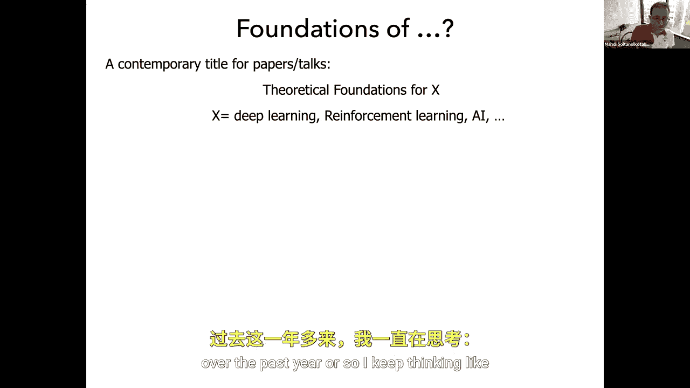
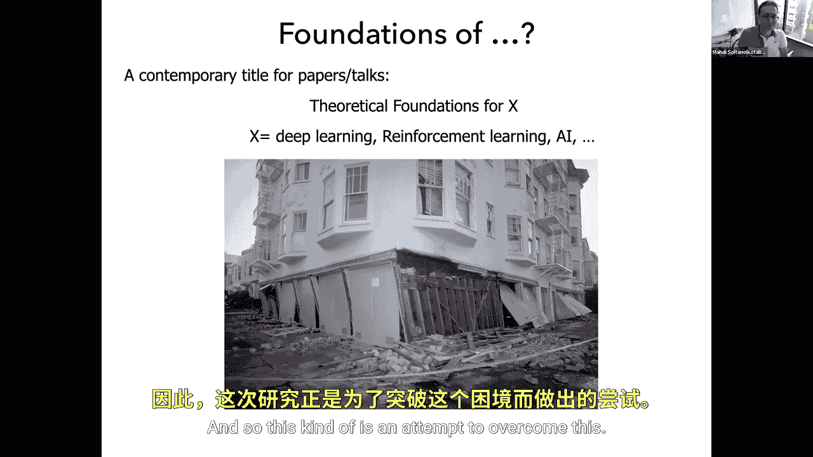
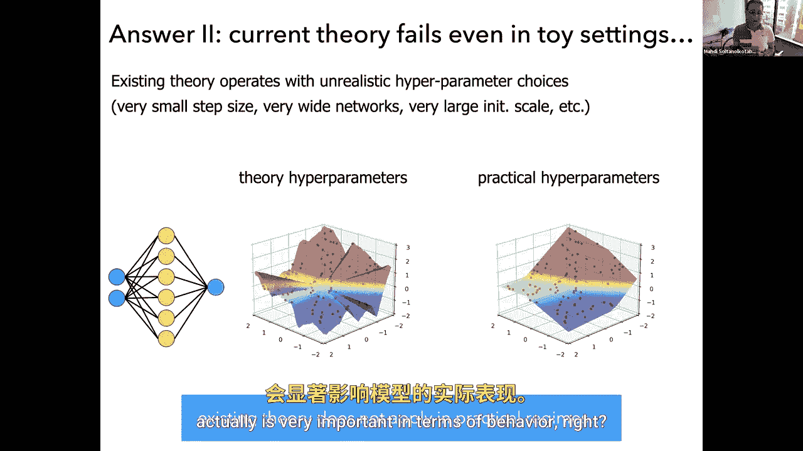
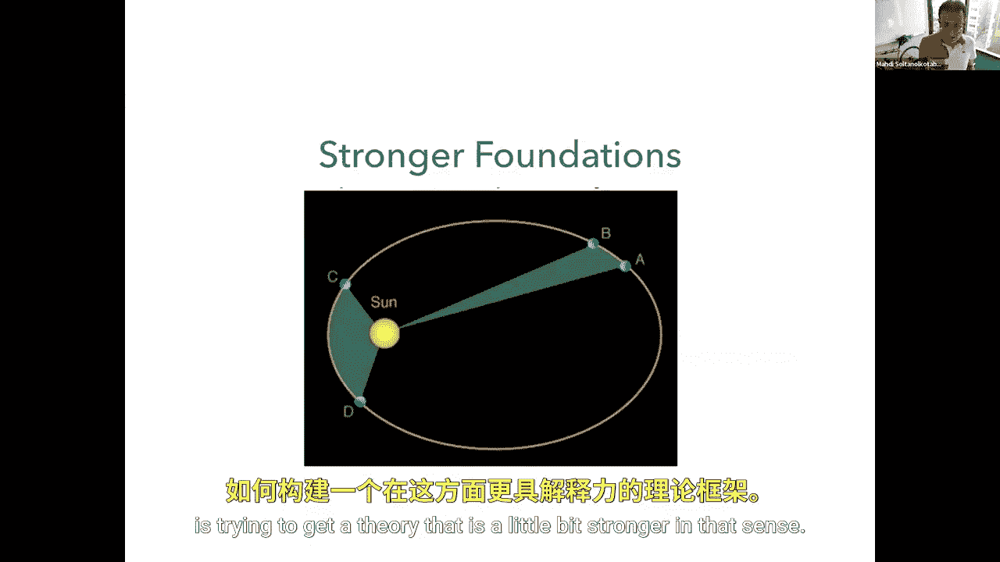
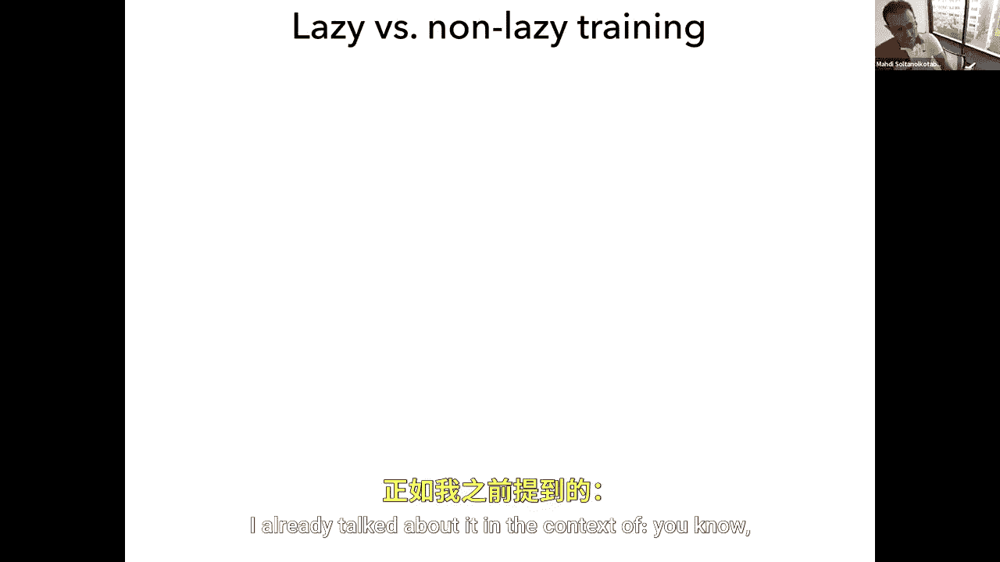

# 马里兰大学【中英⚡深度学习基础｜CMSC828W-2020-Foundations-of-Deep-Learning】-p35-P35-Deep-Learning-Foundations：-Mahdi-Soltanolkotabi's-talk-on-Feature-learning----BV15rpCz9Ed8_p35-

GreatThanks a lot for the invitation and the introduction it' great to be back at Maryland virtually so you know it's a little bit of a mixture of two topics so there are two distinct topics but I saw that there was a lot of previous talk about NDK so I thought you know maybe it's good to give an update beyond NDK right so that's why like the first part is focused on future learning via gradient Descent。

😊，嗯。So somehow it's not okay here we go so it's really kind of an early attempt at understanding future learning so you know like。

Of course talking about foundations is a very contemporary thing to do these days right like you know there's a lot of talk and papers about like foundations。

 the theoretical foundations for X right X is deep learning reinforcement learning AI and so on and you know I've done a lot of these myself right but you know like over the past year or so I keep thinking like maybe our foundation is a little bit shaky right and so so this kind of is an attempt to overcome this and so let me kind of argue very briefly why is it that I think I think we need a little bit stronger foundations right like there's kind of two aspects to it in the context of deep learning at these。

Is that even though we have a lot of nice FMs they're so far enabled to explain a lot of contemporary practices。

 but let me mention some of them， so one example is like choice of architecture right like whether use a fully connected network and convolutional one。

 a transformer network， right？😊，We don't have a lot of insight why that happens why any of those are good you know another example is normalization there's all sorts of normalization bash norm layer norm you know instant norm many。

 many others we also don't have a good insight about that and further or more we don't have a lot of good insight in some of the more contemporary practices over the past few years especially for neural networks this often have to do with the ideas of representation learning you know ideas like pretraining and fine tuning even knowledge distill and so on right so so that's kind of the more you know the more high double viewpoint of why I think we need a little bit better understanding in terms of theory but you know like there's even a simpler answer which is our existing theory even fails us in toy settings right forget about those contemporary state of the art problems even in toy settings we're in trouble and often the reason for the addict that。

The existing theory often operates with unrealistic highparameter choices right you know it could be very small step sizes。

 very wide networks， very large initialization scales and so on just to drive this idea a home just to make it clear what I mean by this。

😊，You know， consider just fitting a one hidden layer neural network to a bunch of data points in 3D so nothing too complicated。

So if you use the fury oriented hyperpar， this is the kind of surface that you get whereas if you use the parameter that's often done in practice。

 you get much smoother and nicer surfaces right。The short story is that in some sense existing theory does not apply in practical regimes and you know you might think like choice of hyperparameters doesn't seem that important right but actually it is because neural networks is a very rich function class how you train them what hyperparameters use actually is very important in terms of behavior right and so that's what this first part of the talk is roughly going to be about is trying to get a theoryy that is a little bit stronger in that sense。

So and the focus is going to be the focus similar to a lot of you know。

 previous talks early on in the class， which was about over parameteritization without overfitting。😊。

So here of course the mystery is in that is that in modern neural networks often you have way more parameters than training data right and you expect overfitting to happen。

 what happens in practice is that you get a very good fit， right？😊。

So there's kind of two mysteries associated with this one is you know optimization you know just to also help you know make sure we're on the same page on what over parameterization mean let's look at this very simple example imagine you have a planted model in a sense that your data set is generated according to a free hidden layer to one hidden layer neural network with free hidden nodes right and then you also train a model of the same size if you do this and you run gradient descent。

 you'll see that you hit a local optimalim right now if you repeat the same experiment。

 but you pick a larger model you over parameterized you add more hidden nodes all of a sudden you get to global optim right so you don't hit local optimal so that's kind of like the first mystery which is like why is it that gradient descent in this context converges to global optimal in particular if you use small random initialization as they're done in practice。

So that's kind of mystery one， the more interesting mystery by far though is has to do with generalization。

 which is especially because we're over parameterizing right there are many global optimum in the training loss so the training loss you know this a cartoon picture looks maybe something like this there's a lot of global optimum and you converge to different global optimum depending on where you initialize right so if you if you you use this as the initialization maybe you get to a global optimum with a certain test loss if you initialize somewhere else you get a different global optimum which has a different test loss right。

😊，And you know although this is a cartoon picture you know this actually holds in practice which is that you can in fact reach different global optimum by just playing with the size of your initialization right and so in our previous example where the model was plantted in fact we can repeat that experiment again the data is according to a one hidden layer rail network with free hidden node and we're just fitting a model of larger size to it and here what I'm doing is just changing the scale of initialization in the sense that initialization is always random but I'm playing with the standard deviation of the initialization that's your x axis right？

😊，So what you can see is that I always get a global optimum so if I draw the training error right I always achieve global optimality but if I look at the test error I see radically different behavior right if I use a small scale of initialization I get very low test error on the left but on the right I get very large test error right which is large scale of initial session and so the problem with existing theory even in this toy setting is that it operates on the righthand side right this is the regime that you've heard about before this is the so-called neural tangent kernel regime lazy regime linear regime where essentially neural networks behave like linear on top of certain features or kernels right so。

😊，Essentially what it means neural networks behave have like kernel。

 so you get some generalization performance out of this。

 but it's a crude upper bound at best right but what the interesting part is like here right where you use small initialization and you get good generalization and so here really the question we're trying to answer is like how do you get know how do you establish gization of gradient descent from small random initialization right so that does the critical question so just a quick reminder of what this nk or lazy regime is in this context so if you have if you're fitting a nonlinear model to your data right so here X this is a regression model so Xs are your input why are your labels and you doesn't even have to be neural networks you know you have a general nonlinear function that you're trying to fit data with。

😊，So you can model it like you know this nonlinear equation。

 if you look at the gradient update it looks something like this so the gradient is like kind of Jacobian transports times residual Jacobian this Jacobian is the Jacobbian of the output of the model with respect to the parameters。

😊，So that's what it is and。So basically this kind of anti linear theory again you've seen this before。

 so I'll be very brief about this basically says that if you have the right assumptions on the Jacobbian matrix right。

 then basically along the trajectory of gradient descent。

 the network behaves linearly in the sense that you can basically model the performance of the network as you know as if linear approximation at initial right this is the formula you see at the bottom。

😊，So the conditions the technical assumptions under which just happens that's not important all you kind of need to know is that at least in the context of neural network if the network is sufficiently wide and if the initialization is sufficiently large you basically get this behavior so you know even though the network is actually nonlinear the dynamics of training essentially you know in this regime behaves as if it's linear with some nonlinear features right so that's the N regime and you know this is。

😊，The brief history like we worked on this kind of linearization principles a few years ago later on it was kind of popularized under like the acronym of NK and a lot of us including myself worked on it and there's a lot of cool results in the space which you've also heard about many of them in this work so but what is the problem with this NK regime right I already talked about it in the context of you know you don't get actually the right gization error but let me give you a slightly。

😊。

