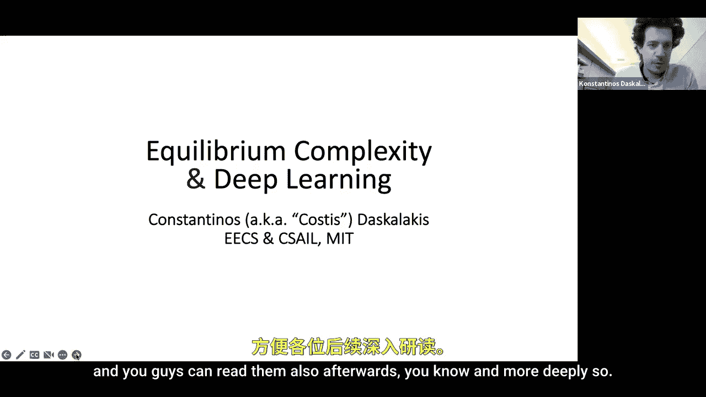
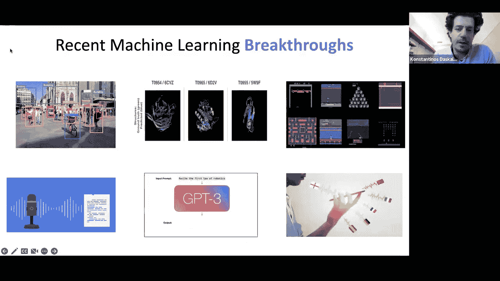
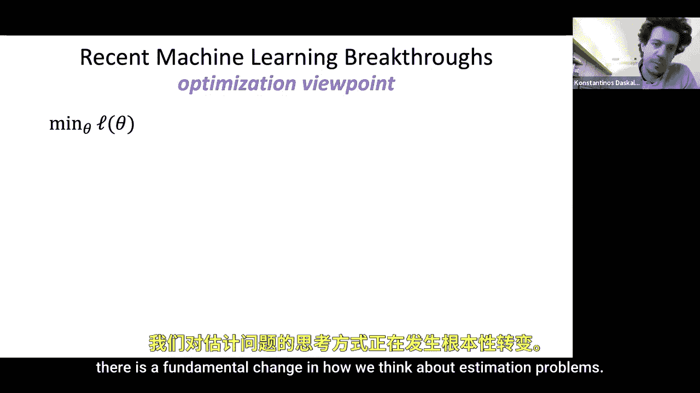
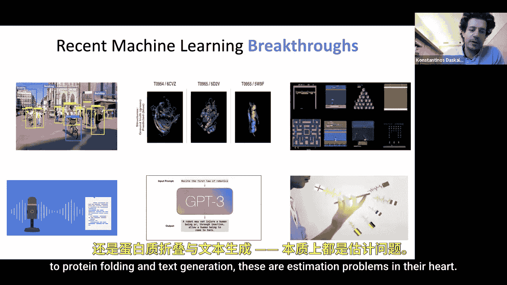
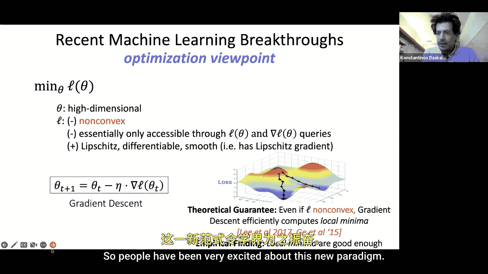
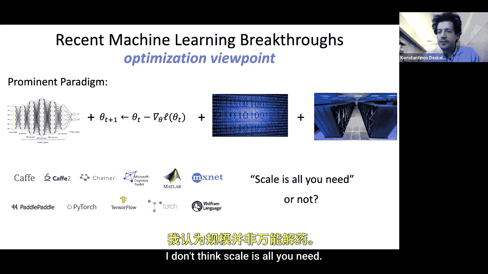
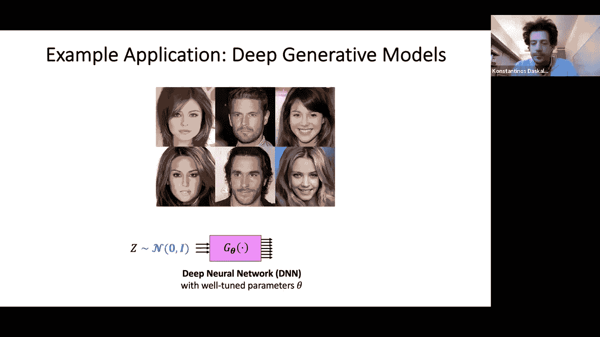

# 马里兰大学【中英⚡深度学习基础｜CMSC828W-2020-Foundations-of-Deep-Learning】-p36-P36-Deep-Learning-Foundations：-Constantinos-Daskalakis's-talk-on-Equilibrium-Com--BV15rpCz9Ed8_p36-

Yeah， hi everybody， it's a great pleasure to be with you today。

I'm going to talk about some beautiful points of contact between complexity theory。

 game theory and deep learning。And this is joint work with several students。

 postdocs and collaborators， and I'll mention them along the way。

Also like I have some slides I can share later also I'm not sure how much I'm going to go through my slides but you know I'm going to share them all and you guys can read them also afterwards you know and more deeply so okay so。

So as we all know， as you all know， reading through the news or interacting with these technologies。

 machine learning has made a lot of breakthroughs in recent years undeniably。

And。From an optimization standpoint， there is a fundamental change in how we think about estimation problems。

 so a lot of， you know like a lot of a lot of the applications you see here from like image recognition and speech recognition to protein folding and text generation。

 these are estimation problems in their heart。

But from an optimization standpoint， the way we approach estimation problems related to learning tasks has seen a fundamental change and that is that we have left the nice harbor of convex optimization and are more and more considering non convex formulations of our estimation problems。

To give some examples。诶。You know， the classical list square regression problem is you know a very nice estimation setting where you know you want to find the best linear fit through your points and you can write this very nice objective to do so。

And that objective is convex in the parameters theta。More broadly。

 so this is an example of the more general problem of doing maximum likelihood estimation in models where your data is coming from an exponential family and there are no latent variables。

youIf you write you know negative log likelihood of inserts an estimation problem。

 it is also a convex function in the parameters theta that are indexing the exponential family distribution so these are two nice。

Broad settings where your estimation problems a nice convex optimization problem。In contrast。

 when you train a deep neural network， as you very well know。

 the estimation problem is very much not a convex problem。And in fact。

 you know like dealing with an non convex problem is not like something new that came out of nowhere only in the context of deep learning。

 if I might make a slight but important modification in these examples that I gave upstairs and think about models that have latent variables。

In that case very commonly， in fact， the likelihood， the MLE problem becomes non convex。And you。

 you have to use tools like expectation maximization algorithm or variational inference。

To deal to practically heurically deal with the non convexes that will arise so by no means you know this shift from convex to non convex optimization is something new but is very much very important and very central in how we think about training deep nets。

诶。And also， of course， as you well know， when my problem is a convex optimization problem。

 the target of my estimation is to find a global opt， if it's an non convex problem。

 global opt is out of reach。It's an MPR problem， so the target is finding some local opt。No。You know。

 as I said， you know， non convexes are not。Something new。

 but like the important features of deep nut training are the following。That are somewhat more new。

 so the parameter vector theta is very high dimensional。Okay。

 so the function you're optimizing is non confis and also you have very primitive access to that objective like so you know you have first order access。

 you can maybe query the gradient end of the function。

 but like more more higher order queries are more expensive。可。And， you know。

 sometimes you have at least。know at least the gradient exists and you know your function is lipst and smooth almost everywhere okay so these are some features that are you know pertinent to the deep network training a problem so long story short。

If you're dealing with such a problem， you don't have many options。You have to run a simple method。

To deal with a non convexity and the fact that your variables are high dimensional。

 and you're going to run a variant of gradient indesscent。And you know。

 gradient descent is not going to find in the global opt。

 but you do have guarantees that you do have the guarantee that you' at least not going to get stuckered at some the spurious critical point。

 you are have the guarantee that you're going to find a local opt。

And the empirical finding is that local optma are pretty good heuristically for many of the problems that we're interested in。

There's no guarantee that the local optum was going to do a good job。

 but for many of the learning applications that people have tried to solve。

 the local optimum selected by this method are actually useful。All right。

So people have been very excited about this new paradigm。

And the following has emerged as a general framework to approach。Challenging learning problems。

writeite a very complex model。With millions or billions of parameters。

Collect a lot of data from out there， get access to supercomputer and do greatding descent to trying to train your model as well as possible on the data that you have。

You turn the crank。And you know， you find a model。And oftentimes that model is good and you write your nature paper and you get your awards and you know like you're very happy。

 okay， so the bottom has been so successful that there are many frameworks that exactly provide you the ability to do this thing。

People are so excited that you know oftentimes people say， okay， like scale is all you need。

The more parameters I have， the larger supercomputer I have access to and so on so forth。

 the better models I can build， okay？I'm not a subscriber to this mentality of scale is all you mean。

I don't think scale is all you need and I want to talk about a set of applications where scale is not all you need and we know that it's not all you need。

And disaster arrive in the multi agentent world。So as you know， a lot of emerging。

 interesting applications of deep learning involve multiple agents。You know。

 in situations like games， like poker Go， Starcraft。Or in， you know， robot， robot interactions。

Or in applications like generative adversarial networks and adversarial attacks that are not explicitly。

Mulag， but we're writing them as a multiagent problem。

 helps you arrive at learning outcomes that you cannot you know know like you know you may not know how to arrive at otherwise。

 or at least in a event helps you like a multi agentent formulation helps you arrive at some learning outcomes that are otherwise not multi agent outcomes。

Have you guys seen you've seen a generative other several networks right I mean maybe let me go through one of these motivating applications really fast。

So， you know， in generator the Sha networks， you is one of these examples that are not a priori multi agent。

But we're writing the formulating like writing down a game helps you arrive at the learning outcome that you wish。

 so in this case the learning at that you wish to attain is to identify a neural network。

That is going to take us input boring randomness。So multi isotropic。Gosian the samples。

。And output interesting randoms in this example。