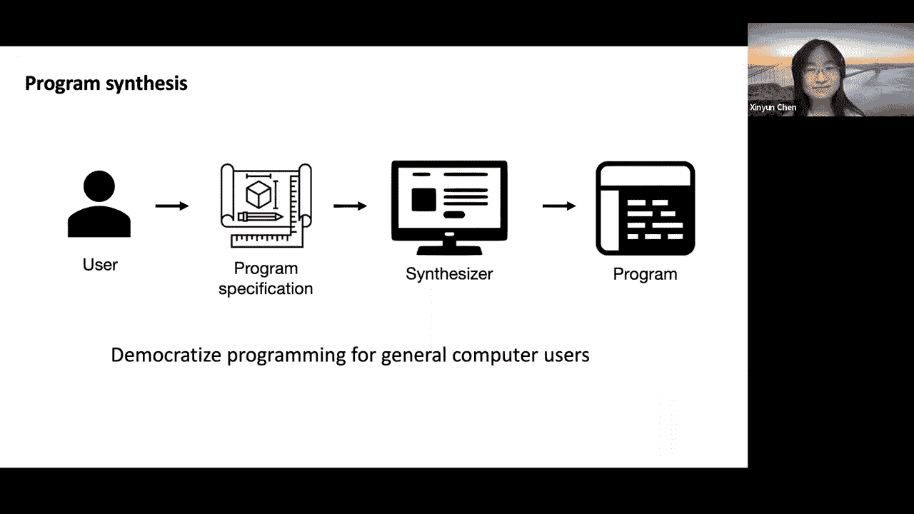
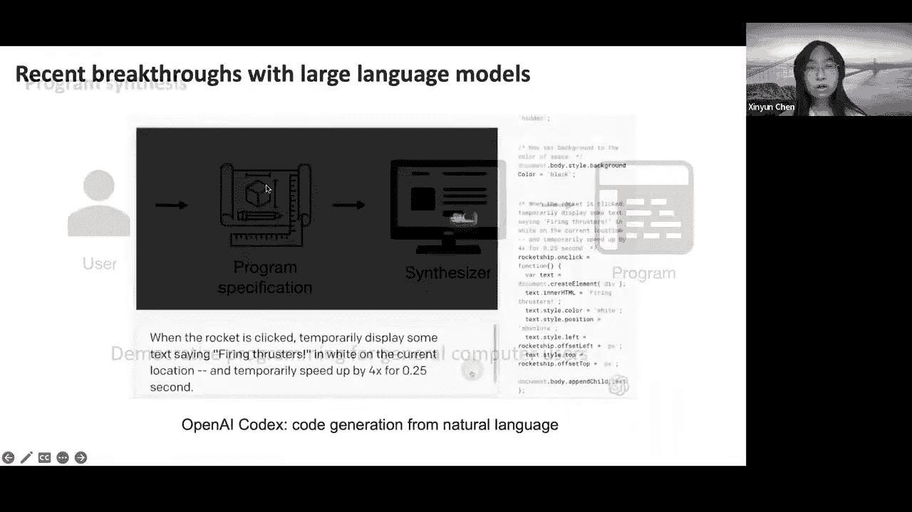
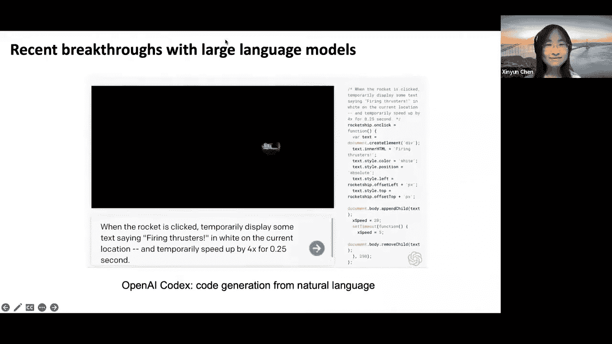
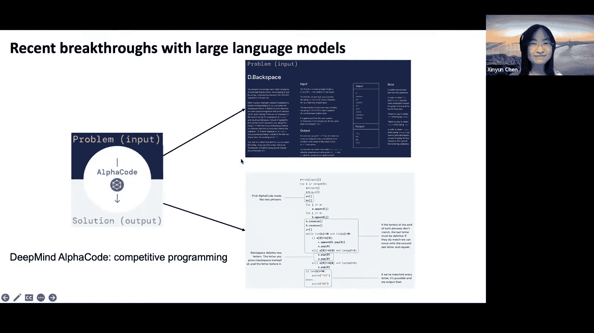
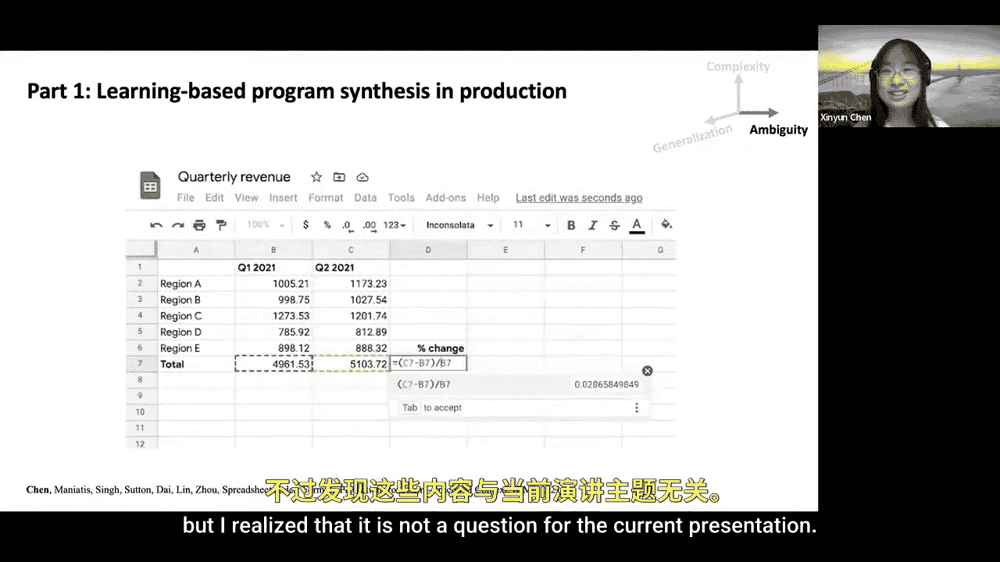

# 马里兰大学【中英⚡深度学习基础｜CMSC828W-2020-Foundations-of-Deep-Learning】-p37-P37-Deep-Learning-Foundations：-Xinyun-Chen-'s-talk-on-＂Learning-Based-Program-Sy--BV15rpCz9Ed8_p37-

Yeah， thank you so much for the introduction。 So yeah。

 I'm really excited to virtually meet like all of you and share my research about learning based program synthesises。

😊，So first， what do I mean by program synthesis？Basically， instead of writing all the code ourselves。

 we want the machine to automatically generate programs， according to our descriptions。

And the long term goal of program synthesis research is to democratize programming so their general computer users without coding skills can also benefit from all the progress of programming technologies to automate their tasks。

Okay。Recently， we have really seen huge breakthroughs on large language models for code。

 especially for code generation from natural language。

So here on the slide， I'm showing a demo from open eye codeex。

So codes is a language model that has 175 billion parameters。

It was initialized from the GT3 checkpoint， which was pre on text。

Then codedash is further trend on Github code cor。As we can see。

 with this large scale pre traininging and large scale model。

Cex can achieve pretty impressive performance on following natural language instructions step by step。

 So like here， this instruction is actually pretty like complicated and detailed， but still。

 the model is able to follow it very faithfully。

Another recent effort to further show the power of language models for code is the deep by Alpha code project。

I also work on this project when I interned at Deep Min。So in this project。

 we focus on competitive programming problems。 Well。

 like besides understanding the very complicated inputat language。

The model need also needs to have some level of reasonable capability。

 so it can come up with an algorithm that can efficiently solve the problem and also to implement co accurately。

AndLater on in the talk， I will also discuss some techniques proposed in this alphapha code project。

So nature language is just one format to describe the intended program functionality。

Another proification of format is input output examples。So here， basically。

 the gene program should transform a lease inputs to the outputs after execution。

And in real applications， the programming contest might not be always sequential。

Sometimes we might also want have some semi structure contacts with multiple data formats。

So for example， for my like a project special codeer。

 I show that we can design a model to generate these special formulas in in Google sheets。

 which includes this tableau contest。And this model was integrated into the Google Shes product。

 and it now has hundreds of millions of users。In learning for program synthesis research or program synthesis in general。

I believe there are two core challenges to consider。Which are the input ambiguity。

And the program capacity。The input ambiguity means whether the program description is precise enough to specify the program execution behavior。

And the program capacity means the length of the program and the control of flow structures that can be practice synized。

So in this talk， I will discuss several applications highlighting different aspects of these challenges。

In my work on program with text， the main challenge is to handle the input ambiguity。

As user written natural language descriptions usually lack enough details。Yeah。

能否 program by sample problems。The progressification includes input output examples。

So it is easier to utilize execution results to scale out a program search。

能否 competitive programming problems。The program description includes both natural language and impropable pairs。

So we can like further utilize this more information to reduce the ambiguity of program description and to see this as somewhat complicated code。

So learning for program cnic applications is just like a one aspect of learning based program synthesis research。

Another line of research in this space is program synthesiss for learning。

We will consider the program as a means of representing some like a reasoning process for broader learning problems。

So why is it beneficial to learn these programs beyond programming and software engineering applications？

The main goal here is to improve the existing neural networks on their capabilities of performing some symbolic like reasoning andization tasks。

So here I will highlight one a challenge called compositional generationization。

 and I will use an example of pseudo language understanding task to illustrate this challenge。

So on the slide， I'm showing a some study instructions or our training set。

 which demonstrates the primitive mapping between pseudo words and colored circles。Like here。

 the pseudo world text is map to a red circle。Besidess these primitive definitions。😊。

The Chinese set also includes some descriptions of functions。So for example。

 here I show a student award effect。And includes like two relating instructions， logg Fb and Dfi。

So lug Fab is translated to three blue circles。 and because we have seen that lu is map to a blue circle。

So one hypothesis is that Fab means thice。You can confirm this hypothesis with another instruction fan。

嗯。Then the test time will be given some new test instructions， such as stop5 here。

So these are some new combinations of these like learned primitives and functions in the Chinese set。

Thenen for us as humans， given only a few samples， we can already infer that that Fab means three yellow circles。

So here I'm showing the full picture of this like a composition gization experiment。

So we can see that in total， there are only slightly over 10 study instructions for training。

And some test instructions are longer than any of these training instructions。So for us as humans。

 we are very capable of understanding this like a composition of grammars and with only a few demonstrations。

😊，But standards standard sequence to sequence models are really struggling at achieving this level of optimization。

So my research in the space of program is is learning and to address these challenges and if emphasizes a third challenge of generalization。

So in this talk， I will discuss my works in this space。

 which includes grammar learning with a few demonstrations from scratch。

 and also I will discuss how we can leverage the pre large language models to improve conversationization for understanding real world programming languages such as those SQL language languages。

So in this talk， I will highlight three lines of my works focusing on these three dimensions of challenges。

First， I will discuss my work special coding where I demonstrate how can design this learning based program synthesis models to like handle those like ambiguity in user written descriptions and how this model can be utilized in production。

In the second part， I will discuss my work on learning with execution for program synthesis。

I will first discuss my work execution guided program synthesiss。Well。

 I demonstrated with input output samples in the progress。

 our model can utilize these intermediate execution results to improve the capacity of programs that can be synized。

Learning the Alpha code project， we further show that by leveraging this execution at scale。

 we can enable the model to solve more challenging competitive programming problems。

In the third part， I will discuss my work on conversationalization via program learning。

So I will first talk about my work neural symbol stack machines。

 where I show that incorporating these symbolic modules into deep neuraler networks is critical for achieving this level of generation when training from only a few samples and also chain model from scratch。

Then I would also like to briefly discuss our recent project。

 which is a called dynamic leads to most prompting。

 where we show that with a proper design of the prompting scheme。

 we can also unlock this like a conversationization capability of existing powerful pre large language models for understanding like a programming languages such as Sple here。

So let's get started with the first part about special code。

 but I also I want to check whether there are some questions。Okay， if there's if there's no question。

 I can， I can continue or if there is any question in the class。

 I can also stop and take some questions。I don't see any questions questions Yeah。

 because I saw some chat messages， but I realized that it is not a question for the current presentation。

