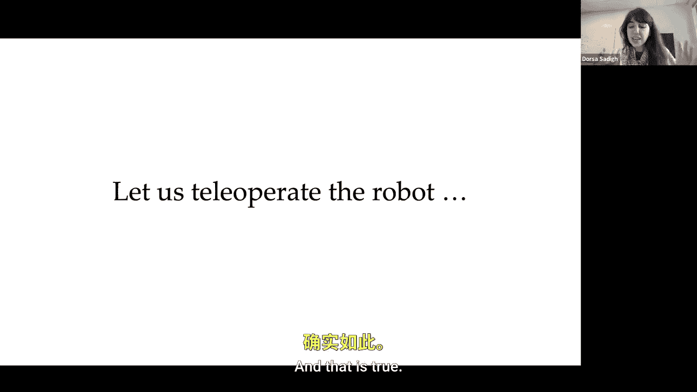
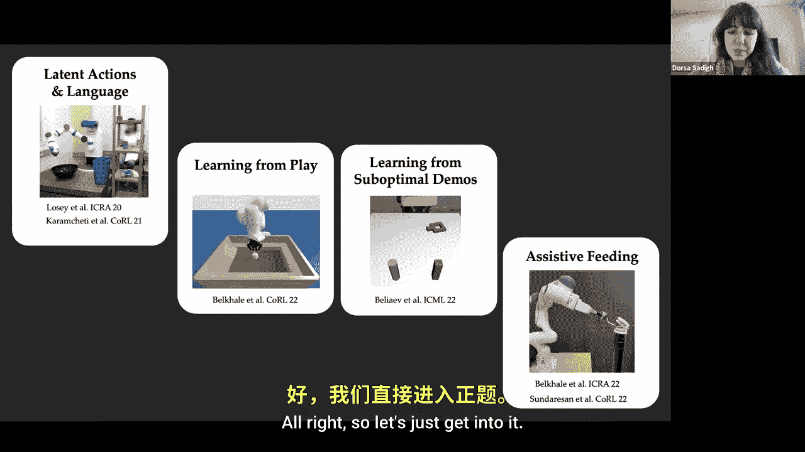
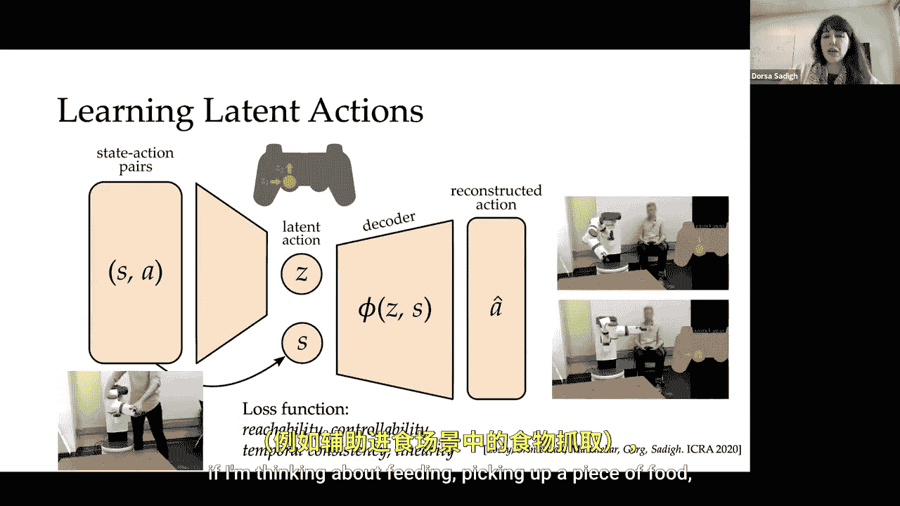

# 马里兰大学【中英⚡深度学习基础｜CMSC828W-2020-Foundations-of-Deep-Learning】-p38-P38-Deep-Learning-Foundations：-Dorsa-Sadigh-'s-talk-on-＂Learning-Robot-Policies＂--BV15rpCz9Ed8_p38-

Thank you so much thanks for inviting me Soha and really excited to be here and yeah today I want to talk a little bit about some of the recent work that we are doing in our lab in the space of learning robot policies so just one note this talk is probably going to be more on the practical end of things so I'd imagine like the type of talks you guys have seen in your seminar course has ranged from theoretical to practical this is from a practitioner's view of how to use machine learning in the space of robotics in the space of controls and in general just more broadly in my lab I'm pretty interested in building robot policies interactive robot policies that can work well with humans so we are interested in tasks like assistive feeding like how do we how do we like get a robot to pick up a piece of food and transfer it to a person's mouth or other types of interactive robotics tasks and the type of work that lies in that we are looking at fall into two categories how can we use interactive data how can we use human data to better learn。

😊，t policies which is actually the topic of this talk and then we are also interested in better。

 more seamless interactions between humans and robots， how can we do better shared autonomy。

 how can we get a human and robot to make a sandwich together。

 how do we go about these types of more coordinate collaborative tasks。😊。

All right so let me just get into the details of this talk if you have any questions at any point in time feel free to jump in i'm not going to be looking at chat but feel free to just like speak up I don't need to go over all slides so I can also stop at any point and can just have a discussion。

Okay so about like two years ago you started looking at this problem of assistive feeding this is one of my favorite problems robotics problems out there so what is the problem the problem is I want to have a robot to be able to pick up a fork and pick up a piece of food and transfer that to a person's mouth very much under practical end。

😊，But it's actually a very extremely difficult robotics problem why is that hard well part of the reason is that different types of food have different geometries。

 different deform abilitiesities and it would be really difficult to actually manipulate deformable objects so that is like a whole research direction and once you pick up the food thinking about transferring the food to a person's mouth that's also very interesting interaction problem。

 how do we make sure that the food is easily transfer inside of the person's mouth。

 how do we put the right like forces， how do we think about the human's comfort。😊。

So in general we thought okay so we can pick this and see what is the state of the art out there for for doing this so the state of the art for doing assistive feeding is to follow a fixed policy so this is a model based policy the robot is basically doing some level of visual servoing so it's going to basically look at like where the human face is。

😊，And try to like go to where the human faces and it computes a fixed pose and it tries to go there and ask a person to take a bite right there。

And like as you can see this is incredibly like uncomfortable I I'm really thankful to this particular user who like sat there and allowed us to use this robot to transfer the food to a person's mouth and and in general like as you can see not not very comfortable right like like this policy is probably not like the policy that I would want my robot to have。

😊，So it turns out that this model based policy is not doing everything right。

 and the question is well， why and could we do better？😡，And one idea is， well。

 machine learning has addressed a lot of research questions in recent years。

 could we use machine learning to actually address some of the issues here？😊。

So then if that is the goal if our goal is to use machine learning。

 then we have a bunch of options right like for example we could use reinforcement learning but I actually don't want to run reinforcement learning in realo like with this person like in the loop I really don't want to hit the person's nose and like get a negative reward that's not a good idea I also don't have good simulators for any of this I don't have a good simulator for carrot I don't have a good simulator for like a person's mouth so it's not like I can just generate lots of data and run reinforcement learning in simulation either so it feels like simulation and in general like reinforcement learning is going to be difficult in this stomach the other idea which I'd argue is more promising in the space of robotics and I feel like theres gonna to be a paradigm shift towards that direction more and more is this idea of collecting expert demonstrations and learning and imitation learning policy from those expert demonstrations it feels like you're seeing like some evidence that giant transformers with large amount of data are going to be useful in many other。

FSo the question is could we use the same sort of paradigm here could I collect expert demonstrations and from these expert demonstrations be able to learn a robot policy for transferring food。

So that would be wonderful if I actually had a lot of data and in this domain I don't have a lot of robot demonstration data and I'll come back to this idea of robot demonstration data a little bit later in the talk but in general this brings me to this idea that maybe we should tap into other sources of data right if you want to learn some robot policy expert demonstrations is pretty limiting so maybe we should look at other sources of data like play or sub optimalmal demonstrations and leverage that information as a way of thinking about learning robot policies and that's a topic that I'll be talking about in in this talk but going back to this problem withing it seems like at the moment at least the model based policy is not that great learning doesn't seem to answer the question so how do people use robots to actually do this task if those two are out of the picture the question is maybe we could teleoperate the robot right if I cant if I can use learning if I can use a model based policy the simplest thing I can do is I can use a joysick and I can tell。

opate this robot and then the robot should just follow my teleoperation input and transfer the food to a person's mouth that should be the simplest thing and there are like all these assistive robots out there that and people use them so that is probably what they do and then that is true that is that is what they do so here is actually a video of a person using using a joystick to teleoperate a robot arm open a fridge and try to like move items around in the fridge。

And one thing to notice here is that even when you're tele operatinger， which is the simplest thing。

 you are joys sticking the robot， it is still pretty difficult to do these simple tasks at home。

 it takes forever to like open the door like it actually takes quite a bit of time for doing that。😊。

And you might be asking well why like I'm really joy seeking the robot I have control over everything this is not doing anything intelligent well if you think about it this robot has seven degrees of freedom or six degrees of freedom and the way we control this robot is by using end defector control meaning that we are controlling the pose of the end defector and that means six things I'm controlling X Y z of the end defector so the linear control and I'm also controlling the angles ya Pe of the end defector so if you guys look at like this person's hand。

😊，He keeps pushinging the side， he keeps pushing the side of the joystick and what that does is that he's changing the mode from linear control to angular control and that is why it actually this mode switching is the thing that takes a lot of time and makes his task pretty challenging。

😡，So what I'm going to do in this talk is i'm going to actually start talking about teleoperation right like this teleoperation also seems like is not giving me the answer so what I like to talk about is how we can build better interfaces using learning how can we learn better interfaces where people can provide lower degree freedom actions use language as a way of teleoperating these robot so we could actually get the robot do interesting tasks in the environment。

😡，And then I'm going to switch topics a little bit and I'm going to go back to this idea of learning a fully autonomous policy。

 so not the shared autonomy domain， but really the fully autonomous like domain where I just want to learn robot policies for various types of tasks and here I want to tap into other sources of data like play data or suboptimal demonstrations and at the very end I just want to like end with some of the challenges of assistive feeding some of the more modelbased challenges of assisted feeding that these learning algorithms are not going to address and the fact that we need to think a lot more carefully when it comes to exactly the problem of food acquisition and transfer so I'm going to end with some videos and thoughts on that at the end。

All right， so let's just get into it。

嗯。All right。So going back to this picture， the idea that we have here is if you consider a sequence of states and actions。

😊，And this sequence of states and actions， they can come from an expert or a caregiver in this case this is Dylan。

 he was postdoc in our lab， he's now a faculty at Virginia Tech and what Dylan was doing was was providing these expert data and what we would like to do here is we would like to generate we would like to develop a lowdimenal action space that the person could use for teleoperating the robot as opposed to these six degrees of freedom or seven degrees of freedom and the idea is collect expert data and try to bring the dimensionality of that using like a simple conditional variational autoencoder and bring the dimensionality down to a low-dial action space in this case is action spaces Z and the Z can you imagine it's a two-dial two- degreeeg freedom action space so if you have a joystick you would be pressing up and down on the joystick and left and right on the joystick and the way that we make sure that you are learning an action that is actually reasonable is by training this autoencoder architecture that is conditioned on the state。

😊，So let's like back up for a second so so if you're thinking about the robot going from one point in the space to any other point in the state space。

 we actually do need like all those six degrees of freedom and then there is a reason that they exist like there is a reason that I have six degrees of freedom but I'm thinking about like controlling that ine。

But the key idea here is that if I'm conditioning this on a particular task。

 if I'm thinking about feeding， picking up a piece of food。😊。

There might actually exist a lower degree freedom action space。

