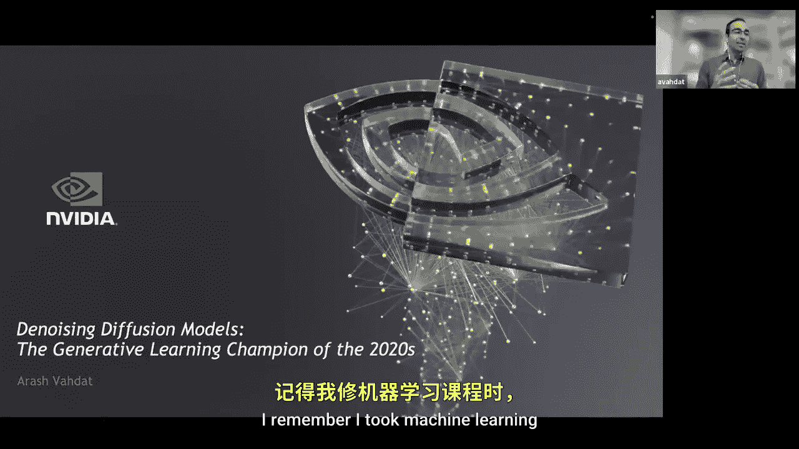
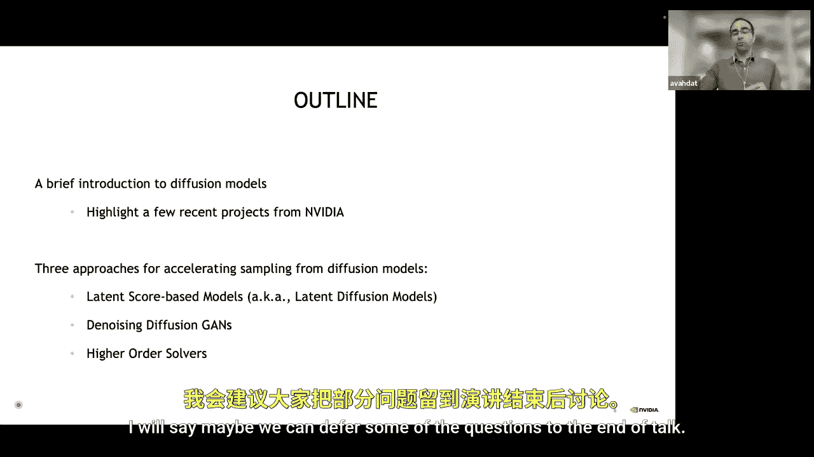
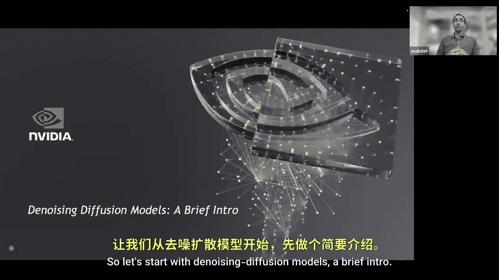
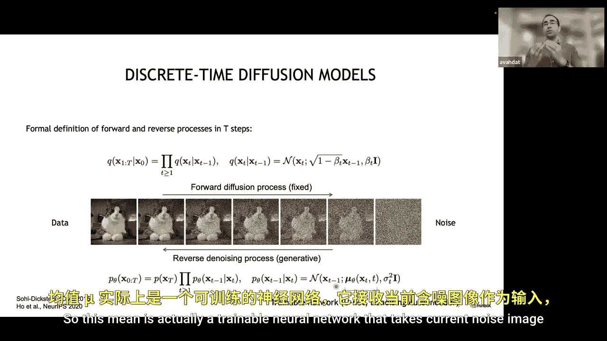

# 马里兰大学【中英⚡深度学习基础｜CMSC828W-2020-Foundations-of-Deep-Learning】-p39-P39-Deep-Learning-Foundations：-Arash-Vahdat's-talk-on-＂Denoising-Diffusion-Model--BV15rpCz9Ed8_p39-

Awesome， thanks for introduction and thank you again for having me it's really great pleasure for me to be here I was checking actually your course page and I was amazed with you know the topics you' were covering and I was honestly when I was thinking I was thinking that I wish I had this course when I was PhD student you know like back then when we were doing I think machine learning was not as popular as it is not yet alone Imagine deep learning I remember I took machine learning and my professor actually skipped the neural network section saying these things don't work so anyway excited time to be at the noise and diffusion models I believe maybe they're gonna be degenative learning champions of maybe early 2020s and we will see how long they're gonna last so。

😊。

I'm pretty sure you actually covered I saw in your course you're covering many different frameworks for deep generative learning。

 maybe just a quick recap in a deep generative learning wisdom that we have access to some set of samples drawn from unknown distribution for example here the set of samples represents set of images from some cute cats and we're going to use these images to train a deep generative model right if everything goes smoothly at the test time at the sampling time we want to now use this deep generative model and draw new instances and hopefully if our deep geneative model has been trained properly these instances would look like the training distribution samples from training distribution that we use for training so if we use cute cats the goal is to generate cute cats eventually so this is the ultimate goal and I'm going to come back to it eventually again。

So if you familiar a little bit with deep generative learning。

 this landscape of deep generative learning is filled with a variety of frameworks。

 generative adversarial networks were very popular for a very long time。

 especially for in image generation and computer vision community beyond them we had viral autoencoders。

 autoregressive models normalizing flows energy based models and these days there is a new key player in this arena called nu diffusion models that today I'm going to try to briefly introduce you to these models and maybe create a case that these models actually do very well perform very well for deep generative learning and they're going to probably be around for a while。

😊，As I mentioned the Nu diffusion models are emerging as powerful generative models。

 they are even outperforming generative adversial networks on some challenging dataset sets such as IageNet here I'm showing you two example works one from OpenAI on the left side and one from Google on the right side where researchers show that by training diffusion models on challenging dataset sets such as ImageNet you can generate very high quality diverse images on the categories that are present in the IageNet dataset。

Almost the same groups at Open AI and Google a year later fast for one year later。

 they showed that actually similarly denoing diffusion models can be used also for training text to image geneative models if you're present as social media it's probably very hard for it was very hard for you to notice a lot of excitement around these models dolly to and imagine are examples are really powerful models one from Open AI one from Google where these frameworks can take a text and generate image that correspond to text and the quality of the images that are coming from these models is amazing you can。

😊，For some imagine can create a scene where tieddy bears are celebrating their coworkerworkers birthday where the cake looks like pizza to me as someone who has been around。

 I mean has been working on generative learning for maybe five， six years。

 this was a dream actually for a lot of practitioner to be able to get to a point where we can build generative models that can do this well and honestly I think it's not exaggeration to say that every day I'm working on these models I'm kind of leaving my dream like these things were out of reach for previous frameworks。

😊，So。Today I'm going to try to start with a very very brief introduction of diffusion models and I'm going to highlight a few recent projects that we've been doing at NVDdia after that I'm going to try to dive a bit deeper and discuss the sampling challenges from diffusion models and present maybe three example works that we have done one is called late in the score BGative models which are also known as latent diffusion models in the community the noing diffusion Gs and higher order solvers these are three example were several discuss deeper and by the way as Soya said please feel free to stop ask me questions if I feel that we're going to fall behind our time of schedule I say maybe we can differer some of the questions to the end of talk。

So let's start with thenoing diffusion models a brief intro so dennoing diffusion models they go actually with two names one is denoing diffusion models or sometimes diffusion models for short but they're also known as a scorebased gen models these two are almost the same they consist of two processes one a forward process that here in the bottom I'm showing you from left to right the forward process starts from data this image of cute cat who happens to be my cat his name is peanut we're going to start with peanuts picture and we're going to add gradually noise to its picture one is a step at a time and we're going to keep doing this so many times such as eventually on the right side we actually get only white noise so if you take an image and you keep adding small gaussian noise eventually you actually get white noise you pertu all the visual content of that image so this forward process usually fixed and we're going to call it just forward diffusion process。

The second process is it。Vers process that starts from noise and to deno input images one step at a time。

This process is thrownwn from right to left， so it starts from noise and goes back to data and this process can be considered as a generative。

Because it starts from noise and it learns to denno these input images one step at a time from right side to left side right so you basically can think of this reverse。

 thenoising process as a geneative process and this is actually going to be the parametric part where we're going to try to train to be able to train to be able to train genetic mod and genetic samples of acute cats。

So。Maybe a little bit deeper into these two process we're going to assume that these process are defined over T steps this capital t is usually very large it can be like 1000 steps and we're going to define the forward process using this markov process this markov process defines the distribution of all these noisy instances so this is x0 and here we have x1 all the way to x capital t so it defines a joint distribution of noisy instances using this product of conditionals each one of them defined on each sampling steps so given x t minus1 we're going to in very distribution over the next system so using product we're going to define this joint this is just a simple markov process。

Each conditional is also simply just a normal distribution right each conditional takes the sample at previous step you can think of like this image we will take it。

 we're going to use that sample and just multiply it by this scalar this square root of 1 minus better t think of it as just a scalar that takes this xt minus1 and this usually scalar bit t is usually very small positive value like you can think of like 0。

001 so this scalar is just less than one so this coefficient will just shrink the sample a little bit。

And then we have this bitter T here， which is again positive， very small posivity。

 which adds a little bit of gaus and noise to the。😊。

To the image right so at every step we're just basically taking the sample in the previous step we shrink it tiny a bit and we add a little bit of noise。

 we shrink it again， we add a bit of noise so every step is just a very simple question。😊。

Perturbation can you can think of it， this is diffusion can that diffuses the samples one system at a time。

The reverse process is also a Markov process that starts from this x capital T on this side。

 so P of x capital we're going to assume that we know this distribution so we assume that for example this can be represented with a normal distribution and we design the forward process such that we actually know that any data point is eventually will be mapped where standard for example normal distribution so we're going to assume that at the end x capital T the normal the distribution is normal and then we're going to now define again Markov process that starts from samples here and then defines this joint over these the noisy steps so again we're going to infer distribution xt minus one given at less noisy image given the current input noisy image。

And again， these models make a very simple assumption。

 they also assume that the denoing model is also Gausian and here again the discussionsian distribution takes X T as input the current step and predicts what is the less noisy version and for doing this we need the mean and standard deviation。

😊，🎼Usually or variance the variance is very easy we can just set maybe sigma t equal to better the same variance we're using forward person most of times we can use the same variance however this mean becomes the tricky part this is actually the part where we need to train the model right so this mean is actually a trainable neural network that takes current noisy image and predicts the average of less noisy version of that and this。

