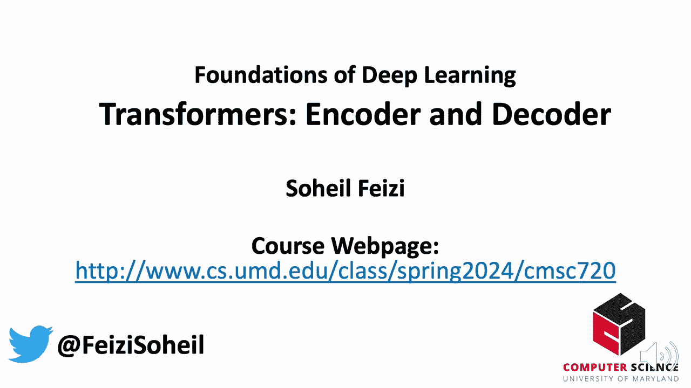
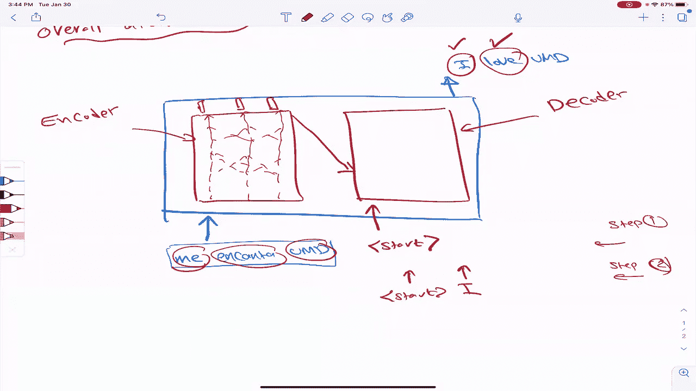
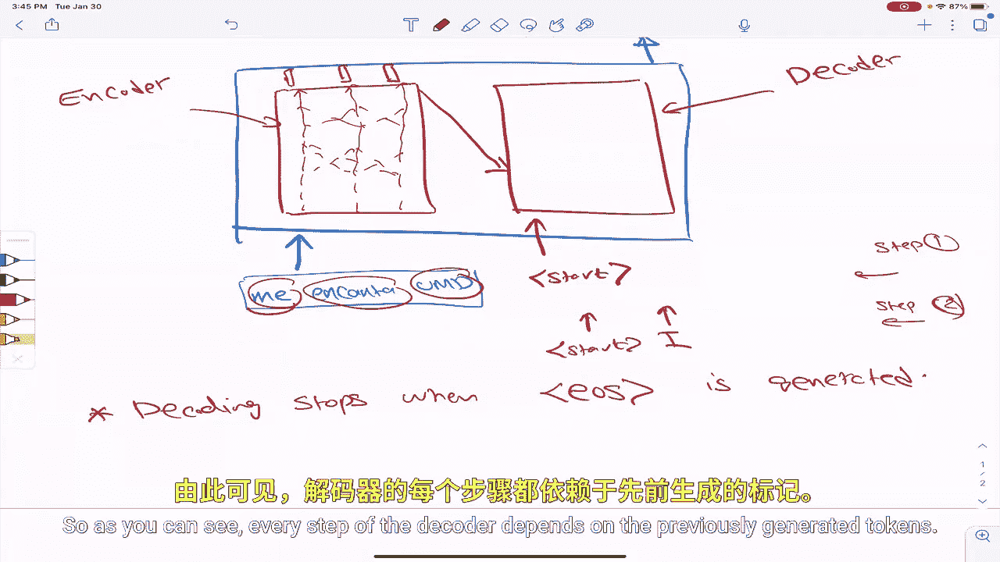
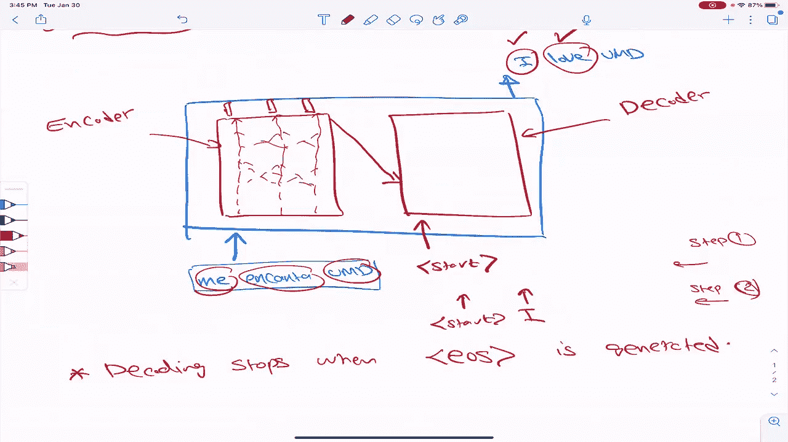
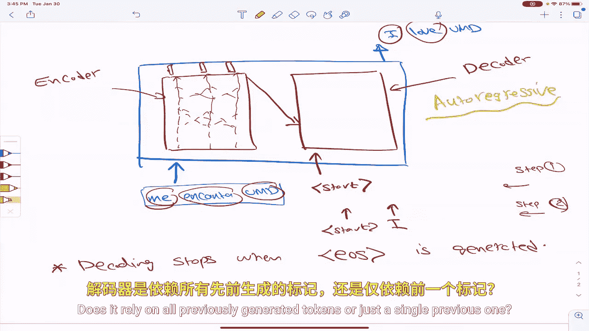

# 马里兰大学【中英⚡深度学习基础｜CMSC828W-2020-Foundations-of-Deep-Learning】-p40-P40-Deep-Learning-Foundations-by-Soheil-Feizi-：-Transformers--BV15rpCz9Ed8_p40-

Get the start there。Today， we are going to talk about transformers。

So the main paper that you are going to talk about。Is a paper title。Attention。Is all you need？

I believe it was published or it was released in 2017 last time I checked this paper。

Had more than 100 case citations。This kind of shows the importance of the transformers in modern AI and machine learning models。

All right。Instead of like just。Going through。The different elements and different blocks in the transformers。

 what I want， you know us to do is to。Develop and design a transformer ourselves right Together。

 we want to think， why do we need。A particular process， why do we need a particular block？

What are the choices that we can have and hopefully we can learn a little bit more and perhaps you can have some ideas about improving the transformer architectures or coming up with new architectures。

All right。We are going to focus。On an NLP application。Which is translation。

But transformers have been used in the variety of different domains and applications， in fact。

 perhaps end of today's lecture or next lecture， I'll talk about vision transformers。

 basically similar architecture applied to image domains and vision applications。All right。

 so what is the problem that you're interested in solving？Let's say I have a phrase in Spanish。

I did Google translate， so I'm not sure how accurate it is。Let's say me andカンタ UMD。All right。

 and we want to develop a method based on transformers。

To translate this and the translation in to English is， I love UMD。All right。

So what is the overall architecture？So the overall architecture is an encoder decoder architecture。

Do you get an input？And so here's my overall architecture。As your input， you get your original。Text。

 original sentence。Me and contact UB。嗯。Original phrase。And as the output。

 I want to generate the translated version， which I love UN。All right。So， first。

This text or a form of this text that we will talk about will go through。Part of the model。

 called Enr。Yeah。So what is the job of the encoder。

 the job of the encoder is to encode information for each word or token。

Another way of thinking bored。Based on the context of that phrase。😡，So for each word or token here。

 the output of the encoder is going to be a vector。So I have three words。

 so I'm going to have three vectors here。With a particular length that is my design choice。Okay。

So probably you' are familiar with word embedding， so you can embed word or a token。To a vector。

So if I do that， okay， so I'm going to get an embedding for the first word。

 I'm going to get an embedding for the second board。

 I'm going to get an embedding for the third Okay， fantastic right so I have my vectors。

 then I should be done。But the issue is that obviously we want to have the context information。

Even encoded in the each tokens embedding so we don't want the embedding to be。Context agnostic。

 so we want the context information to also be present in each of the vectors。

So that is why we need some sort of。Depenencies。Across this path。做得。

Something that you're going to think about。So this is the encoder part。

 now I get vectors somehow for each token that combines information not only for that token。

 but also for other tokens。Then I'm going to have a decoder。So this is my decoder。

So this information is going to be transmitted to the decoder again we are going to explain how that works。

And I want to be able to decode， meaning that in this application to be able to translate。

So it might be there。I don't have any input， so I'll start with like some generic token。

 which is called start token or start of the sentences。SO S token。So here we have the start token。嗯。

I will generate。Yeah。My first output word from my decoder in that case it will be。The board aye。

And then I will use the generated word I as the input for the next step in the decoder。Okay。

 so I say I generated this token I。Then for the next time， so this is step one。

For step two in my decoding。Not only I'm going to have the start token as an input to my decoder。

 I'm going to have the previously generated token， which is I。

To my decoder and generate the next word。In this case， it will be。Love and key point。

 so that is going to be my decoding。Process。Remember， in the different decodings。

The encoder is fixed right so you already encoded the information， you're good， right so you're done。

Then you're basically repeatedly decoding the next word right so you start with the start token say based on the information I have start token what would be the most likely or most appropriate first word as my output。

 you generate that you have that as your input， then you can say okay。

 so I have the start token I have the word I， what would be and based on like the encoded information。

Of my original phrase， what would be the most appropriate selection for my next vote and my next token and you keep going。

Then doビス stop。We stop， then we generate。

The end of the sentence， token。嗯。They called in。Stops。when。End of the sentence token。Is generate。

And that's。So that is。Theyate that transformers。Work。In a high level。From an application point of。

So as you can see。

Every step of the decoder。Depends on the previously generated。とken。

So that is why these models are also referred to as autorecursive models。All right。

 I think there's a question， yes， does it rely on all previously generated tokens or just a single previous all previously generated tokens？

