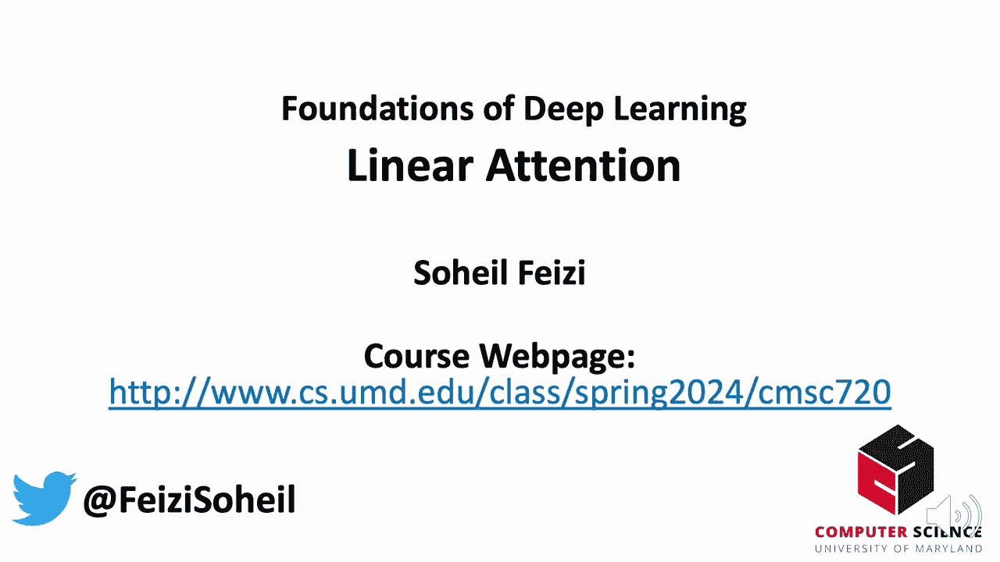
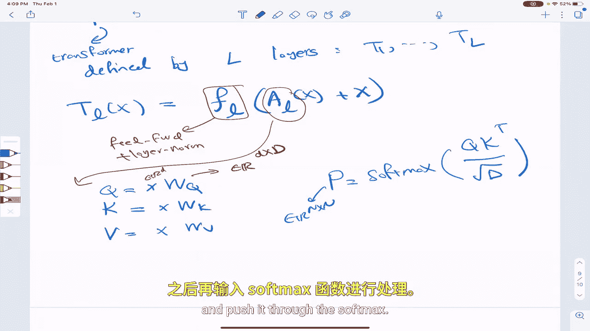
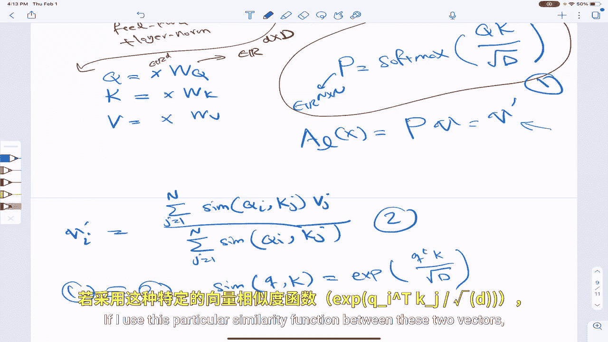

# 马里兰大学【中英⚡深度学习基础｜CMSC828W-2020-Foundations-of-Deep-Learning】-p41-P41-Deep-Learning-Foundations-by-Soheil-Feizi-：-Linear-Attention--BV15rpCz9Ed8_p41-

This topic that I want to cover is about linear。Attention。So if you have N inputs。

It means end tokens。So what is the complexity either in terms of the computation or storage of？

Computing and attention matrix in。One of the layers that we have。

So what is the size of the attention mixture？😡，The attention matrix P is an n cross n matrix， right？

So it has the probabilities。Of attention， value between any pairs of tokens。So for large end。

 this can be very expensive even to store， just imagine you're processing。10000， those 30。

000 awards orken tokens。just computing this matrix。It can be expensive。

 so how do we compute this matrix by solving an inner product？Between the quarries and the keys。

So that computation is simple， is linear in the dimensionality of the keys andqueries， but anyways。

 you need to repeat it roughly is speaking n squared times。So that part can be expensive。

So the question is， how can we make？This computation linear in M。

So that's the idea of linear attention because in that case， we can scale up to larger input sizes。

Okay， so in order to explain that I。Okay， so first， this can be expensive。fourth。Large。Inputs。

Okay so。The idea was proposed in this paper by。Like these people。I won't dare pronounce the。

Last name， but you can find the paper on the course web page， so let's set up some notations first。

Suppose we have end tokens。And each token has dvalue right in the previous example D was 5 12 and n was three because we had three input tokens。

 so that's the matrix x。So you can think about the transformer。As a mapping from N tokens。

Each represented with Dvalue to。To how many， how many tokens？And tokens， thank you。

Each represented with how many numbers。T numbers right in the original design。

 so there is nothing specific about you know having the same the same links。

 but that is the design that you know we have。😊，ok and。This is defined。By L layers。T1，2 T， L。Yeah。

And in each layer， we have the following function。When I apply the encoder on add layer L。

 so what do I have I have， I first applied the attention。Attention， self attention layer to X。

Then I have the residual connection， I add the output with the input。And I normalize it。

And I push it through a fee forward effort。So' summarize that part， so this is my。

Fet forward network。Plus。layer我。Noting that key for。Is applied to each row individually。

So we don't have the cross talking fee forward。That's it， that's the transformer function。

So what is the what is the？Form me love for the attention。So we first generate three matrices。Pick。

Coing matrix by multiplying x2 matrix Wq。The key matrix by multiplying x with WK and v matrix by multiplying x with Wv。

So here x is in t dimension in Rt。These matrixriceses will map a vector from t dimension。

 let's say to a vector from capital T dimension。So the output of the for the queries。

 keys and values they can be different in fact they are different so I use a bad notation here because。

In the previous case， my small div was。512。My capital D was 64。

So capital D was smaller than this small anyway。You getた。So using these three matrices。

 we form the attention matrix P。This matrix is an end by N matrix。And the formula that we had。

From the original design was using the softmax on the inner product betweenqueries and keys。

 that was the similarity values。And we divided by the square root of the size of the keys。

That stabilizes the training based on some empirical evidence and push it through the softmax。

 these are the probabilities that we get in terms of the attention values between different layers。

Between different toolss。And then the attention layer is just simply multiplying this attention matrix with the value matrix。

And we get there。Output of that self attenally for the multi head。

 we do it a bunch of times we just concatenate outputs， push it through。A linear project candidate。

That's basically just a mathematical summarization of what we covered。😊，Earlier in the lecture。Okay。

But there is nothing really fundamental about。Using this particular formula here。So this isnt good。嗯。

Good maybe initial try so you want to。Compute similarities between queries and values。

 you do the inner product， maybe you normalize it。And then push it through the soft expert。

There is nothing really fundamental about using this particular formula。

 so you can use other similarity measures between vectors， it doesn't have to be the inner product。

So， in fact。If I look at the eyerow in my output here， I'm just going to show with the prime of I。

 the eyerow， this is the embedding generated for the eyes token。I can rewrite the whole formula。

 this inner product by。Wite the following formula can look at。As summation from1 to end。

 I look at the similarity， it doesn't have to be the particular similarity function I'm using。

 it can be a general similarity between the query for that token。And different keys。Remember。

 we get with these similarity numbers and we multiplied it with the。

Value vector for corresponding to。To J。 and we normalize it by looking at。

Sation from one to end similarity between Q， I， query I and。Tj。So if you look at this formula。

 one and this formula 2。They're equivalent， so you can show they equivalent if the similarity function that we use between the。

Cry and key vectors。Is in the form of exponential function of the inner product。

Between the two divided by the square root of。If I use this particular similarity function。

 between these two vectors。

多员。