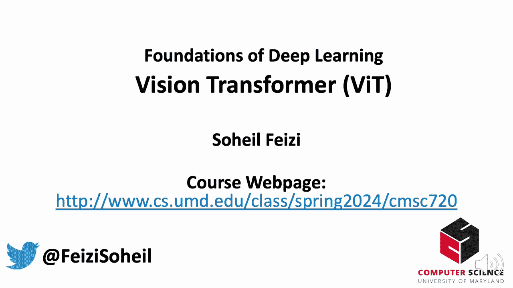
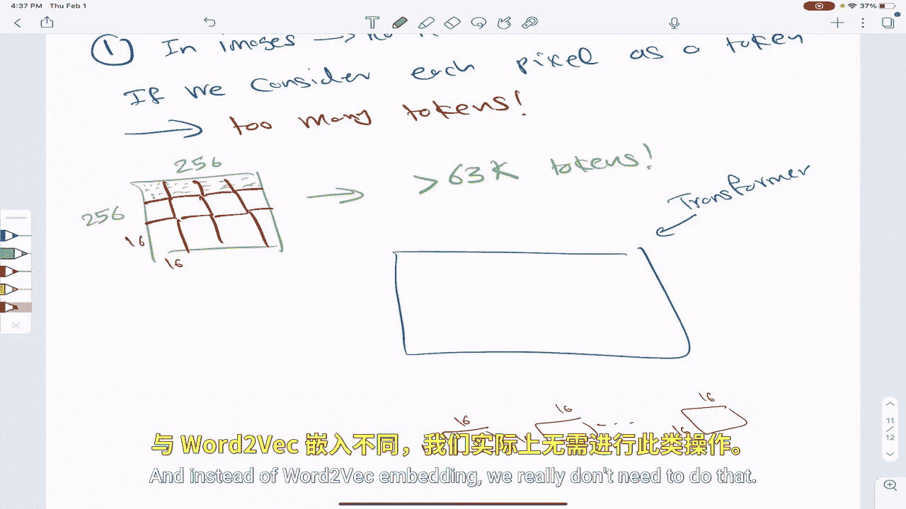

# 马里兰大学【中英⚡深度学习基础｜CMSC828W-2020-Foundations-of-Deep-Learning】-p42-P42-Deep-Learning-Foundations-by-Soheil-Feizi-：-Vision-Transformers--BV15rpCz9Ed8_p42-

So the next topic that we want to cover is vision transformers。

So we are going to follow the paper with the title and image is worth。An image。Is worth。

16 by 16 words。By these authors。Again， I'm not going to there prounce it。Okay。So here's the problem。

😡，Behave。Transformers， encoders and decoders， but let's say just the encoder part。

It works really well on NLP applications， for translations， for other NLP related applications。

So how can we use， you know， even before that， can we use transformers？For on images。

For vision applications， for example， for image classification， segmentation， detection， et ce。

So what are the potential issues？In using。Transformers。4 image。Obviously。

 they were not designed for images， they were designed for NLP tasks because of the way that they handle their inputs。

But let's say if I want to use them on images， so what are the potential issues。

 so what are the really key differences between the two domains that we need to somehow handle if you want to use transformers on images。

对，对告。In the start。You have something like prediction do。Okay， so you're talking about embedding。

 embedding of what。So that I with moral candidates to understand what be。

I think that that is more than on the exciting board。Okay， so that's that。That's a good angle。

 so let me take one more answer， yes。我车里。或者咩冇。Maybe I don't know like but I'm looking for something even simpler and perhaps a little bit more fundamental someone in the back。

 yes you。😊，Okay。Exactly， right， so the input to the encode there， remember。😊。

Is a vectorized version of my tokens， let's say you have a board， it's a discrete board。

 discrete element， it's say I you like ice cream or something， so we vectorize it。

 you get get a vector。Add a positional embedding and then you pass it through your model。Okay， so。

But in images。We do have inputs。So in NLP， in fact， it was， you know， I would say it was。

A little bit more difficult to tackle。Tactile words because they're discrete right。

 so we had to like go through like vectorization。😊。

And get like vector embeddings using you know War2be。But images， they have real numbers。

So maybe that is even easier。😊，So can I。Imagine。Each pixel is a toer。

For me and it has a real value right， so I don't need to go to like the vectorization。

Wouldn't that be even easier for my task because I don't need to go through the war2Ibe？A process。

Yes，It comes right down。undant redundancy is not bad right so as input so you have more information so why should I be worried about redundancy？

You at the back。你个。Excellent， so yeah， so of course I can consider each pixel as a toer。But。

You are going to have a lot of tokens just imagine， you know， you have。Images with the resolution of。

 let's say 256 by 256。 You are going to have more than 60000。投かです。

That basically corresponds to like processing a text with 60，000 board。

If you have an image with like 1080 to 1920 resolution。

 youre going to have2 million tokens that you need to process。So that。Is computationally difficult。

So that is the first issue。Okay。Any。Okay， so how can I summarize that。In NLP， okay。有。Natural。Ocean。

Of。Tokensす。So if we consider if we。同识你。Each pixel。As a token。咩。以下。Too many。Tokens。For example， for。

An image。Of size 256 to 256， which is not an basically unusual resolution。

 you will have more than 60，000 tokens。Expensseive。So how can we solve this problem？

So the idea that was proposed was to， okay。Let's not look at images。At a pixel resolution。

 let's look at like， you know， bunch of pixels together。

That's the issue that we had right maybe had like too many pixels as individual tokens just like。

 you know group pixels， you know， maybe look at like 10 of them together。Or2 of them together。

Or maybe。Like hundreds of them forget get it。So how can I group pixels。On images。That is ease right。

 and I can consider them as like a group so I can look at them as vook， yes。😊。

Do some sort of pooling， whether it's average or not。That's like way too fancy for for my taste。

 something even simpler right so you have an image， you know， before you could look at each pixel。😊。

Right， so I'm going to like draw like 60，000 points here， this hoga。I'm not going to do that。

 but like， how can I。How can I what is like the simplest way of grouping pixels？

And someone who hasn't yes you。Your patches。 Thank you。 God bless you， so。That's it， right。

 so that's the whole idea。Cut your images into patches。And then each patch。You can just flatten it。

 right， so it's a victor。You don't need to do like， you know。

 board embedding that's already a vector。Maybe the size of the patch is big。

 maybe you can do like a linear embedding， you don't need to do like a board embedding。

 you can do a linear projection to reduce the dimensionality of the vectors， that's optional but。

It already comes in real domains like that's the main idea of transformer so here is my input image I want to use a transformer。

Ts。Former。So I'm going to have my patches。16 by 16 that's the design choice that they had。

 that's why you know there's a 16 by 16 in the title。

So I'm going to have these patches of size 16 by 16。As my input tokens。Vectctorize them。

And instead of war two V embedding， we really don't need to do that， but 16 by 16 maybe a little bit。

