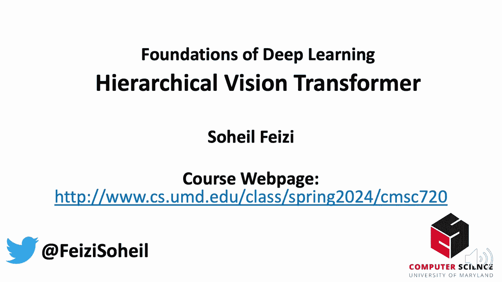
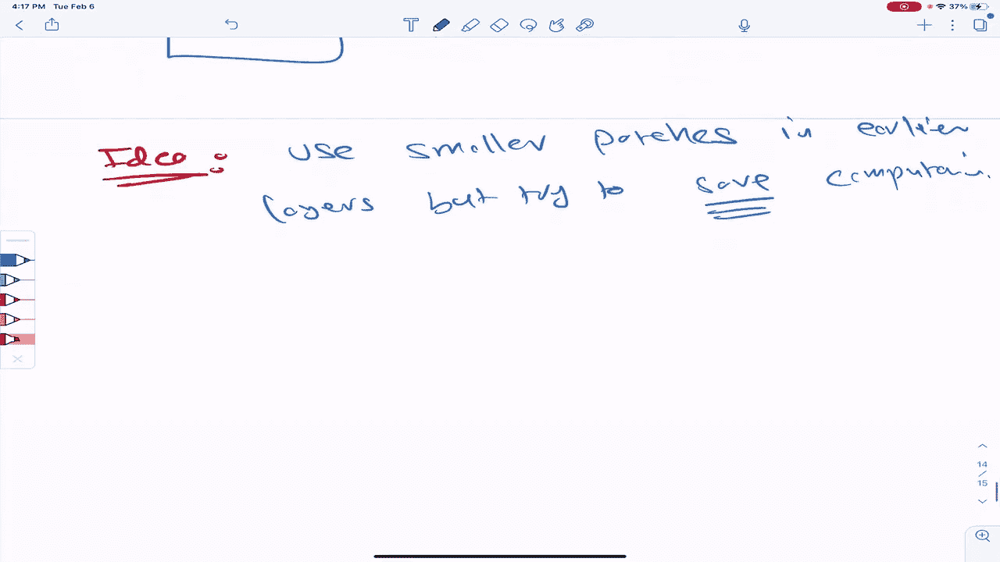

# 马里兰大学【中英⚡深度学习基础｜CMSC828W-2020-Foundations-of-Deep-Learning】-p43-P43-Deep-Learning-Foundations-by-Soheil-Feizi-：-Hierarchical-Vision-Transformers--BV15rpCz9Ed8_p43-

All right， so let me move on to the next topic。About swine transformers。I think it was introduced。

In 21。All right， so I talked about two issues in transformers， one is that okay。

 so there's no In transformer， national notion of patches and the second one is the lack of inductive bias and we came up with some sort of solutions to tackle those problems。

The third issue in the transformer， in transformer is。Is that。

The model is as good as the resolution of your patches。😊，嗯。So because each patch。

Is viewed as an independent element。LikeBecause again。

 we are using transformer from the language domain in the language domain you have the board。

And that's it right so you really don't care about the letters in that form because the combination of the letters。

 they form an independent element and you're good。So okay。

 maybe like one word may have like different meanings that's completely fine right with respect to the context。

You really don't care about like the combination of the letters in a board。😡，But in images。

That may be a different story， you may have a patch， let's say 16 by 16。

 there may be a lot of things going on。In that touch。You may have like a bunch of objects。

 small objects within one patch。😡，And we are putting everything together in one independent element。

😡，So what happens for example， if you want to solve image segmentation。

 image segmentation is a problem where you need to assign segmentation values。

For each pixel so you want to solve this problem with the P resolution。

 but now you have 16 by 16 patches。They're all。Within12， within 1 L。

So you cannot go higher resolution。And 16 by 16。And that is a big problem。

 especially in division domain。All right， so another issue is that the resolution。嗯。So。嗯。Of patches。

你咩。对。Hbil。Oh， vision transformers。On。High resolution tasks。For an example， just imagine you have。

An image again， we are looking at 16 by 16 patches and here you may have like multiple people。

Multiple objects。Then you won't be able to， for example。

 detect those individual objects within a past because that's not a resolution that you are even looking at your input image。

Same， so here detection is going to fail。Segmentation。Big wires。

Understanding images in the pixel pixel resolution level right so when you're looking at 16 by 16 patches。

Your model is not going to be successful in those。In those types of tasks。Okay， so the question is。

 how can we。扫。This issue。Right I'm looking for some ideas。Yes。😊，Something like slid。

But the sliding window。It is not going to solve my problem，😡。

Because look if I'm starting with like 16 by 16 patches。Whatever I do after that。

 because I take a patch， I vectorize it， maybe I embed that。

Using your projection head and like I can do whatever on top of it。I'm not going to recover。

The information within that patch for those individual objects or in the pixel resolution。

That's not going to happen。one more idea啊， yes。You can slide windows of different sizes。

Don't forget about sliding windows。That's time go help。Someone from the back row。

Like the last two rows。Just want to make sure that you guys also say it。Any ideas？

If you have a quick idea， you get an A+， yes。You go。不 you。好。

Great great suggestion I think you should get an A plus so the idea is that maybe we can look at like different resolution right so maybe it started like higher resolution and then go towards lower resolution in the later layers。

😊，In other boards， maybe in the。First layer or the first level of applying word transformer。

We should go higher resolution， right because there's no other way around it。

So if you go 16 by 16 patches， like there's no way to recover the information within that patch。

 so we should go higher resolution， meaning that we should maybe consider four by four patches。

 like much smaller。So what is it maybe like one by one patches， like， you know， pixel pixel？

But Fibbe didn't do that。What was the reason that we didn't what was the intuition behind patches so why didn't be bother with like having individual pixels？

Represented as tokens。Computation issues， right because remember I you know。

Made this speak of a deal about oh， look at， you know。

 or resolutions of the images like let's say I have 10 a by 1920。

 then I'm going to have like more than 20 million tokens。😊，If I look at individual pixels。

And the computation is going to be a big challenge for me。All right。

Maybe maybe I was wrong right or maybe I was misleading you 15 minutes ago。Maybe we can start。😡。

With individual pixels or okay， let's say four by four like patches。And try to deal with。

The additional。Computational overhead。😡，Within the architecture itself。

Because there's no other way around right if if he started like bigger packets， we are patches。

 we are losing that information so we have to。Start with smaller patches， there's no other。😡。

And so let's start with that and then see。There can be to。

Like some savings in terms of the computation because the only issue is the additional computational overhead right so let's just look at our bank accounts and see。

 you know what are the you know subscriptions that you know maybe well unsubscribe from Netflix and you know HO Maxs you know and all of these and try to like。

😊，Only keep the ones that are really important。Okay， so let's do that。All right。So， the idea。

Then use。Smaller。Touches。In earlier。Layers。But， try to。Save。Computation。Yeah。これ。Yeah。

So in the paper， they start with four by four patches。

