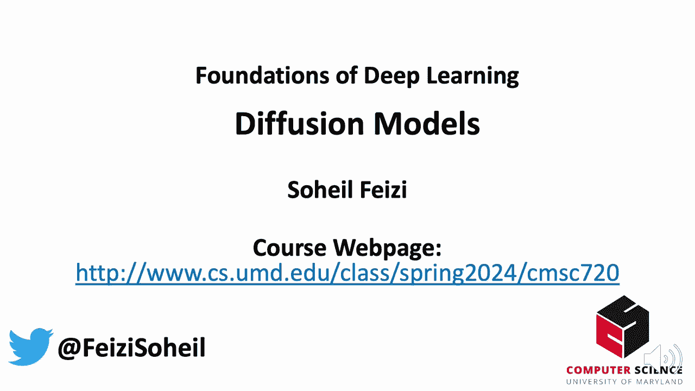
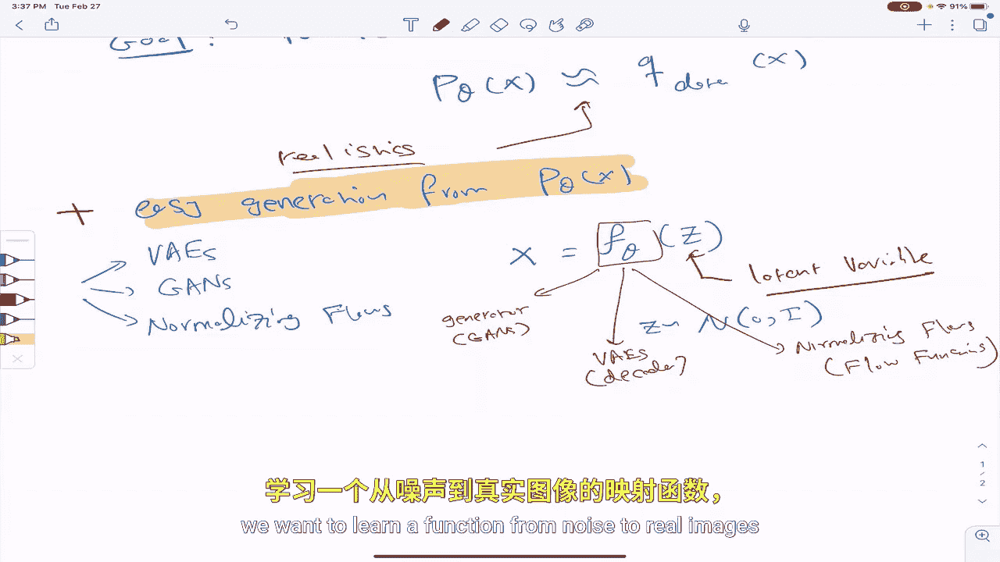
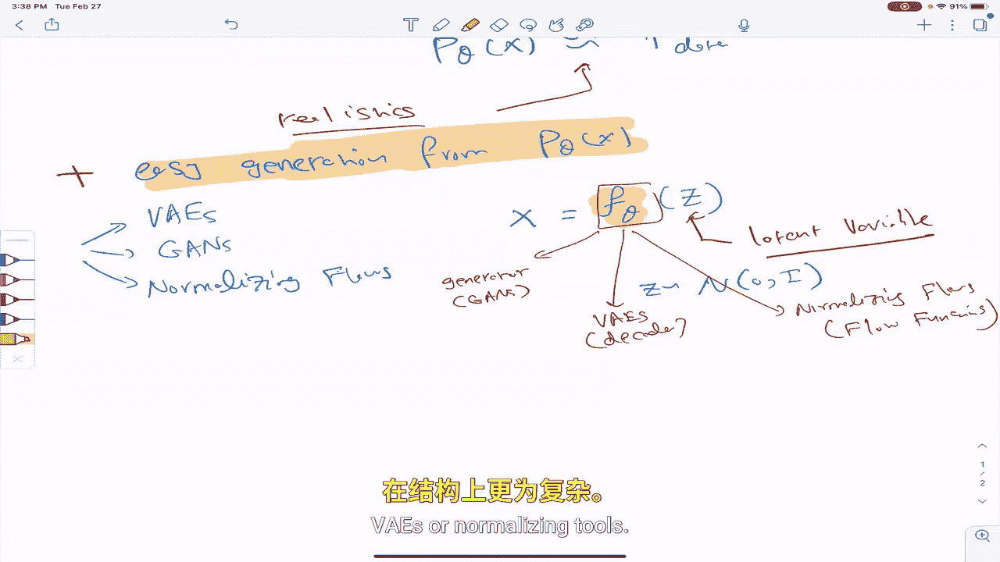
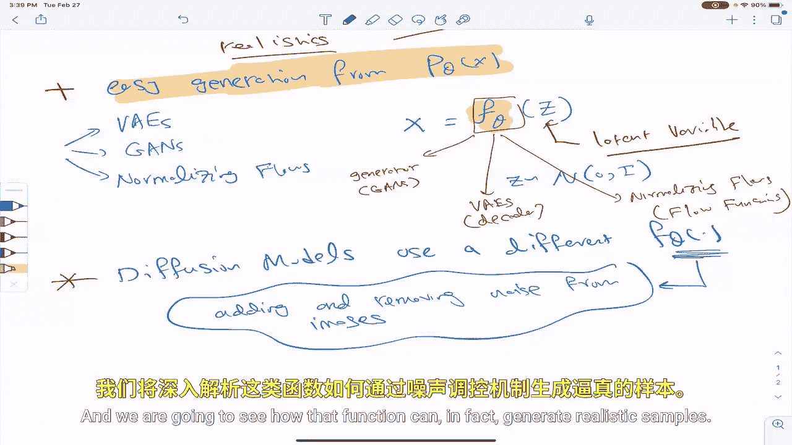
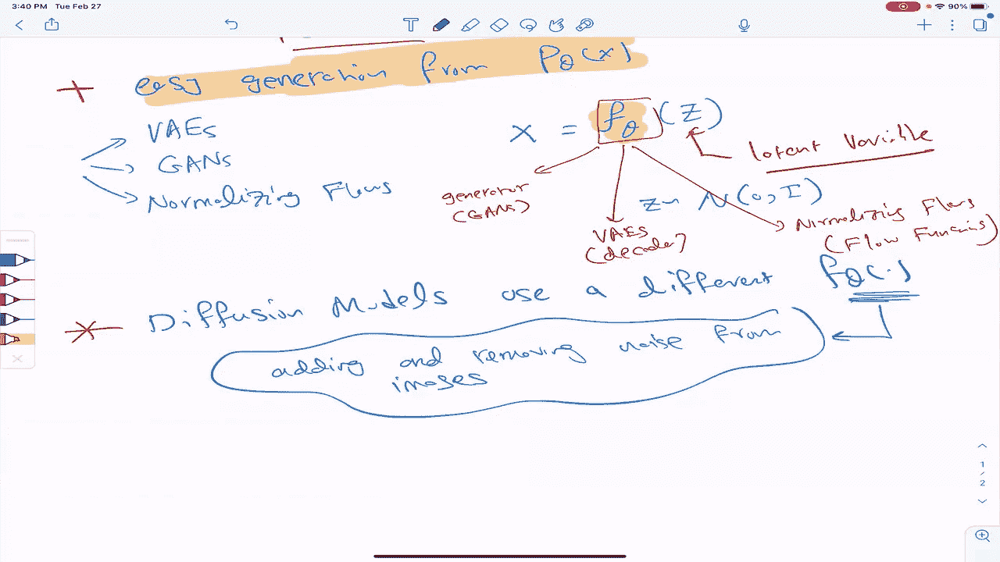
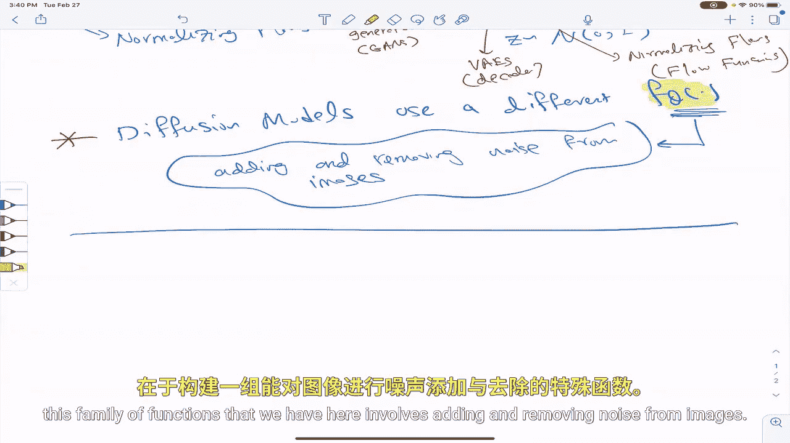
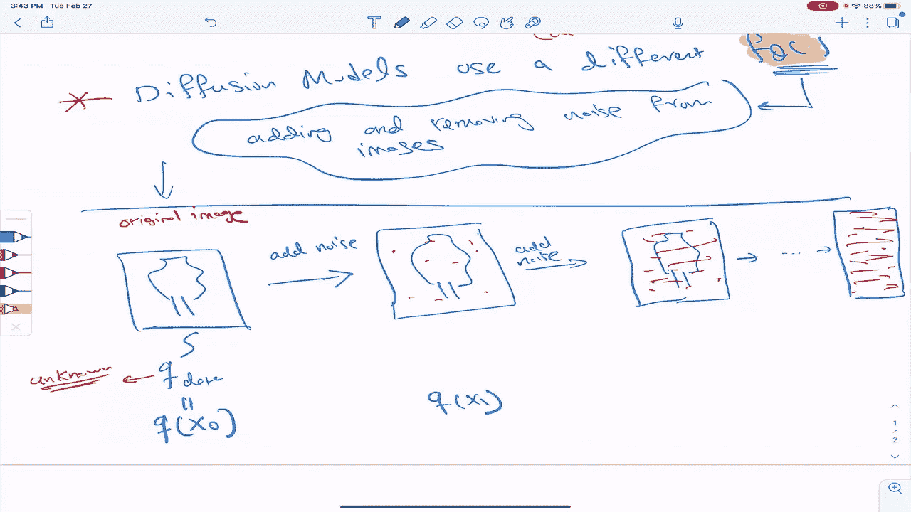

# 马里兰大学【中英⚡深度学习基础｜CMSC828W-2020-Foundations-of-Deep-Learning】-p44-P44-Deep-Learning-Foundations-by-Soheil-Feizi-：-Diffusion-Models--BV15rpCz9Ed8_p44-

。So today we are going to talk about diffusion models。Again， diffusions are diffusion models are。

Generrative model。 So we already talked about。Variational outenrs。

 we talked about generative adversarial networks or GNs， we talked about normalizing flows。

And diffusion models have roughly speaking a similar problem formulation。

 what is that problem formulation we are given a training set？

Starting with the simplest case and later on I'll talk about more sophisticated generative models where you can have additional inputs rather than input images okay so you have training sets training set with end images。

And we assume these images， they come from a distribution。

 an underlying distribution that we don't know， let's call that distribution Q data。Oex。And or cold。

Is to learn。A generative model， Pta of X。Such that P theta of x in distribution is similar。

To the underlying data distribution。 So we are able to generate realistic samples so that this assumption ensures the samples that we generate。

Is realistic。Plus。You want。To be able to easily generate samples from Ptas， easy generation。Yeah。

Yeah。Okay， so。They is the same problem formulation we started when we were talking about variational auto encoders。

Generative adversarial networks， normalizing。Bs。And in these cases。

 what we formulated x as a function， let's say， f theta of z。

 where z is your noise or latent variable。Oftentimes we generate Z。

According to a gausian distribution to。En short we have an easy generation the second。

Requirement that we have so you generate a Gaussian distribution and then you pass it through your F sub theta that's your generator in the case of GNs this is called generator。

In the case of Gs。In the case of VAEs。We call it decoder。And in the case of normalizing clothes。

I were flow functions。Comose on top of each other or the flowoma。so你 this。

Overview of what we have already covered diffusion models are not different。Again。

 we want to learn a function。

From noise to real images。In a way that the distribution of the output tooth matches the underlying distribution of real images。

 even though we are not aware of that distribution。で the the set upて goal。Is the same。

 The only difference here is that this function is going to。

Be a bit more complicated compared to the case of Gs or VAEs are normalizing tools。

So that's the only difference that we have in diff fuion mode。Diffusion models。Use。It's different。

Punction F theta in their generation。 And you are going to see。

This function of theta is going to involve adding and removing noise from images。一定。And removing。

Noise。from。Emails。This is going to be the set of functions that we are going to consider functions that will。

Add and remove noise recursively， and we are going to see how that function can in fact。

 generate realistic samples。

But from a high level， it is the same formulation that we have。

For diffusion models to GNs VAEs normalizing tools。

 and you are going to see in fact the way that we are going to develop this function is going to be extremely similar to the way that we started to think about the problem when we were talking about VAEs and GNs and normalizing。

So that's the context。

All right， so。In diffussion models， as I mentioned。

 this family of functions that we have here involves adding and removing noise。

From images， so the way that it works， let's say during the training， you have some original images。

 some realistic images。Let's call this。李知呢。Iage。One sample from your data set。Let's eat it。

It's an image of it。And this sample comes from a distribution， as I mentioned。

 this distribution is called Q data。So the problem is that we don't know this underlying disagreement。

 right that's the whole issue that we are trying to deal with when we are talking about generative models。

 so we don't know this is unknown。So in the diffusion process。

 we are recursively going to add noise to。The samples that we have in our。

 that's called forward process。And you're going to see why that will become useful in the generation process itself。

 so we add noise。Brecursive。So here you have your。3。😊，But maybe it's some。Noise on top of it。Okay。

 so you add more noise。Or add noise to the noisy version， so you get a noisier version。Of your image。

And you do it。😊，Until。Basically， you destroy。Whatever information you have in your original sample。

At then you add more and more noise that the。Resulting image is basically a noise image you don't really see your original content in that image。

Okay， so let's give names to each part。So here I'm showing one sample。From your training。

And I'm assuming that sample is coming from your distribution， so there's a distribution of your。

Training samples， these are noiseless samples， these are original samples that you have and that distribution is called Q theta。

Or I'm going to refer to this distribution ad with Q x0 x0。

 it means your original noiseless distribution。Maybe we arere adding noise， let's say in one step。

Every sample。Will become noisier version of that sample at the previous time。

So you're basically changing the whole distribution。😡，So at this step。

 you are going to get the distribution Qx1。So， every sample。

I's a little bit noisier。😡。