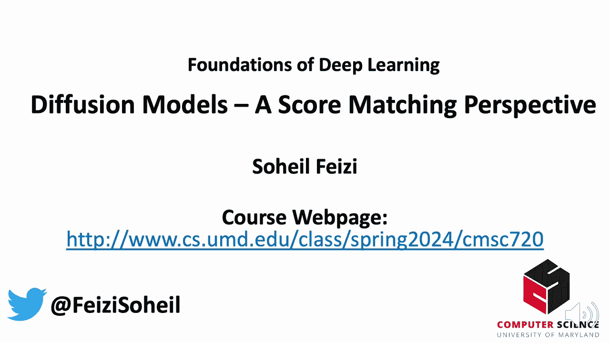
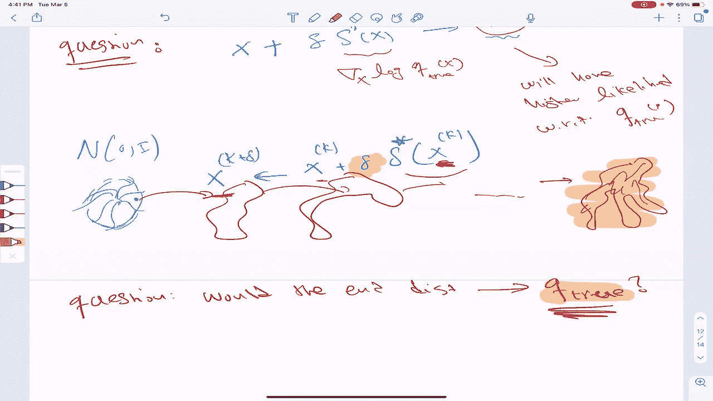

# 马里兰大学【中英⚡深度学习基础｜CMSC828W-2020-Foundations-of-Deep-Learning】-p45-P45-Deep-Learning-Foundations-by-Soheil-Feizi-：-Diffusion-Models：-A-Score-Matchi--BV15rpCz9Ed8_p45-

Interpretation。Of diiffffusion models。Using。Coote and quoteat。It's scored。放下。Yeah。Okay。

 what is a score function？For a given point X。I define a core function with respect to the particular density。

Let's say I have a density Q X。I look at the log。Of this density is probability， it's a number。

 a it's a problem， it's a number log of it is a number。And I look at the gradient。

Of this function with respect to X。It's a function of x I look at the gradient and vector x。

 therefore it'll be a vector。😊，The same size of x。That's the definition of the score， so if you hear。

 okay， so I'm computing the score in the context of diffusion models。

 this is how a score is being defined。Okay， and。We can have different densities， for example。

 you can imagine that you have the true density of your input and you compute the score with respect to that true density function。

That is unknown， that will be your tools for function。

But you can compute the density with respect to any distribution it gives you。

Basically a vector field， right so。For every X。It's your space high dimensional space。

You have X here。The score， again， it's a vector， so you can add it to your x。

 you can subtract it from your x。Whatever， so that's going to give you a vector at that particular point x。

As a function of the density。It's a definition。Okay， obviously we don't have it。

For the true distribution。Q two呃。But suppose we have it。

 let's say I give you the score corresponding to the true distribution。Suppose。I give you。

Score the score function。Corresponddent。The true distribution。Through distribution of data。

We don't have the true distribution， therefore we don't have the score。

 but let's say I give you this S star of x。Okay。What would happen， My question is this。Question。こ。

You start with some point。X。And you go a little bit in the direction of your score。Maybe again。

 as I mentioned， the score is。The same length of your x， but I'm going to add a score to my x。

 maybe bit'd like some。Some， some scale。So this is going to take me to a new X prime。

So what do I know about x prime compared to the original x so I you know I take an x an input。

 I go a little bit in the direction of my score。And I have another input， I have another image。

 I have another vector。What do I know about X prime compare plates？😡，还有还一个。Higher likelihood。

 so because。What is the definition of score again gradient？😊。

Of the like likelihood with respect to like the Q through。So it is like one step of gradient ascent。

You're taking one step for the log likelihood function。You get x prime， so this will。Willil have。

Higher。Likelihood。Obviously with respect to what with respect to that。

T distribution that we computed the score with respect to。So take one example。

 if you had the score for the true disagree， you don't have it。If you have that score。

 then you can update your input。Go from X to X prime。Then maybe this gives me an idea。😡。

If I had this S star。Of x， the score function for the ground root。Maybe I can start with。😡。

Some points， that is random。And I apply my score function repeatedly。

And if will change my distribution， hopefully this will converge to my ground truth distribution。

So I will start with some Gausian distribution， take Gausian。I will。Okay。

 so in high dimension Gaussian is concentrated， but maybe not the best visualization。

 they'll just like throw it like this， it's a Gaussian distribution 2D。😊，Pick a point。

 then follow the score， you update your point。It's a X。It's a K plus delta， it's a bad notation。

 but anyways I'm going to use it and'm not confused with T that we use。Plus。

 deelta times this core is star evaluated at。K。So you have Xk， it's an input。

 you just add a little bit of。Score to it， you get the new point and you just repeat it。

So you have this based on this you will get some other distribution for each point I'm going to do that and then you're going to have like you know you're changing your distribution。

And at the end of the day。You are going to end up with some distribution， right。

 so you transform your distribution。At each step in you are account your score update。Question。What。

で。Last distribution or the。Or the end distribution。

Converge to your through distribution if you do this。So you start with Ga samples。

And suppose you have the score for the ground truth distribution， you don't have it in practice。

 suppose you do have。And you take these samples， you just。

Opdate each of them in the direction of score a little bit， you get a new distribution。

 then you update them a little bit， you get another distribution to it like， you know。

 many more times with small enough delta。Like take like。2000 steps whatsoever， the last distribution。

 the ending distribution that you're going to get。Would it converse to the true distribution。

 because you're using the score with respect to the true distribution？Yes or not。

How many people think you will converge the through distribution if you start the process？

By using the score for with respect to the ground rules distribution。Can you raise your hand？Okay。

 mostly centered in the back rows， okay， so who thinks it won't converge to your ground with distribution？

Okay， so great and the risks are uncomitted。