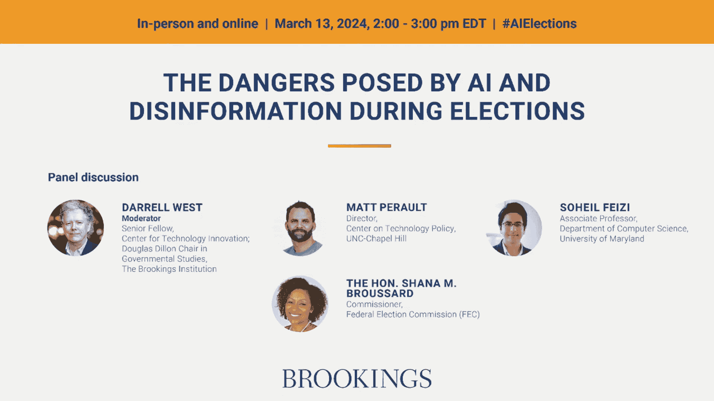
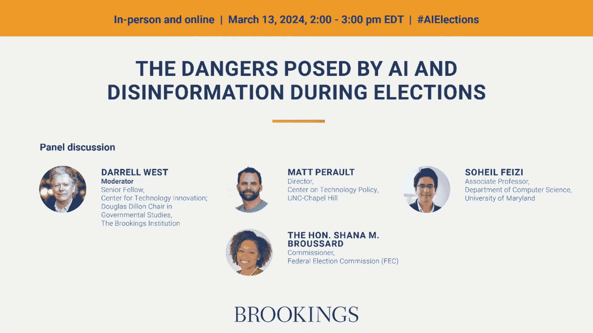
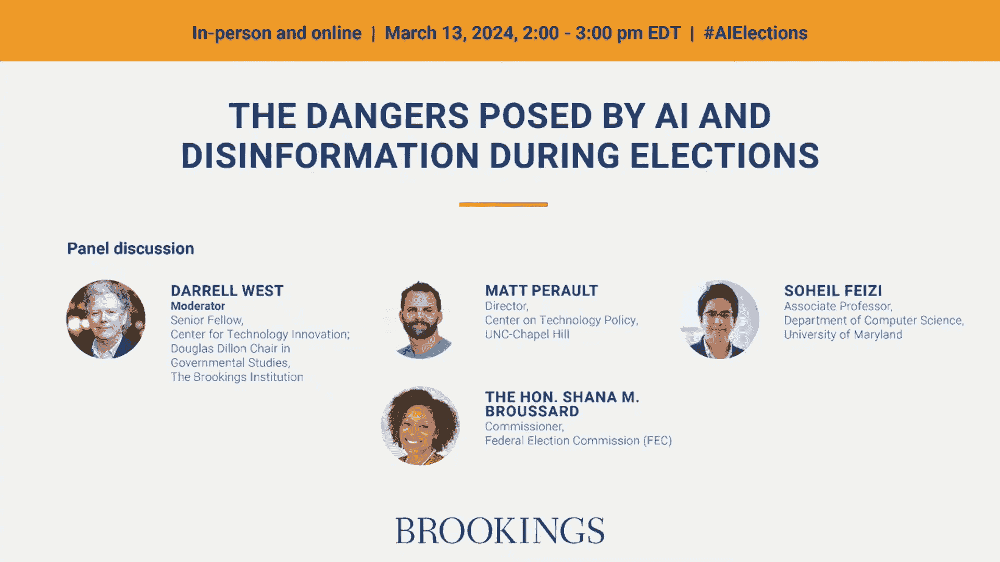

# 马里兰大学【中英⚡深度学习基础｜CMSC828W-2020-Foundations-of-Deep-Learning】-p46-P46-The-dangers-posed-by-AI-and-disinformation-during-elections--BV15rpCz9Ed8_p46-

No， this was shaky。嗯。

Good afternoon， I'm Darrell West， a Seni fellow in the Center for Technology Innovation at the Brookings Institution。

 and I'm pleased to welcome you to our forum today on the dangers posed by AI and disinformation during elections。

The 2024 campaign is shaping up as one of the most impactful USS races in recent memory。

 there are vast differences in the visions offered by the various candidates and people around the world are paying close attention to the American elections。

At the same time， there has been an emergence of new generative AI tools designed to create。

 among other things， fake content， videos， and audiotapes。

This is a particular challenge in 2024 because literally about half of the world is going to be voting this year。

 there are major elections in the United States， India， Indonesia， Mexico， Pakistan。

 the European Union， and a number of other countries。

Many people across the world are worried about these elections and a fear that they may end up being decided based on false narratives。

 and all these developments raise interesting questions about possible USS risk to our own election 2024。

And the role that disinformation could play in that campaign。

My Brookings colleague Elaine Kmar and I have a book on disinformation that is coming out this summer。

 we argue that we need to take disinformation seriously。

 it does represent possible threats to our election。

 we look at the organized networks that are behind disinformation and we also outline the lucrative nature of disinformation。

 there are large ecosystems out there that are finding the distribution of false narratives to be quite profitable and so therefore we suggest we have a number of different recommendations in our book。

But we suggest that if we really want to address as we have to think about both the organized networks and the financial and political incentives that people have to spread this type of information to help us understand these issues。

 we are delighted to be joined today by three distinguished experts。

 the honorable Shana Bsard is a commissioner at the Federal E Commission where she has served since 2020。

 prior to that she has worked as a New Orleanss assistant district attorney and also an attorney advisor at the internal revenueevenue service。

 I think you like to work at noncontroversial agencies right。And I should also note in 2023。

 she helped launch an FEC effort to develop guidelines for the use of AI in campaign advertising。Dr。

 Sohiil Fei is an associate professor of Comp science at the University of Maryland and there he is the director of the Reable AI Lab and focuses on ways to develop trustworthy AI how to develop explanatory AI。

 how to deal with questions of racial bias in AI， all of which are very hot topics Matt Perult is the director of the Center on Technology policy at the University of North Carolina at Chapel Hill。

 there he serves as a professor of Prae in the School of Information and library Sciences。

 and he writes on online expression and Polit Adv among other topics。

If you have a question for our panelists， you can email them to events at brings。

edduu or tweet at the hashtag AI elections， so today we're going to discuss the election situation and ways to address possible threats。

 I'll start with Shaa， so we know that disinformation is shaping up as a major problem this year。

 how should we address the challenges related to campaign disinformation。Well。

 we start off with the easiest question for hers how should we address it？

The way that is being addressed now is that there is state legislature that's coming through 14 states have been able to do something that have worked in concepts of how to include disclaimers that work on content or transparency we've had some really interesting legislation that has put out just last week by the Klobuchars of bipartisan Senator Klobuchar Murkowski that go to the heart of what I think is one of the ways that we can not just combat but inform about AI misinformation and that's through the effort of disclaimers there's a big controversy that deals with First Amendment rights when you're dealing with speech and particularly when dealing with political speech。

 but one things that the courts have said that when it comes to disclosure。

 disclaimers are still okay and so that is the thing that I'm hopeful for most when I see it through the state and through a federal efforts there are being done is the push for disclaimers。

So I know that there are some possible FEC guidelines on the AI use in 2024 and I know this is an ongoing rulemaking process so you can't really say very much about it but I'm just curious about the public comments period how it is gone how many comments the commission is receiving and just kind of the general nature of the reaction so far Sure there was a petition that was filed by a public watchdog group public citizen is the name of the organization and that it was a petition that would allow through a regulation and its preexisting for fraudulent misrepresentation or solicitation for using that as a means to be able to regulate AI so the petition went through the notice stage we put it out for comments and we received very healthy comments。

 2400 comments to be exact which shows that everyone is interested by this topic you had comments that were received from both sides so i'm always happy to see where there is a collective interest。

Regarding this， but I will say that overwhelmingly the comments were positive about moving forward with some type of regulation for artificial intelligence because this is a pending rulemaking there is very little more that I can say about that but I do say that there has been there's been rampant discussion in the commission so we look forward to further discussion and moving forward on that What's impressive to see all the interest in that i'm not surprised you've gotten 2400 comments there's definitely a lot of public anxiety around this topic So hi you seek to develop trustworthy AI What do you see is the possible AI related problems in 2024 and how should we think about those issues first of all thanks for having me on the panel obviously there are several risk that AI can impose maybe the biggest one is the creation of misform and disinform using generative AI models so I can tell you in the last couple of years there has been a。

in the quality of these generative AI models， for text， for images， for videos and for audios。

 so not only they can generate realistic samples， but they don't leave in many cases visible or invisible signatures on the content so that we can use them in order to fact such content later on so that's one of the main issues there are some other issues that amplifies this risk the scale the speed and the flexibility of these models。

So these generative models， they can be used to generate not one sample， not 10 samples。

 they can generate thousands and millions of samples in seconds。

And they can generate it in a way to maximize the impact by targeting certain profile of voters and to basically do the voter manipulation to maximize the impact of their disinformation and maybe the third aspect that is less in my opinion talked about is the risk that AI defense to combat this problem can create itself。

 so there are a lot of detectors， AI detectors for different modalities like text， images。

 videos and audios and we have been studying their reliability for a while and bottom line is that these detectors are not reliable so they have a huge false positive rates。

 that means that if you have real images if you have real content if you have real videos maybe about the candidate that come to light before the election so that content if it is。

push through one of these detectors， and it is flagged as AI generated falsely that can basically be used to falsify real evidence。

 That's another risk that AI can create。 and in my opinion。

 that is less studied and less highlighted in especially policy policy domains。Thank you Matt。

 you have been a long-ter observer of tech policy what worries you about AI in the 2024 elections so thanks so much dryl for inviting me to attend and Catalina for your help organizing the event I really appreciate it's honor to be here so I approach this maybe first from some one step back which is how do we think about evaluating public policy problems I've been motivated and excited recently by the Knight Foundation's new investments in translational work they're actually starting a center here in DC in partnership with Georgetown that will be directed by Alyssa Cooper that's focused on translational work between the Academycade and public policymakerrs I think there's still。

