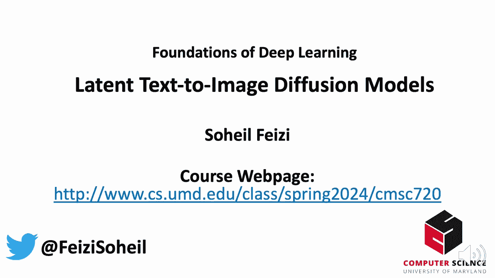
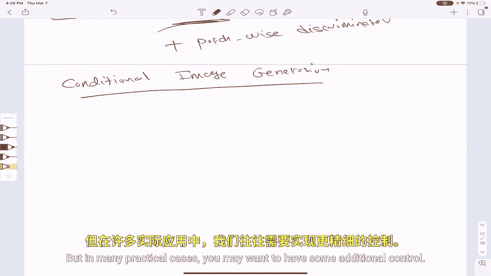

# 马里兰大学【中英⚡深度学习基础｜CMSC828W-2020-Foundations-of-Deep-Learning】-p47-P47-Deep-Learning-Foundations-by-Soheil-Feizi-：-Latent-Text-to-Image-Diffusion-M--BV15rpCz9Ed8_p47-

So， next， I'm going to。Talk about。Lant。Diffusion。Models。If you， for example， have heard of。

Stable diffusion。That is based on latent diffusion models。

So what is the problem that we want to address here， so the problem is that。Images。

Are high resolution in many cases， so you have。Perhaps many， many pixels， 1024 by 1024。Million。

 more than a million pixel。😡，And in the generation， if for example， you consider PDDPM。

Or even during the training。So you are working with really huge vectors。

 like vectors of millions of numbers。That is not。Scal them。

It is very difficult to train these models。 it is quite difficult to。

Produce high resolution images in a quick fashion。So that that's the fault。

So what is the solution here？I'm going to keep you a hint。嗯。The solution is to。

Use an encoder decoder。Comppress your input。To a smaller dimensional space。

Do your diffusion in that space in the latent space。And the compress it。En coldder， decoder。

 that is it。ok  so。Here's the idea， so here's your input。You have an encoder。

Map it to a smaller space。 Okay， so now you have。A more manageable。Vectctor right。

 so if you even think about like a 2 d version of it， if your x was。And 1024 by 1024。

Maybe your compressed version is only 32 by 32。Much smaller， right。

 you have about like a thousand numbers to work with before like you had a million numbers。

1000 reduction in terms of the space of and the dimensional material Okay。

 so do whatever you want to do in this space， this is the diffusion。Process。Go towards noise。

This is the normal and then again， for the reverse start with the noise。

Bring it back right so basically this is what we have already covered you really didn't say。

 you know your inputs are images or whatsoever， right？It could be any distribution。

 it could be the distribution of the encoded version of your images doesn't really matter。And then。

 for your。Artput don't display this， use a decoder。Decoder， and then。Have。Have this output。

Let's call it Xa。That is the whole idea of latent diffusion models。

Maybe I should have called it latent diffusion models in moment。All right。

 so what is the you obviously have different choices to use for your encoder and decor。

In the original paper， they're using something very similar to VQ G。

And I want to emphasize this is fixed， you are not optimizing this。😡。

You take an off the shelf encoder and decoder， that's it， you could use any other encoders。

The one that you are using is based on BQ can。And。😊，Let me on a side note。

 just explain how VQ can is trained just you know for you to get a little bit of feeling it's a pretty decent encoder and decoder。

 it's based on quantization in the late space， it's a side note。Right。

 so the way that this encoder and decoder again， this is training。Separately。

 you know you're not training during your diffusion trained in another time and then you're using it as a fixed encoder and decor during the training of your diffusion。

 but I'm explaining how it was previously trained okay so you have an input X。They use a CNN encoder。

And you get basically a latein representation， I'm going to show it in 2D。

And they quantize this latent。The presentation， you have like a quantization numbers here。Each。

Code or each number here corresponds to a code。Or a vector in your code book。

Let's say number one corresponds to these numbers， number two correspond to these numbers。

And you use it again， a decoder， a CNN decoder to decocode。

It is very similar to the quantized variational outcome folder that we already taught。

You can look at the construction loss as is2 laws。The quantization is not defreable。😊。

How do we do we manage that in our integration， in our creating computation， you just ignore it。

 right and what do we call it？It's straight through estimators， okay， fantastic good。

But instead of the L2， they use LPps distance between。

X and x tilD x hat between input and output LPs is a very interesting distance。

I won't go into the details but again it is defined based on features of a normalized feature of a convolution network so you can like basically map your x to the features。

 the normalized features and then look at the L2 distance in the feature space， but again。

 it is a distance it's a very useful distance， especially in terms of capturing the perceptual changes between the two inputs。

But they also add a discriminator。Paashwise is discriminating。Totuchwise discriminator。To ensure。

The patches are photoreistic， so for each patch they ensure that the quality of it is good by just looking at just training a discriminator。

Look at different patches。 it goes through。riator and it is kind of similar to what we covered in the GN lecture in terms of ensuring the distribution of the patches across your inputs roughly between they are similar to each other so that's why the name GN comes from。

And this is quantization is because of the quotes that they considered。So that's it。

 That's the latent。If use your models。意い。Okay， so we have time for one question， yes。See。

Instead of working with million numbers， you work with 1，000。Because you're。Oh， who quant。

 So I I I I thought so it just。In terms of the quality of the encode code empirically it improves the quality and it is because you are basically putting a little bit of a structure in your latent space。

 so the small variations don't change your latent I thought about like you know what you as well like the encodeant。

Okay。So the next topic that I want to cover is conditional image generation。So far， we talked about。

Generative models in a broad。Sense， meaning that you have some training examples。

Let's say photos of cats or dogs and other types of photos。

 and you want to train a model to be able to produce photos and images similar to examples that you have in your training。

But in many practical cases。

You may want to have some additional control。