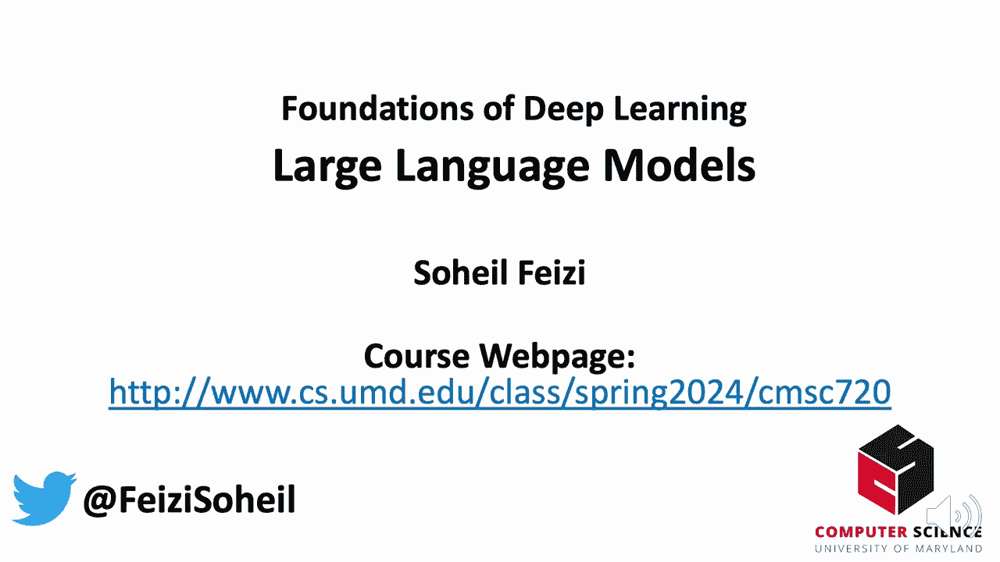
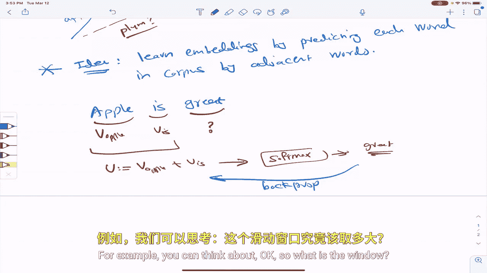

# 马里兰大学【中英⚡深度学习基础｜CMSC828W-2020-Foundations-of-Deep-Learning】-p48-P48-Deep-Learning-Foundations-by-Soheil-Feizi-：-Large-Language-Models--BV15rpCz9Ed8_p48-

I'm going to in the next couple of lectures， we are going to talk about language models。嗯。是。

Broadly defined is our models that work with。With language， with text。And obviously。

 these models are super important。You can use them for processing huge amount of text。

 you can use them for translation， you can use them for question answering。

 you can use them for many other applications。So at the heart of it is。Howy can。Input。

Or sentences or words。Into these mathematical models， because inherently， obviously sentences。

Are composed。Of wars or tokens。嗯。But mathematical。Models。Take。Pre investors as they input。

So here you see a contradiction in the previous lectures that we were talking about images。

Image models， we didn't have this problem because images， you can think about them as。As vectors。

 as real vectors， vectors with real numbers。😊，Discrete or whatever format that you have。

And that format is compatible with the input of those modes。But in language， we have this problem。

Wds are not mathematical objects that I can easily input to my mathematical model。

So in order to deal with this problem。In 2014。It was a。Very influential paper called War2be。

 I'm sure all of you are familiar with。Were too big。

 but I'm giving a little bit of a historical context before moving to even more complex language models like Chay PTNs on us let's see where we started。

 what were the issues， how we are dealing with with those issues。Sa want to be。

It is clear from the name， so it is a module。哦。That takes wards or tokens。And it produces。Victorors。

Or embeddings。So you might think， okay， so why do we need to train such a model。

 maybe I can just represent my words， it's on random vectors， but unique。Let's say Ben， I have。

 you know， let' say。Apple is great。😊，So I have a sentence of this。

 I'm going to map my vector apple with some numbers。To some numbers is another。Token。

 I'm going to map it to some numbers。 Great， than another token。

 I'm going to map to some random numbers， and I'll be done。

So why do I need to learn and mapping our words to real vectors？Paricks。Semantics。

 but you know something simpler than that。What properties would you like to see in these vectors？第す。

It's big， right so context， you know what does that mean right so give me like more concrete。

Similarities right， so the first property I would like to see is that if two words are similar。

Their embeddings hopefully should also be quite similar。

That will make the job of my mathematical modeling easier。😊，Because now okay。

 so let's say I have two words great and awesome， right？They are more or less similar。

 so it would be easier for my mathematical models to deal with roughly speaking similar vector。

And so that's the first property that we want。😊，I want similar。Wds to be enough to。Similar。

Vectctorors or ems。Okay， is that enough？If I have similar words， it is not too similar。

So that is necessary， but perhaps I want something a little bit related to the。

 as you mentioned context， so I want to have some sort of relationship。Incod。In my ems。Capture。W。

Relationship。Just as an example， suppose I have a vi representing Apple。

And I have a vector representing purple。If I sound these two up。

 Apple plus purple because now I'm representing them with vector， so I can sum of the words。I expect。

 okay， maybe。The resulting vector should be close enough to a word like plum。

It's like Apple at this purple， right， so it has like some level of relationship。😊。

Embedded in my embedding space。So that's another property that would be great to have。Alright。

 so how to bank learns。Such embeddings。は。The idea is， for example。

 I'm not going into like the details of it because it is not a。Classic methods， but。The main idea。

 we actually use it in even in modern language models， the idea is to learn embeddings。

By predicting each word in or corpus by AJM。Each work。嗯。Pposely。Adjason。She。Whats。Okay。

 so let me explain that with an example。Again， consider the example Apple is great。

Let's see we start with some。Random initializations for every token， every word in my vocabulary。

 so I get a vector for Apple。I get a vi for the board is。

And let's say I want to predict what would be the embedding。Or。For my to cream。So the idea is simple。

Let's sum this swapwa， I define a vector， let's say the apple。Plus。

The embedding for the award is you can normalize it。And effectively speaking。

 you just push it through yourself。You have this this。Word， and then you try to match it with。

One of the tokens， one of the embeddings that you have。To predict the next word， which is great。

And then you can use back propagation。To update your em。So in other words， you can think about。

Wd2 work as a very simple neural network。诶。Basically， just ads。The embedding of adjacent boards。

So you have now a vector and then you try to align it。

In a way that is predicting the next word or the word that you have in mind correctly using subjectsgroups。

If is' defiable， you just update your input。And there are many variants of this method。

 but for example， you can think about， okay， so am like， what is the window。

 what is the stand window？😊。

