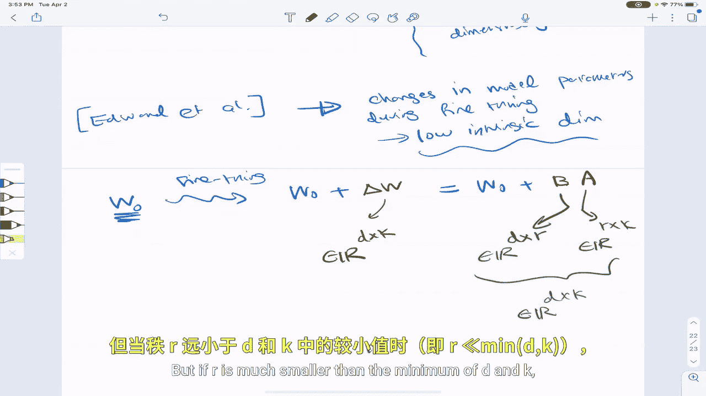

# 马里兰大学【中英⚡深度学习基础｜CMSC828W-2020-Foundations-of-Deep-Learning】-p49-P49-Deep-Learning-Foundations-by-Soheil-Feizi-：-Large-Language-Models,-Part-II--BV15rpCz9Ed8_p49-

Today we are going to talk about fine tuning， large language models。Yeah。Wine tu。Large。

Language model。There are a lot of language models out there， many of them， they have released weight。

In many instances， but when you have your own data。

 you may want to find tune the language model on your private。

 potentially private data to have a better model for the application that you have in mind。

But that immediately poses some challenges because of the size of these bombs， for example， G3。

As we talked about， it has。More than 175 billion parents some models。Like palm。They have even。

More parameters and these days people they use a mixture of experts， they use even bigger models。

 so the size of the models they are huge the order of hundreds of billions of parameters。So。

 that means。Even storing。Debates of your model。It is quite challenging。😡。

Let's say one single GPU because you are storing。Hundreds of billions of numbers。

And you want to do some compute on top of it to。Potentially change bits of your model for your specific application。

 so there are issues in terms of the storage。There are issues in terms of the compute。Os。

And you need to have a lot of memory， a lot of compute in order to find your model。

So with this problem。To deal with this problem， there are several solutions in order to make both storage and compute lightweight for many downstream applications Okay so we are going to talk about not all of the solutions provided in the literature but probably most successful solutions that have been adopted widely in practice。

So one set of solutions is。Call adapters。Yeah。So the idea is quite simple， so the idea is okay。

 so you have a big model。谢系吓。A large model。Instead of。

Changing all weights in my model during the fine training process。

 I'm going to specifically have some particular layers。Called adapters。

That can potentially be changed during。半一天。So I'm not going to change the entire weight。

 so these are going to be the same。Same as the pretrain model。Same。As before。う。

But some of the years are going to be some parts of my network is a lot to adapt to the particular setup that you're point。

So that's basically the idea of adapters， obviously it is good because。

You can reduce the number of parameters that are updated。During the fine in quite a bit。

 depending on how many layers do you have in your adaptation。

So a particular family of adapters is called Laura。Short for low rent adaptation。

There are different implementations of adapters obviously I won't be able to cover you know all of them。

 but I'm covering like the most successful instance of this family。As I mentioned。

 it is called Laurel。Short for low rank。好的，Yeah。Okay， just to give you a context。

There was a paper by。I got Johnnyian。No。Thats basically an ETL that basically showed。

If you look at model parameters。If you look at the distribution of model parameters。

 they are intrinsically low rank。They have done some empiricalical analysis。😊。

Showing the distribution of model。Prameterters have。Yeah。No rank。Intrinsic。Pmental。Okay。

 and in many cases it has been verified， in fact， you know you recently had a paper in Nors called diffus reundancy。

 where we sure that you can randomly sample that was for a classic resnet model。

 you can randomly sample the features in your penultimate layer。And the model performance is。

Pretty solid so you don't really need all of the features in your last layer。

 you can randomly sample and the model performance is still good that kind of shows there are a lot of redundancy in thes of your model that even if you draw quite a few of them the performance of the model at least on the benchmarks test that remains pretty much the。

So another paper followed up on this idea。Paper by it。哦。

And they argued that not only the model parameters they have quo and code low intrinsic dimensionality。

 but also the changes in the model when you are fine tuning。

 it has quoanqu low intrinsic dimensionality， that was basically one observation that limit impity。

Changes。嗯。Model。Parameterters。You in fine tuning。Often have。As low。Intrinsic。避免小老。

That was basically the observation that they made。Based on this observation。

 they suggested this really simple idea。So， suppose you have。Se of weights in your model， W。

And you want to update these wayss， let's say in fine tuning。By迎 tuning。So starting with w0。

 these rates go to w0 plus delta rather。These are the changes that you are。

Making to your bases during the final period。So instead of writing the changes as w zero plus step w。

 the assumption is。You are going to。RightThis has w zero plus2。Mattrix。B multiply each other。

 B times a。And we are going to ensure。These matrices are low rank， meaning that。

If let's say your deelta w， the dimensionality of this matrix is。D byケ。

Just as a general notation that you might have the N can be big numbers。

You're going to assume the dimensionality of B。Is D by a number。

Like R and the dimensionality of a is。R by K， obviously， the product will give you a matrix D by。

Okay。But if R is much smaller。

T the minimum of the Nk。