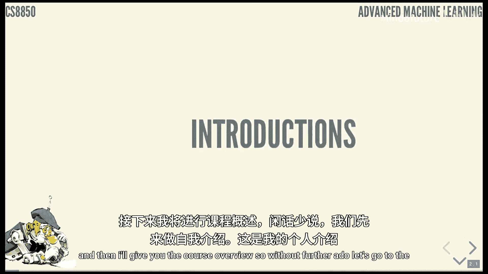
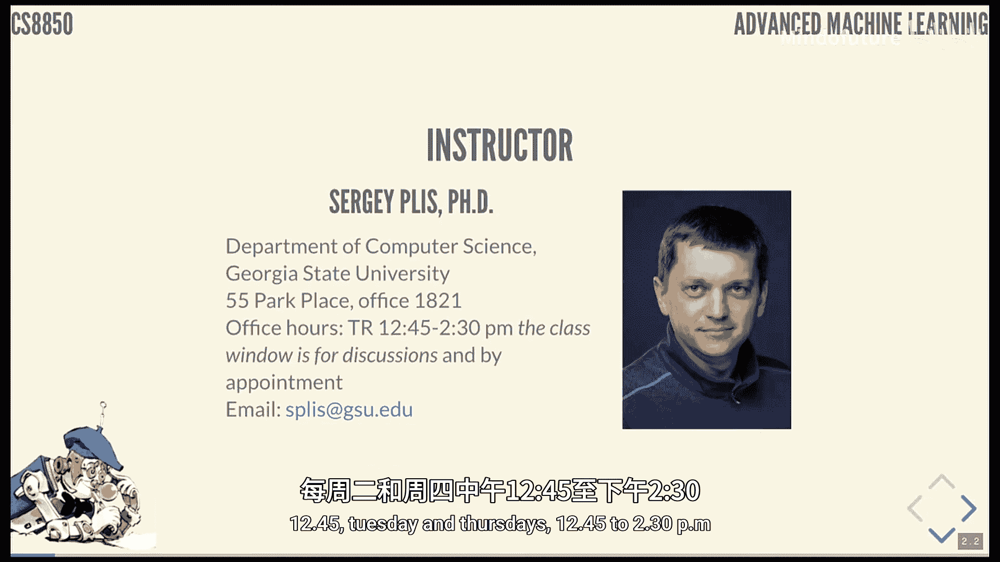
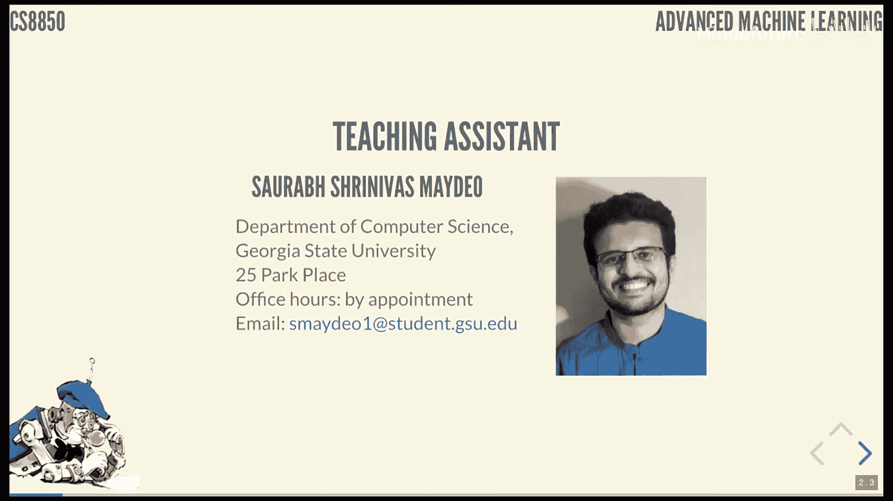

# 高级机器学习主题-CS8850-｜-Advanced-Machine-Learning-p01-P01_高级机器学习-导论--BV1sapPz4Ewx_p1-

はい、フす。Let's start our first lecture， Wee to the Advanced Ma learninging course。

Those will be recordings of my lecture， which I will be most likely recording for you at night。

Because of that。I want to warn you there will be some differences in style and manner。

When I teach a class and when I look in your eyes， I have feedback， I work with you directly。

 but when I'm recording for you。Well， basically， I'm recording for an MC room and I'm not talking to anyone。

And it's at times very hard for me to sound excited or。To deliver。

The jokes in the manner that I wouldn't intend to deliver them if I were talking to。

Those are the downsides， but the upsides though。Is I will be putting all my lectures on YouTube when YouTube allows you to watch the lectures on different speeds。

I have a。I recorded some of the lectures in the beginning of the COVID last semester and turned out I do speak very。

 very， very slow when I speak for the recording。Or maybe I always speak that way。

 but I just didn't notice before， so you may be interested in listening to those lectures at higher speeds。

 at lower speeds， posing and watching them whenever it's convenient。Not at the time when。You know。

 you were assigned， buts the meaning of asynchronous is there。And as I wrote in my mail。

 we will meet and discuss the questions。And well， we can talk about that when I see all of you on Tuesday。

Meanwhile。Let's talk about the course， this lecture is an introductory lecture so I can tell you about what to expect and what you will be learning and what I will be learning while teaching you。

Introduction of we go。So there will be this is a good example and I do not want to cut this。

 there will be hiccups， there will be overlaps and things like that I will not be able and I don't think it's the most productive for me to prepare YouTube marketing quality features this will be really a lecture with all the pauses。

Us and Us and all things like that。Welcome to the real World Le experience。We want to do about。

Who are， who we are。 I will introduce myself and my。指。😊。

And you will get a chance to introduce yourself。On。tuesday啊。

At the first class or at the first discussion section， actually， we'll talk about that later。

Then we'll talk about why study machine learning。And then we'll talk about what is machine learning。

And cover a brief history of machine learning。 And then。

Delve into reinforce learning a little bit just for fun。And then。I'll give you the course overview。

So without further ado， let's go to the introductions。

This is me。My name is Sergey。You could call me simply doctor， please。呃。Im a professor。

 associate professor here at the Department of Computer Science。But I work at the T Research Center。

As a director of machine Learning Cor。And I have。A span of experiences， including。系佢知咩。Industry。

 startup world and。Many others。 So I will try to。Teach you or train you or convey the difficulties or the interests。

大。That you hopefully share with me that I have in machine learning and its practical applications。

 and hopefully I will be able to explain why some of the theoretical aspects or some of the deep aspects of how machine learning methods work。

Are important。Everywhere， not just in academia， but also in industry and also in any application of machine learning。

诶系。Youive a。Con front with。Well， my address is in the  55 Park Park place but。Unfortunately。

 it is unlikely that we will meet that person in this semester just because the timing is not right。

I may come to the office， but it will be very hard to justify why shall we meet in person because for me it will encourage additional driving。

And hold that round trip， but try it you can email me anytime and ask me your questions。

The office hours。Will be our class。So please show up and be there in the class and have your video on。

At least you know the glasses are synchronous， we're all sitting at home it's all online。

 but we need some sense of presence， some sense of human touch。

 so if you are connecting to the class and you're not having your video on，You're not counted。

 basically， because I will run my。Zoom with the setting。Only show those people that have video on。

So because when you come to the class， to the lecture， you're not putting。

And disabilityibility log or something like that。You're there here， so please be there if you come。

U what else up， you can always have an appointment and have a one to one Zoom call with me。

 but I would prefer if we cover all of the topics during that。Slug。1245， Tuesday， Thursdays。

 1245 to 2， 30 pm。

Here's my teaching assistant， Z。So。せ線字。Unlikely there will be any personal appointments。

So you can always email him and he'll respond and hopefully organize the one to one call。

In any of the media that we can。舍得。

