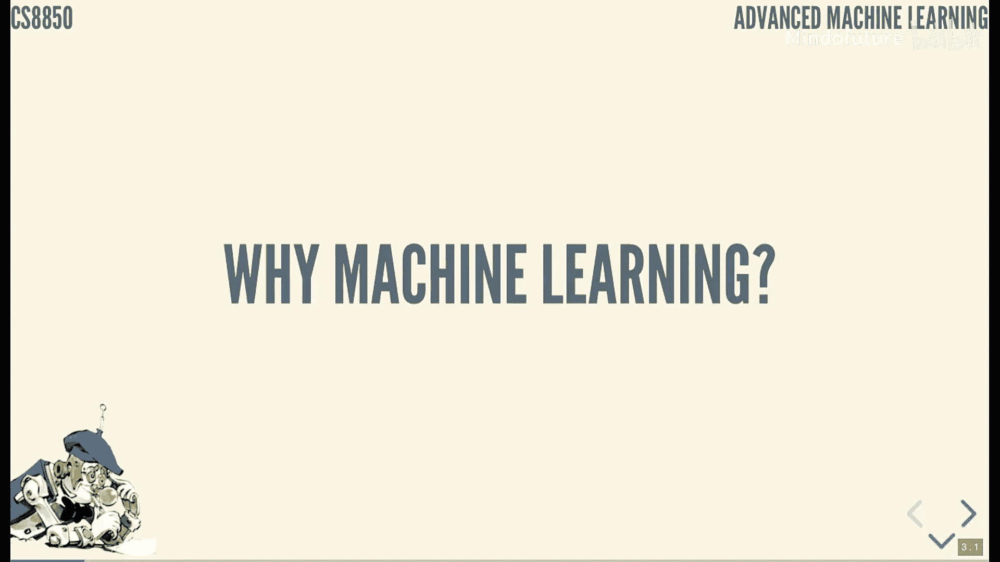
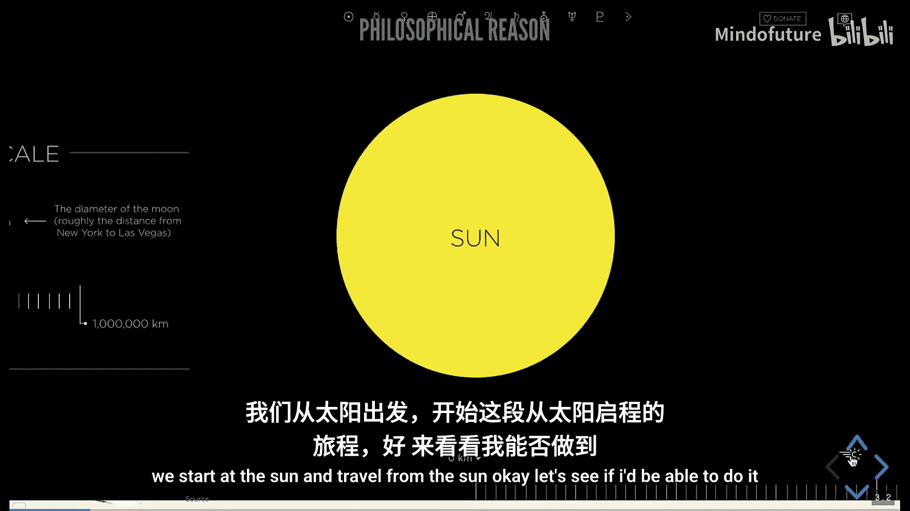
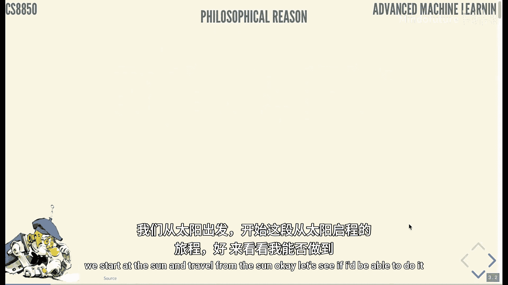
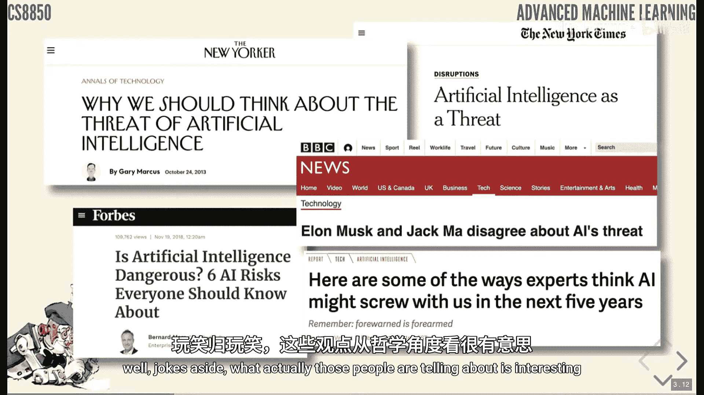

# 高级机器学习主题-CS8850-｜-Advanced-Machine-Learning-p03-P03_为什么选择机器学习--BV1sapPz4Ewx_p3-

So let's talk about why to study machine learning。And I will give you a few possible answers。

 of course， this is more a rhetoric question you。You understand。

 but why would anyone be interested in studying machine learning at all？

So let's start with a philosophical reason。something slow， contemplate。

 imagine the scale of our universe。And。Imagine a model。Where the moon。

Is just this big it on the screen。So one big so is the amate of the moon。And then this is your scale。

Yes。It's 100，000 kilometers and this is one million angel。Let's start。Well universeverse the left。

And know that we see how humans travel。The distant galaxies every day on Netflix。This is just a show。

 just a dream， so let's look at the reality， let's look just at our solar system。

This is the nearest start that we know。二三。If we start at the sound。And trouble from the sun。

嗯。ok诶。Let' see if I be able to。

And travel from the sun。I this speed of light。This is the speed of light。

It's the fastest speed allowed by the universe。So I know， well。The point being here。

 if we sit here and stare at it for quite a while， this is the fastest speed we can go in the universe。

Then。Eventually。We will now skip surgery。Eventually。In 3。3 minutes。We will arrive at this speck。

 which is almost the size of the moon。Just called Mercury。

Noticeice nothing in between just emptiness。We can go to Venus。And that will take life。Six minutes。

We can go to earth。About eight minutes right from the sun。And here's our moon， just a single pixel。

So。If we again want to travel at the speed of light。That it could take forever。

The point I'm trying to make and all my slides will be available somehow either as live presentations。

 live slides， JavaScript。Or Pf。You will be able to explore the similulator yourself。

 the point I'm trying to make is art。Inverse is quite empty。And if we don't invent。

Some radically new physics。Which is which at least from an immediate near side perspective。

 seems unlikely。Then travel to。Even distant or nearest planets， well Mars is okay。Thinking about。

Further planets in our universe or in our solar system。It's unlikely。A human bud。

 we just not made for this fast space and boring trouble。

That's you know hibernation and all of that stuff， maybe， but it's way。

 way easier and cheaper and sensible and not that cruel to send machines to explore the universe。

And we cannot send our current machines， we need smart machines， we need artificial intelligence。

 we need machines that learn and to be able to build machines that learn。We need to study。

 the discipline of machine learning， because we need to understand and know how machines learn。

That's one of the reasons that's kind of a philosophical one， why to have that discipline at all。

 there is also pragmatic reason and this is from something that we do at the trends center。

So we want to collect a lot of data about our surroundings。If you don't want to go to space。

 if you don't think this is the ultimate frontier。All right。

 least if you don't share that goal with me。Fine， well。系好。

You want to be healthy and you want other humans to be healthy。

 so we want to collect a lot of data or collect some data。

Notown invasively without cutting ourselves up open。

In order to understand what is happening with this is， right？

So our usual answer to questions like that is。Well。

 we'll just let's collect more data and more data so we understand more and more and more and at some point the data becomes so large that it becomes a problem itself because high dimensional data is not easy to see through yes。

 we can collect。Everything， and then what？How do we make inferences。

 how do we find the physical or biological laws hidden in the data by analyzing the data。

 but it's just fast amounts， well， wouldn't it be nice？If we have a helper。

Something or someone who automatically extracts the meaning from all of that data。

That will be our machine learning solution， right our again。

 artificial intelligence robot that learns that extracts us from the data。

 but that ultimately we could have intermediate。Results with algorithms that extract that meaning。

That's another reason to study machine learning。What else Well， if you are not inspired by this too？

哦。Think about how the world views it。Look at these headlines from the top serious publications in the world。

AI is taking of AR jobs， AI experts says automation could replace 40% of jobs in 15 years。

 replaced replaced by robots， 10 jobs that could be hit hard by AI revolution over 30 million ways workers will lose their jobs because of AI。

Oh， scary， right， what will happen？Will， like。Will the businesses just get rid of people and undermine way AI or we won？

Hels， we want robots to do the work， we want to auto the factories， we want self driving cars。

 don't we？But at the same time。There is a fear。That we will lose our jobs。Fear or not。呃。Because。啊。

你你你た嚟。So。嗯。The media is full of the crazy。From my point of view。

Crazy fears of artificial intelligence taking over the world as if we already had。

AnyAnywhere close artificial intelligence。Right so looking at these headlines。

 artificial intelligence as a thread， why we should think about the thread of artificial intelligence and all those serious serious media shops are。

Sious publishers。And yet that's what we're afraid of。

 the robots are taking over the world and that all the way。Well。

Jokes aside what actually those people are telling about is interesting philosophically speaking。

 so philosophically to explain if you don't know yet。

What people are afraid of。Or of the kind of argument that they make is the paper clip argument。

Imagine that we don't yet have artificial intelligence or artificial general intelligence。

 AGI is not there， but we just build very powerful， very smart algorithms。

To achieve the goals that we set for them。So this algorithm。

Imagine the paperly algorithm or paper gl problem， I think that's usually unique Wallstrom。

 but the philosopher but。They could be wrong attributing it again。They imagine this。

So experiment hypothetical， we have a powerful algorithm that will do what our algorithm or robot or。

Devicice that tells。Or does precisely what it's being told， and we tell it to make paper clips。

So it starts making paper clips and in the process it optimizes everything to make paper clips。

 so it takes over the world andma all the resources。

 start spending all the resources for the paper clips because that's the ultimate goal that's the best thing to do and then eventually it decides that humans are in the way of making。

good paper clips and because it's such a powerful algorithm， it just destroys all the humans。Yeah。

 all of the stories， I hope you get it that you know。

 it could be at any other level if there is a powerful algorithm。

Essentially an ugly or powerful entity that we create that has goals that are different or not aligned with our goals。

 then we should be fearful that it will accidentally eliminate us by trying to sell their goals。

 it's not task to be malicious or something。嗯。Where like where are we talking about it at all？

Shall we be afraid of losing our jobs， and I personally think that new jobs will be created？

It is like hites back in Britain， in industrial revolution times。

Were afraid of automation taking away away like the looms were taking away the amount of labor。

Feeding the progress is like that it's being fearful of。Btter times， more。

Aundant future where the jobs are just different， right？But that's。卖点。

