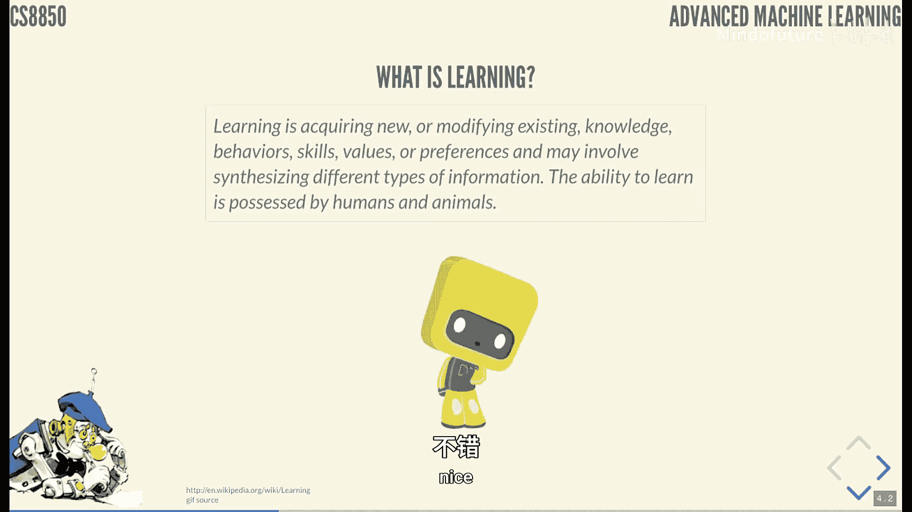
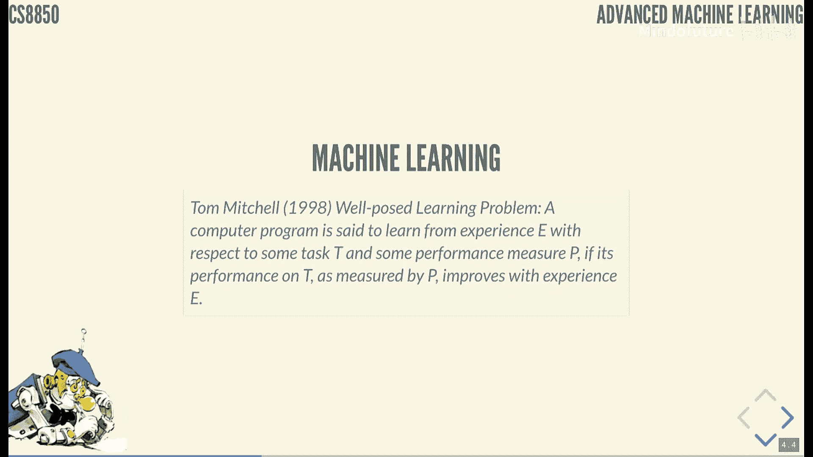
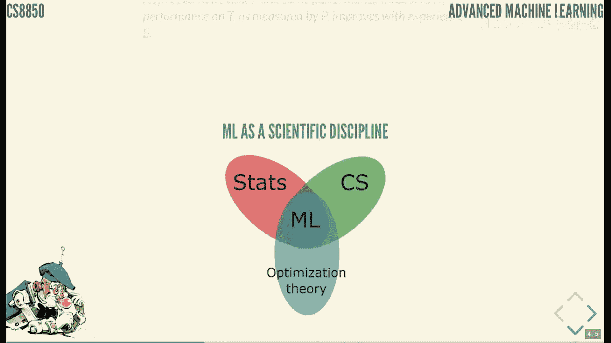
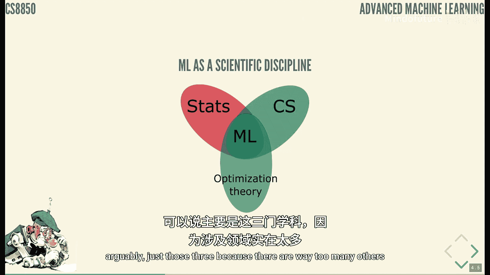
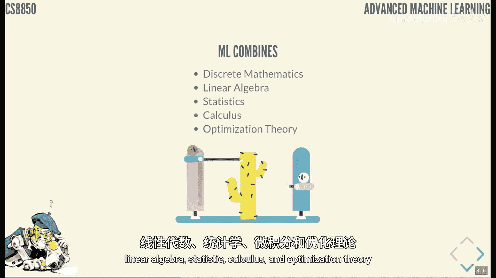
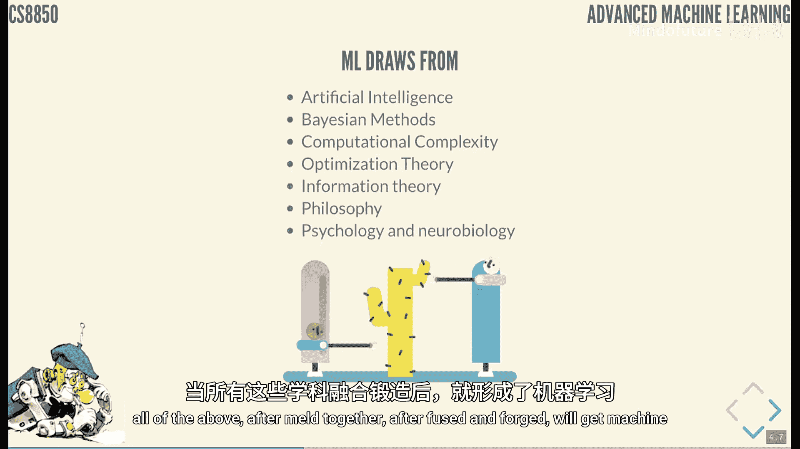
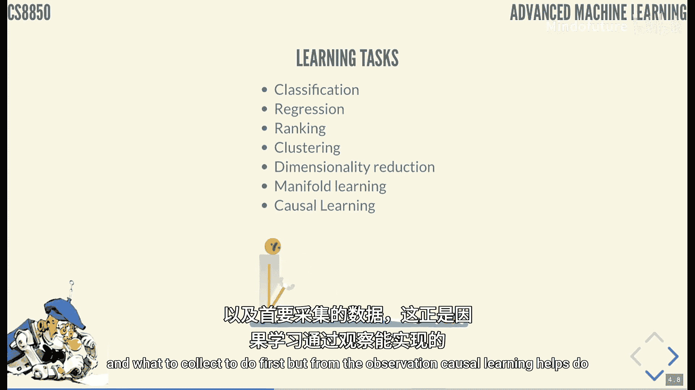
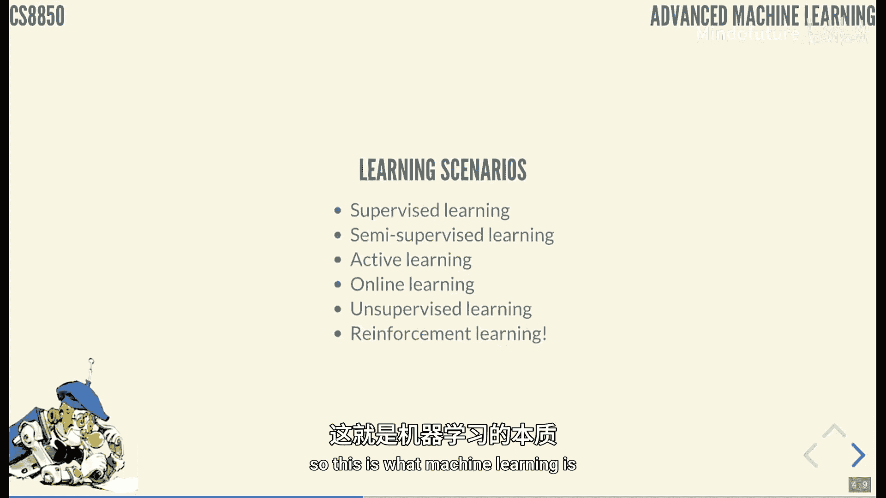

# 高级机器学习主题-CS8850-｜-Advanced-Machine-Learning-p04-P04_什么是机器学习--BV1sapPz4Ewx_p4-

So what is machine learning？嗯。Let's。For a moment， first think about what is learning。As always。

 when I don't know， I go to Wikipedia， a wonderful source and the answer to all my questions。

 Wikipedia says learning is acquiring new or modifying existing knowledge behaviors， skills。

 values of preferences and may involve synthesizing different types of information。

The ability to learn is possessed by humans and animals。Nice。

 I wonder what does that trouble think about it？

So what is machine learning？According to Arthur Samuel 95159 definition。

 machine learning field of study that gives computers the ability to learn without being clearly programmed。

love this。Program versus learn。 What does it mean to learn。What machines。

Here's a definition from Tom Mitchell， 1998， Tom Mitchell is the founder and。

First chair of possibly the only machine learning department in the world， at least in the US。

 I believe that is in Carnegie All。Tom Mitchell says well pose learning problem。

 a computer program is set to learn from experience E with respect to some task T and some performance measure P if its performance on T as measured by P improves。

With experience eat。Good。Does this correspond to what our current algorithms do？

Does this correspond to what we're doing with。Online processing and learning from YouTube video and commander systems and everything。

 we'll find out this semester。

So， machine learning。

Is a data science discipline， in a sense it's a synthetic discipline。

 it lives on the intersection of statistics， computer science and optimization theory。

 arguably just those three because there are way too many others。

Let's look at others， so machine learning combines discrete mathematics。零件啊，这边是。Stistic。Cliccus。

And optimization theory。

At least， at least。As learning draws from artificial intelligence。Baesian methods。

 computational complexity， optimizationization theory， information theory， philosophy。

And psychology and neuroia biology。So all of the above。After meld together。

 after fused and forged we get machine learning。

Some of the people。嗯。Say that machine learning is just applied statistics。Well。

 it's similar to saying that computer science is just applied mathematics or mathematics in programming。

The difference from statistics is that in statistics， the models。

 statisticsisticians are more interested in the models。呃。First define a model。

 then estimate the parameters and then study the parameters and separately because the model is built in a way that it' itself meaningful。

 It's like a physical law or physical model。A simplified version of what's happening in the world。

That's statistics in machine learning。All of the knowledge that humans accumulated in statistics still applies and is very useful。

 but the goals are different。In machine learning。They may。Fcuses not on the model。

 but on the ability to go from data to。Predictions。To figure out。How to behave。

Just roll the raw data。And driven by this goal in machine learning， we study。

Like we don't focus on the models so much， but more on their performance。And that performance。

 because we're。Msachine learning is part of computer science includes computational complexity includes。

Ability to work on limited resources， ability to handle large data sets。With large clusters。

 large computational resources， but nevertheless。And ability to get from the data to。

A program essentially to learn a program that will execute in the wild。So what are the tasks？

That machine learning phases or what are the learning tasks that machine learning deals with？

One is classification。That is even。A bucket of entities。

Take them out and put oranges on the right and apples on the left。Decide which one is an orange。

 Which one is a app。Regression。Regression is more about predicting continuous quantities。It's。

Say look at a picture and estimate an age。Like the person's age who is on the picture， Powell。

 are they？That would be a regression problem。If you do the same about the weight。

 that is even better regression probably because the weight is truly continues。ほら。

We matter the age in years， we usually don't estimate age in seconds how to match what the regression problem deal with。

Another program or another learning task is ranking。Rrananking is by observing people's。Preferences。

Can an algorithm figure out。Which movies they were？

Like more in which less and sort them by the ones that they will likely enjoy。

Another ranking problem is our web search when you type your query。In the search form。

Which results to show first， which results to show next， this is also a ranking problem。Glustering。

Clustering is a problem of finding structure in the data without a supervised signal。

 without the teacher telling us anything， or maybe with some supervised signal but then。

呃For a different leadership。Another problem is dimension Uniteded action。Well。Imagineな。

Collect genetic information about every person in this class or every person Georgia State University。

 50，000 students， plus professors and plus staff and everyone。

How do I look at the data and the relationships between？

The people in the data set who is near each other， who is further。

 So dimensionality reduction reduces the noise in。Or variability or。Theyuce this。

The redundant or say non variability and projectss in a sense， sometimes not linearly。

The data to a lower dimensional space。Where it's easier to analyze。

Or if that space is two dimensional or three dimensional。对个 look感。Will touch the methods。

Another one is manifold learning。This is helpful to one of them。Examples are one of the vacations。

 compression。Manyfold learning would be for data that leaves on some。

Multidimensional manifold instead of occupying the space， multidimensional space uniformly。

And yet another one learning space causal learning。Becauseuse learning is about。

Figuring out the relationship。Relationships。嗯。From observational data。

So if we are observing data from the world， can we figure out what causes what if we measure from sensors？

诶。Some process。Some phenomena in the world。Can we run and out and establish relationships。

 for example， we measure two quantities， temperature and height。嗯。Just the。Yeah。

 temperature and I'd say just this two， can we establish or maybe we could do temperature and pressure and can we establish the dependence between those two are actually causal in？

Does。Pressure cause height or does height cause pressure。Of changes in pressure。

So this is causal learning and that could be useful。Again， starting with our philosophical task。

If we send a robot to a new planet， the robot is expensive， if something breaks。

 it's even more expensive because we lose the robot with it's unlikely we can send a repair crew。

 so doing experiments and moving around，Randomly studying the surroundings is expensive。

So it's better for the robot to first to sit still， save energy and hardware and just observe。

 collect the information from surroundings， and establish first rough model of what's going on around and which experiments where to go at least and what to collect to do first but from the observation。

 causal learning helps。

Good that。So what are the learning scenarios that those learning tasks exist？Here are a few。

 One is supervised learning。 One is supervised learning。 It's when。

There is a teacher and the teacher shows an example。And。Gives an explanation， usually a label。

for example嗯。Here's an animal， an animal， this animal is a cat， here's another animal。

 this animal is a dog， so that's a teacher with a supervised signal， this is supervised learning。

Settings。So semi supervised learning is that。When there are lots of observations。And only for some。

 the teacher gives the signal。For example， there are lots of books online or lots of comments online。

Let's take the comments example， comments in the movie database。

 and only for some of them we know if it's a positive comment or a negative。

 the other comments we have to figure out from the context from the wording of this of those documents。

 this is Se provides high learning。Active learning is a setting in which we can request or decide which experiment to perform what to measure。

 so we collected some data。Which is usually expensive， learn something。

And then we can from what we learned or from。The kind of mistakes we make on the data that we have。

 we can figure out what we don't know and then instead of collecting any kinds of data。

 we should collect only the data that will improve our performance。

On what we're doing wrong right now。That we improve a little and figure out new weaknesses。

 maybe we will reduce the space of weaknesses maybe。

We will discover new weaknesses always and keep exploring and collecting the data。

Another one is online learning that is when information is。Just streaming at you。

And you should learn as you go， or the algorithm should learn as the data comes through。

 magifying the behavior online， usually， and right now the most successful algorithms that we're dealing with are offline。

 say deep learning。Colllect a lot of data， train your model， scratch the data。

 freeze the model weights， apply the model。Even if you put it into online settings。

 the model doesn't learn anymore， it just does inference。

 makes a prediction on every new sample that is coming at it。If you need to improve it。

 you just retrain but the online learning strives for algorithms that learn as they go。

 anytime new information comes in， the algorithms should improve。

Another one is fully unsupervised learning。Is when there is no teacher signal at all， just the data。

 clustering is one example of unsupervised learning。But。Like in general。Humans。

 when we grow from babies as kids。Largely our learning process is unsupervised。

And by just observing a lot of data。While it is tricky and manipulating it。

 which is not considered and supervised， we learn a lot about the world with very sparse。

Supervise signal from the teacher。Parents or surroundings where some kind of a label is given to this and that a currently popular and very interesting subfield whenupvised learning is self supervised learning。

It's like self play。Why it is becoming popular or becoming popular， there is a reason for that。

The field recently has perfected supervised learning algorithms。

B propagation that we will talk about and gradient descent。呃。They're so effective。

That if we could use them， it was the original thinking if we could use them。For。

SFor unsupervised learning when we have the data， but we don't have any any label necessarily。

And then we could extract。Lots of knowledge about the world structure without having any particular task。

For example， in natural language processing。If we can make the model， predict the next world。Sorry。

 if we can make the model predict the next word。We have abundance of labels。

Even though we didn't involve any human inter labeling or any teacher， so when we convert。

An unsupervised learning problem into supervised that's called self supervised learning in that is not there。

So another settings or learning scenario is reinforcement learning。Is when。

The model has to decide on a sequence of actions while it's going through the environment or through the world with its states。

And the learning signal comes sparsely in the forms of yourards。

And sometimes your words are negative。Which is sort of a punishmentishment。

So this is what machine learning。

Is。