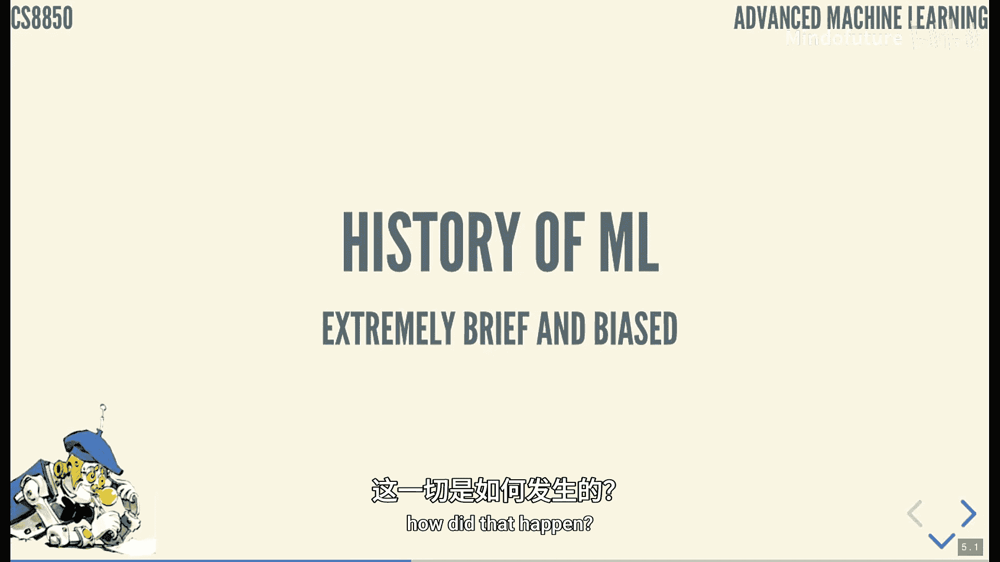
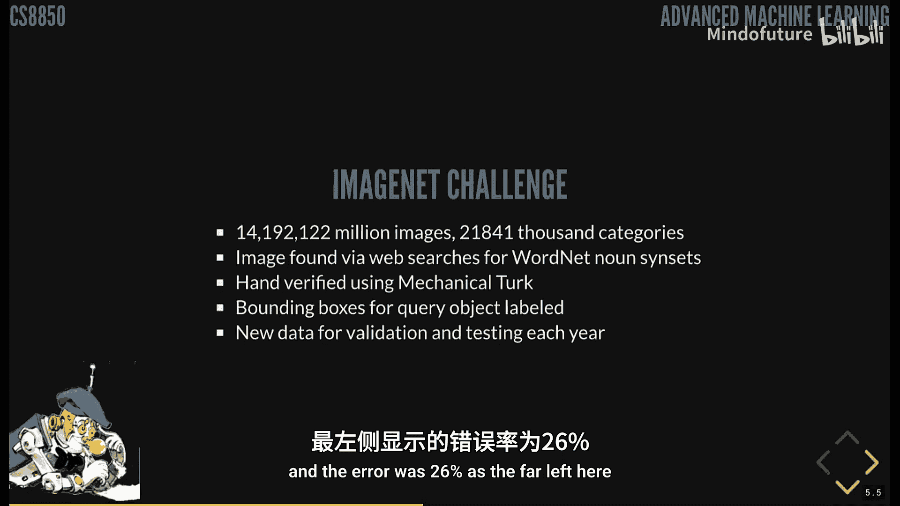
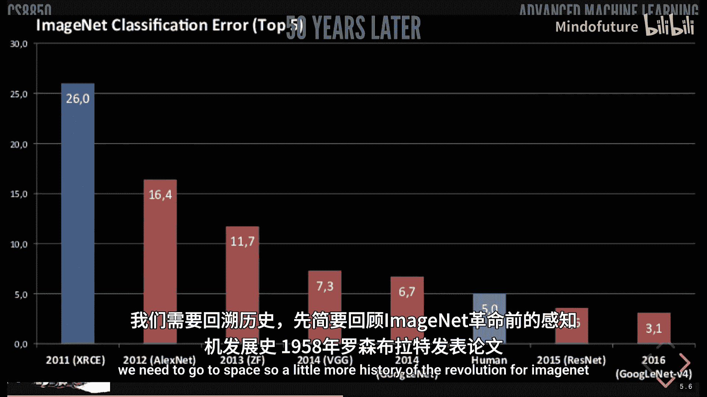
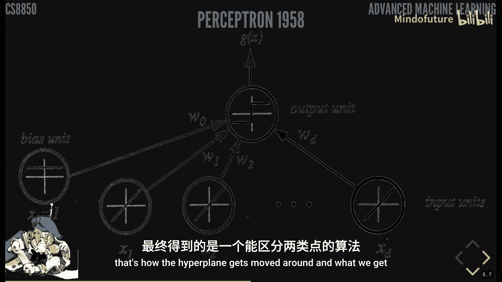
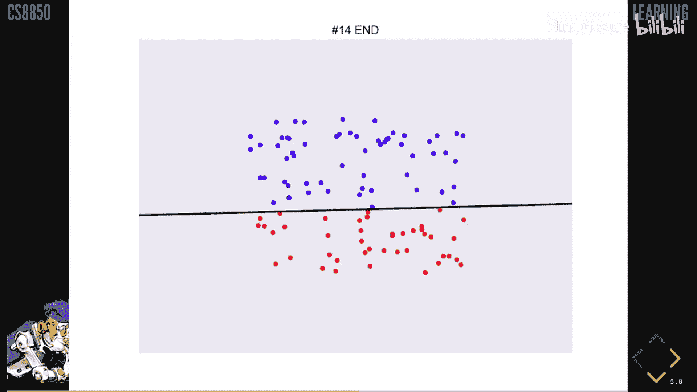
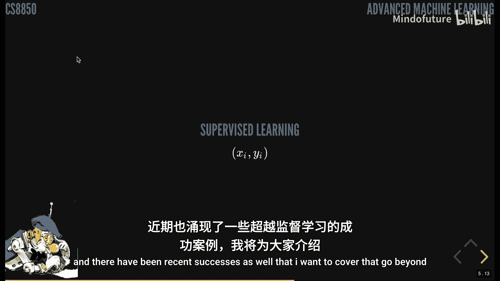

# 高级机器学习主题-CS8850-｜-Advanced-Machine-Learning-p05-P05_机器学习的历史--BV1sapPz4Ewx_p5-

Okay， statistics， optimization theory， and then fear of losing jobs to all robots taking all the world and all of that。

How， how， how did that happen。

How did we get to this point？Well， let's try and。C， notable urban legend， 1966。Marvin Minksky。

 that's how Vi goes， Marvin Minsky， MIT touring Award winner of 1969 in three years after this。

 hired a first year undergraduate student and assigned him a problem to solve over the summer。

 connect a camera to a computer and get the machine to describe what it sees。Well。60 years later。

 we can claim we solved the problem。But as everything goes。

 this is just an urban legend and in fact it wasn't Martinvinnisky。

 it was Simon Peard and hired a team of 10 students and there is online if you follow the link in the slides down below。

 there is an online。Explanation。Of the program of what needed to be done。

 But that's basically the computer vision problem。computeruter vision， a research program for。

Somemer that took computer visual 60 years to realize。Thanks to the recent development。

 But this is not uncommon in。In anything computer scientistss do like this XKC's E tells us when a user takes a photo。

 the app should check the'。The customer says when a user takes a photo。

 the app should check whether they're in a national park， the programmer sure easy， a GIS lookout。

 geoinational system， give me a few hourss。And the customer says and check whether the photos is of a bird and a programmer。

 well I need the research team and five years， five years， okay。

 sometimes it's 60 years as a just so in computer science it can be hard to explain the difference between the easy and the virtually impossible。

So what helped image that challenge。Feifei Li， a professor at Stanford， N her Group。Ha established。

Store of labeled images with 14 million images and about 22。

000 categories for each image and establish the competition。

All of the images were found by web searches for World net nouns Ss。

Hand verified using mechanical torque so people looked at everything and labeled everything。

 bounding boxes were provided by the organizers and by mechanical torque I assume for query object layer that were labeled。

 for example， not just okay， there's a bird in the picture but also okay in this bounding box。

 the bird is in the picture。And new data was added for validation each year and the competition was running for a while and the error was。

26% as on the far left here or around 25， 26， maybe 30。

 it was slowly year by year by percentage point crawling down in 2012 Alex Krezevski。

 a student of Jeffrey Hinton，And Toronto University published this paper， Alex Ned。对吧。

It wasn't called AlexNe， it was just the CNN， basically the story goes that Alex convincednes。

Jeffrey Hinton to start using GPUs and he called it up GPUs。

AGBU implementation of a convolutional neural network and was running a classifier training on INe data set。

 so in 2012 they published a paper and took part in the INe Comp。

 well that was 50 years after the 1966 computer fussion task given to a single student the Ur Legend Code。

But。This Alexnet paper almost half the error right， so it used to be 26% the error and it became 16。

4 so that's a huge drop and it did get noticed since then since that moment what happened is。

Alex and other people at Toronto University from the team established a company outside of the university to。

Put intellectual property into and Google and Microsoft start。

Piaging for that company I started a piing work in the end， Google won。

 but it prohibited the people in the company， it practically was an equi hirere， they hired people。

Like graduate students who just graduated Alex Kushevsky。

Included the work at the Google in the Google Brain division。

And the price that they paid was so high， they told them not to disclose the price。

Well in anys that was an explosion in the industry of deep learning of course people were working hard on neural networks and other things and on machine learning as you know since the 50s but industry successes were。

Veryddingable。In any case， since Alex said， the CNN that TX used was invented in 1998， by the way。

 not in 2012， so we all are standing on shoulders of giants or。On a tower of many。

 many lemings like H， like ourselves， right like myself。But the point is that by 2016。

In it's just four years， this says nothing on geological timescale， but by 2016。

 the error from 26 in 2011。It got to 3。1。Google net V4 so lots and lots and lots of things have happened since then and we will cover some。

 but most of them are attached to conventionalvolution neural networks and architectures and large scale computation。

 but anyways it's a huge change and its。Large。Shift tectonic shift。

 I would say in industry where words like AI became commonplace and it became。

Customary to talk about the hoers replacing humans。

Which actually we can do like I worked in industry at a company for a year replacing a lot of human labor。

People accompany company yes， was hiring a fleet of human。

Rators in India who were looking at a bunch of medical documents one by one as they stream from f and labeling accurately different points on the documents like patient provider dates and。

All other entities and putting them in database， and that was a tious and expensive flavor because people had to do it。

So in a year of work with a team of five people， we were able to animate it almost completely。

 just with some current cases， maybe 5% current cases left。So the fears。4。Jobs that are。Not creative。

 Don't require thinking are real。 and if you are planning。For a job。

Where you would just use your visual system and never think or invent anything。

 then maybe you should reconsider your career choices。

Because people like me and my graduated students will try to automate those jobs and I hope you will get excited enough by this class that you will try to atmate those mundane jobs so if humans can work on more interesting。

 more challenging and more useful tasks， remember the first slides we need to go to space。

So a little more history of the revolution for Inet Perceptron。

 958 Rosesnbl published a paper where this simple linear。

Threshold pifier was introduced and it's just a sum of the inputs with an additional bias term。

Our bias。Input is always one。 and weight is what changes。 That's how all they。

Hyperplane gets moved around and what we get， we get an algorithm that is able to separate two classes of points。

 if the linear separating plane or line in this case exists and so those are actual iterations of perceptron convergence algorithm move will cover this algorithm in class in great detail。

And then immediately people started talking about stacked perceptrons if we can。Conect个。

WeMultip partsrons into super network。Then we cant solve much more complicated problem because immediately after introduction of the perceptron or very close。

Since Marvin Mininsky and Simon P published a book called Perceptrons， where they。

Proved that perceptron is unable to solve certain large classes of problems。

Like X or air problem or X or。And well， patternss a problem。呃。So。

The networks with stacked perrons are able to solve all of those problems and a modern version of those。

Sed Perrons is the deep neural net that you all probably heard about if you don't know how to how to work with it。

 other one on the picture is。Feed forward， so calledled feed forward neural network。

 And it's just a bunch of linear transformations followed by non nonlinear areass pointwise non nonlinear areas with。

Itsyorical， I guess output， but it can be a regression as well。

Thevol network is a little different in the sense that。It introduces an inductive bias。

A specific conductive bias。For images。Assuming that images contain translation invariant pictures。

 for example， if there is a cat in the picture， the cat is a cat doesn't matter if it's in the upper left corner or lower right corner or somewhere in the middle。

 the same we could say about edge detection， the edges you know counter。

Clockwise edges or vertical horizontal edges。There's still edges and no matter where they are in the picture。

 so interestingly， there's inductive bias biasing the whole model to images。

Has recently been shown to do surprising magic that if you take a fit forward network and and images and try to classify them by not training by simply randomly initializing fit forward network then you get garbage out。

 but if you carefully randomly initialize a convolutional neural network without training you still already from the beginning can get good accuracy。

 so another thing with convolutional network at least the one on the picture。

 and I think this one is pretty close to AlexNe。So that won in 2012 for Inet competition。

The interesting part is or two parts。Al right。We have。I'm trying to write on the on the screen。

 but it。I。Maybe next step。But what I'm trying to say is look at this。

This part is fully convolutional， it only consists of convolution layers。

 but then it is followed again by feet forward effort。

 we will talk about this part closer to the end of the class that you don't always need feet forward connections here at the end。

You may get by with just the convolution art or fully convolution for some networks。

So that's one type of inductive bias for images that have spatial correlations。

And spatial structure inherent in them。But there are also time series and sequences such as speech。

 such as text， language， and many， many other sequential data sets。Time series in science。

As well and here comes Recurrent neural network RN RNNs are super powerful tooling complete machines they can do or they can compute anything computable basically and in theory can solve。

All commutable problems。They just may not always be the most efficient because of the recurrent step the next。

Step of the computation can only be completed once the previous steps are done。

 unlike convolutional neural networks where everything can be parallellyzed。But still。

 the current neural networks are。Important model and powerful model。

 we should never overlook their power even if transformers or any other neural networks。a。

At the end of the day seem to be more powerful and seem to be solving。Or dominating into at least。

landscapescape。The trick about everything that I just told you is that。All of those successes。

In industry。At least and some in academia。Can be attributed purely to supervised learning。Since 2012。

 an acquisition of the company with。Alex Krasevski and Jeff Hinton。含。Of what we have。

As the field perfected is supervised learning， of course， many。

 many other attempts and efforts are created like variational Gs for Bayesian optimization like。

V auto encoders like generative adversarial networks and things like that。

 but still the best thing that we can do is bad propagation and supervised learning when we have x subi for each sample。

 the data and we have Y subi un labeled for this sample。

There is more dimension learning than just supervised learning and there have been recent successes as well that they want to cover that go beyond that。

