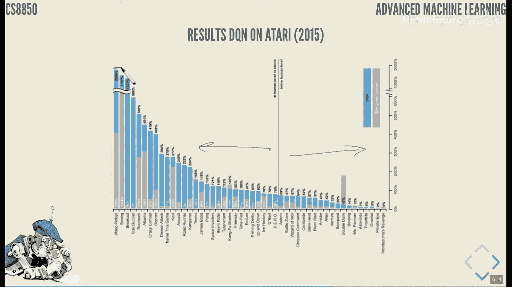
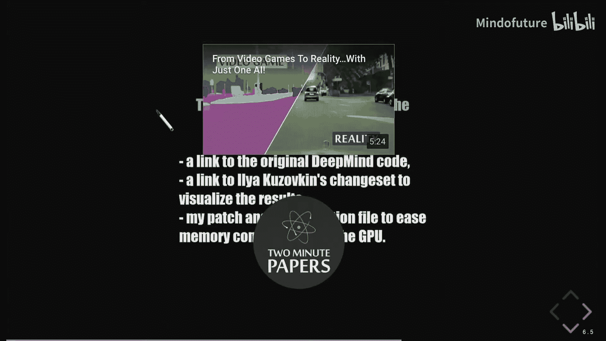
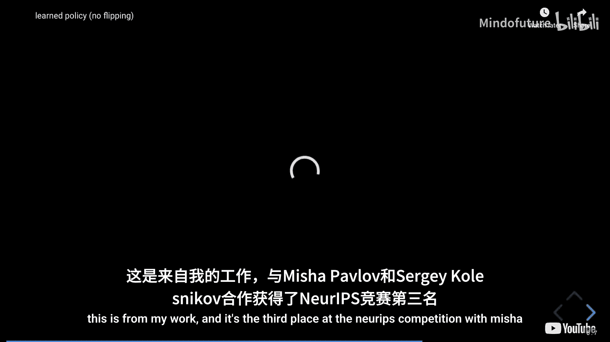
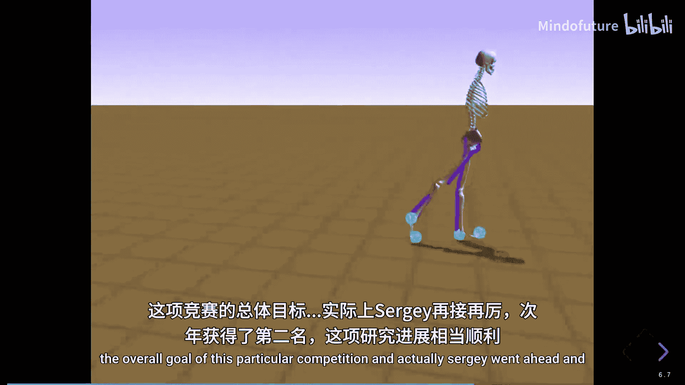
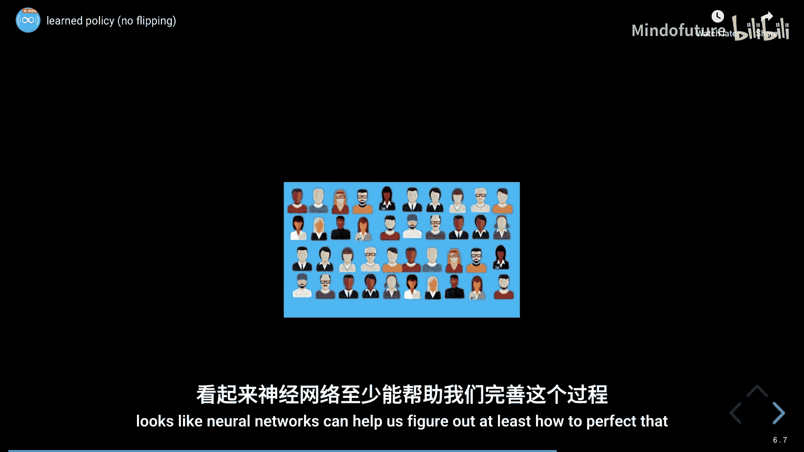

# 高级机器学习主题-CS8850-｜-Advanced-Machine-Learning-p06-P06_强化学习--BV1sapPz4Ewx_p6-

No， another。I would say big surprise of the recent time that。

Worth mentioning and our story would be incomplete。Without is reinforcement learning。Yeah。

 so reinforcement learning has existed for a while and a book by Sa and Barto was very popular and at one point maybe 20 years ago。

 it was an area of research with Markov decision processes。嗯。Well not lots of stuff。

 but then eventually similarly to deep learning more neural network。

People get tired as we get tired of everything if that is not fashionable anymore。

And kind of moved on from reinforcement learning。Apparentlyly not everybody。

So reinforcement learning considers。Learning problems slightly differently， well。

 actually very differently if you think about supervised problem。Because in a supervised problem。

 you only。You or your algorithm， the brain， right， is only shown。咁 this先いやオケー。呃。So。

This is our algorithm and it's only shown。An example and then say a label comes here。

So in that example， what should the output be in example， what should the output be？

In reinforcement learning， the situation is different because。

The output is the action of an agent in the world。And the way the world responds that the action in the world changes the state。

 changes the world， and agent gets to observe the change of the state or the world。

As a result of the agent's action and also the agent gets to observe reward。

 which can be positive or negative， so that's reinforcement learning in a nutshell。In 2015。

 I believe。嗯。Not。I'm very famous yet at the time， but already quite known for some of their publications and for acquisition by Google。

A British company called Deepig Mind started looking at the problem of playing At games。

 playing it from the screen。Of。They can hear there。Just input is the visual。

 the state is just this the pixels basically。And another additional input is numerical。

 even though this picture shows graphics for the number。

 but the computer was actually getting number and the choice was the joystick。

 what do you do with the joystick if。Show that their system here is again。The input is your image。

 then it here goes the conal neural network。 let's replace the whole brain and the whole decision process with。

The convolutional neural network followed by fully connected layers that make decisions about where to move Josic。

 up， down， left， right， south， north， whatever， button pressed or no button pressed or don't do anything and once the system does it immediately it。

Obsserves the changing the world。 Let's train the system by。Proropagating the score。Or。

Trying to maximize the score。And what do we observe or what did they observe， actually。

 if you look at a multitude of a third games written over the years。Deman manage to demonstrate that。

Thanks to convolutional neural networks， thanks to deep learning， and end to end training。

 we can train a model。That can play all of those games with various accuries and most of them or a lot of them with superhuman accuracy。

So this is below human level play， this is above human level play and some really above human level。

哦。

So let's see how does the system work， let's just watch for now。

So the algorithm will play a tight breakout the most important thing to know is that all the aging is given is sensory input what you see on the screen and it was ordered to maximize the score on the screen as I said。

 Now the main knowledge is involved this means that the algorithm doesn't know what like there's not any additional information so10 means of training。

 the algorithm tries to hit the ball back。咩？Not the good right。But it's trying hard。Poor。

 poor algorithm。Okay， much better。 getting better there。So look。This seems trivial but。

The thing to note to observe is that all that the algorithm C is sensory input just the pixel， okay。

 240 minutes of training half a day。What what it does。A click， look what it's figured out。Look。

 it' figured out how to make a tunnel。And。

え。So another interesting demonstration of what they did。Is sequest。

So why I'm showing it to you because it's very interesting， the algorithm Cs quote unquote。

 remember the 966 talk 1966。Taskk about computer vision by Simon Po。Same bumpers， sorry and。

What the algorithm see is just 480， 520， the score is given numerical the rest。

Is given us an image and look， it's figured out to go up and get oxygen。

Without ever getting the medical value of oxygen， just the pixels。

 just the screen and if it doesn't get oxygen， it cannot maximize the score。

 obviously it does and like when the score goes negative for the score goes down。

 that's easy to say oh of course that's supervised learning or whatever gradient in descent。

 but look here a different type of magic is happening because the algorithm is more powerful than。

you know， whatever simplified assumptions you can make about it and that's fun。

 that's a good start that eventually allowed Ze to create Alpha Go and win the world champion in go and then create Alpha zero and surpass everything we could imagine about go playing or chess playing or any of that board games。

And then。What was next alphapha master， I think， no alphapha master was in between well anyways。呃。

Those are the advances previously unimaginable。WithWithout the learning and that added to trans learning。

 So another another thing is。This is from my work and it's the third place at the Newris competition with Niche Pblo and Serge Galesniov they've done most of the work on this。

 the task was to train a model that is able to manipulate the muscles of that skeleton to work as far as possible。

And as you see， it's still not working quite。Human like。

 but it does work and which is amazing so then。Overall。

call of this particular competition and actually Sergei went ahead the next year and got to second place and yeah doing quite well with this research。

But the goals of the enforcement learning or operating in real world robotics we could better understand our。

like recovery over our body after surgeries， if we understand how learning algorithms work on the muscle level because one thing is to formalize an algorithm of how to multiply numbers。

 another thing is to multiply how to learn to walk or how to formalize an algorithm how to learn to walk。

 we're still unable to do that。And I don't think we need to looks like neural networks can help us。

Figure out at least how to perfect that。

