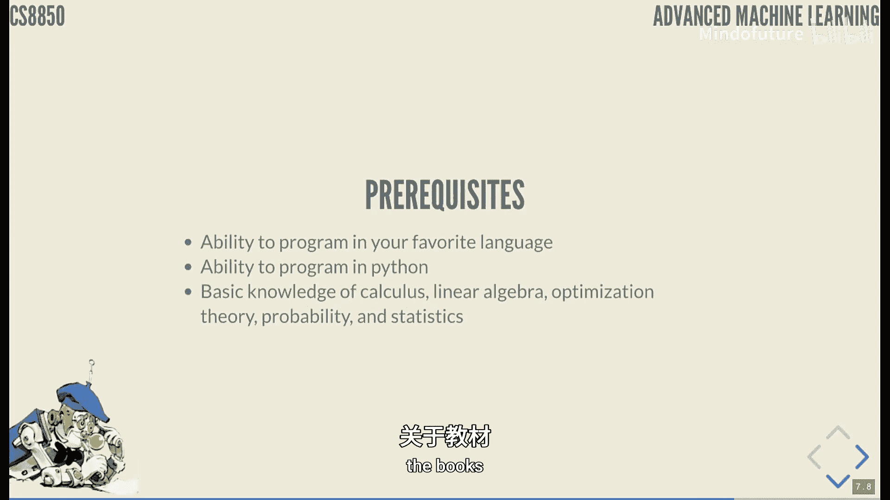
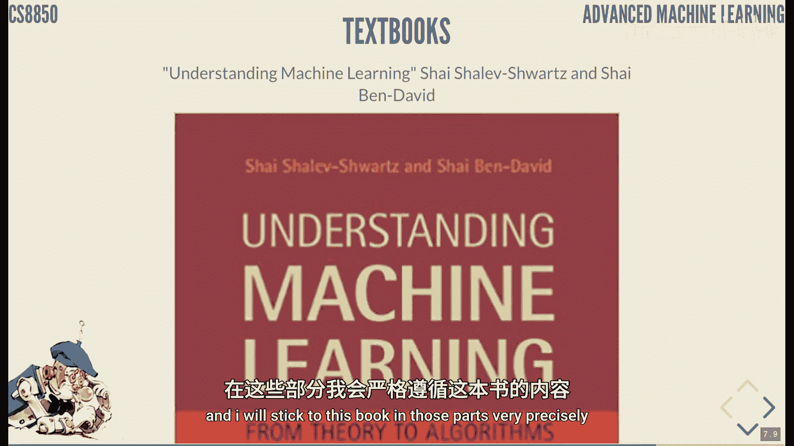
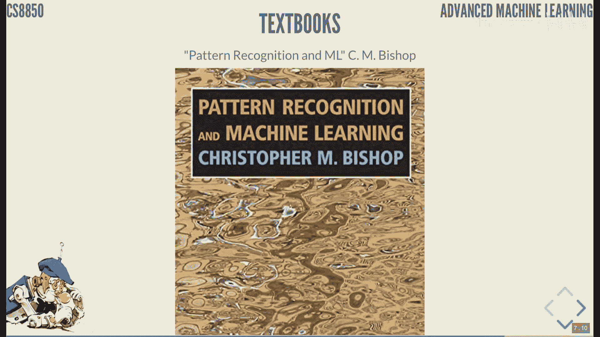
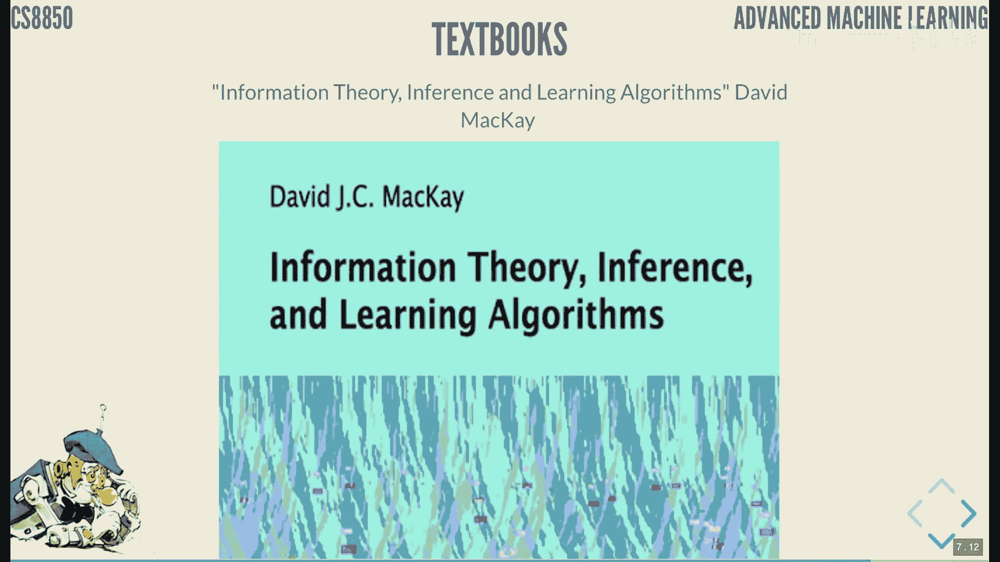
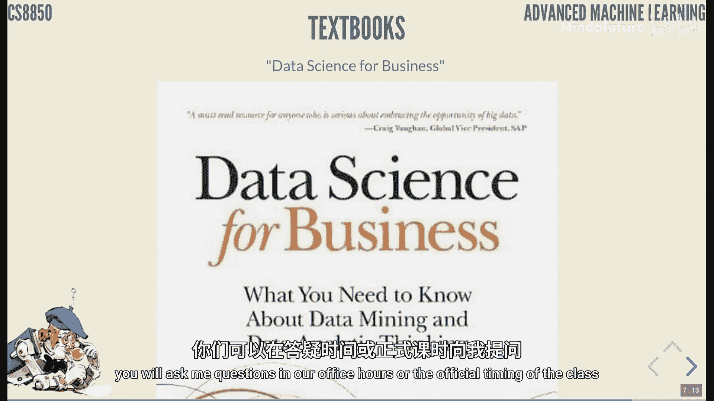

# 高级机器学习主题-CS8850-｜-Advanced-Machine-Learning-p07-P07_课程概述--BV1sapPz4Ewx_p7-

Enough of the history now。What we will do with it， the course overview。What will we cover？

I'm planning to go over basics of the learning theory。

So we can understand what is learning and how we address that in。National learning， specifically。

And we will also go through。And I this subjective choice of most important or maybe more advanced algorithms that I think you need to understand how they work in order to understand how to reason and think about other learning algorithms。

And here and there， I will sprinkle some information about what the field recently learned on top of the classical level classical machine learning approaches。

 which includes。The revelation， you probably who came to the field just recently。

 SGD or stochastic gradient indescent is all you know about。

 but believe me there were times when it wasn't the winner。

 it wasn't the only or not even the favorite algorithm to use for optimization of functions。So。

Also what we learned recently in optimization， local minima， very bad， very。Important beast to fight。

 but we learn at local minimum in overprometized models。

Are not as bad as they seem when we can always get convergence， then another one is another。

Concept is bias variant and Str of and what we recently learned that just talking about bias variant and Str of and if you nott know some of the terms。

Don't be afraid。If you do all your homework and pass all the quizzes。

 you will eventually get lectures that。Where I will talk about all of these concepts that I mentioning here。

So bias very trade off turns out to be an incomplete story and well another one that I just said is that reinforcement learning。

Is not quite that probably I'm not going to talk about reinforce learning in this class unless we cover all the materials pretty quickly and。

I have a few lectures or I lecture left。But still， it's good to know about maybe you will be able to use reinforcement learning。

In your project， because the class is structured。such that there are a few learning possibilities。

 which I will talk about in one of the next slides。

 so if I were to throw all the basic foundational algorithms on one slide，I will do it this way。

 So what we're going to learn is on the slide。Well， we'll spend quite some time。

Musing or talking about。What is learning？怎么か。Right here， yes， we'll spend some time。

Talking about this learning theory， as I said。And we'll cover。Various learning algorithms。

Perceptron logistic regression support vector machines in quite greater details so you understand the principles behind linear models。

We also talk about optimization learning or optimization optimizationimizing parameters。

 gradient in decent， maximum likelihood， maximum of postiary map estimation。Well have an SGD lecture。

 and we'll talk about。The powerful gradient and computation that all of you who have ever used any deep learning packages frameworks rather。

Such as bytorch or。TsorFlow， and of course I recommend using Ptorch。

 it's much easier to do researching， but if you're in the industry and only running what somebody else developed for you。

 of course use TensorFlow， it much more optimized。For industry applications。

 but how the purpose of this class。And probably it's important to mention。

Don't expect me to teach you programming， Don't expect me to teach you a Lego like okay。

 combine these things and。You will get the result This is kind of maybe a good undergraduate tutorial class that would teach。

All of you are doing。You know， putting things together， cutting pasting from。

Stack overflow and getting your code run and then falling flat on your face。

 the first mistake appears， and then you have no idea how to debug it and understand what's going on。

I'm not going to do that， what I will try and my hope is that you walk away from this class understanding some of the basic principles behind modern machine learning behind what is working in industry and in various research applications as well。

So because I think that knowing what's going on behind what drives the decisions。

 what drives the failures of the algorithms。Is very important for your。Ability to solve problems。

And the more。Like the stronger， you'll grow as problem solvers。

The better chance you have at building a。Good career。

 a successful career in the industry or in academia， and of course。

 machine learning problems are only one kind of problems and。

I just have to say to my defense that I won't be able to teach you to solve all possible problems。

 but we'll try。For example， in the project。One of the problems that you will have to solve is actually people's problem。

 how to communicate with a team well just let's talk about it a little later。

 So then in this class also。How to work with the data。various major specization， algorithm。And then。

 we'll talk about。Various models for modeling data sets， such as non nonlinear beings。

And various classifiers and kernel denities estimate to meet。Is important， excuse me okay。

Here's an overview。Lecture by lecture so what will happen and I need to repeat that again if you didn't read my email。

 but I hope you did。And I hope you listening to me right now will send me your nicknames for reporting your grades。

One of the things， like there are several components and we'll come back to them in the next slide。

 several components in the test column right here。嗯。Okay here， so one is Q quizzes。

Another one is homework。And another one is project and exam。So well have two exams。

And we'll have one project and we'll have， I think， five homeworks。So quizzes。

There's sort of a necessity of COVID thanks to COVID。

 all of this asynchronous stuff you will listen to my lecture。AT leisure anytime you like。

But in order for me to make sure that you do listen to the lecture and I don't waste my time recording it。

If you don't at least you know the material I will give you light quizzes well first of all it'll ask questions just about what this simple stuff。

 nothing in depth， it's not an exam， it's not to solve something it's just did you attend the class sort of thing and also it gives me an opportunity to put Easter eggs。

 for example， I could ask。In the quiz。What plants did they draw in the lecture？And。

Multiple choice would be a tree， a bush， or a flower and。Well， yeah， that's fun。

 I can insert Easter their eggs。嗯。Only for that alone， it's。It's a good justification to。

Make quizzes necessarily part of the course。This is how the grade will split and again homework。

Work together on the homework。But I will turn on plagiarism system and if you're caught plagiarizing。

 sorry， read the syllabus zero grade or I'll send you to the。嗯。

Department to figure out what's going on， please do not plagiarize， do not copy each other answers。

 just discuss them together homework is your chance to understand stuff and communicate with each other figuring out the problem but not wake up 30 minutes before the deadline and just copy from your friend and hey friend。

 please don't let your friend copy from your work you're doing them bad service。

Exams exams are there， I think we do need those exams they just。Like ideally they would be in class。

 don't use anything， no notes， well notes maybe but no books no sources。

 just some humbling experience so you understand really how much you know。

 but now given the situation of asynchrony I'll think about it exams may be。啊。Sort of longer。

 not timed。Exercises， but I'll think about it。 maybe， maybe not， maybe just。A real quiz。

 like multiple choice or lots of questions write down the answers。

 most likely this is most likely an outcome。And again， homework exams and quizzes。

 they're all about learning。The concepts， the theory。

 understanding the machine learning and having some practical understanding homeworks will contain some programming tasks。

 Python only please。And homeworks have to be done in LEC because。Well。

 it's a grad school and it's an advanced course and there will be a lot of math。

 how else do you express equations， please， please。Lic。But the project is a different beast。

The project gives you an opportunity to。Apply。All of what we talk about and explore beyond the methods that we discuss here in the class。

That gives you a chance to be a little creative， and that gives you a chance to。嗯。

Sort of understand how theory maps the practice the projects should be fun。

 but that it's a discussion， there will be a subsection on the project I will tell you about。

Probably the next lecture， the quiz， the quizzes everyday quizzes or everyday lecture quizzes are binary what does that mean Pione is easy。

 it's thoughtless process you don't have to think about what you're getting。

Or you don't have to argue with me or get extra points， it's easy， less than 70% of questions right。

 fail the quiz and the quiz， no partial credit ever。

Same but said otherwise fail more than 30% total quizzes， then you lose 10% of the final grade。

 quizzes amount to 10% of the grade。And if you lose。四啊。We have 24 lectures。Total。

 that means we have 24 quizzes。If you fail eight quizzes or more， well， actually it's seven。

To be generous to you， let's say if you fail eight or more。

Then you will lose 10% of the final grade the final grade is 100% if you lose 10% of the final grade。

 that means you're getting B or no more than B。So please。Take those quizzes seriously and believe me。

 I'll try to make them。Just sort of notional of what was in the lecture。 Nothing about。

You test of knowledge。呃。Although we'll see how that comes。And one more time。

 no partial trace on the quiz。It's binary well， another thing is relative ranking。

Send me your private nicknames as soon as possible if you haven't done so because it's gonna be fun。

 I do want you to see where you stand early if you're failing like if you're falling behind the rest of the class I don't want you to be surprised I don't want 70% of the class getting A's and you're getting a D and start and in a surprise if you see well apparently not all people see their own problems。

 so that's why。Everyone， send me your nickname that only you know and I will publish a sorted list of your grades as we go through quizzes as we go through homeworks and all other exam assignments and then you will see。

Where you stand and hopefully I'll get some。Competition going， but of course。

Don't get too excited about that， just focus on your own education and complete your own tasks and just try to defeat yourself。

 not your bodiesd around you。Prerequisites。A built to program in your favorite language。

 I assume that the computer science student。Who is taking an advanced course？

Cant program in anything programmable。But it's worth mentioning。

Anything programmable includes Python， so please。Program in Python。Program your homeworks in Python。

 easier to check and we'll just stay at there。You also。

Aquired to have basic knowledge of calculus linear algebra optimizationization， theory。

 probability and statistics。Where will love。I have one lecture。A refresher。For all of that。

 maybe or maybe partially。But。It's not enough if you already haven't heard or haven't worked with。

Each of the topics in some depth。 So please， please brush up if you。

Don't know if any of those words aren unfamiliar or any of those topics are not familiar。ボさ。

I will use whatever I cant just tell you okay here's one book and I will just follow and stick to that one book。

 I will use different sources， I will try to link them for you in my slides so you can click and read and。

so on。 But I will try to incorporate information about latest research as。I find needed。

Although some of the theory will come from this book understandinging machine learning。

 and I will stick to this book in those parts very precisely。

A lot。We come from pattern recognition and machine learning by Chris Bishop， a fantastic book。

 if you don't have it， you probably should。

Some will come from the famous deep learning book by Goodfe Benjo and Kville。Although。

I don't know if you need it for this class I will also take through David my casebook information The In and learning algorithms。

 which is available online as a PDF free of charity if you wanted。

 but I have I myself have a couple of copies。

Hot copies and another book with a cheesy title， but surprisingly good。

It's called data Science for Business。嗯。So if academic machine learning classes is all that you took and you never actually worked in a real applied project and industry where you needed to solve。

Data science problem。W is machine learning then。Before your interviews。

 if you're thinking about working in industry， you should absolutely read that book。

 I will use it closer to the end of the class， you don't need to have it unless you feel like my description makes you want to buy it or download it or whatever。

So that's it for the class， that's what we're going to use。😔。

In the class that's what we're going to do， I hope that's clear we will find out if it's not。

 you will ask me questions in our office hours or the official timing of the class。

