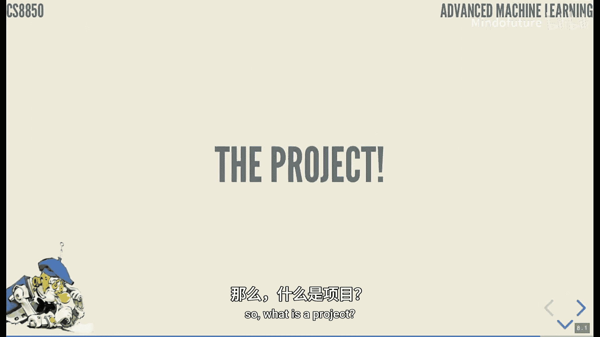
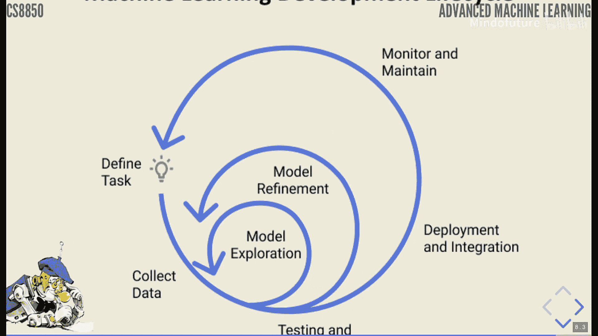
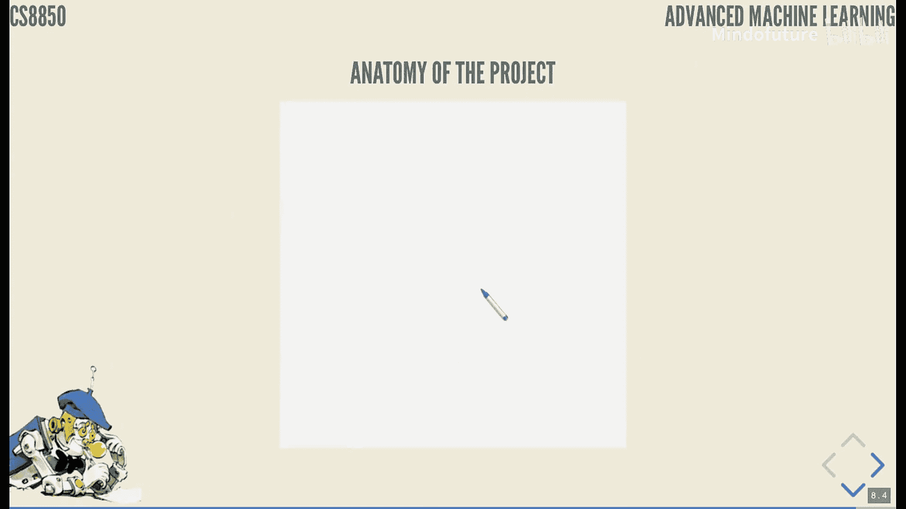
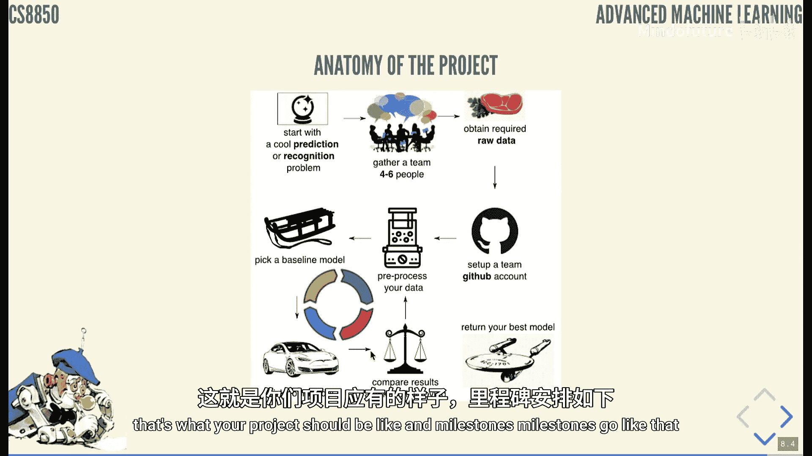
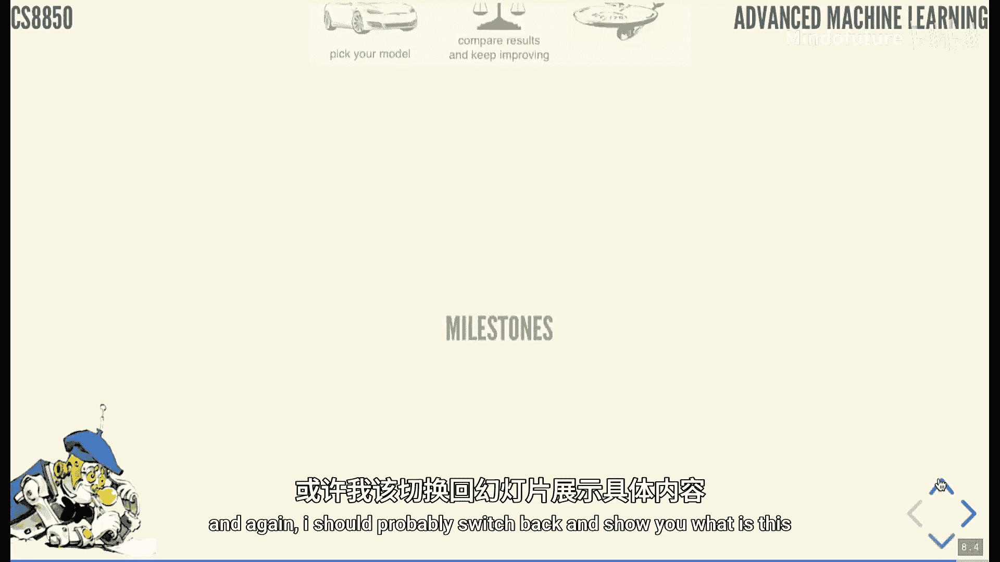
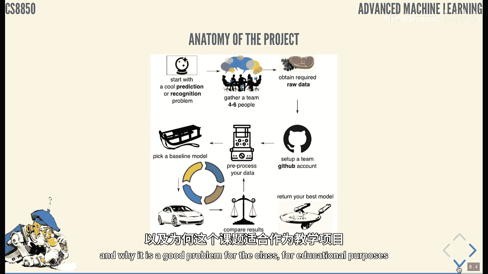
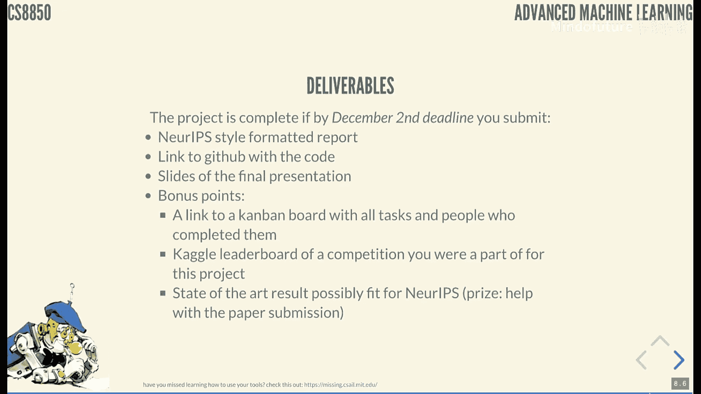

# 高级机器学习主题-CS8850-｜-Advanced-Machine-Learning-p08-P08_项目概述--BV1sapPz4Ewx_p8-

Okay， the project。Why do we need the project machine learning is。So theoretical。So deep mathematics。

And other stuff。Well， interestingly， machine learning is。

Close to natural sciences compared to other well mathematical disciplines， I guess。

 but computeruter science in general is as well。As you know， you're all computer scientists。

Or maybe future computer sciences。That computer science is concerned with the real world as well。

 not just whether the problem is solvable， although that's interesting too。

But whether we actually can solve it in our real physical systems。

So different measures of complexity do matter and different measures of real life complexity do matter for machine learning as well。

 simply knowing knowing about the existence of bias varianceance trade is trade off is not enough to make your project successful。

Simply knowing that you have to have a test trans is not enough to make it work is。

There is a lot of nonverbal knowledge that is。Not easy to learn from the lecture。

 the only way to learn is by doing it。And a project is precisely for that to make you learn by doing and to help you learn something that I will never talk about in the class because there is no time and there is not even。

A way to do that if you're not my student and if I'm not working with you directly day to day。So。

What is a project， what are we going to do？Well， a great metaphor。

For a typical machine learning project。Is lean startup。There is a book by that name。

 you can read that， but there's book。Practically condensed down into very。Digestible form。

The scientific method。And。I don't know， maybe my education。

 my background never directly taught me the scientific method。

 although we learn or hear about yeah the scientific method and that's how you should do it and blah。

 blah， blah but there was no formal training and experiment design in what an experiment is。

 why is it important at least for me and I assume that for computer sciences that's true too so I had to learn it on the job and。

I recommend you to get familiar with the scientific method maybe。

By the surroggateates likely in Start book， maybe by a little more fun surroates such as Harry Potter and methods of rationality。

 and interesting fanf that is written by Les Wg。And hell well。Actually。

 that's a pseudo name and then the website where it was published， but if you're interested。

 maybe tell。Simpst digestible form is the Harry Poter and methods of rationality。But。Basically。

 the idea is constant iterative development and experimentation。 It's on the screen。

 come up with an idea， build something。Something that works as quick as possible。C it up。

Test your good， test your hypothesis。Measure the performance， analyze the data， learn something。

Learn something that you do wrong， make an iterative improvement and keep doing and going through the cycle of experimentation again and again。

 that's what a project should be in other ways。呃。We can summarize it。

The project is about first defining task。Then collecting the data。

You won't been collecting the data in your project， I assume。Because I highly。

 highly encourage you to make one of the ongoing Ca competitions your project。

And the data usually is already there because collecting your own data。

 this will be just a another kill。我等要。Go through the cycle of moral exploration until you get something that works in your testing and then you do model refinement until you're satisfied with the testing results that。

Pformance metrics are good enough， and then you deploy your model。Think about kggle competition。

 you submit your model for evaluation and then monitor the performance let redefine the task and continue now maybe you will need new training data。

 maybe not so in。

Otherello wordss。Yet more other words， anatomy of your project should be like that。

Start with a cool prediction or recognition problem。Prediction。

A recognition problem can be formalized as a supervised learning problem， predicting something。

The future。Gather a team or。No less than four people， no more than six people。

You have to have a team of either four， five or six people that's at no other options。

 the purpose of the project is to make you work together。

 to learn how to work together and that's a huge educational experience I want you to have。

Then obtain raw data。But I already spoke to it。Set up a GiHub account for your team because。

Advanced machine learning class is part of computer science。

 you will have to code even if it's simple scripting and using other libraries。Thanks， Python。Still。

 the code should be in GitHub and it should be clear and available。

 it will be part of your submission。Preprocess your data， prepro is important。

 feature extraction and learning how to represent your data such that the algorithms that you know about or you know how to use are useful。

Or。Can digest that data and make predictions speak of cursive dimensionality and other things I will cover in this class later？

Then。What you usually do and what they're recommended to do here， pick a baseline model。

 just throw together something simple。For example， if you're trying to do some kind of handwritten character recognition problem。

Please， please do not start with the latest paper on archive or nature about。

Casule networks or I don't know， spytop transformers don't dont don't start with a baseline model like I don't know。

 pick up support vector machine， pick something that is very simple that you know how to use you don't care about the stellar performance at first you want a performance because if for your project。

And I stress that because this happened already， if for your project， you select a fantastic。

 difficult。A modelel that you want to explore how it works。And。The moment you get this model to work。

Happens five minutes before the course is over on December 2nd。Then you're in big， big trouble。

Think about the deadline as a real production deadline as a real paper deadline or proposal deadline if you're going at academical route。

 there is a deadline， you cannot risk that by spending a lot of time developing a model that may not work you need to start with something that works already at some level and then iteratively improve the model may come up with a better model。

 compare the results， is it really a better model well you need to know statistics how to compare so you're not misled by noise in your signal and you're going out route by picking out a model that you think works good but it doesn't。

Well， once you compared and chose a better model， maybe reprocess your data a little bit and then repeat the cycle。

 improve the model now your new model becomes your baseline model and you think and test and think and test and。

Improve the model until finally you produce the best model that you can or you feel you can given the time and put it in production that is presented to the class and。

Defend your project altogether as a team。That's what your project should be like。

And。まずス感ツ。Milestones go like that。Deadline September 10th。

 each of you individually before forming teams， if you can form teams before that fantastic。

 that means you have very good people skills and you know who you're going to work together with for the rest of the semester so submit project ideas it's okay to individually submit project ideas I stress that。

Because。Say 40 people in the class。We want to form no more than 8 teams。衣服。

That means if each of you submits a project idea and I shut down。

All but every eighth we're fine right or we'll get enough ideas for。The final project。

 we will have eight good ideas and then people will the winning with the winning ideas will have to。

Convince people to Joe and other people， other members of the class students。

 view to be part of their teams。Deadline for the project， Write down one pager， something。

 your thoughts， Here's my idea。It's a carggle competition。It is like what it is。

 what kind of data set， and again， I should probably switch back and show you。What。

Is this so describe your idea as a prediction problem， what will the data be， what is the goal。

 what are you predicting and。Why it is a good problem for the class， for educational purposes。

All this interesting thing。All this interesting stuff。Then form teams。

 if teams have to be finalized by September 24th。Also， you will， it will be an assignment on Icol。

 you will send me which team you belong to。And we'll go from there now you're ready and you will work on your project and on October 8th。

 the class before the midterm。Each team will have like a 10 minute short presentation of。

Your project， basically。1en minutes is enough to highlight。What the problem is。

What you're trying to do， why you're trying to do that， how you planning to address that。

 if you've started and done something already。You will also present that October 8th。

 that will be your midpoint check in on the progress of the project。Then by deadline。

 which is December 2nd， every team saids a report。Whi is a paper written in a neural information processing system style for machine learning。

 one of the top machine learning conferences。With a little more practical  twist than ICML international conference and machine learninging。

Yeah， that's it， there will be a report。And itll be evaluated and of course。

 to make it fun and interesting for all of that of all of us。Every team will have。Longer time。

 about 20 minutes to present the project to the class。

And we'll divide the teams between1 and second notice December when each one presents and that's going to be a fun event。

Well， of course we will all be at home， but that work works quite well because then everyone gets to ask questions and it'll be like our own mini conference mini workshop if you want。

 we can even make it public for your friends we'll think about that。Definitely going to be fun。So。

To speak a little more precise about deliverables， what will you need to submit？

In order to guarantee yourself a good grade， or at least。In order to。别看着 it。Good great。

 so New York's style formatted report。It will basically be a paper with a title and abstract references and everything introduction。

 what you've done， that'll be a learning experience as well and。我每个例节都 have a b student in your gym。

To take care of that， or at least to help with advice on that， and then a deliverable。

 there will have to be a link to GiHub with the code。

Because what that will evaluate also your bullet request。learn to work with GiHub， how you do that。

 you create a branch every time you want to make a change and then you submit a PR and the rest of your team or somebody in your team every time a different person reviews the O and emerges it。

 so all of that will also be looked at and evaluated。啊。Okay。

 then slides of the final presentation will be a deliverable， they will be stored。啊。唔问系。Hard drive。

 I guess， and in a college。As archival material， and they will be evaluated the quality and。

Performance。So， there's a。Link below。Speaking about Gitthub another app。

 if you feel like you don't know what I'm talking about， maybe。

 maybe you should also read that link missing us at。CSL， MITduU， the slides will be available。

Bonus points， so these deliverables， the initial deliverables， they are required。Bonus wines。

And by the way， in this class， there will always be bonus points， that will always be extragradeated。

 at least I will try to give you problems for extra credit in。Homework in exams。

Possibly quiz like this one， I don't promise quizes just to check here。Attendants。

 just to check that you're not sleeping。Ps pointss is a link to combat board with all tasks and people who completed them because with six people or five people in the team。

 you need to have some kind of means and especially now with COVID with this remote working you need to have some kind of project management tools saa is fine trail is fine figure out for yourself free about it。

 this is also a good learning experience because I want you to all work collectively I don't want one person to do all of the work which is not wise for that person and the project will be poorly done because within one single project usually there are so many。

Problems that。One person will not perform as well on。Compared to a team that works together。

Kgo Leboard。So as I said， highly encourage you to pick an ongoing Kale project for your competition。

 for your project kle competition for your project， so if you win Kale competition。

 which is fantastic。If you develop something scientifically novel。

 this is also good because then we can write a paper。

 I will help you write a paper if it's worthy of submission and we'll submit it to somebody venue。

Maybe neural information processing system next semester maybe to ICML International Conference on machine learninging。

 but that is if you really produce something scientifically novel。For learning。And yes。

 Kaiggo Liboard because you want to win some competition and have some objective measurement。

 well for example， imagine you win a Kaigal competition and get $25。

000 prize and I give you C for your project， well at least you have your $25。

000 prize right so if you just do some other project and get a C without the price for winning。

Kiggo competition that wouldn't be that nice， right。Okay， enough。

 I hope you don't have any questions about the project， Thank you。

