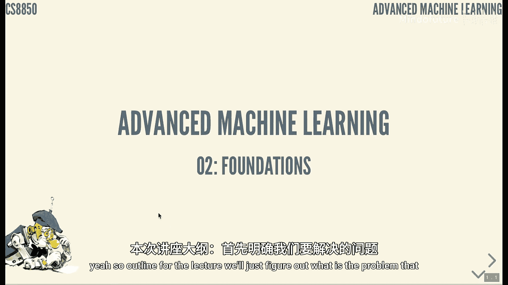
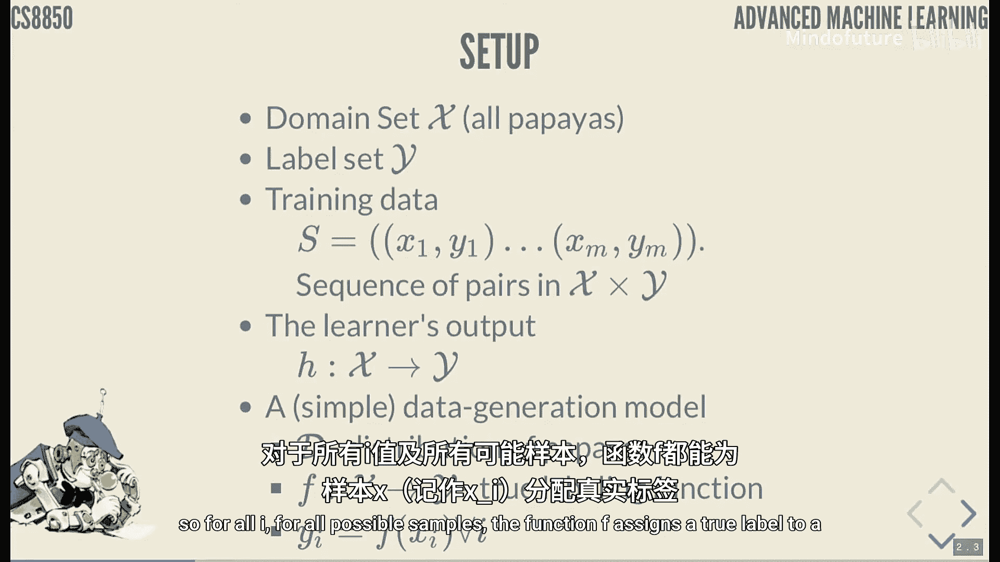
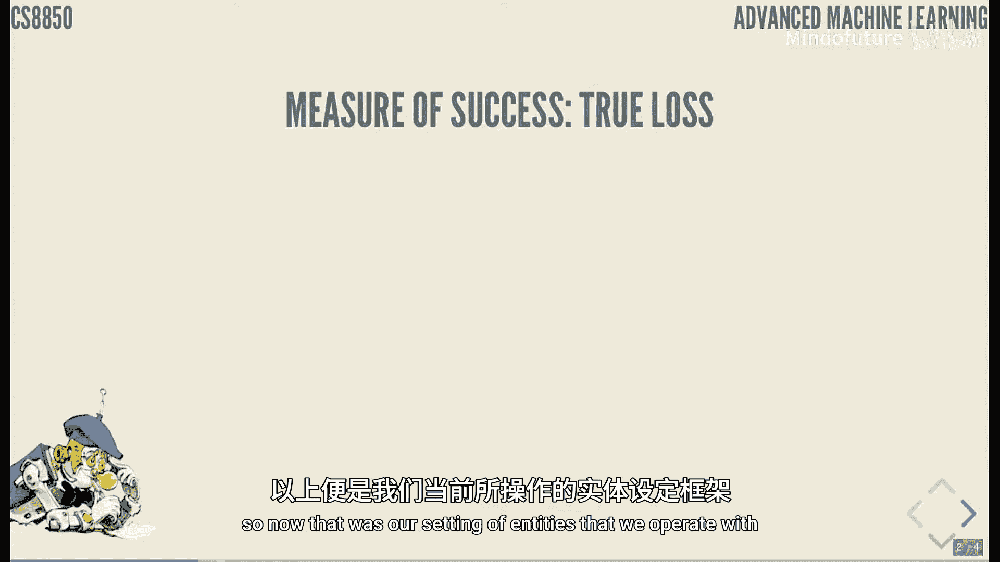
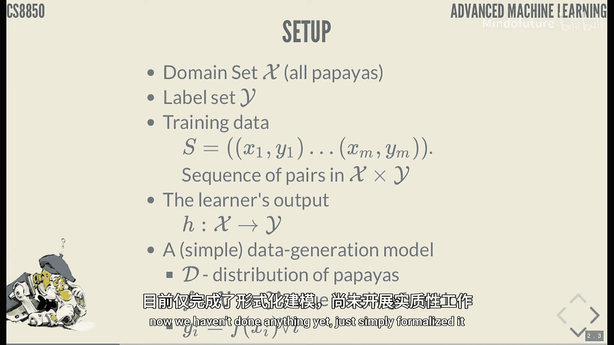
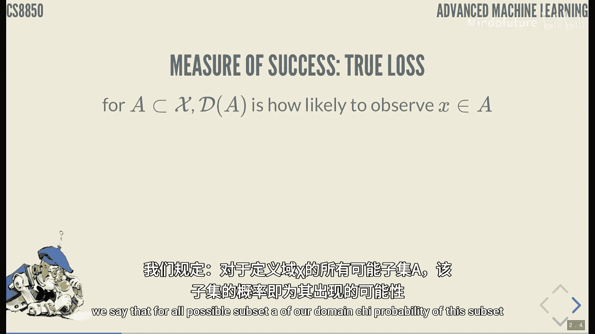
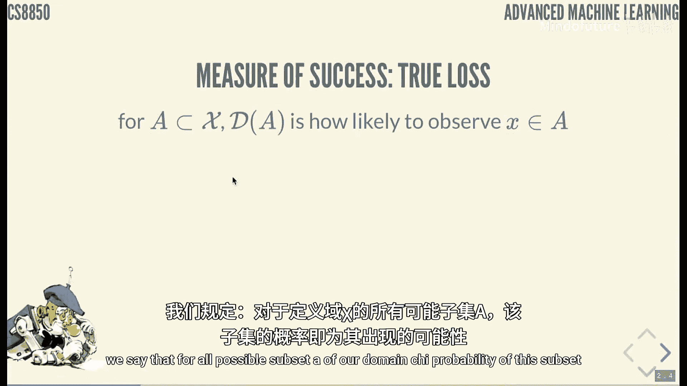
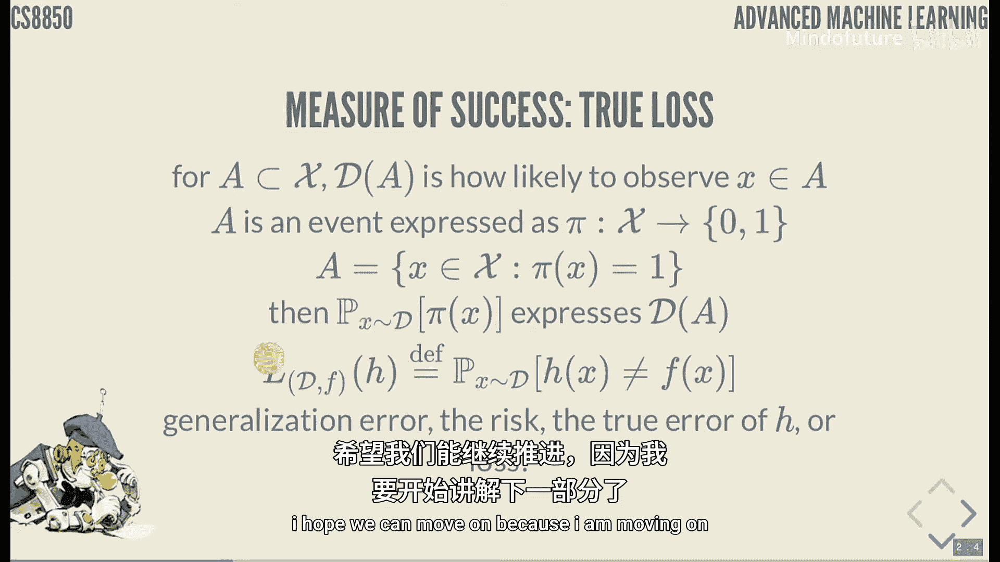
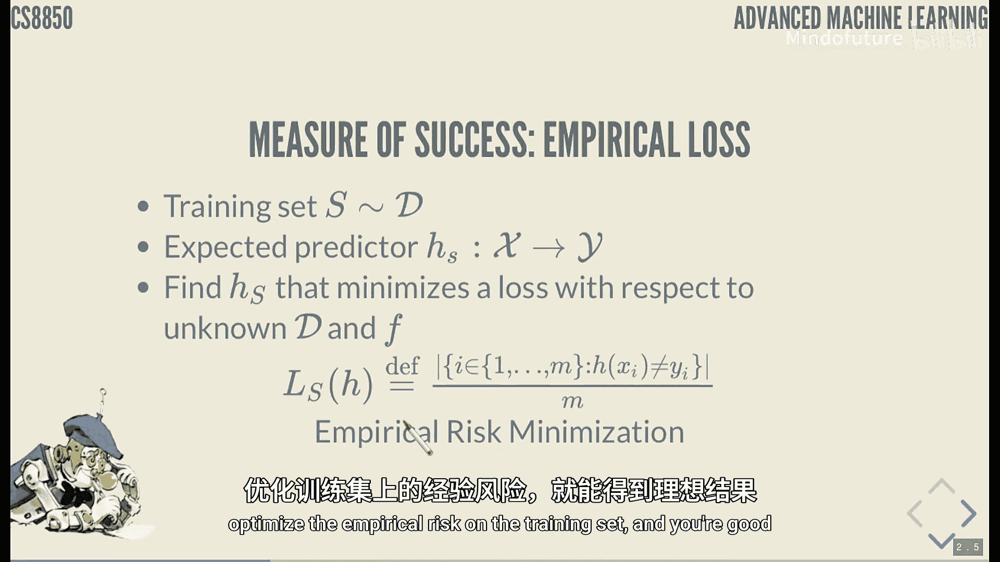
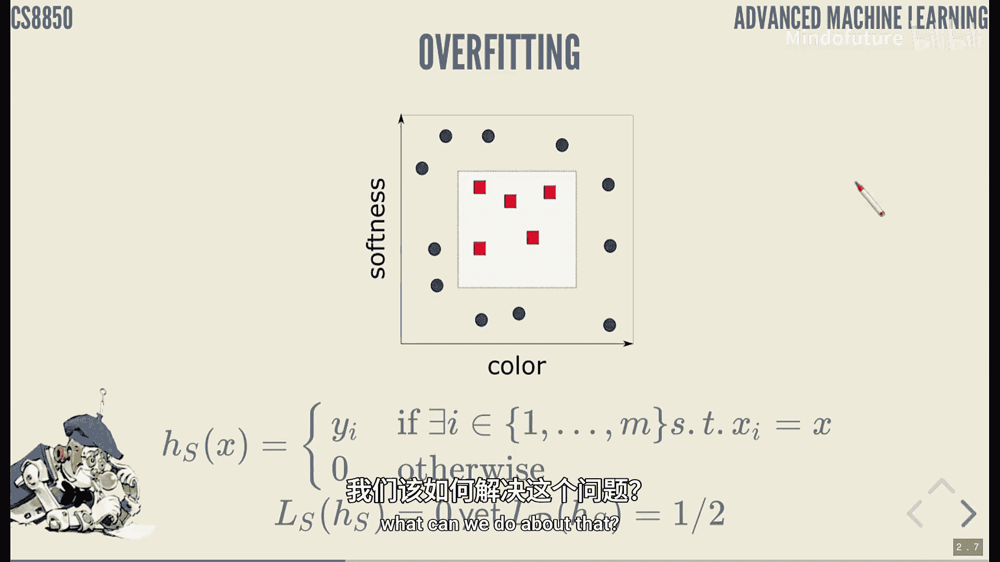

# 高级机器学习主题-CS8850-｜-Advanced-Machine-Learning-p09-P09_学习问题的形式化--BV1sapPz4Ewx_p9-

This is our second substantive lecture。I hope you have listened to。My description of。Project。

And what it is and why it is needed。嗯。Okay， so。Let's， well， actually， it's a first substance lecture。

 right？All of the administrative we have already covered and you are comfortable， I hope。

With what to expect。So let's now go through the actual stuff。

 so today we'll just cover simple stuff foundations right， what is learning。

 why what are we we be doing here。And。Think I can do it the following week。嗯。Yeah。

So Ill plan for the lecture。Or we'll just figure out what is the problem that we're solving。

Let's just try to formalize the problem of learning and the second one is we'll talk about inive bias。

Something that will help us solve that problem and then we'll try to bound the probability of error。

Of our learner。And。Let's go on。Problem statement。So imagine that you have just arrived。

To some small Pacific island。You soon find out。Like papayas。

Are a significant ingredient in the local diet。However。You have never before tasted papayas。

 You have to learn now how to predict whether a papaya is see in the market is tasty or not。First。

 you need to decide which features of a bias your prediction should be based on。

And on the basis of your predictions or of your previous experience rather。Well。

 on your previous experience with other fruits， you decide to use two features。

Let's just simplify our exposition with limiting it two features。

They by buy is color ranging from dark， green， like on the picture， most of the fruit。

Through orange and red to dark brown and the papaya softness ranging from rock heart to mashhy。

Your input to figuring out。You input four figuring out your prediction。

I a sample of peyes that you have examined for color and softness and then tasted and found out whether they were tasty or not。

So imagine you've tried like don 10。15。あ。There is composition of those two features。

So let's analyze the task。This拜 by啊。Seelection task of what should your algorithm be？

Of learning Papaya classifier。And we demonstrated by analyzing in analyzing this task， you will see。

Some formalization of the learning theory， so set up。Let's start with Kai。

than my insect。So our domain in this Papaye example， is all papayas or all data sampless。

All possible， not just the ones。That。We already tried it。Or三。Then label set why。

Is or label set of oldpa piees。0 or one。Say one is tasty。等样的。Another thing is a sequence S。Here。

The sequence S is often called a training set。It's a sequence of pairs of。Data sample and a label。

This is a scent。So number3 and one。Sa。1。イ大し。Just say you have this。做 picture。

So as you see the set sequence of。Samples with the corresponding labels， in our case， poppayas。Well。

X， in our case。Is it two element factor？X1， X2。Where。X1。Is color。So soft course。二哈。So we have that。

And as you see， the set is a chronic product of the set of op bias and。Sa啊。Possible sorry。

S or complete set as will be growing a product of。The domain。And the label set。Okay。Oh。Let's say。

A learner。Or are learning0O。Considers as but what it needs to return， what we're after。Is。H。

Which is our。Predictional。Aka classifier， Aka hypothesis， Aka predictor。

And it's a function of that map。From the domain set。Those the labels set？Which means that。

Our predictor reclassifier takes x sub i as an input and should return a y。As an map。So our learner。

Is a process that as a result。And it turns a function。As you see。

 this classifier is the output of our learner。Of our learning， I'll get。

And then what we also need to definey。We need to define a simple data generation generation model。

And that data generation model includes G。嗯。Includes capital D， which is a distribution of Popayas。

And。It includes or we assume in today's lecture。It includes a true labeling function。So。

This is tricky because well， you understand F is our true H， right？

If we get we can recover from data or from training samples。S， if we can recover F。

We're as happy as we can be because that is our。The actual presence of F is tricky。

 and this is what we assume， we assume that every possible papaya can be either declared。

Righte or not ripe or rather tasty。Or not tasty。えん。In the real world， that's not true。Because。

For one， all pasts are different。And what I like， you may not like what you like， I may not like。

 so there are corner cases， but let's assume。We can always， absolutely。In this case。

Assign a true label and there exists a function F that does exactly that assigns a true label。

 that's what it says， so for all I for all possible samples。F。

the function of assigns a true label to assemble X。

Thanks so much。So， now。That was our setting。Of entities that we operate with。

Basically， let me go back just a second， basically what's on the screen is。

Formalization of what I verbally told you on the previous screen with the Pacific Island。

It's just we have assigned a precise mathematical notation。

So the task or story about needing to pick ppayas or classified ppayas as fe or not。By there。

Hardness so touch how they feel and how they look by those two parameters Now we haven't done anything yet just simply formalized。

But in order to solve the problem， simple formalization and follow the parts is not enough。

We need to set up a measure of success。So let's first set up or define。The true loss。The loss。嗯。

A measures have success when we know everything and have access to all the data。What we do here。

 we saying that for all possible subset。

え？オバーデメインかい。Probably有为几。Of this subset。Is how likely。We observe x within that subset。So。

Probability of。Subset over them in a is just the likelihood of observing x within a when you pick random x。

对 okay哎休 sir。A is an event。Expressed as a mapping。From our domain。The0 one。

That is an event either happens or not。Which we just formalize that a is a set。Of such samples。

X in our domain chi for which our indicator function is one。That's weird， nothing interesting there。

But once we define everything like that。Then we can say that probability of pi of x being1 or just probability of pi of x because it's either1 or0。

With respect to the data distribution。Is the same as。Probability of our event8。

That is probability of how likely。Prombility of。Observing randomly。Again。

 I stress that probability of observing a randomly sample x within an a。

And it's the same as saying right if this isn't our domain。系。And this subset of this domain A。

Just nothing but a is a subset of chi， right？Here。And if we randomly。Sample an X。G位 or。

This expression just tells us say pi is one in this box and zero outside。

That's what this sp tells that is the zero and1。I hope that's clear。Then we can define and loss。Look。

 we're defining it like that。As probability of a randomly sampled X。🤢，Or probability。

That honor randomly sampled pes。Our classifier or predictor。Will it return a label？

Different from what the true labeling function would return。Remember loss。

Now is probability of an error。Probability of incorrect label return。

This is also called generalization error， the risk， the true error of age of our hypothesisthesis。

 or simply a loss。です。Lo。Of hypothesis H。With respect to data distribution and through labeling function。

Okay。I hope we can move on because。

I am moving on。So that was the true loss。An abstract notion。But。Andbi laws。Is slightly different。

 right？Because we don't have all possible data。So given a training set S。

Which is a randomly sampled subset of chiI。What can we optimize？We can optimize。It'sedical loss。

Or error with respect to those samples。So。Our expected predictor。Or predict that we will get。

In this way。Is H with a subscript of S。So this predictor， we can optimize or have optimized。

On a subset。All of that。后背的。It still maps any member of the domain to a label。But we found。

An age that minimizes loss with respect to an unknown DNF。On that training sample。

 so we're minimizing loss on the training sample。And once we do that。

We can define our empirical laws。And。Now we can do empiricalical risk commization。

So this loss is with respect to a training set。And。It computes a error or a loss。An expected error。

Of that learner。And if you parse this， this is nothing but。numberumb。Of incorrect samples。

Over the number of total samples in the training set。我就意识告爱个行。But this is the。And incorrect。

It's defined here， so H of x sub I is whatever our classifier returns or hypothesis returns。

So we count in this set， only those eyes。For which the label is not equal to the true label。

 remember how we defined our as。Is a set of or sequence rather。Of affairs。

So we already have both of them， X and Y。And the last one is X，M， Y M。and okay。

I should have done this somewhere in between and there's Xi。😔，怖い。So we have all those pairs。

We just found our error on the training as the training set S， and this is our empirical list。So。

We may be able to estimate a classifier that does well on the training set。

 but what we really want is a classifier that does well with respect to the true loss。

That's clear what。What we usually want is。A classifier the general as well。So wouldn't that work？

This is a nice mother。Colect the training said。Optimized the empirical risk。Oh， the training set。

And you're good。What can go wrong there？Well， let's consider this example。So we have our papays。

 there is softness axis and there's the color axis。So， if。For some reason， in that space。

 imagine that are ripe ppayes or tasty ppayes。Is everything that falls within this square？

Applepaya with a combination of。Two features。X and Y。Well， x1 and x2。

That falls within this square is actually a tasty of， the label is one。

And avas properties that fall outside is a bad vampire。

To brown to green you see what those axis are so this is our true labeler function that that's how F would assign the labels so we collect the training subset which is squares and。

Circleles， so those are training subset samples。This is all that we collected， right。

 we couldn't buy thousands of papayas and sample them。

 so we bought a few quite a few actually and not。And many of them were bad。So。

I train classifier or my learning， I'll get it and tells me， oh， okay。

I can minimize your empirical error completely to zero。Mim possible。

And what I will do is the following。 if you give me a new papaya。I will check if this is the same。

 if it has exactly the same combination of properties as something that I've seen before。

 one of those blue and red samples。Then I will return the label。

Then I will return if that x sub I that has exactly the same properties。It's tasty。

 I will return one， if it's not good， if it's not tasty， I will return zero。Here。But。

If say a newva pi falls here or here or here or anywhere， everyone will return zero。So， look。

My inbiicular risk？Is zero here？My accuracy is perfect。What。Andbi loss is zero。But my true laws。

Will be still one have because the prediction will be random。

 my training sample is too small to overwhelm all of the possible sampless。

So that's not what we want， right？That's called overfitting。

If we define an empirical loss and we optimize empirical loss just like that without any further considerations。

We will overfied。Because the learner will give us a classifier that performs perfectly on the training set。

 minimizing emvi loss。And doesn't perform。On the symbols outside side of the distribution adult。

What can we do about that？

