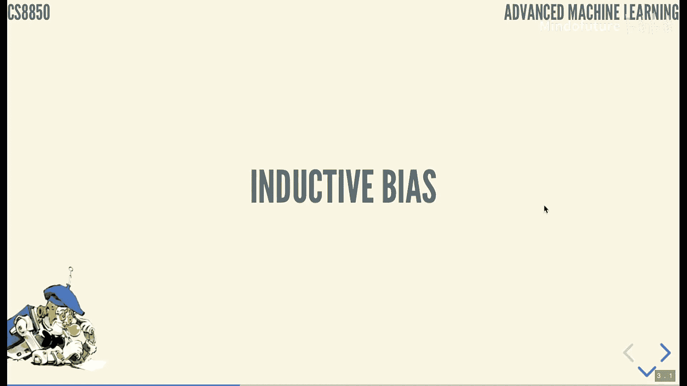
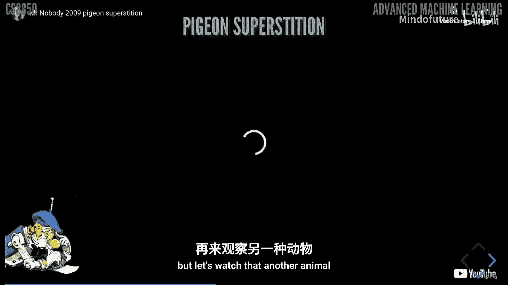
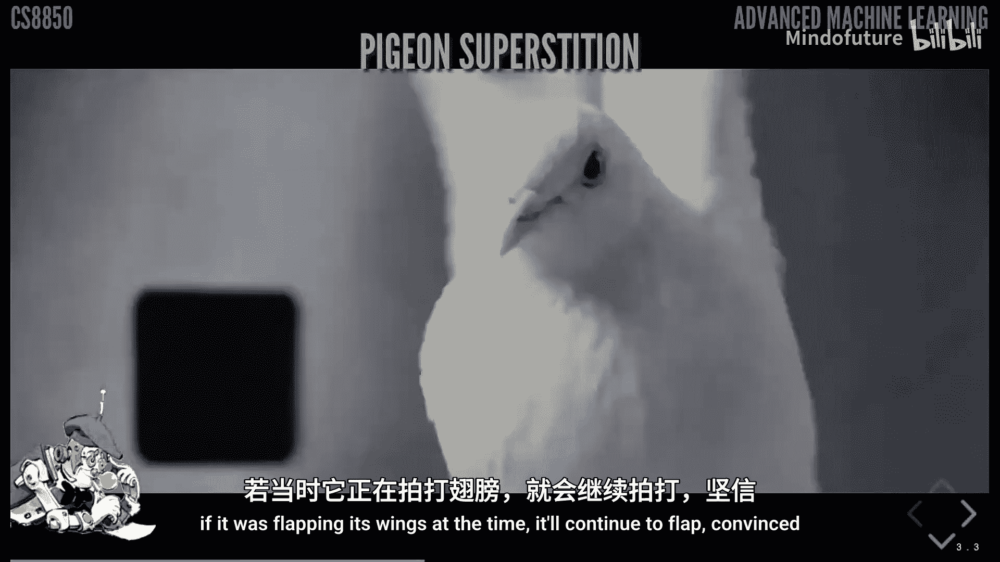
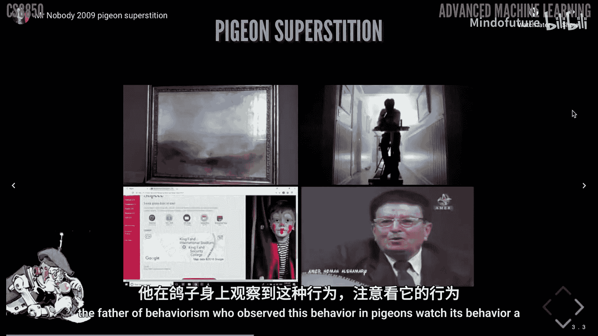
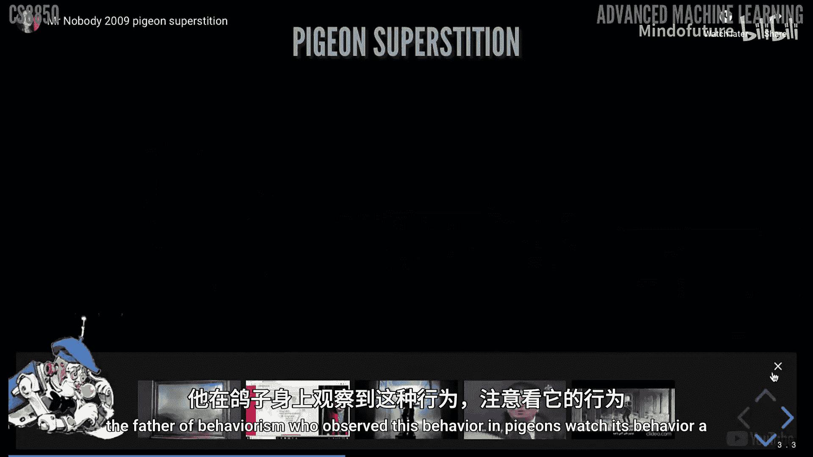
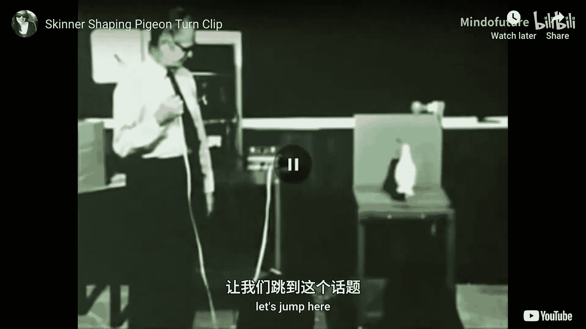
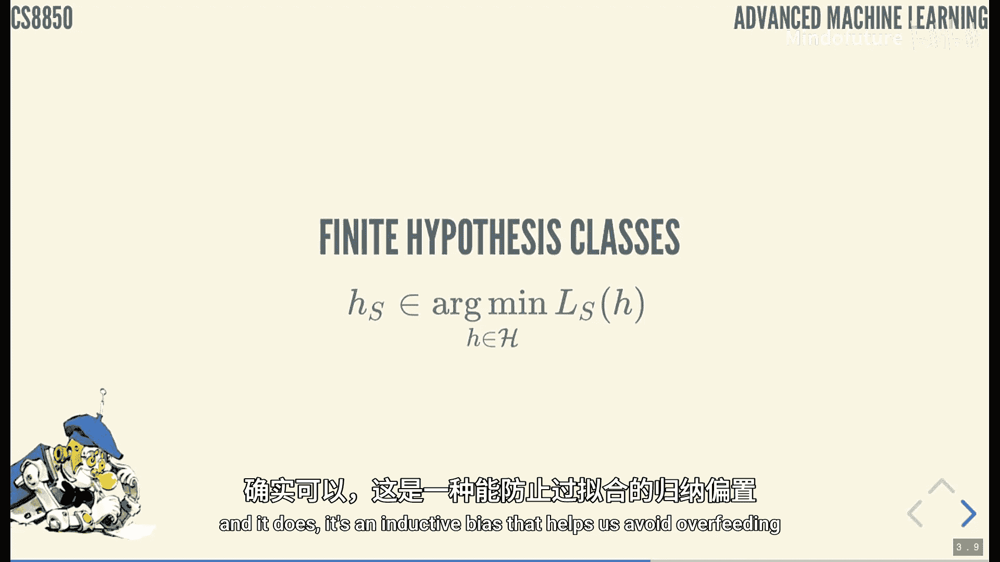

# 高级机器学习主题-CS8850-｜-Advanced-Machine-Learning-p10-P10_归纳偏置--BV1sapPz4Ewx_p10-

Let's talk about。Inductive bias。Just for me。What is it？Let's start with。

Some examples。So there's something called weight shy。That was observed in rats。诶 basicallys。

We are building learners and it will be good to。Turn our attention to how animals learn or other successful learners。

 remember according to Wikipedia， learning is assessed by humans and animals only。So all right。

When it encounters a new food， it's been observed。It tries a little bit first。

And then kind of watches itself waits if it becomes nauseated or somethings like it doesn't feel。

Well， it never touches that food anymore。So，呃， basically。There is a learning process here。

Sort of trial and error。 And before they start eating。Good quantity of food。

They try to avoid poisoning by bad food， so they try eating a little bit。But。Let's watch that。

想到 there来吗？🎼Most living creatures。The pigeon quickly associates the pressing of the liver。

But when a timer releases a seed automatically， every 20 seconds， the pigeon wonders。🎼Do to deserve。

If it was flapping its wing at the time。

It'll continue to flap， convinced that its actions have a decisive influence on what happened。

We call this。🎼Peon superstition。So。All right。Try a little bit of food。

And then make conclusions about their food。Peons in this ph， especially。They also try。Well。

 they also strive for food， right？But they observe instead of actively trying to do something。

 although they do， they're smart birds。They can press a button as you've seen this video to get the food or they can move a box to sort of。

Control their height to get to the food。But the main point is both of those animals。Rods and pigeons。

They practice something called inductive reasoning。Indexive reasoning。

 you're all now proof by induction right when from small local points or。From small local。

Depenence is assuming that nothing changes further。You can establish。

That if something holds for a base case and then it holds for every step， every transition。

 then it holds forever everywhere。So inductive reasoning in ratds is similar if they tried food。

And it made them feel bad。They kind of assume or the learning process forces them to assume that。

This kind of food will always be bad for them。Or reverse if they try food and the food is something。

Tasty good， doesn't make them feel bad， it becomes a familiar food。

And they make an inductive step that this food will always be good。So with pigeons。

 the story is slightly different。Like the pigeon superstition。

sThe pigeon starts doing more and more of the stuff that they were doing when the good stuff is happening happened to them。

 so they observed correlations。And they try to reinforce the effect by just following the relations that observed。

 let's switch another video from。嗯。The father of behaviorism who observed his behavior in pigeons。

know what。嗯。Watch its behavior a bit。It's not doing anything in particular， you see。

But I'm going to try to get it to do something。Suppose I。

Shape up the behavior of making a complete turn。What I do is simply as I did then to wait for some part of that。

Behavior， theres more of it， you see， you can see the effect is instantaneous。

I'm waiting for it to turn counterclockwise now。And then I reinforce that movement。

And I wait for a more pronounced movement than that， it's got to be more than that。

Here we go all the way around。So the point is that by reinforcing by。Adding immediately， by the way。

 adding some kind of conditioning or lobbying conditioning。

 the bird can be made to do some interesting。Tricks or whatever behave skinner。

Once they bird to there。we're just watch it。

这是。You're a bit。あ。Let's jump here。So what about rat superstition and conditioning。

 can we do that to rats with their foods so when they try some food， can we electroshock them？

And make them not like that food and avoid their food。 Yeah， we have lots of。

Things that we can torture them with and。The saddest evil people in the lab coats have done that all。

 right， We can make loud sound， Sudden loud sound。 We can splash them with water， we can， whatever。

I lecture show them。The goal is to induce negative conditioning。

 so they try some food and it's tasty， but you get the lecture shock so what the researchers observed。

Doesn't work only if the rats。Are like they have food poisoning problems like nauseusea or。嗯。

Any any other other problems with their food track only then they negatively associate the food with。

You know， being poisoned， poisonous， but otherwise。They continue eating it。

 even if it was causing them bad。Feelings or bad。呃。

Something bad that the researcher has done to them。So interesting。Peon practically overfis。

And a rat in this particular example does not overfe， so can we do something。

 can we learn from those two animals well actually from a rat？In our case， what can we do。

 So our learner。It doesn't overfeat the hypothesis or the classifier。

So one solution and the solution we'll consider today is a search over a restricted search space。

We will choose a hypothesis class in advance。Instead of a learner。Picking up any possible H。

 any possible classifier that satisfies or minimizes empiricalities。We will say， okay。

 only from this particular class select an。Predicctor。Age。That minimizes empirical risk。食工。Yes。

And then。In this way， we introduced inductive bias。By。

Ping the learner to a particular set of predictions。But oh。We want the learner。To learn predictors。

Such that they will perform better。In that in reasoning on unseen samples。

 that's why it is called in virus。So there are other inductive bias here， of course， we could say。

Maximum conditional independence cast in a Bayesian framework。

 try to maximize conditional independence， that's an index bias and a naive base which we will cover in this class。

Use that。We can use minimum cross validation error that is also an inive bias that helps well。

It's a bias， it's not a guarantee neither of them， we can use maximum margin， Inive bias。

 we will cover that in this class as well， you will understand what it is。

 minimum description length， MDL， maybe， but that's another inive bias that we can impose sort of an outcomes razor。

And。Minimum number of features， for example。And nearest neighbor， another negative advice。

 lots of possibilities for improving the learner。But for now。

 let's say that finite hypothesis classes。What will help us to avoid overfitting？And it does。

 it's an inductive virus that helps us avoid overfeing。

