# 高级机器学习主题-CS8850-｜-Advanced-Machine-Learning-p11-P11_我们能否限制错误概率--BV1sapPz4Ewx_p11-

Okay， no。That we have。Set up everything， we have our loss。We have our。

Definition of all the moving pieces。We have inductive bias。The limited class of classifiers。

We now want to bound the probability of error that our classifier makes。错 and。

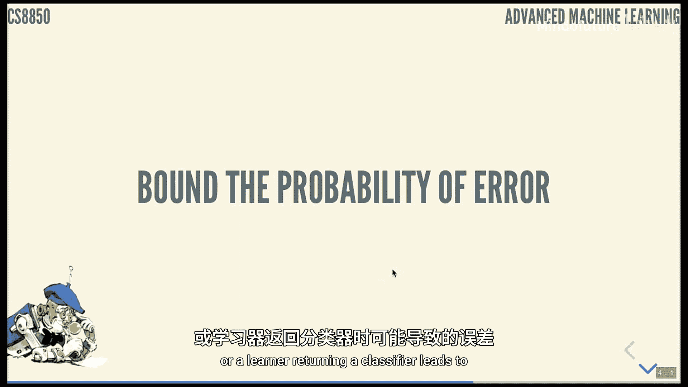

Deturning a classifier leads to。 So for that， let's make a few assumptions one is。

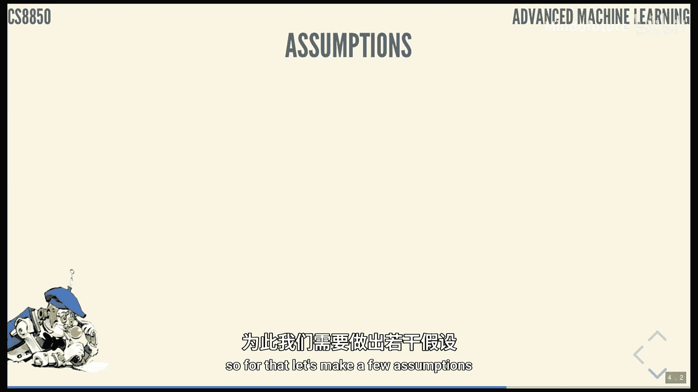

Realizability assumption。We assume that there does exist an H star。

In our finite set of possible classifiers， such that。Los呃。The true loss is zero。

This implies that with probability one over random samples as from our。

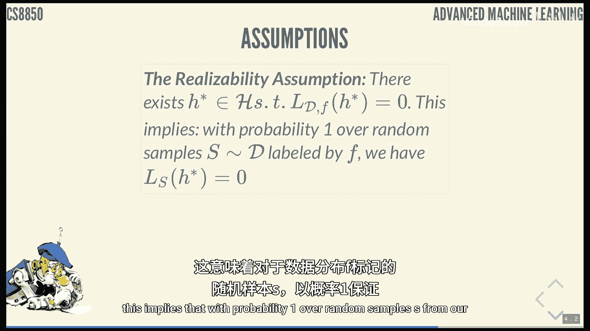

嗯。Data distribution labeled by F。We have that loss of this H star equals 0。Basically。

 what that means is that we will find anF。There is a way to find an F that are H。

Find the capital H class of classifiers。看的。And another one is idea As。

It says that samples in the training set are independent and basically distributed。

And it's the noted that S sampled problem。じ呃。S M。 So basically DS sub M is。

Distribution of all of the。Tples。Of training set。Over length in。

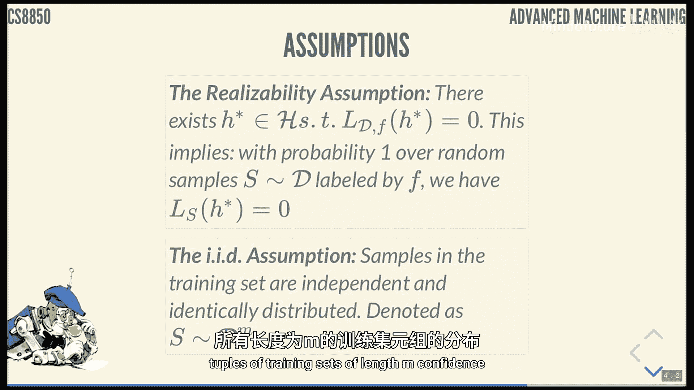

， confidence and。哎个行。The risk。L。

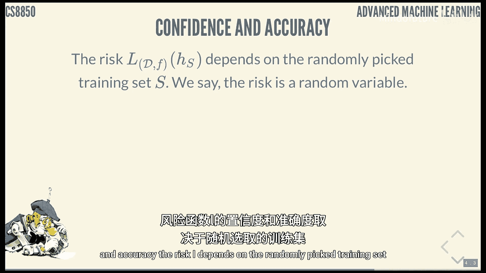

Depends on the randomly leak training set。We say the risk is a random variable。

Some training sets as can be really bad。Do know the probability of getting a nonre sample by Sigma。

 so imagine we just got bad unlucky and our training set is not representative， that's what it means。

Then， if。With probably Delta， we got that。We will not be able to learn a good classifier。

 a good hypothesis age。But one minus delta is a confidence parameter。

 because if probability of getting bad data， bad training data is delta。

With one minus delta probability or with one minus delta。

 we're confident that we can learn class from this training set。

We also can't hope to always have perfect loss， right， so let's introduce an accuracy parameter。

The accuracy parameter epsilon。Our failure is when our loss is more than epsil。

And so it's kind of some tolerance of how much error we are ready to tolerate and our success is when our loss is less than equal to epsilon。

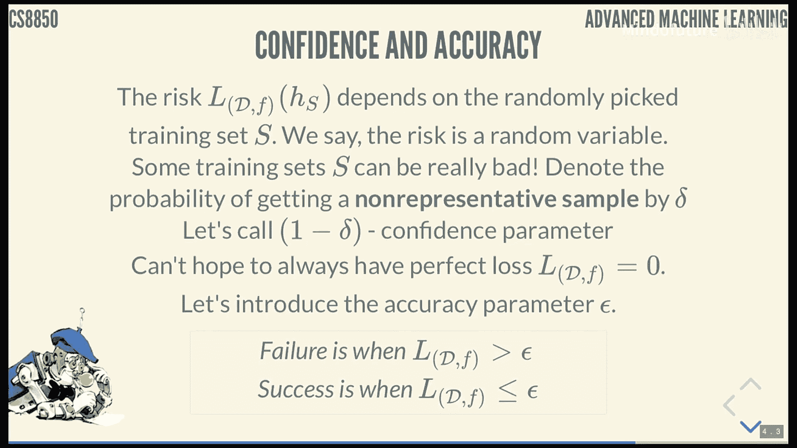

Note I'm introducing here to。Probabilities or two。Parameterters， one is Delta。And。

If we got like it's the probability of getting unlike a sample for training set。

 if we gotten like it probability of Delta， that's it we can't do anything。

 our loss will be always a failure， we will never achieve。

A good loss because we can't learn anything from the training set。

But also we can't always hope to achieve perfect there。When we introduce Eon。It's our tolerance。呃。

And again， theyre all， both Delta and Epsilon are。In the center below 0 to1， right。

 Delta can be fully one otherwise we。It just doesn't make sense because our confidence zero。

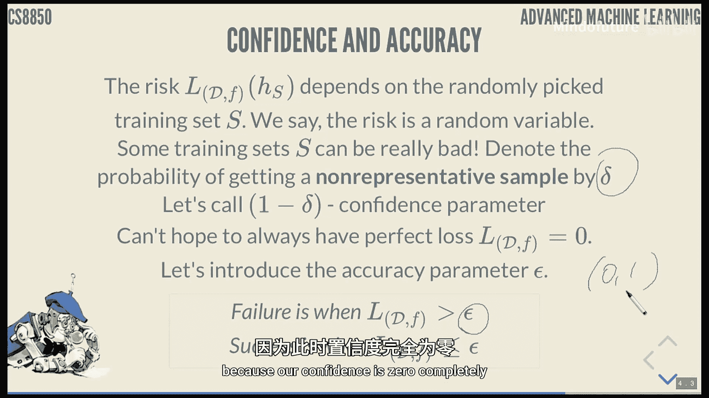

Com believely。And similarly about that on。

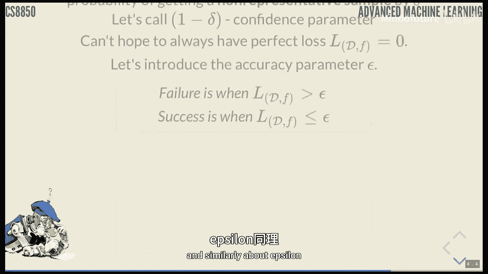

So what is the probability of bad sample that fails the learner？

What is the probability of drawing a bad sample that fails the order？This is instances。

 let's do not as bar x as。Define S bar x as instances of the training set。We want to upper bound。

Just probability。Of the training set。For which our loss is greater than a predefined epsilon that we pick。

So the set of bad hypoes。H andb or bad classifier。Let's see know by H O B。Is such that。

And it includes all of the hypothesis。Or classifiers for each loss is greater than preified Eppsil。

But there is also a set of misleading samples。And misleading samples is M is a set of training samples。

For which there exists。A bad hypothesis。For which。Sample empirical loss is zero。

So let's dwell away and a little bit。So， we have。That hypothesis said。

That is defined with respect to the true loss。But in。We also define the set of misleading samples。

It's a training error， right training samples。They will lead to zero error。Zero empirical risk。

So didnt know earn。Training a classifier on one of the samples。Will produce。

An empirical and will produce an age from the set of bad。A hypothesis。Because on this learning。

 on this。Training example empirical laws for this particular bad hypothesis。

 and it's bad because it doesn't provide us required accuracy。But for them， it will be a for。

We in that case， own that sample。On misleading sample， the loss for the bad hypothesis will be zero。

So。

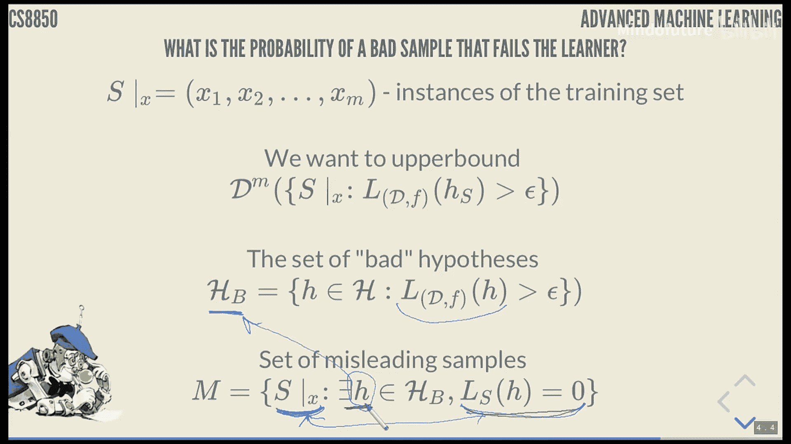

No。Let's remember our assumption， the realizability assumption tells us that。There exists a solution。

 there exists an H star within the hypothesis that we considered that。

Provides zero true loss that minimizes true loss to zero， and it implies that over samples。嗯。

All of the samples in D labeled by F， we will have empiricalvari loss equals 0。

 which means that once we find。呃。Once we find an HS。

If you find or the learner algorithm finds a classifier from。The training set S。

Which minimizes empirical loss。诶。And the true loss can only be bad more than our tolerance。

If the hypothesis is bad because if the age belongs to the set of bad hypothesises。

 because it returned。Z or it resulted in zero，Yeah， because。With zero empirical vehicle loss。

It produces unacceptable true loss。That means。The set of training。Samples。Training tus。

For which true laws。Is greater than epsilon。Is a subset of misleading。嗯。

Se let's go back and look at this again。

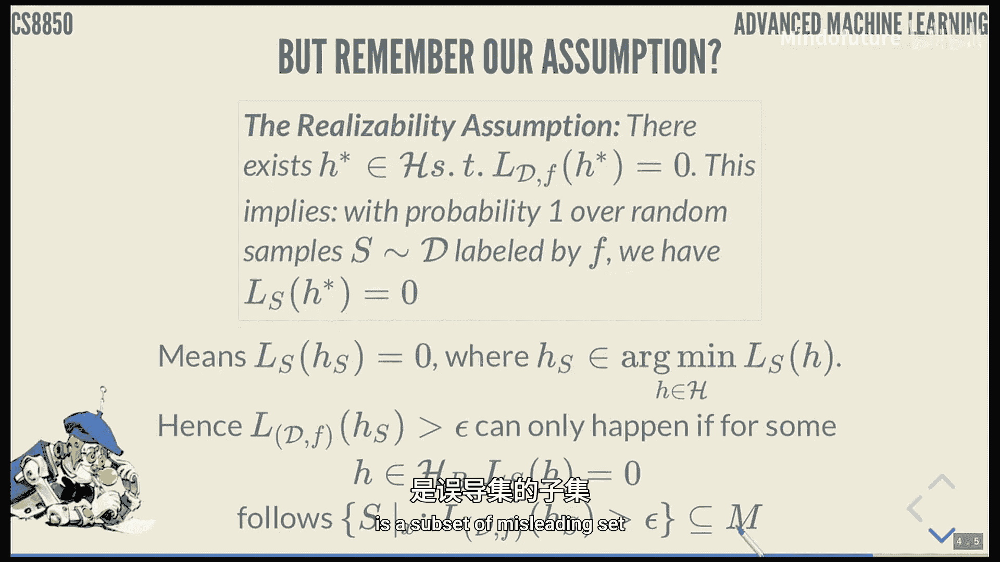

Set of misleading samples。Importantly， it defined as set of training。

Set of misleading samples is defined a set of。呃。It's such training set for which there is a bad hypothesis。

That results in0。别 goodです。And bad hypothesis once again， is a hypothesis that does not。

Satisfy our definition of success， it's a favor， the loss。The trueos is greater than Epsil。

But that practically means that。

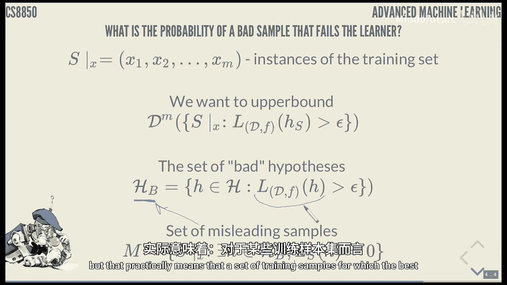

A set of training samples。For which the best。Or minimizing a vehicle risk learner。

The best classifier that minimizes empirical risk is greater than Eson is a subset of misleading。

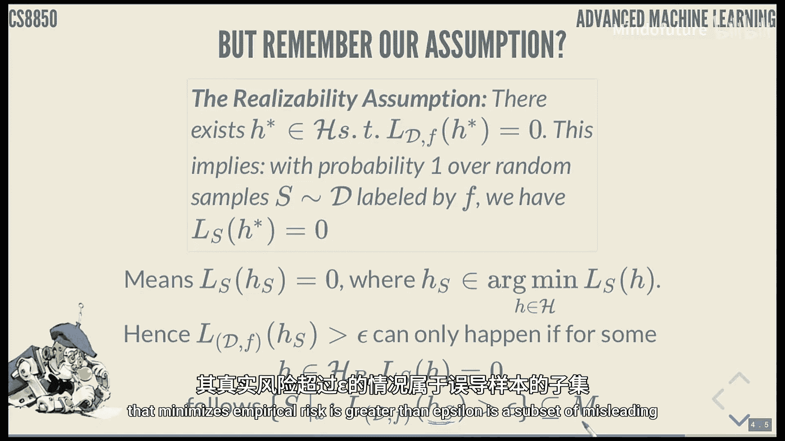

Samples。So， we won。Just back again to the point。We want to upper bound。Probability。Of this。

Misleading set。So。Now。We want to upper bound probability of getting a training set。On which are laws。

True us。Will be unacceptable， greater than absolutepsilon。

We know that this set is a subset of misleading sets。Probably propers， I said， we don't know。So。

Knowing that we can rewrite this set of misleading examples。Or misleading samples。

As a set of all of the。水明。Doos。I rememberber。S x is just。A training tu of length。Sled from the data。

And a set of misleading examples。Here's as defined。But we will rewrite it as a union。Of。All of the。

Training sets。For which。The loss and particular risk。Is0 on H。For all ages。In a set of bad。Hyperth。

Right， that makes sense because for each bio hypothesis。This for hold。

But then the original probability。The one that well not original。

 but we want that we want to up bound probability of getting a training set for which。

Los is greater than Epil。Since this set。Is a subset of them。

Let's do know that just for now with a letter A。So， a is。A subset of them。Possibly proper subset。

 but we don't know。From this follows。That probability of a is less than equal probability of misleading。

Seep， set of misleading examples。But then we rewrite our probability of set of misleading samples。

As probability of this union because that's the same。

The misleaing set defined either way is the same。

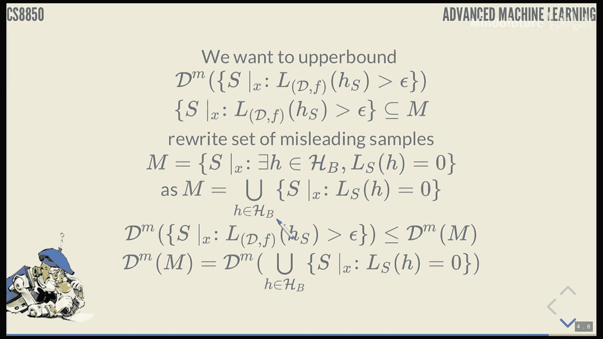

気し？And we'll use the union bound。Next。In order to establish or to link confidence and accuracy。

No remember。So what union bound says is that probability of a union B is less than or equal probability of a plus probability of B so easy to demonstrate again。

 imagine this is our。Universal said。And then， there is set。诶。And said be。

So getting set A and B union。In this case will be equals。To the sum。Of to the well。

The union will be equal to the sum of probabilities。But once you start overlapping A and B。

You can immediately see。That。Probability of getting an A plus probability of getting a B is greater than probability of hitting a union B。

That's the union bone。We can use that union bone。That probability。

 this is our previous set A that we don know probability of getting。

An incorrect sample or a sample that will fail a learner。

Is less than or equal than some over the bad hypothesis of probability。Of。

Getting a sample that will fail that hypothesis。That will lead well， not actually fail。

 but make us speak that bad hypothesis because empirical loss on。Baries on the sample equals to zero。

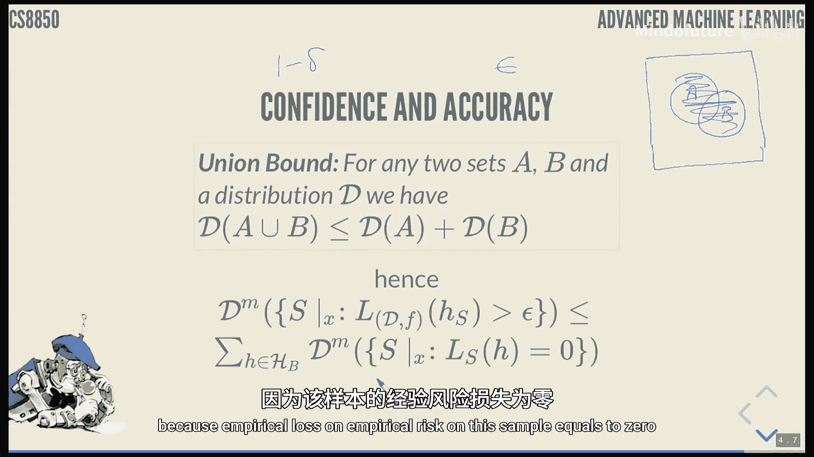

Going further。Now， we established the。

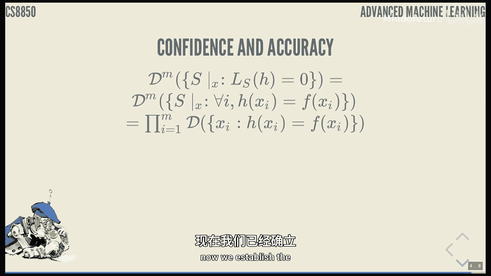

嗯。Yeah， having established this。Let's continue our de。

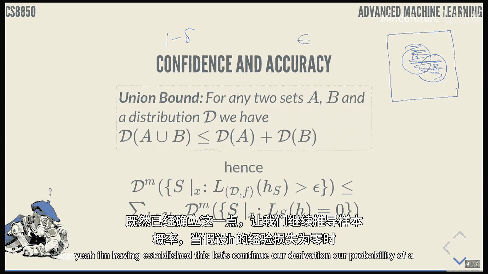

Our probability。Of a sample。For which。嗯。Empirical loss at an age。At the hypothesis age is 0。Equals。

It is equivalent to a probability of getting samples。Such that for all I。

Or for all elements of that sample， this is just a rewrite in a different slightly different notation。

 but what just what that means is that。Impirical loss of zero means that our hypothesis will determine exactly what our true labeling function returns on all。

Samples in this tuple， in the list of training samples。本。

Which is equivalent exactly the same and we are using the fact that we are sampling IID independent and identically distributed。

It's equivalent to the product。🤢，Of probability of。Sample set of samples， X。For which。And product。嗯。

Okay， well， I should pause for a bit。 This is important because this is probability of tuples of length M。

Probability distribution over tuples of length M or probability distribution over training sets of length M。

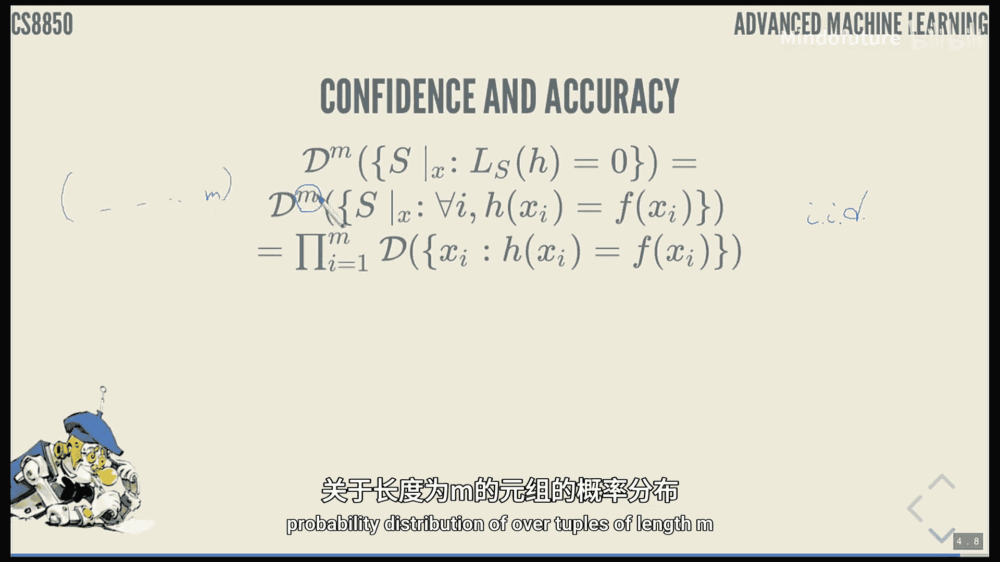

And by。Because we sample them IID。Once with sample。1 S， say we're considering only one S。Its。Yeah。

 like one of the ass。Then。We can rewr we can rewrite。

Test probability distribution as a product of original probability distributions over x sub I。是。

And we're only currently all of our ages here are bad hypothesis。

 it's not for all the this doesn't hold for all of the ages necessary。But big。Cause age。Here。

Is a bad hypothesis？You can set it's a hypothesis such that the true laws。

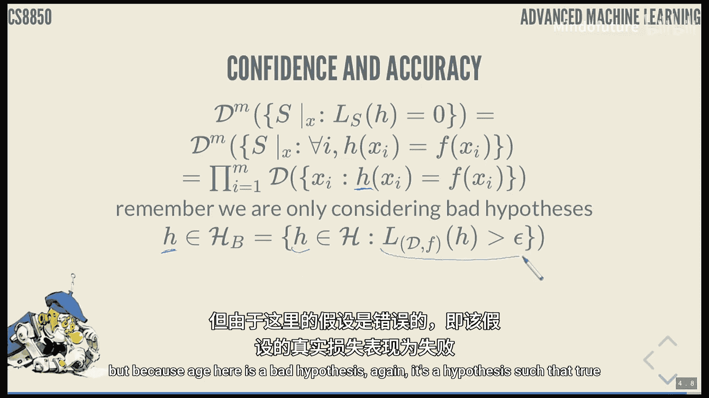

Is a favor。Because of that， we know。That。Probability。

Of a set on which this bad hypothesis returns a solution that returns a label that the true labeling function returns。

Equals。The one minus the true loss。The one minus the true loss on H。Which makes sense， right。

 the true loss is the probability is the probability。Or expectation of incorrect。

Responses or incorrectly。Yeah。Yeah， the the loss。Cones。Or takes an expectation of this quantity。

Wellello。It really counts， we have an indicator function that returns zero when this is true of it disclose。

欢万个的头子。So probability team。Of getting。I mislead didnt hypothesis。That matches。

The truth is one minus the loss of this hypothesis。But one minus the loss is upper bounded。

 but one minus the epsilon。Look here。And if we use that identity。

1 minus epsilon is less than or equal to epsilon to e to the power minus epsilon。Then。We can。

Upper bound， the probability of getting a sample at which a bad hypothesis remember we're working with bad hypothesis only。

It turns zero。Los， zero empirical loss。Is less than or equal。

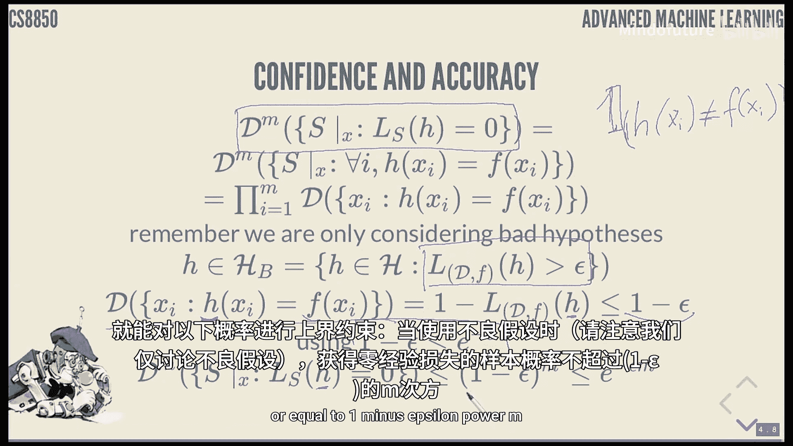

To1 minus absolutepsilon power M。That's this。Or。Using this identity see。It is bounded by。

E to the power minus epsilon M。

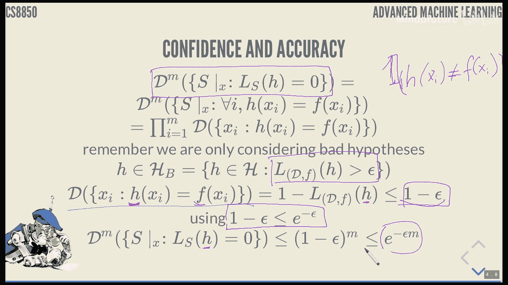

So， our bound。Is the following？The question is， what is the probability of randomly ending up with a training sample？

For which are。Te loss。Will be greater than what we want it to be。And that probability is bounded。

By this size。Of our hypothesis said。With the following。Factor。And that coefficient factor。

Depends on what accuracy we want to obtain and how many samples we want to use。In the next lecture。

 we will talk about why it is important， why this bond is interesting and important and how can we use it。

 how can we make the next step of。Figuring out a learning model for our data。

Or for our approach from learning of learning from data。

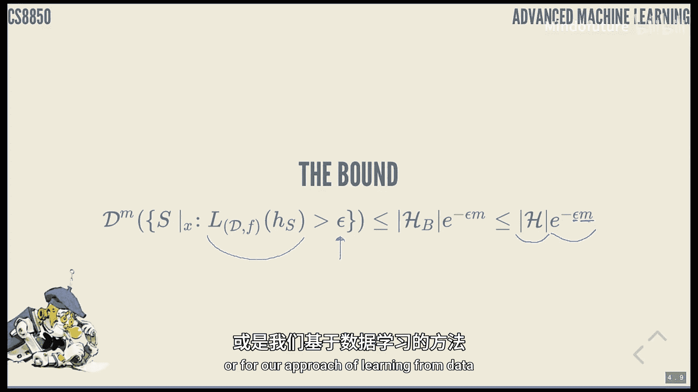