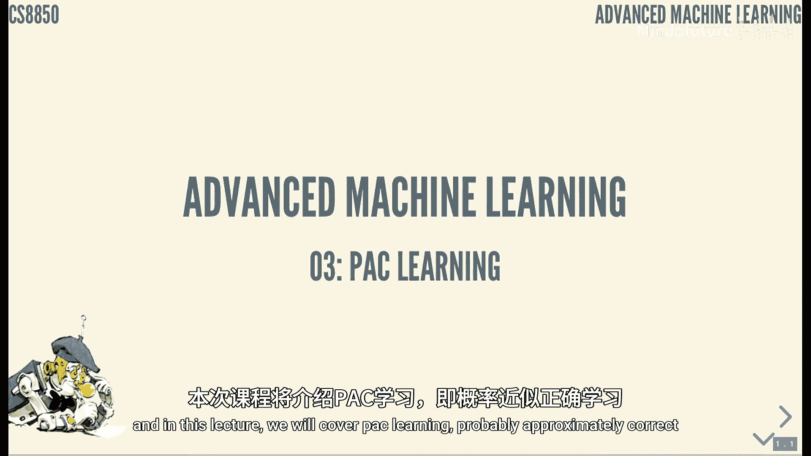
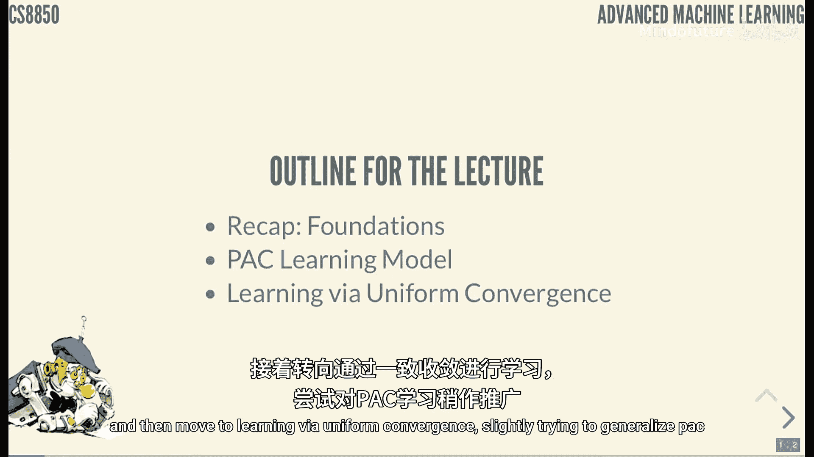
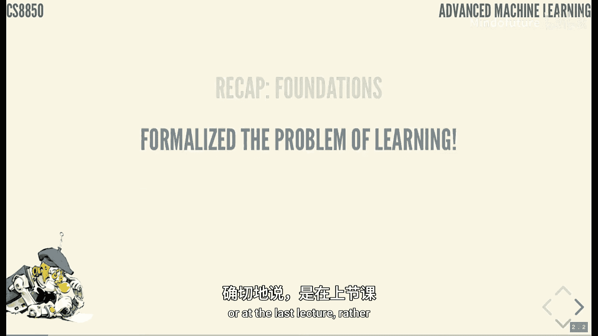
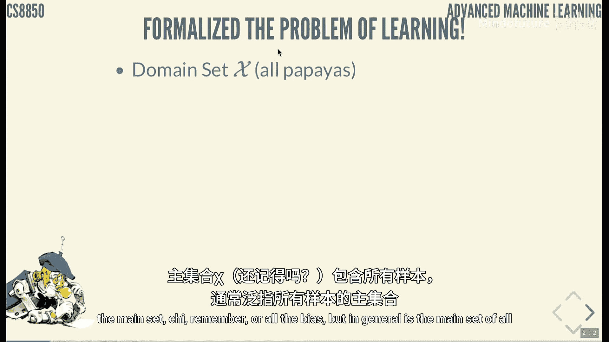
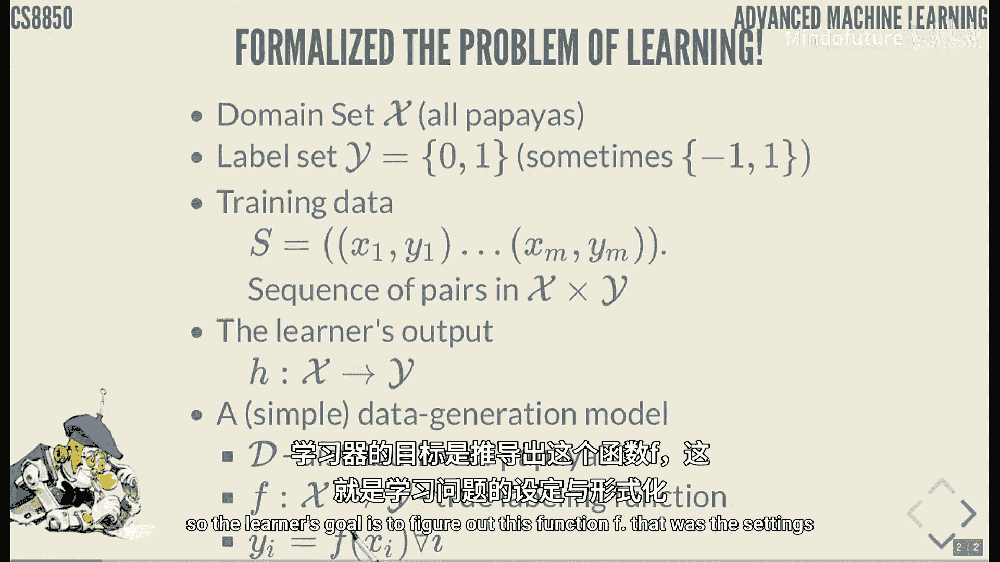
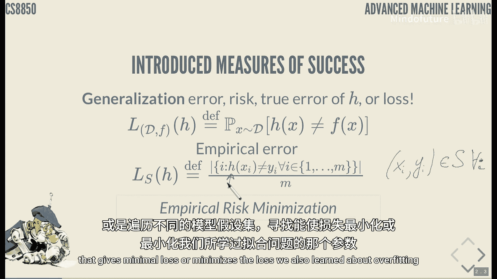
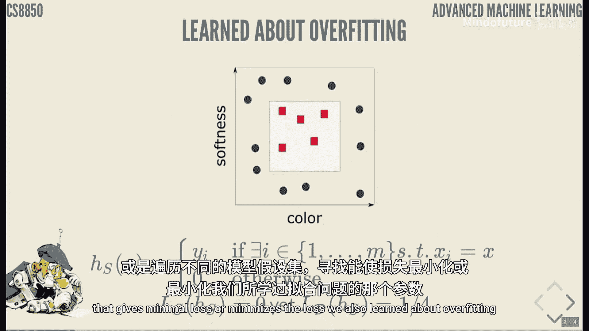
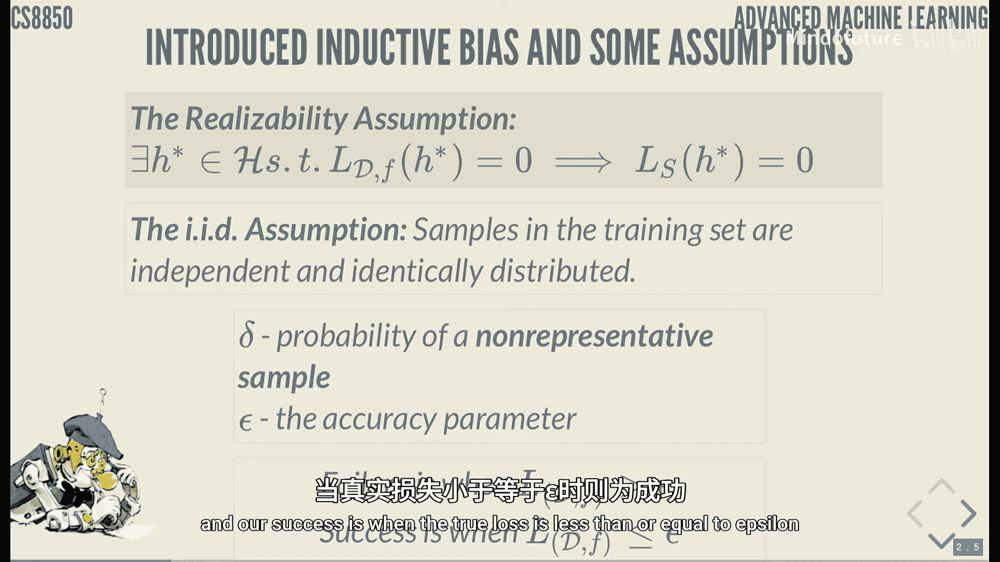
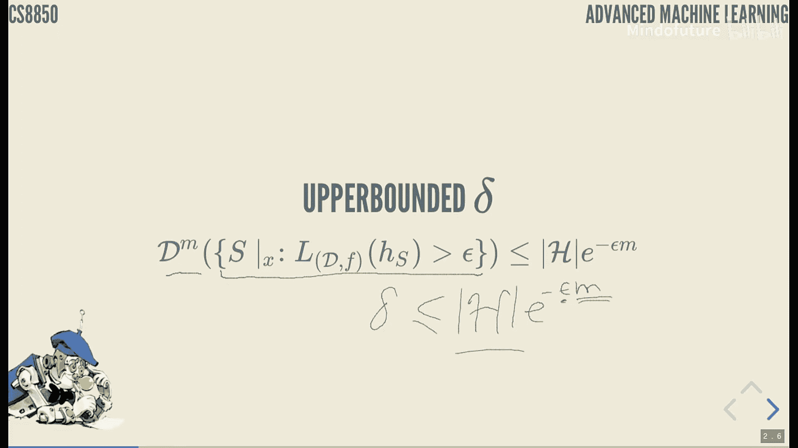

# 高级机器学习主题-CS8850-｜-Advanced-Machine-Learning-p12-P12_讲座2的主要定义--BV1sapPz4Ewx_p12-

Today， we continue to understand。Foralization over the learning problem。And in this lecture。

 we will cover PA learning， probably approximately correct learning。

Here's how we'll go about it。That was plan of the lecture。First， a quick recap。

 what did we arrive at？The last lecture。What do we know and what will we use at the lecture today？

Then together， we will introduce P learninging model。

And then move the learning via uniform convergence。Slightly trying to generalize back learning。

O we go。Recap foundations， what did we learn from the last lecture or at the last lecture rather？

So last lecture， we formalized the learning problem。That mindset。Ki， remember or all bias。

 but in general is the main of。

All cycles。Then label set。诶 why。Whi is either0 one or sometimes we center it and make it minus one and one。

 but we have to have the set label set。Just a secondhu。And we have to have training data。

Sequence S is often called training set。And it's a sequence of pairs a bit cross product or a chronicer product of。

Chron her set product of Ka and Y。Basically just a sequence of pairs of data samples and the corresponding labels。

M of them， not all of them， but just a subset of the training data， the guy。

Then we have probability well。Yeah， then we have the learners output。Yeah。

 then we have the learner sal and the important to distinguish the learner is our learning algorithm。

And it produces a function， it produces a program that we execute on every new input。

And generate the label。So the learner。There is a learning algorithm that speeds out a hypothesis。

Call it the classifier， Call it the predictor。And then we need to define a data generation model when we did。

 so we have the distribution of data， probability the distribution that generate。

Papayas or in our example， but it could be just any data， basically T is the environment。

And we also assume that correct labeling， true labeling。Function that it exists。

It's just unknown to the learner。And what that means that for all。So for all eye。呃As sample sample I。

Supplis the this function， will get the true label assigned。

 so the learner's goal is to figure out this function F。

That was the settings for normal of the learning problem。We also it a measure of success。

Geneitalization error risk true error of age or loss。

Loss is the assumed true loss here on the whole domain。L stands for loss。

With respect to the environment or data generating distribution。

 and they assume existing true labeling function。Take any hypothesis。And returns or is defined。

As probability of this hypothesis returning incorrect answer on any given X。An imped code loss。

Is simply a normalized count of incorrect prediction over the training set size。

 so M is the training set size and empirical those is s empirical loss is L on S on that training set size so given the training set。

Which is a randomly sampled subset of act。What can we optimize？

That's the problem of empirical risk minimization。We can optimize empirical loss。

That is error with respect to the samples。And our samples are the pair。So for all I。For all pairs。

 we can minimize that error。And we may be able to estimate a classifier that does well on the training set。

But what we really want is a classifier that does well with respect to the true laws。

So and empirical risk， we can minimize because we know how to compute it。

And so we can keep adjusting our hypothesis。We can't do anything to the data， as you understand。

 we just keep adjusting our hypothesis or going through different hypothesises。Stets of models。

And looking for such an age that gives minimal loss or minimizes the loss。

We also learned about overfiing。

In the simple example， imagine that。Our task is such that we have。largerarger square。

 which has area of four and a smaller square where has area of one。

 so you can see that the larger square can be tiled with the smaller squares with four smaller squares like that。

And you can see in these settings， a particular learner could return a hypothesis to us that perfectly minimizes empirical risk。

By simply。Excuse me， following this rule。ギムのサド。🤧X。Which again， I repeat in this case。

 x has two components， x1 and x2 it's a two component factor。

Compare if the given x is one of the x's that we've seen before and if it is。

 then just return the label of that x that we've seen before。

 and somehow an extreme case of nearest neighbor， so it's like find the nearest neighbor but that is it not the neighbor but just the label the actual point。

 and return zero otherwise， empirical loss is zero in this case。

 perfect perfect error ideal hypothesis but wait if we do that then our。Actual， a loss。

True loss will be only one one over four because it'll end up with correct label only in。

Want to work for。Cases in a quarter of cases。Yes， indeed。It was return zero。啊。

In most of the places and it will be correct， but in one quarter of the area it will return zero。

When it should have returned once， so the error the true bus will be1 over four。

So we also introduced inductive bias and some assumptions。

The important assumption is a reizability assumption that means that we assume that there exists such an hypothesis h star among the set of possible hypothesisses。

 such that the loss， the true loss of which h star is zero。

That there is basically it says there is a solution and since there is a solution。

MT immediately means that for any subset， because this is for all data， for all possible samples。

That means that for any possible training subset， the loss will be zero。I hope that's clear。

We also introduced an IAD assumption samples in the training set are independent and identically distributed this assumption is with us for a long time Leslie Val and introduced PA learning in 1984 and now 2020。

 we're still with that assumption and only now people are starting using machine learning algorithms a lot in real life in real application and。

We we're learning。That。We have to do something about this assumption because most of the data is in real world doesn't come my ageG。

But that's。26 years later or。36 years later。Let's just stick to the idea assumption in。

In this lecture。In the printer， identicalally distributed IIT。If you haven't heard about it before。

 we also introduced two numbers Dlta and epsilon， delta is probability of a nonrepresentative sample that is probability of a learner turning the best possible classifier on the training set。

 but the training set is nonrepresent so。True loss。

It's not going to be good at all no matter what you do。And Epsilon， the accuracy parameter。

 Epsilon is just a flash factor for all kinds of uncertainties that we cannot hope to achieve the best。

Possible accuracy。Anor of zero。So。俾贴。And theex on。And then what that means is we define a failure。

 our failure is when the true loss is more than excellent and our success is when the true loss。

Is less than a equal to exon。

Also。At the end of our last lecture， we upper bound the Delta。So theyelda。Is probability？

Of getting non representative sample。And now we know from last lecture。That it is upper bounded。

By the size of our hypothesis set。And。A scaling factor that includes。Sample size。

In our accuracy parameter。

