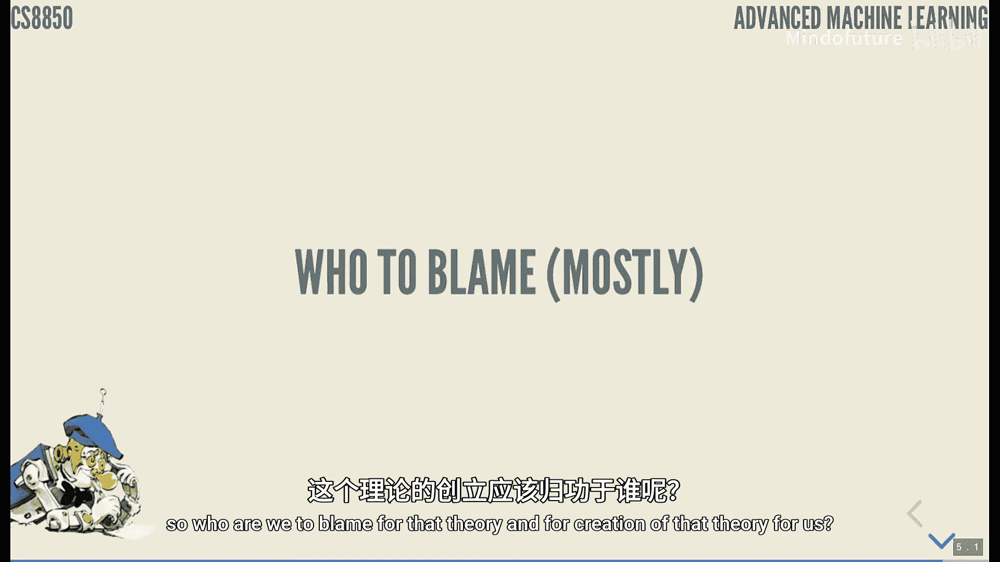
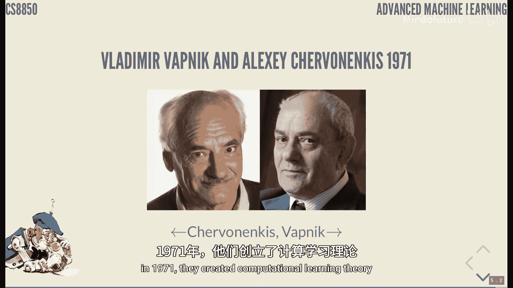

# 高级机器学习主题-CS8850-｜-Advanced-Machine-Learning-p13-P13_通过一致收敛学习--BV1sapPz4Ewx_p13-

Now we know that finite hypothesis classes by clable。

We know also how to redefine relax some assumption and define agnostic pre learnable classes with general or generalizable。

Loss functions。Let's now look at another general tool called uniform convergence or learning via uniform convergence。

So。We're receiving a training set S。And for if because。Our hypothesis class H。Is finite。We can。

Brte force simply go over all possible age， small age hypothesis in the hypothesis set。

 evaluate empirical loss and return an age for which empirical loss is minimized。Right。In principle。

 and so we hope。That。Our minimizer of the empirical loss is also a minimizer of the true loss。

 or at least it's close to it。嗯。Saying the same informally is that it suffices to show that empirical risk for alles in。

 in the finite hypothesis class is a good approximation of the true risk。

Eerical risk is a good approximation of the true risk， if we can show that， then we know。

It's like the class。It's learnable。P learn。So let's define that formally what we mean。

Epsilon representative sample。What is an excellent present sample。

 a training set is called Epsil representative with respect to domain Z。Fite hypothesis set age。

Generalized loss L and data distribution D。If for all hypothesises in the hypothesis set age。

The difference or the absolute value of the difference between the empirical loss and the true loss is less than or equal to epsilon。

This is absolutely presented if some。So now。Assume。Thattter training set S。

Is epsilent over two representative。We the this back。这 the domainZ。Or。Finite hypothesis set H。

 generalized loss L and distribution D。Then the output of empirical risk minimization。All right。

 in particular risk minimizer。On that training set S。Which， which is。H， sub S or hypothesis。

That belongs to the minimizer。The set of hyposes that are minimizing the loss because there could be duplicates。

They very够 us。And it satisfies。So if S is absolute over two representative。电。In particular risk。

 minimizing solution satisfies the following inequality， the true laws on this minimizing hypothesis。

And it's minimizing empirical risks， that's what this subindex thousands is less than or equal to。

A minimizer。Hypo of the true loss plus epsilon。But this is the definition of agnostic backability。

Howpe， is that true？Well， let's prove it。So we can prove it。As follows。Let's take the definition。

Of excellent。It represents some。It just tells us that。A sample is absolutely representative。

I for all hypothesises in the hypothesis class H。The difference。哦。And baby colo。And。Cruw us。

Its less than or equal to Epil。Since。We're talking about Epsilon over two。

 let's just try Epsilon over two。So because of that。This first。Inequality holds just a little detail。

 so let's say if LD is less so if true loss is less than the sample loss。Then， trivially。L自。

Our H is less than or equal。Well it probably do less plus I worked。FLD is larger than LS。

 but their difference is smaller than Epsilon over2。Then， clearly。This inequality still holds。

BecauseBecause of this inequalityities。嗯。Then。Because。Age sub S。Is the minimizer already。I had。

From the eye is said。Large age that minimizes  empirical loss。

Any other hypothesis is either the same gives us either the same empirical loss or larger empirical loss。

 so this inequality holds as well。Then from here， we can go to here by noticing。That we can replace。

Alless。And medicalical loss。By诶。Yes， but。This quantity doing just a similar trick， right？And。

But just this。There is no difference in symmetric argument。And once we have。And so we have it。

 we know that this expression。Equals to the expression on the right， well just sum up。

The epsilons and get our epsilon。 Brad this is nothing but。呃。Reional。

Expression of agnostic molecularner。SoTo ensure that empirical risk minimization rule is an agnostic p learner。

 it suffices to show that with probability of at least one minus delta over the random choice of a training set。

 it will be an excellentps representative training set。That's another tool。呃。That concludes a little。

Superficial intro exposition of pack learnability and。PracP learnability theory。 So who is。

 who are we to blame for that theory and。For creation of that's the theory for us， so mostly。

It's those two people， Vladimir Vovnik and Alexey Hervanenkes in 19771。

Created computational learning theory。

And Leslie viant in 1994。Created fact learnability definition。So he introduced。呃。

A different precise mathematical definition of。Which。Hi， both this is classes I' order number。

And in 2010， he got a tuuring award for that， that's the Nobel Prize of computer science。

And that's it for today's lecture， I hope you had fun。

