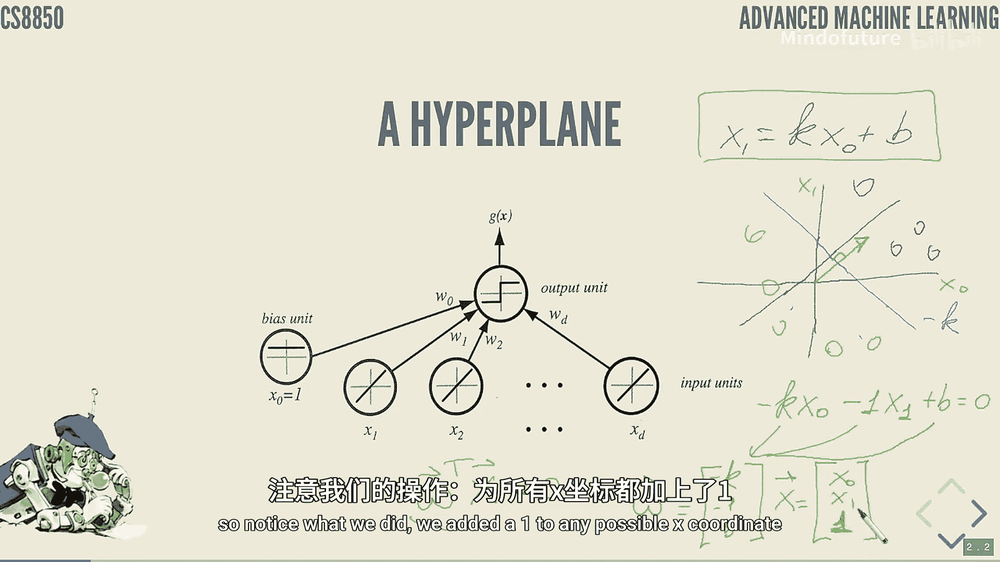
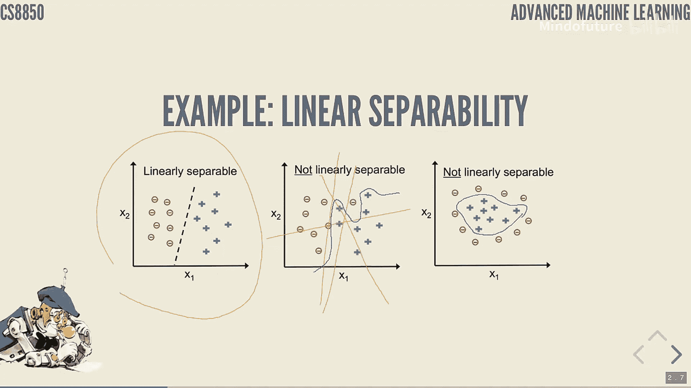

# 高级机器学习主题-CS8850-｜-Advanced-Machine-Learning-p14-P14_线性决策边界--BV1sapPz4Ewx_p14-

Hi， this is our fifth lecture and it is all about linear models。Linear models here are more about。

Separation of your data， linear seability。Okay， so today or in this lecture。

 we will cover linear decision boundaries。Talk about one of the earliest and if not the earliest learning algorithm for linear decision boundary。

And then which is called percetron。 And then we'll call about talk about pericron extensions。

 Most this will be about。Separable case。As linear pericron initially， the algorithm。

Was developed for separable cases when the data can be separated。

 the classes and the data can be separated by line or rather a hyperplane。

 which we will' talk about shortly。And then we will also talk about nonseparable case。

So linear decision boundary。Well。You have watched all of the lectures on linear algebra。

Youre perfectly comfortable， I think， should be by now familiar。With。The lion equation。

Let's see yeah。So the one， the one that we usually。Have in mind for a line。Yes is。

The slope plus bias。Expression of a line right in 2D。Let's slightly modify it。

So we have two dimensions。X0 and x1 and。We have our bias and we have our slope。

So slope encodes angle。With a positive slope and a negative slope。And Bo。Do you know it's that shift？

A shift from the origin。Just the distance of the whole line。

From a line panel to it that comes through the origin。嗯。Long familiar and kind of boring equation。

 How do we extend it， How do we generalize it to multiple dimensions what like what this equation represents is a two dimensional line in what we can do with it。

 yes and 2D。 If we have two classes。Green and red。Then。Okay let's remove that。😔。

We we don need this actually， but。So。Into the this line would separate。Red from green。

If we rearrange this equation。And write it in the following。先不为。Let's say， we have。给 x。0 minus。1 X 1。

Lets be equal0。So。No。If we split those coefficients。😔，And arrange them in a back there。Okay。

 -1 and B。And represent our x， our parameter space as x0。X1 and1。Then。Let's call this W。

And let's call this X。Only W and X are vectors now。When we do that， we see that。We can。Right， our。

Neear and dear familiar line equation。As a vector product or scalar product of。W and X。

 X is something that is changing。是。X 0， x 1。Those coefficients are changing around。And。

W is something that is fixed that describes a line。When the scalar product equals zero。

Then that means a point is on the line。And if we plot a W for this the。Well。

 actually if we're talking about the minus k， we should have a minus here， right？😔，If I plot the W。

It'll be a vector that's perpendicular to the line。And W is called a normal vector。

Normal to the hyperplane。 now our hyperplane is one dimensional。And the trick with the bias。

 we've done the that's an important trick。Before we generalize， I want to draw you a figure。

 so not just what we did， we added。A one。So any possible X。

Gordondon。Let's go to the blackboard。

Effectively have done。So we started with a flat space。And in that flat space， we had。

Some green data points。And some red data points。But if we。Draw a line。

That is easy to manipulate in the two dimensional space using two dimensional。X0， x1 coordinates。

And I'll go。 I'm going。Delibvererately slow。I just don't I don't want to quickly accelerate and lose you。

 so those of you who perfectly know what I'm talking about。

 you can skip this or listen to the video at2 X speed。So if we do this。

 if the dimension of w of the vector。Then I'll delete this part。 So if we do this。

 if we have a normal。As we know how vector is defined。If we have a normal vector。And we move this。嗯。

Let me see yeah， if we and we move this。Herurbal point around。When we do so， we。Rate。Our hyperplane。

From one position to another。 But if we do so and try to separate。Green from red。

Here on this picture， then we will not be able to or will not always able to。

 because we do need to an ability to shift our。嗯。Origin of or a pivot point of rotation of this。

Normal。To the Hyplane。So just working with this red W and X。And。Havingming the equation。

Means that our hyperplane or a line in this case and 2G case。

We'll have to always pass through the origin and all we can do by rotating W around。But as you know。

 the scaling W back and forth wouldn't change the line direction but by rotating W around we can。

Orient the separating line， but we cannot separate all the classes。

 What if our actual separating line is here because red。

Goes as much as up to here while green is over there， right。

We can never align the white line here separating Hyplane with a red separating hyperplane in this case。

 in the two dimensional case， because all we can do is rotate the white line。Importantly， again。

 and I repeat any point on this line。As we know， scalar product or inner product of two vectors when it's zero。

 that means they' verypendicular any。Vect their X。Which denotes a coordinate in the 3D system that is perpendicular to are predefined or。

Pre defined normal vector to our hyperplane。That is means it lies on。The hyper plane。

So how can we deal with this situation when？We have a W and can conveniently rotate it。

And we have such a cool， clear equation。 Yeah， of course， we can do the ugly。I have the bias。

That it will be kind of weird when we go to higher dimensions while we have3 dimensional data in our data space。

 a rotate hyperplane， separating hyperplane， and then adding some scalar value then the equation doesn't look as beautiful as。

Good， so what we do。And we'll use that multiple times。 We。

 some of the algorithms that we will consider will switch back and forth。From using the bias。

 from not using the bias，Look interest at an interesting trick。The transformation。

Add another coordinate。Do each of the points here。By adding another coordinate。We go in Su 3Z。

It's kind of a fake 3D we take this。Square napkin。And we put it in 3D。Imagine that。This is one。

That we added。Through each of those。Pos。So now each of them。Just looks like x0， x1 and1。

That's why it's nothing but this Iplane that。Next 0， next one。And。

X2 so this hyperplane is just a parallel hyperplane to x0 and x1 will lift it the hyperplane。And。

And that's the beauty of。嗯。What are we going to do？R W vector。No。Represents。A hyperplane。Now。

 two dimensional。Generalization of a line hyperplane that passeses through the origin。

And it passes through the origin。But what we consider as a separating line。せ生？If we look。At this。

 we are using the yellow hyperplane。Its going of continue。嗯。Yeah， and。Yeah。Okay， so。

Look how clean and convenient。 Now， our dimension。Of W and x can be anything。

 and the hyperplane equation will still be like the circled one。And I can sort of。I don't know， grab。

I can just grab with my hands， right？This。Back there。And drag it around and when I drag it around。

 I will create another hyperplane that passes through the origin and I don't know。Points here。

And now I separating well。Any more separating， but my separating hyperplane。

 let's make it orange is here。Or it's still in effect， a align。Because as I said。

 because of this one， that we're still in a suit。So easy for pseudo。And the space。

 we just added another convenience。🤧。And back to our。We're going hyperpl in equation， so this。

Equation that I wrote here for multiple dimensions。Could be represented。As this figure。

And this figure is just a coefficient well， it's the way it's thrown here， it's kind of upside down。

Our one is added on top。But it doesn't matter it could be on top on the bottom or effectively anywhere。

 as long as it's consistent for all access， for all data points。

And our bias is now encoded in our data points。And。When。呃。AW。Normal vector is normalized。

The one device is just that rate。Let's look at the equation。Of the hyperplane。Okay。Since I think。

The simple geometrical intuitions are super important for understanding what's going on with linear classifiers and to understand。

Further as an effect of。嗯。Like as an effect， I understand the geometry of this whole classification space。

Let's。Like dwell in this a little bit more， a little bit longer。

Slightly different notation from what I proposed in the previous slide， but I figure。

Let's say x0 x1 x2， right？So， distance。From the origin。Is our bias weight normalized by the。

Length of the W vector。Usually the normal vector is。set。In geometry。

 at least an analytical geometry and again。Just for your reference。Is set1。

 so W0 is the bias in the distance simultaneously。But嗯。嗯。When we're going to do optimization。

 W is actually our parameter。So what does it mean？To grab and rotate means to modify and to tweak to change the parameters。

 remember I told them last time that x is our data and x's don't change their right well we can of course scale them and filter them and all that but assuming it's our data they're fixed and we just want to find the right W so in the course of changing and searching for right W。

 we can of course restrict it to a sphere and sphere of radius1。mThis is a baby sphere or a circle。

And this is my W， and I can just restrict it to the circle of Radius1。嗯。

But that adds additional complexities to the algorithm so we didn't do that。

Or won't do that in this lecture today and that could be anything and then。As an fact。

 we do need to normalize。The get。嗯。To get our distance。From the origin。Another one。 another。

Gemetric notion is。This distance of a given point to its projection on our hyperplane。

And you can derive it yourself， but it's basically。G of x， as you know。

 it's zero only for points that are exactly on the hyperplane。And so it will not be zero。And。Again。

 if W。Those are all vectors。3 dimensional in this case， but multidimensional in the channel case。

 so R is the distance how far is the point from our separating hyperplan Okay。

 just just kind a recap of the previous slide of the same thing。Yeah， so another。

Another thing that we could see from here， that。Well， like we can just derive this using。

W transpose x。So。In theIn case of normalized W。Conveniently， if this is one。

Our equation just exactly gives us a line equation， gives us a distance from a point。

From the Hyplane， but notice an interesting。Another interesting and super useful property that we're going to use。

If you have W that defines this。Line here。So this W， this hyperplane。Again。

 I maybe hyper playinging the model。衣服。R X， imagine this is a length one。 The W has length1。

 So we are in right here。R the distance of a point from a hyperplane equals W transpose x。

Inithner product or projection。What happens to those two different vectors？

That are not on the hyperplane or two points equivalent。So 01 and  point2。And I'm inconsistent。

 of course。Should be one0 zero base count。When we take in a product this a projection。Now。

 just a little clear why this is the distance because the W transportse W is。A length one。

 when we take。Projection of sort of collocated vectors are of a vector that is on the same side of the hyperplane where w is pointing to our result will be positive。

But。For a vector that's on the other side， the result will be negative because the projection is right here in the opposite in the opposite direction。

 they're pointing this vector is pointing sort of to the opposite direction of the w relative to the separating hyperplane and we。

Thats conveniently。With this representation in this calculation of the distance。

 we conveniently get a negative space。In that positive space。

So any point that's on one side of the hyperplane。It's kind of arbitrary within flip W and the signs will flip。

 but given w that defines the hyperplane， that W also defines a half space， so this half space。

Well have。Will be positive and this health space will be negative and everything on the hyperplane。

 as you know is see。 so in three dimensions， it's the same this health space will be positive here。

And this will be negative。And going color dimensions， we will get to。Do just。By analog。

 the same situation， even in the higher dimension。Okay。

 that was tedious but enough so an example everyone loves examples。

 so this is a super familiar example， linearly separable as you see data。

 at least the one I'm showing you is linear separable this data set is a very famous dataset set。

 it's I flower dataset or Fscher's I dataset， it's a multivariated dataset set introduced by the British statistician。

 the eugenicist and biologist， Ronald Fisher， actually a revolutionized study of Sta and this data was introduced in his 1936 paper。

And so the use of multiple measurements in taxonomic problems as an example of linear discriminant analysis。

 that's the paper title， it's sometimes called Anderson's Iris data set because Ed Anderson collected the data to quantify the morphologic variation of iris flowers。

Of three dead set species。Oh。😮，Two of the three species were collected in the Gupe peninsula。

 all from the same pasture and peaked on the same day and measured at the same time by the same person with the same apparatus Fisher's paper was published in the journal。

The annals of neugenics。Creating controversy about the continued use of the IIS dataset for teaching statistical techniques today。

 the dataset consists of 50 samples from each of three species of IIS， Iris， Setosa， Iris。

 Virginia and Iris， Veric color。Four features were measured from each sample。

The length and the width of the seepals and petals in centimeters。

 that's what you see here on this picture。And。Based on the combination of these four features。

Fishsure developed a linear discreminant model to distinguish the species from each other。Well so。

We do have data that comes。In multidimensional space。

 or most of that data comes in multidimensional space if we measure。嗯。Are subjects or our samples？

As a collection of various measurements。For humans， we have weight， height， H， eye color， whatnot。

 hair length， we can do multiple multiple measurements for human faces for recognition we can have multiple measurements。

 so those dimensions， those x0， x1 that we drew。That just abstractly and geometrymetrically。

Theyre not too abstract they are actually。You need to train yourself to think in this linear algebra。

Spaces。Pect their spaces。O。An interesting example also。Is that。And again， this。

Some cl implementation， Y's and A's are y is an x。And RA is our W。So。Yes， it is sermonology。

 introducing some sermonology。Because I want you to change your thinking about these problems if the terminology is not already you。

Innate do you're thinking or just remind you what it is。

 so this separating Hyplane would separate those two classes， the black and the red。But only if our。

W vector， our normal vector。So the separating her is within that solution region， so that's good。

And another thing we can use labels minus one and one。

For the classes and then we won't need to like to worry about the sign。Because if we。Seeo。

Say that this is the label minus1 and this label is one。And all we will need to do is W transpose x。

Times the label， right？And if this times the label is greater than zero。

The in classificationification is correct。By doing that we are effectively， well， why is correct？

Say label equals minus1 for this particular x and classification is correct。

 That means w times x is negative， its less than0 right。

 So if this is negative times negative label W times x times label。That's it's specific。Exsposed。

 but the same is true。For a positive label。W times x。For correct classification。Should be。

Greatter than zero， but that means that LW。Transpose x。Should be greater than you。

So if we make labels negative and positives and multiply。Our。Clification by those labels。

 we know that。Positive result means correct classification and negative result， for example。

 if classified incorrectly。Here。They wouldn't keep this on。

Classified incorrectly here would mean positive times negative and a negative sample。

 negative class sample。Is incorrectly classified and a result。It's less than zero。

So geometry is helping a lot。呃Here。Another example is。Yeah，A different data set。

 So there is a linearly separable data set。And this dataset is not linearly separable。

 so we can draw a line。Anywhere， such that。Both blue and red。

 the pluses and minuses are separated on the other side。Into different healths， half spaces。

As it is done here in linearly separable case。This is another non interview separate bookcase。

But of course， some people say， oh， this is non a separable case because we can draw。

Of order and everything inside is plus everything outside of minus， but then I can say。

 well if anything is not linear is separable right。

 we can always find an intricate border that separates。Plus class from a minus class。What does。

Two major cases and a minor subcase。

