# 高级机器学习主题-CS8850-｜-Advanced-Machine-Learning-p15-P15_感知机作为线性分类器--BV1sapPz4Ewx_p15-

Okay。So。We know everything there is to know about hyperplanes and。Gemetrical manipulations。In 1960。

People have started thinking about can we use these hyperfs， not just setting them up？

Lning them from data。Remember， our empirical risk minimunization， all we have is data samples。

Can we actually come up with an algorithm that learns？The value。

Of W from looking at those data samples and Frank Croesenbl， this gentleman on the figure。Actually。

 I suggested that algorithm and inspired by the way how neuron works。Called the perceptron。

As aidification of the word neuron， perceptron， something that perceives。

And here he's on the picture in front of hardware implementation of that perceptron on Mark1 machine。

Yeah。Yeah， I rejoice those who have Python and import torch or Tenorflow command。

So back to the hyperplane， if we draw our hyperplane equation。

Lots of things in science are about seeing things at the right angle。So W transpose x equals0。

That's equivalent to this picture， right we have。Values of x。That are multiplied by the weights。

我看不能测 theW。They're summed up， and then they have a threshold。If they're on one side of the threshold。

 the output is positive and if they're on the other side of the threshold， the output is negative。

More at zero if they are on the hyperplane， so after drawing this figure of this linear discriminant。

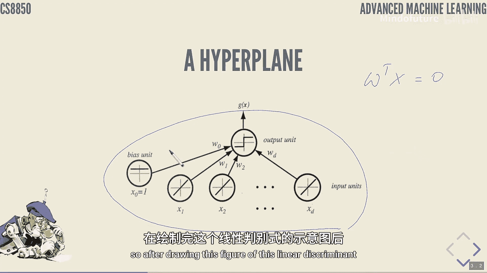

嗯。Frank Cresembl as you got inspired。Or so connection with the neuron discovery and neuron was discovered by Ramon Kahalal。

 and this is one of his hand。Drawing on what he saw in the microscope。He， basically。

Discovered a specific form of staining that would reveal those neurons。In ratd brain， I believe。

 but basically in mamalian brains。And。The weigh this neuron。

 the actual neuron in our cortex and mammals， cortex and。嗯。

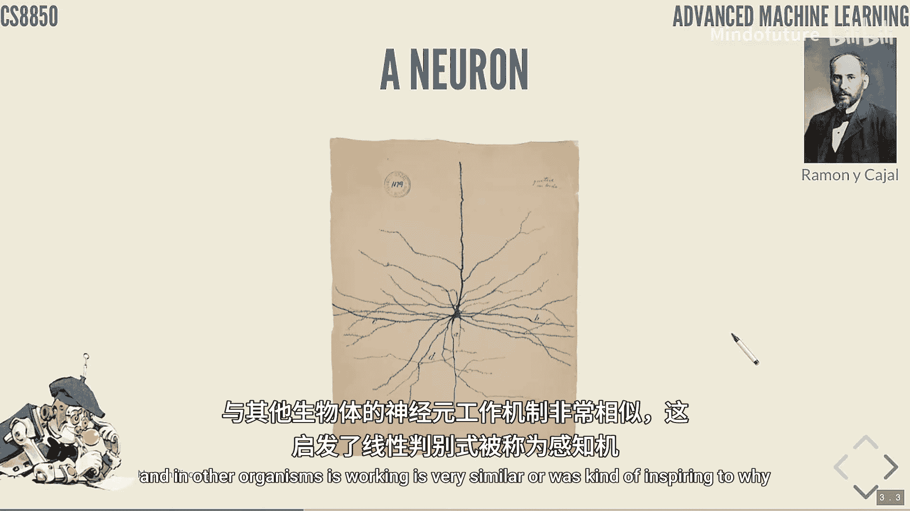

And other organism is working。It's very similar or was kind of inspiring。

To why the linear discriminant was called perceron。

The neuron has dendrites which are connected to axons or outputs of other neurons。

And it has somebody soma。And an output axon once the action potential， well。

 once the potential of the sum increases。Some threshold， which is called action potential。The有人。

Produces an output。 It fires。So what Perceptron does， it has input。Through dendrites。

 so they're weighted， so they have different strengths， each thendrite and quote unquote thatdrite。

 of course。Eects the input differently， so if this input is not as important， the weight is small。

 if this input is negatively important， the weight is negative and if this input is super important。

 the weight is high and so on， so you see the analogy when we it's still the same geometry。

 we're still in a simple。Back there space。But once people started thinking about this linear discriminant。

Biologically。And。Yeah。It opened up a lot of ways of how to consider new methods or how to。

How to work with the linear discriminants， maybe with a rotating hyperplane。

 which we still that it's much more fun to think about neurons。And we human。

 need inspirations and need we humans need inspirations。

Then this rebranding of a linear classifier into。呃，而且床。

Attracted a lot of attention to the field of artificial intelligence。

 It's going to created machine learning and created them。TheLearning field in general。

 So all of those products of the inputs with the weights are summed together and then thresholded with。

No and differentiate of both threshold function， that's important。And then。

Returned as an output and if the output is incorrect。

 then there is per subron regarding rule that we will just go into shortly。

 so very similar or analogy to a neuro by analogy to a neuro very simplified。你不扔。Okay。

 so how do we optimize all of that， how do we learn especially given that this is a nondifferiable function and as I told on one of the previous lectures。

 we are not going to use gradient descent well， first of all we need some criterion or objective that we will optimize。

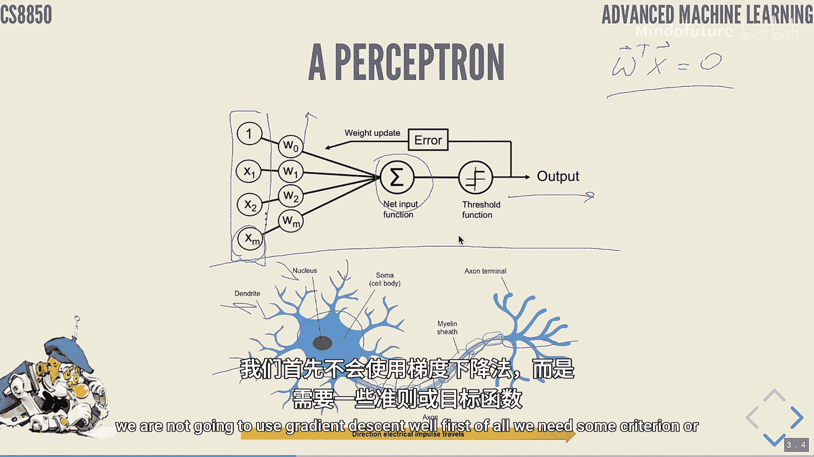

And our criterion is。Let's notice it's the distance。Of the point well。Oh。As assume the W is。

normal let's call unnormalized distance of a point to the hyperplane and multiplied by the label。

And we only consider incorrectly classified samples。So incorrectly classified samples， change color。

Will be those。For which this value is less than zero for we already considered that for correctly classified samples。

 this should be positive， this value should be positive so for all incorrectly classified samples this will be negative and this criterion with this minus sign in front will be positive。

So we want to minimize that number。And， well。Ideally， there is nothing incorrectly classified。

And W is parameters of our model， so those weights of the percept。

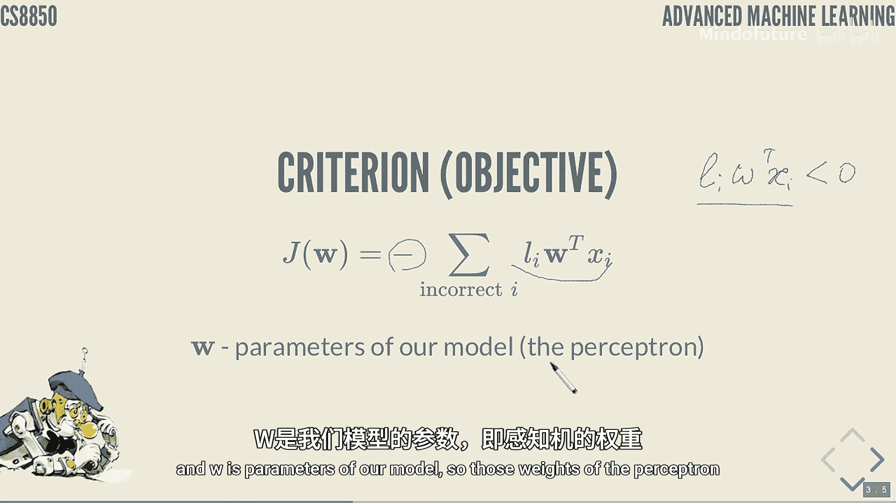

There are two algorithms of the perceptron， one algorithm is patch。

It considers the whole dataset set at once。And in bad pericron。

 we have a bad perceptron we have a few inputs， it's our initial value of the separating hyperplane normal。

Some learning rate， a learning rate can depend on。Iteration， so learning rate function。

 some criteriait is when to stop。And。We initialize our counter of iterations。

In the end of the patch Peron， we return。AW our solution。Hyperplan。

So what this algorithm tells us is repeat until this criterion。Is less than。Some threshold。哦。

So if there are no points in the。So why is the set of samples misclassified by this current W current hyperplane？

一方。And。There is nothing misclassified this is zero and definitely less than the threshold。

That what we do， we go through。Multiple iterations， and at each iteration we update our W。

 the current W with some learning rate discount。Of sum the sum of L， the labeled times specs。

Only for me classified samples。But for all misclassified samples at once。

Another algorithm that is called stochastic algorithm。

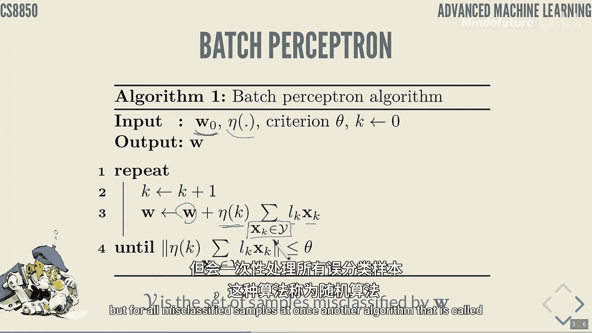

Or stochastic pericron for stochastic pericron。 All we do is we initialize the W and。

Set the counter to0。人都会 keep going。呃 through。Our data set one by one。

Liinearally just touching each point and checking if it's misclassified by W， that is notice if。He。

K times W transpose X K。Is less than0。Then。We adjust the W by。LLK Xk product， So label times the。啊。

valueue。They actual。Loation or the actual data sample。

So and we do that until all patterns properly classified。So that's kind of。Interesting， right。

 why would that even work so we take the W， remember。Theト dimensionional shape。We have double。Here。

We have samples of one glass。On this side， and we have samples of another class。On this side。And。

The W。嗯。Yeah， the， the W goes。I think this is the current W。 well。

 we don't have a misclassified in this picture， but if there was one or some misclassified。

 that say here。So this sample would be misclassified because it's negative。

Let me just the color so you can see what I'。Talking about。So if this sample is misclassified。

 we're just saying， oh， okay， add this sample times the label， which is here。

 we already multiply the label， right？嗯。And。T that jump over there。

And keep doing that chaing motion back and forth as like until you converge， will you converge。

 well surprisingly， and we will prove it now。

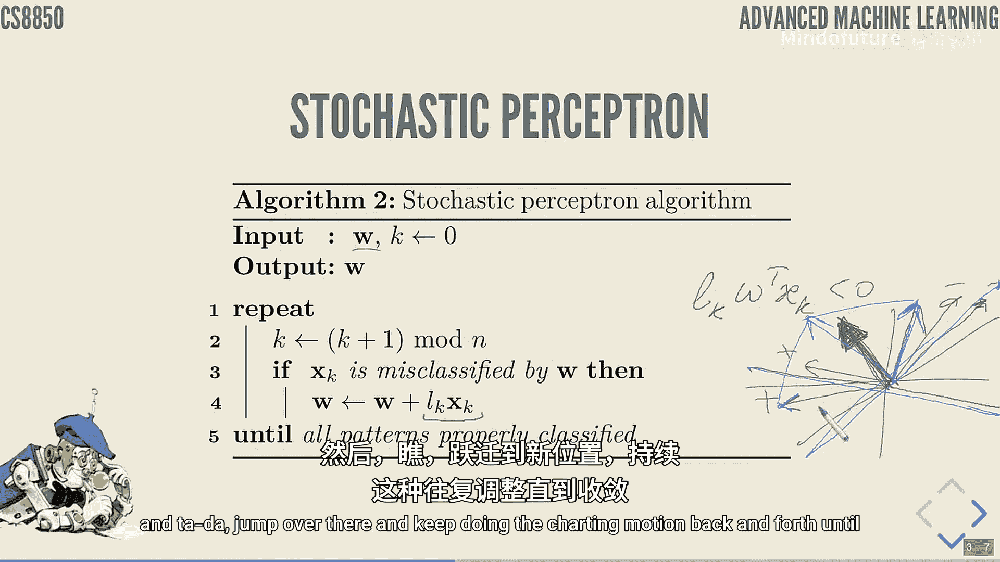

Sttochastic algorithm convergence theorem， if the training samples are linearly separable。

 this is very important。Modifier or。requirementquirement， if they are linearly separable。

 then the sequence of weight vectors in line 4。Of algorithm 2 will terminate at a solution vector。

Surprisingly， again， look what is happening。We have。こ color。We have some random hyperplane。

We multiplied our points。Whether the sign。I that those are。Points of one class。

 those are points of another class。And as long as they're all on the positive side right here。

 everything's fine。But then。If there is one point on the negative side， that's L I W transpose X。

Its less than zero。We just make a step。And totally quickly。

 not smoothly change the location of the hyperplane and then do it again because now all of those three are misclassified。

 so say we check this one and we check。And jump here。And through this jumping motion。

we constantlying get jumping motion， we again misclassify as labels， why should it work。

 why it converges， so what Drsmbl has done， he proved that this algorithm converges。

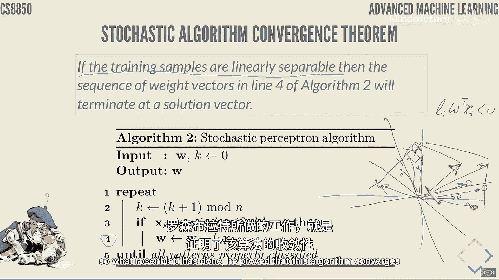

And let us try to prove it， too。So。Let us show that for any solution， W Tilde， the following holds。

 so W Tilde is the data set is separable and W Tilde is a separating hyperfe that does separate the solution。

And。Okay。So， we need to show that。K is our iteration。We want to show that for the next generation。

 what we have。😔，Is closer。The distance from W at the current at the previous iteration is larger。

From the optimal or its not look， it's not optimal。

 there is no optimal in from anything that separates two classes。Again， need another picture。

So there are multiple。Hydropplanes that would be a solution。

 so W tilda is any of them it's something that separates the classes。

 so we just need to show that with this algorithm。With each iteration。

 we'll get closer to a solution W tilde。Or be no worse， less than oreccota。Let's try that。So。嗯。

This is our line four in the algorithm， right， our next W， WK plus one。

Equals Wk plus misclassified xk times its label。So we know that for true， for the solution。

This holds。for WT， there is a separating hyperplanes， so this inequality holds。Then。If we。you right。

This equation。By adding the boss。Ss。Minus alpha W焦点。Nothing changed right。

 we added the same thing to both sides of the equation， it's just the same equation。And then。

If we square both sides。Nothing will change either， right？It's just the length of this vector。

Versus the length of that back there。Because if this equality holds。That means the vector， see。

 this is a one vector minus a scaled version of another vector equals yet another vector。

The equal is a算 state that means their element wise equal。Which that's how we got W K plus  one。

 But if their element was equal， the length are equal。 That's what we're done here with。adding L度。真的。

The left hand stays the same。But。Let's open up the right hand side。我。嗯。Let's try that。

So what do we have。Just going slow。 There' is nothing scary here。

 but I want you to understand how these things are done。So scalar。back there。sorryrry。

 this is a next。So over that's square。Of L2 norm tells us it's just that that we。K minusなだ。話。オッきー？え。

And when we multiply those to。We do the transpose。But。This things that。Transpose is nothing but。

Just the e norm squared。Let me。Actually smell it out。

So what happens because we're multiplying two vector， there is a transpose here。So we started。

The vector norm of one vector。But， we know。It's equivalent of。Be norm is an number number。

Just so you know， but then we squared。So this X。Is。What's inside。And I呢。

Working through so you are comfortable。Right this again， is nothing but L norm squared。

So we're right it here。The next part comes in two pieces， one is we take。

This and multi supplied by this。We get。WK。ななし。m goodW that。Transpose L， K， X， K。But then。

We get another one。 We get。I X K transpose。Times。WK。さ to mean。But'll notice。Here。

That this is a scalar and this is a scalar and it doesn't matter if you。Get a scr。

This way or that way。So theyre equivalent， that's why we just sum them up and I have a two here。

 the answer is the same。 and then you get the norm here。So that word is clear， I hope。

Or pose and derive， well， I'm not writing here。You can just。So I have this bar。We can do it。So now。

We just follow the algebra。We bring this inside or multiply through。Nothing else silence here。

 simple manipulation for now。And then。We know that the step four， remember。In the stoastic。

Pers for algorithm step four happens only if Xk was misclassified， so because Xk was misclassified。

 we know that this holds。So it's less than or equal to zero。Its this expression。That's expression。

It's less than3 equal to0。So， it is negative。Because。It is less than or equal to zero。WithThe the。W。

Okay， it's negative。And we're simply。Drop in。Oops。Let me think。Okay， I found a problem。

 I missed a two here。That's why。So there is no two here。

 but now I added it back and then it makes sense， so this is negative and if we drop it。

From on equation。Then the remaining part is larger than it was before before because we're not subtracting that part right。

 so， just since Xk was misclassified。This bar is negative。Were removing that from equation？

And what we have seen without this part is larger than。What we had before。

 that's why instead of equality。We have， we now have well， and again。Maybe zero， right？

It's less than or equal to。 Thats why that's why we replace it with the less than or equal to sign。

And。

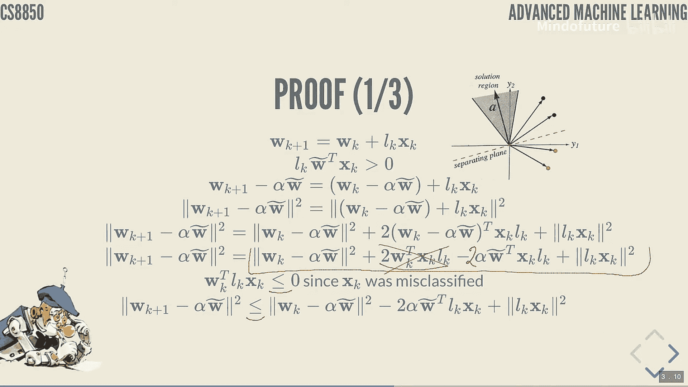

I will cheat a little bit。I will fix my slides on the fly in the lecture， that's my cheating。Okay。

 after this part is clear， okay， alpha is just a positive constant trend， so some some constant。

Wett know yet。So。We established this。So far that。W。

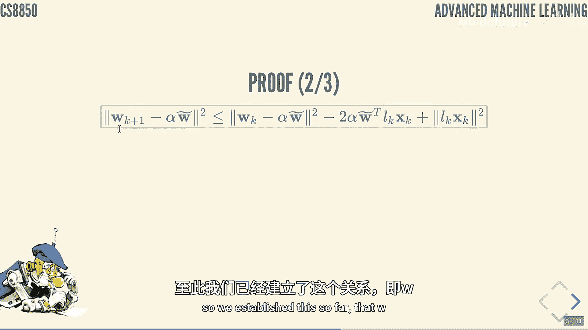

At the next declaration。Minus。Scacaled version of our solution W。

W at the next iteration when a scale version of a solution W。

The distance or the length of the vector is less than or equal than。This number。

And it's a scalar number。You can be sure of that。Let's introduce beta squared。Let's just the call。

Beta squared。Is the maximal。Norm squared norm of our data。Samples and。Miclassified in this case。But。

Yeah， maximum maximumim norm because we are onlyconceing。Me classified samples but。

I guess any pattern back there because。AndThat would be simpler to think about it since the label is just a signine plus or minus。

 it doesn't matter because we're squaring。 that's why we drop the label， so we have maximum。norm。

Beta squared is the。Maxxiical real of a sample。干嘛？Is。Let's introduce Goma as well。

The smallest inner product of the solution vector with any pattern vector。So， we have。Bey the square。

Maximum lengths of pattern vector。Squared。And we have。Coma we're just again， just definitions。

 Let's just introduce so we can。Simplify what we see on the screen。And。好。But comment tellss us。Is。嗯。

Let me try to give you an invitation。So we have a hyperplane。As。Well， then it。

For it to go through the range。Streened。So we have a hyperplane。That is a solution。Of the classes。

OfWhat this is doing well。Will move the signs。 So like I'm drawing it slightly slightly differently。

 but what we mean here is。We're taking a sample for which this distance to the hyperplane is minimal。

So we're taking a sample that is closest。To the hyperplanes。 So no this， not that， but maybe this。

 maybe that or maybe there is one。Right here or one right at the her Pla somewhere。

 so that's our comea that they are。a minimal distance to the hyperplane。So if you look at here。

 so we took。The smallest of you here。圆吗？And we took the largest value here。Wait。

So we're saying we will add。Maxxiimal。But we can add and we will subtract minimum。

But we can subtract。So our bond holds， well， our bound holds regardless for any。Any values。

 but we are saying this is the furthest bound。I think we are furthest apart。The lift the。

Right and it's as large as it could be for this specific data， that's what it says here。是。Okay。😊，And。

If we set our alpha。To beta squared divided by gama。Then。We will。

End up with the following inequality。Just plug alpha here and you see that you get minus2 beta squared plus beta squared。

😔，You are minus by the squared。 the distance to the solution。At each step。

Is reduced by at least beta square。At each at each iteration， that's what this says。

 So at each iteration， it's at least it's。The inequality less than are equal to。

So we had that distance。And。We subtract subtract。 Well it's possible reduce just more， but。

Because we took the largest， remember by。This common beta assumptions， this is the largest。A。

Poss value。But if it is smaller， then that means the reduction or actually。

 this is the largest possible value means。This is the maximal possible。好。Re actionuction， I guess。

Okay。

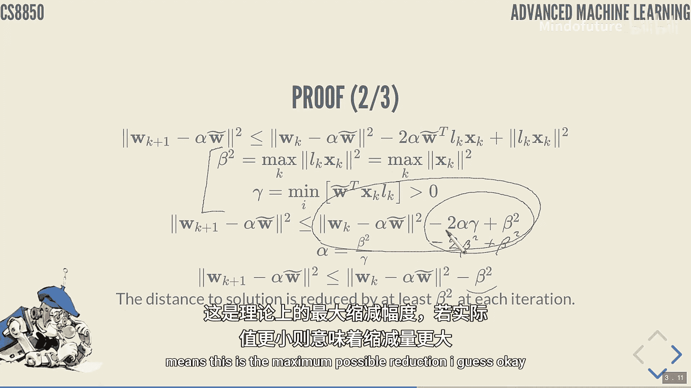

So final steps， we arrived at this inequality。And after K iterations。So we know that we are reducing。

But at least beta squared。And after k iterations， we are reducing by k be the squares。

 if we start with 1 and we get the k plus 1。We got we made K minus。K beta squared reductions。

So in the distance。This one。Can it become negative， So it cannot be less than。

Or we called some negative number， so this number can only be positive。So we can reiterate with。He宜。

Maximal number of iterations is so we cannot do more than k0 iterations。And。Yes， K zero is just。

This ratio， if you plug a0 in， you'll get zero rate。So we bounded， we know how many directions。

The cell good will make。引窝日。For our W。To get to a solution， W。Were in a zero distance。

So if we initialize。W1 with0。Let's start with a zero vector。Yeah， then we can so。

That's what we're getting。Alpha squared。So just algebra manipulations。

And we defined alpha as beta squared divided by gamma。Remember overber。And when we plug that in。嗯。

Deition of alpha。let's check was it beta squared。 I think it was beta squared divided。没也。Yes。

 let' second， everything works out。So alpha squared is betata for alpha square gamma squared。😔。

And that's how we got commona squared here， be the squared then be to the fourth。

Canceed and then we'll just plug definition of beta squared。

 it's the maximum value of the pattern divided by the point that's at the minimum distance to this final solution remember。

 there are many many solutions。😔，And。If your final solution by chance， will end up。

In such a way that there is a point super close to it。This value is super small。

This is a small value。And this is any reasonable value for any reasonable value。

 this can go as small as it could。And your K will be the largest， it's kind of counter into ease。

If you're algorithm， you're all getting converges， but if it happened， it can ofverge。

Such that one of the points is very close to the solution。

The number of iterations will be maximumimal。Think about it and that should help this whole proof and this inequality。

 you will work on it in your homework， it's all covered。And explained in the court homework。Well。

 I mean， explain you will explain it to yourself by going through the homework。

 but that will become super easy。

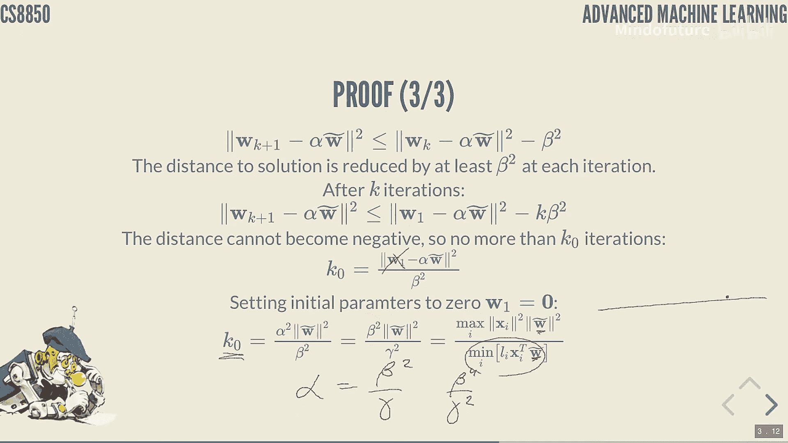