# 高级机器学习主题-CS8850-｜-Advanced-Machine-Learning-p16-P16_感知机扩展--BV1sapPz4Ewx_p16-

Pciron is an interesting algorithm。And one of the first where learning was probably converent。

In several。But there are a few or a couple of witnesses that we want to correct about it we'd like to correct about it or approve so one of the things is the following。

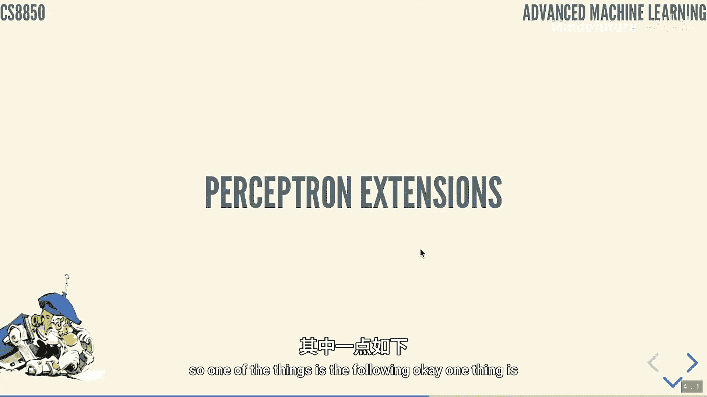

オケ。One thing is。If we have。A separable。Cnily separable data。And let's say。This is actual data。

 So we are in。I don't know any beorganization settings。

We can have as many solutions or pega and can have as many solution as it once。Or。

In things many rather。All of those。Irop lanes。Will be the first transformation solution。

We can arrive by just by a chance from than starting somewhere at any of them， and it's fine。

And so some of the solutions will be。Too close to the red class。

 some of the solutions will be too close to the green class， is it possible？To。よ。

Yeah iss it possible？Or would be nice， right？If we could intuitive，ly say， well。Imagine we placed。

And looking for some color good place art。Solution I plane right here。

 well at this point green is steel on that side consider this the directions of this my。

Drawing in the screen but still on the side。 So what if we just didn't collect enough data and it's a mistake there is。

Now， there go go green。嗯。The actual data set is like that， right？

So the same goes backward to the right class， what if we put our solution to the class to the right class？

But the data that we collected is actually slightly over， so intuitively。

 but we will talk later in the class about。嗯。Proper proofs for that proper considerations。对 이제 맨날是。

A hyperplane somewhere in between in the middle。So， that。衣服。オッケ。C though。Somewhere in the middle。

So that if we failed to collect the data correctly。We're still kind of leaving some gaps。

 so some green can still go here， some red can still go there。

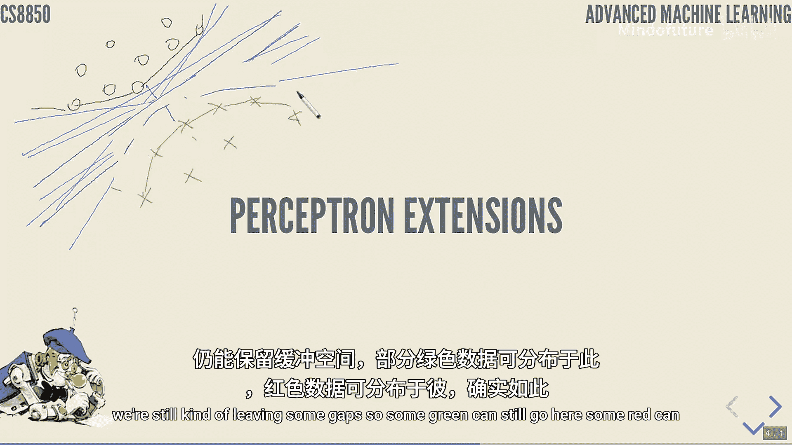

So yes indeed and again remaining this is R W and the Ys are our label time X I mean I never used the Ys on the previous slides just because it's yet have another thing to remember。

そた。So margin tellss us。That we'd like to have。呃。A region in which we don't allow a solution region in which we don't allow any points。

So for example， in for one or previous。Examples， if this is a separating hyperplan。And。

Our Bos ended up here with Y Bos or label times X。But we have a margin。

 we don't want other one to be too close。We will shift there。Iber plane over here。

 this is a director this is just that'm showing you。

So that our margin is large and there's nothing in here effectively if we fleet the sign of those points back。

They will be on this end of the Hyplane and it's kind of we're adding。

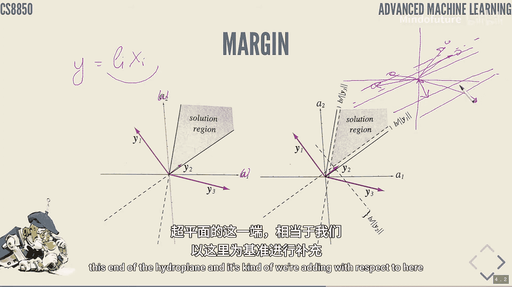

ううんうんどうですかどうですかね。With respect here， we're adding some。Some cap around or some。Sorry same color。

 same color。 So we're adding some。嗯。A a strip of where the points are regulated， so that is our B。

 our margin。

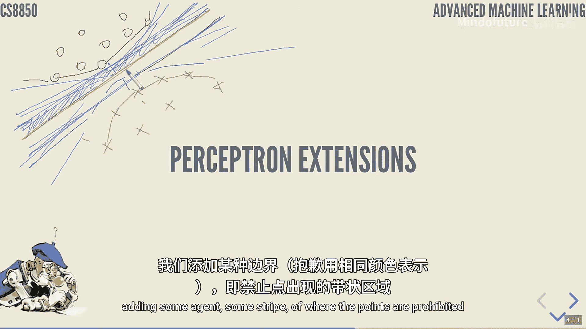

嗯。So for various points， for various wises， those margins will look up differently。导。

How far they are allowed to be from the Hyplane solution Hyplane。

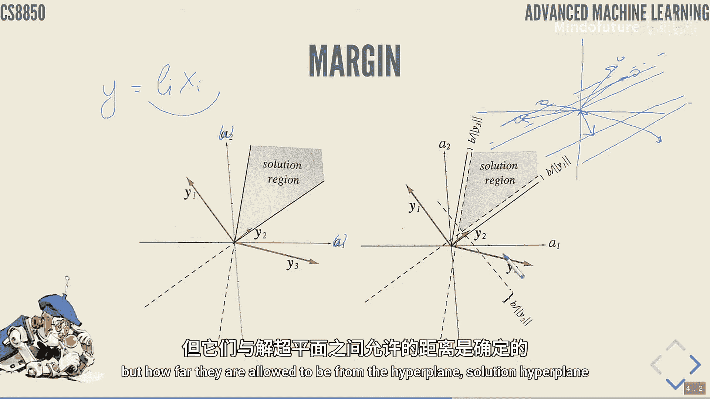

So indeed， we can take the stochastic pre algorithm and be formulated to work with the margin。

 we define how much we want the margin to be， so the gap at the points are not allowed to be within。

Thecinity of the separating aplane now we define the learning rate and threshold and then our incorrectly classified samples are those that are closer to the hyperplane than the Sc B。

 so we have hyperplane that we're going to use on mu data。

And we hope that it will generalize better if it's not too close to our training data。

 that there is a gap B， so it's not less than or equal to zero。

 it's actually less than or equal to B。So from either side， because this negative。

Or either positive class or for negative class， if they're classified incorrectly。诶。

But even when they're classified correctly， that they're too close。

 the point is too close to the hyperplane， this condition will trigger。And as before。

 I this is just our J criterion。il W transpose。For。In the set of incorrectly classified samples。

So this is nothing but the gradientient for that particular symbol right if we take theusive of J。呃。

Re respect family we。We did nothing but。So we're doing this gradient in descent and yeah。

 we can minimize this objective。With the margin now with the margin B。

 so in the hope of no theoretical groups yet， but in the hope that we can do better in practice and our stopping crition is that when everything is。

Away on the right side， on the correct side and away from the。呃。Separizing group。

 classifier plus the margin， so remember before we just had greater than zero for all of the sum。

That's one generalization。A hack，A beautifulauti one and works another one is let's look at this object of creativity。

What is the problem with it or the problem with it that it's discontinuous。

 so it's highly discontinuous and we've seen that the points will be jumping back and forth or the steps will be jumping short I will show that to you in the next section and that's not too nice but we would like to have something smoother and we would like to be able to optimize other criteria than just simple。

妈呀，不。嗯。Pres it from objective function。 or from credit。

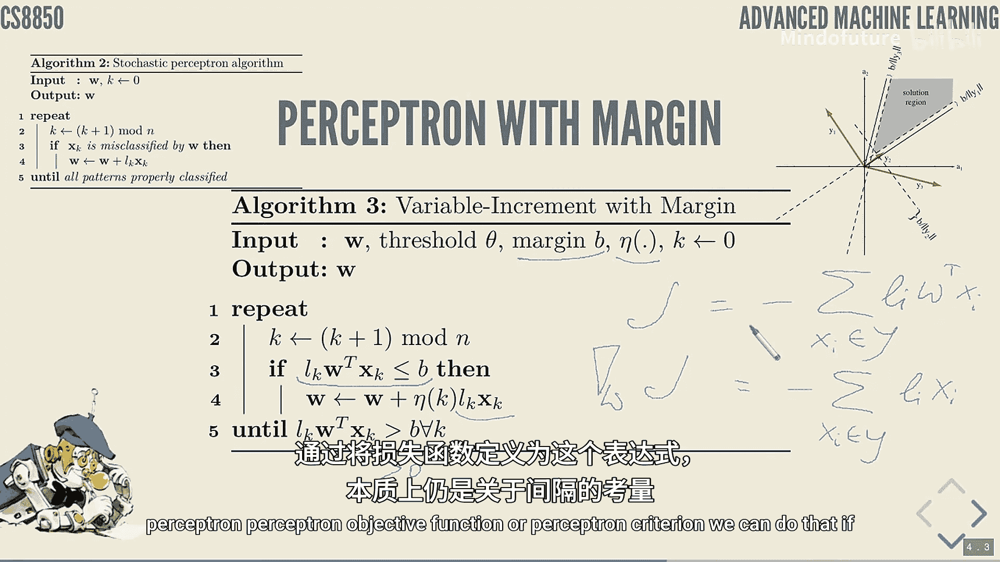

And we can do that if we define our laws as。This expression。Which is。嗯。Nothing but。

So we still have our margin。We want to deal with the margin because it's useful for generalization。

 that's how innovation goes。But instead， and I reproduce our previous crad。Incorrect， still in。

symmetricSo that this is our previous criterion， were normalized by the length of that。嗯。Or yeah。

 the， the norm of the sample anywhere added。No2。Margin。

The gradient differentiated with the respect na volume。Will be this。

 well this is a codeic function with respect vector to w， so we get the linear。

Ragt with respect to W， and it's still like。あ。Make an objective the credit is a schemer。

Function that they vectorar terms a scalar of vectorar as we discussed before E。

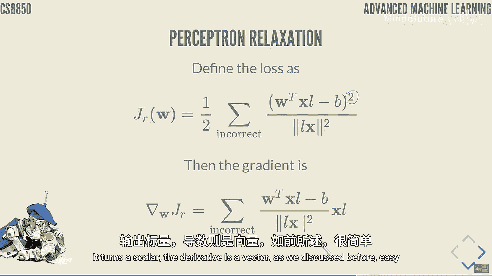

And then。We just use the stereative。

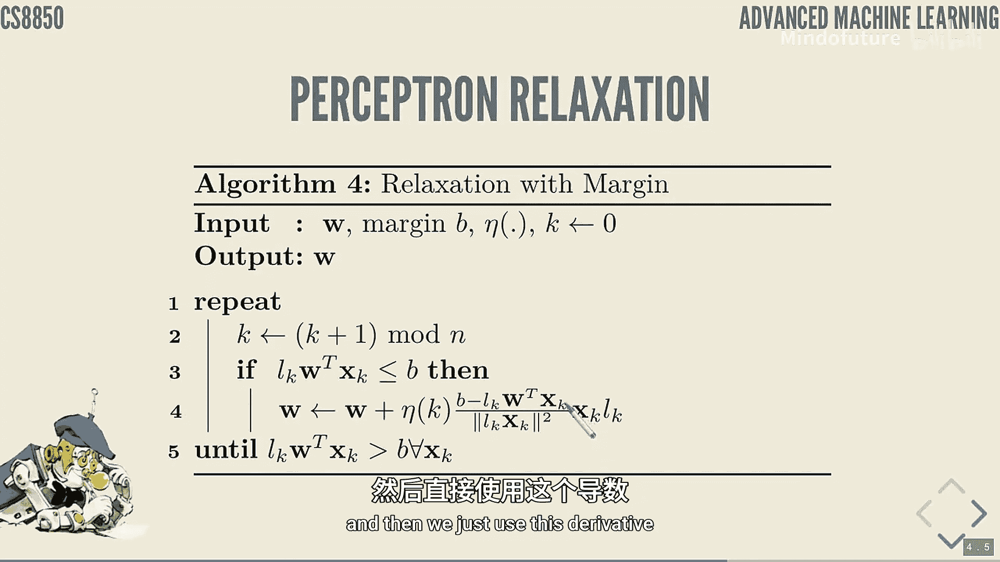

This before。それ。So this is our derivative。 we were using。

Firsts the pro derivative before h is minus L， X。And we were minimizing that objection function。

 so the minus。T plus bit now。

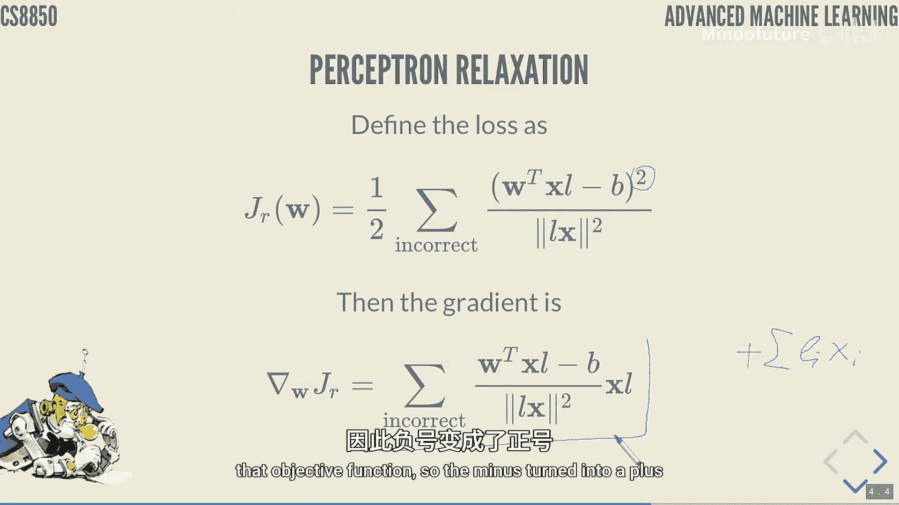

We have a learning rate， which can have an negative sign。Jing go forth， so we fleet them。

 that's where the next assigned went。We have the same perron with margin that now。

With a different objective function that is smoother than the original one and the smoothness。Well。

 the original one was totally discontinuous， the smoothness has an geometric in the degradationdation。

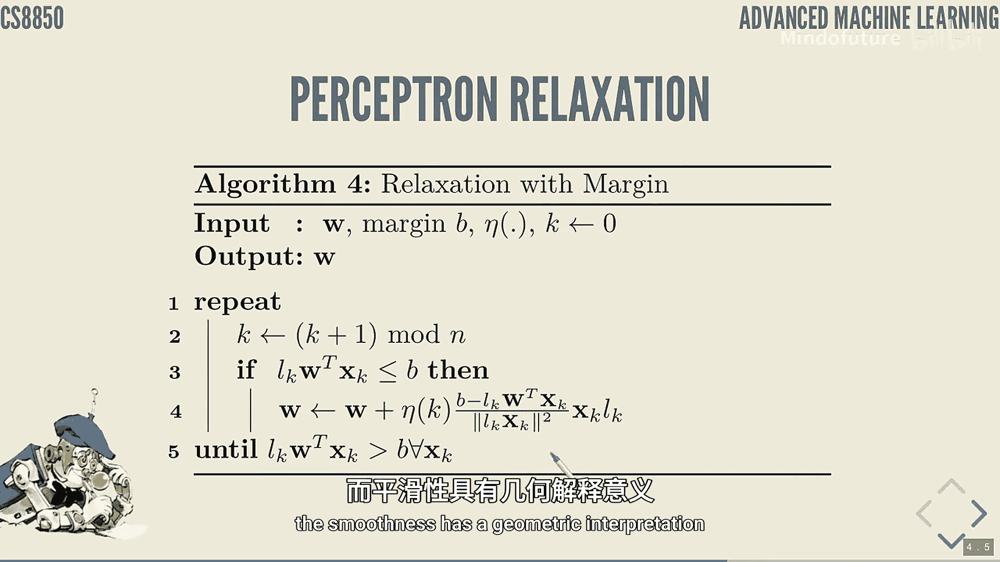

So we have RK if we define RK as this ratio。Just our area was just without。嗯。ね。Additional l X。

Then RK is the difference to this hyperplane， which we know， this hyperplane is defined。By Yk， again。

 the reminder， yk is L times xk。It's our magified data sample that's scaled by the label。

さ basically minus one one。But now。This new。嗯。Herling here on the figure。Is。A function of W。

 so the normal Yk or xk then z。Is the normal to the hyper planee and all of the Ws or。

Is here all of this novels。We'll minimize our solution， we'll minimize or。Sorry， all of that is said。

F the equation that make the equation equals B。嗯。Pet the solution。

 and by doing great in the sense in。E the times are gay， we actually。

Taking a current W and smoothly moving it towards。Thisplane in any of Ws on this hyperplane would satisfy。

The solution for each is why。Is correct。Well， anyways， so that's a theron。Relaxation procedure。

 it will access the discrete non smooth。Objective function of the original perron algorithmga and makes it smooth and。

N get behave with a margin so that the peritron generalize better。

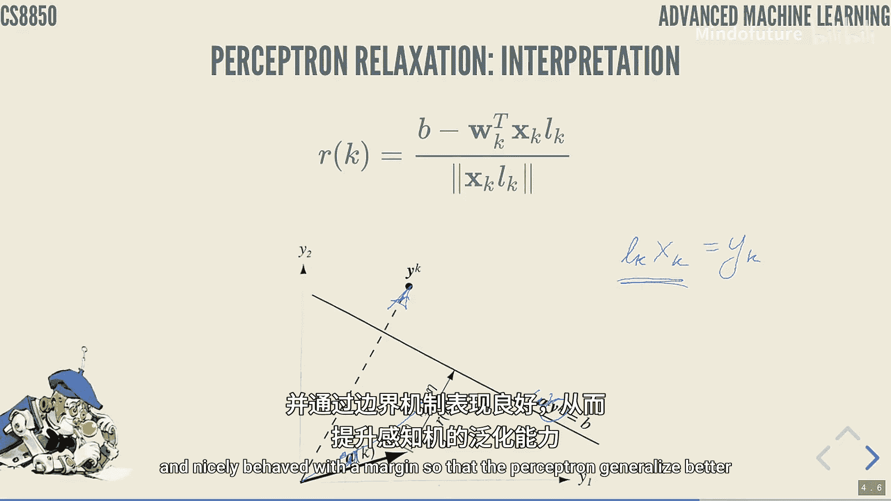