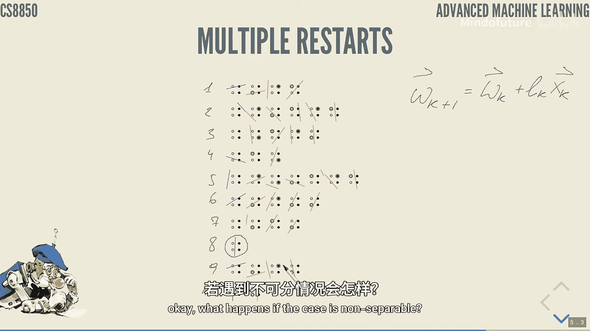
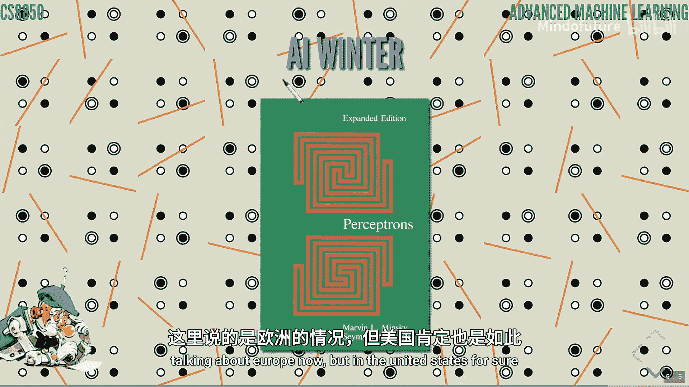
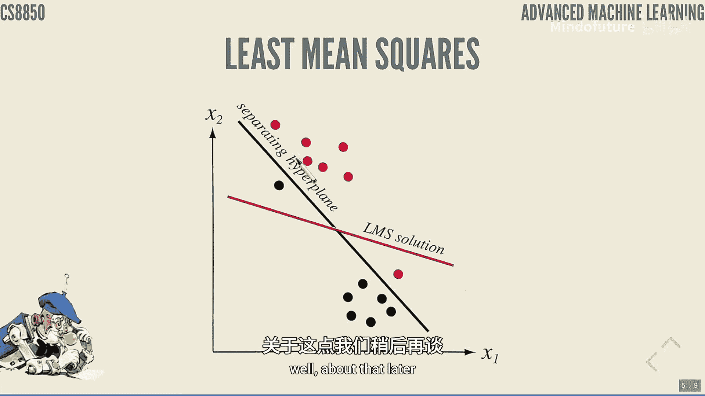

# 高级机器学习主题-CS8850-｜-Advanced-Machine-Learning-p17-P17_针对线性不可分类的线性分类器--BV1sapPz4Ewx_p17-

是了吗？Picproron is beautiful and extensible in a separable case。

 but what does happened in nonseparable case， let's talk about it in this little episode of our lecture。

So， I wrote。Persceronal， sastic perceronal and。I will make it code available for you after you turn any your homework because it's one of the tasks and I generate step by step solutions here so this is one。

诶社微选其 c。We start with a separable case with just four points and this is our current。W solutions。

We initialized W randomly and this is our separating hyperplane。

 separating hyperplane places this point on one side and the stay points on the other side doesn't work then it considers。

This point doesn't me classified。Moves the solution considers the next point as misclassified moves the solution。

 so the rounded point is a misclassified point and in many， many directions or just a few actually。

Given that it's only four points， it converges to something。Solves the problem。

 several example works like that。Deliberately was looking for something that gives me a longer solution for this very。

 very toy problem， toy example。Most solutions are very short。

Randly initialized correctly or just took two steps and converged in order。

 all it does that would be。remember the step4，你能聊那。

Nothing just take a misclassified point next scale and just go into that direction。

 vector there some。So。Those are different runs for exactly the same problem。And the painting on。

这便 on the呃。Random institutionalization。Numbers。Steps， I'll takes， varies。

 but it surely the largest your solution。Okay， what happens？

If the case is nonseparable。If the case is inseparable。Liinearly nonseparable is's here。

Look at this example or。This is an actual run。For。Hundred steps， hundred durations。

go from one to three and then go down if you want to see how they' are written。

Work so circle is a point that theyll didnt consider next as the next misspecified sample。

This is a classical example called X or air， so exclusive or problem because if you put。

Access on that， this point will be 0，0。 this will be。1，0， zero， one， one， one。And。If you。啊。

And give the labels to the class at 110。11 should return0，0，0 should returnze， yet。0，1 or1，0。

 should you turn one。So or would return a one here as well， but exclusive or returns this here。

 so that's why exclusive or probably when the case is nonseparable。

 the algorithm will run indefinly the perceptron original perceptron algorithm。

 that's what you see on the screen one possible run on a nonseparable case。

 it just continues running and running and running and never。

Convert because there is not a solution well a simple toy problem， not a surprise。

 we see that just by naked eye that this case this case is not linearly separable。

 of course it will not be able to do it but Mar Minsky and sameor pepper。

Cas an AI winter by publishing this Perceptrons book where they， among other many， many other things。

 proved the Ethereum that perceptron is unable to separate。Los other cases。And。For next。

However many years decade or two， people didn't know what to do about it and AI wasn't funded as much in the academic circles in the United States。

We're not talking about Europe now， but in the United States for sure。

 but what we usually encounter in France looks like that， it's not。

As Polish as exclusive or problem and something that we can tolerate。

 okay if we misclassify the sample， it's not a problem， it's okay right。

 can we still find a separizing hyperblin？So， if。We change our original criterion。

 so the top one here is our original crron criterion。

 and if we change that criterion with the mean square squared error。

And then just differentiate and practically。The gradient and descent on the MSC。Yeah， so conence。

 then we should be able to solve the problem and why didn't we start on that？Like completely。

 why did we need anything else and this is coming to the practical question of choosing the right loss for the problem。

Turns out that least mean squares error is not guaranteed to find a solution， even if one exists。

 like in this example， so we'll talk about more about least squares in。

Our next lecture and it will be as fun as this one take home points is。Linenily separable。

 many classification problems or many classes of classifiers。Can be。

Are reduced to linear classifiers and linear classifiers among many。Include aifone as a subset。

Of classifiers。Support preventiontion。There also be a linear classifier and we still use it because it's very powerful。

 even in the separable or nonseparable but linear case。I about that later， so that I phone。

When you need to understand and to learn。From this lecture is about the geometry of the space and it's very good to be able to understand and visualize and have an intuitive feel of the geometry of the space。

 then you will see what the algorithm inventors are doing。

 like in the relaxation procedure say or like in the margin introduction to the preicron and then you can yourself solve a problem by following your geometrical intuitions about the data set。

That's the main point of this lecture and also。just pay attention to the proof technique。

You don't need to memorize that or the kind of。You lucky you remember that， just remember it exists。

And you just need to。Can I understand the steps？Of the proof and this proof will help you to solve your homework or to understand your homework。

 pay close attention to the situationt。Boys are。Close to the final solution。But unfortunately。

 as with many it's iras。Things you can only see that once the solution been approached。Well。

 about that later。

Thanks and talk to you in class。