# 高级机器学习主题-CS8850-｜-Advanced-Machine-Learning-p18-P18_线性回归--BV1sapPz4Ewx_p18-

Okay， here's our。嗯。Lecture。On some interesting and。Actually， even beautiful transform。

Princiipal component analysis。嗯。And we also cover something beyond classification。

 beyond linear classification， we talk about linear regression。In this lecture。

The main things that we will discuss is linear regression。

 linear algebra pressure that will be quick。And then in detail really clearly explain and goes through spectral theorem。

🤢，And then cover principal component analysis followed by dimensionality reduction demo。

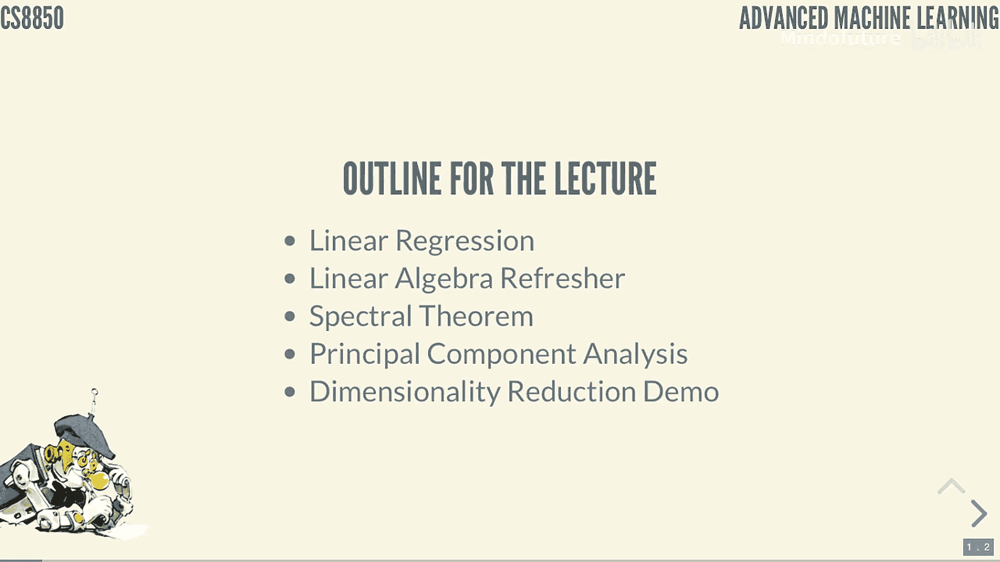

Okay， let's begin。Li regression。I have mentioned that already before we have discussed part of it。嗯。

And some of the previous lectures， and。You should know by now that。We are we all。

Legeander and gas for invention of the method， actually the method of least squares feeding。

And the name regression。TheCrept take。Actually not explaining anything name was given by Francis Carlton。

He may not be the one to fully blame for the name adoption。

 it's just reminding you what we've already discussed was。Observing regression to the mean。

 the tendency in biology of the offspring。To thanks to the mean in。They're phenotypes。

Like height of offspring eventually will go to the average height and so on and so forth。

How did the method of least squares？😔，Get the。Regression name attached。 I don't know， but。Anyways。

 it's just my bad beef that the name doesn't explain。Much or anything at all。

 We have also talked about this list squares。

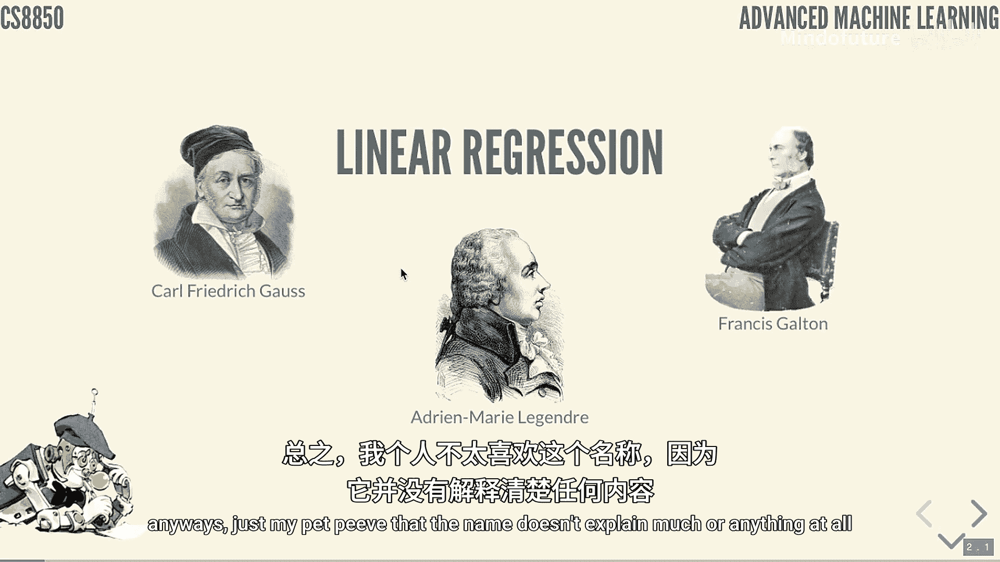

Meanless meanless squares on least men squares。应该是。When we were trying to。

Avoid working with only linearly separable data in the last lecture when we were trying to separate the data thats not necessarily linearly separable。

 but the problem there was the classification。At least means square solution will not always be will not always be able to find。

A separating however plane， even if it exists。So。It works in practice。

 but it's not guaranteed to find a solution right。But。Linear regression。For feeding a line。

Through a data set or fitting a hyperplane， through a set of points， actually works beautifully。In。

If we use method of least squares。嗯。For example， we have our measurements。嗯。Xes。

 and we have our response variables wise。So， we have。X0 x1， say， and then Y。Valable here。

So we want to find such a hyperplane。That。Can optimally fit。Pvicise。Such that。

The squared error of the y the hyperplanes is minimized。

So w transpose time x gives us prediction of the one。And we want。The linear predictionion， Line feet。

To the y B minimal in square root sense， so that's linear regression least mean squares。Or me， yeah。

 list me in squares。We're minimizing just the mean squares and regression。😔。

So instead of writing this。We can rewrite this in the matrix form and in the matrix form。

 everything is more beautiful in the matrix form， as you know， right， so W transpose。Times X I。

Is the same as X I transpose times W。Still， we're still in。Component wise element wise form。

 How do we get that x and W that's what I'm trying to say W actually is the same。In both cases。

 but X I， so。X， I is。It's transposed。Is the row vector X I transpose or X1 transpose。

 and then we go x2 transpose and put them together。And。X 3 transpose。And finally。

 our last X N transpose。Number of samples here。 It's the same hand。And this is our。X matrix。This X。

It's the same as here。So we take this x matrix and just multiply it。为W。

When we do each row of x matrix is multiplied by the vector and we get。A column vector。

Where each column is a prediction of Y I， each I row。

Another column which I throw is a prediction of Y I。So， the result of。This multiplication。

Will be a factor。Rejected。And we take all of our true responses。Simultane all。

We want to minimize square。A mean squared error， how do we get？That means squared error。That's where。

The transpose。Multtiplication comes in。 You can work it through， and you will see that。呃。

I probably need to add this and there's two ways to write the same thing。

 Those are two ways to write exactly the same thing。Because。

When we do when this transpose vector is multiplied by this vector， essentially it's a sum。

Of the squares。As we have。系。There's difference right inside the square bracket。

So I took this equation and they wrote it in the matrix form there。

Equivalent representations of the same。Mathematical expression。Once we have that。

 we can open up the square， right， it's like a plus B squared everyone。

That's the formula a squared plus 2， A B plus B。Right， well， only we have a minus。On despair。

 find minus nothing。Nothing can make us unhappy。 we have to A B， B squared。Only we have a factor。

 So instead of a。Minus B。Squared。We have。しピ。So this is the same right that's the same good old formula that you remember from your high school and all I do is I take this。

 multiply by that but it's transpose so here's what I get and then I take this， multiply by y and。

this white trans times。What transpose X W。With a minus and another one with a minus x。

the next that transpose x transpo is y。Those are actually the same。

The answer will be exactly the same， so I have two。Instead and then by transpo。Just let it right。

 I expanded once I expanded this。诶诶。Want to drop the wire， because。

The wises are given and they're not affected by anything if I will be minimizing this expression。

With respect to W， I want to find such a W that my least means squares criterion or loss is minimized。

And since W is not a part of what transpose y is it。This version trans I wouldn't affect my result。

 I drove it。And I compute the derivative of。呃。Well it just for this going over a screen。

 but basically。I take my list。Mean square criteria， and I want to know the derivative。😔。

Using the formula for now， we can derive it， but there is no need the formula of。Couter it form。

 so not just there's。This will be the B。And。Deive for this part with respect to W。Will be。

X transpose， x plus。X transpose X。multiultpl by W。And。Divative of this part。It is nothing。

 but this is just a linear equation， right？😔，就诶。W。With respect W。It's nothing but to a。

So that's what I'm doing。や。Let me write it here where there's some space。So again。

 the first part is x transpose x。Plus。Transposing this X transpose X。I believe。

Which is nothing but two xs per x double。This part。-2 x trans。喂hy。

Stative with this park with respect to Dubley。And。But I have one other hand。so系。Take。

That's what I get。No， said。This derivative to0， I can find the minimum of this function。Right？

So to minimize listing squares。We've got the which we just discussed。

Let's settle this zero and find the value of w that minimizes the expression。

So by setting derivative to zero。They essentially get S spark。Thank。This。To the right hand side。

 you have this expression now inverting this， so we're pre multiplied by x transpose x minus1 and as you've seen what is x transpose x。

PR X。Has。旨意。Times number of samples dimension。This is。Each row here is x sub I， right？

So it's a number of features， number of samples by number of features。

 so x transpose y is a D by D matrix。And。It is full rank and inverible when we have enough samples。

Well。Our number of samples is。Ratherer than。Dimenssions of the data。

I pre multiply left and right hand side by the inverse of x transpan eggs。And my list squares。

Solution。As。As follows。What you see here。It's called a pseudo inverse。Is expression。

Here is cylinders。And we arrived at it from differentiation。But。Another way is。To say xw equals y。啊。

That's what we want to have。But what we do is we。If we multiply both sides。By the sitting doors。

We can we can't do this。Not justて。If we could do that， we would find W immediately。

Because x is not full around， it's a rectangular matrix。We have this Su inverse solution。

Nquals again，7verse times y。😔，XDgger times y。Me。Those sir。嗯。Pas cancel。

So get identity density time stuff。Thanks。 why。And we have a solution。So。Interestingly。

So the inverse always exists。Even despite。The fact that this matrix may not be always inverible。

That we can compute cylinders as a limit。Of this expression plus excellent I。In德ed。And yet。

 when we are， as I said， in situations that when we don't have enough samples。

But the dimensionality is large。So inverse computation maybe unstable。

And other methods may be preferred。Instead of。The inversion。It's like the solution is there。

 it's not because it doesn't exist， but there are other me。九个ulating。For example。

 since we know the gradient。A weekend can just the gradient decent。

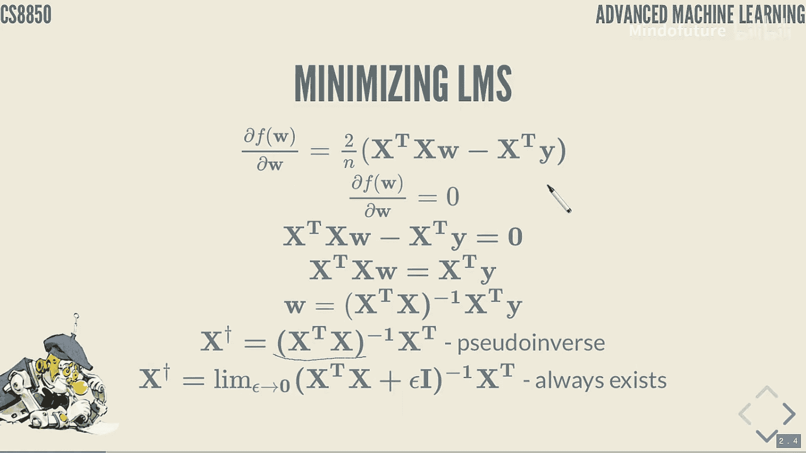

Okay， since we know the gradient， we can solve the method。F squares， we can。Or regression iterly。

So given the data set。

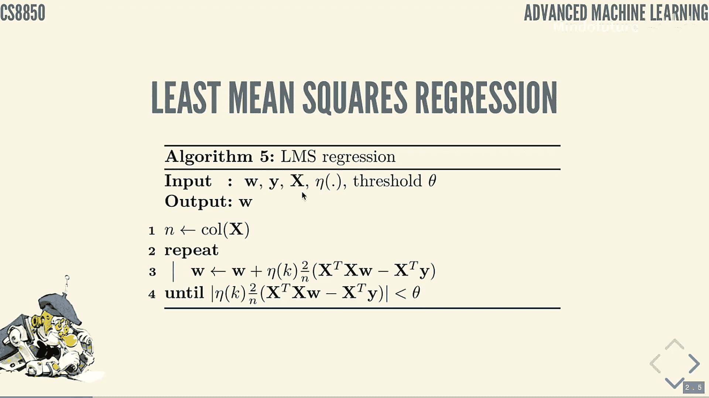

X。Some schedule learning rate， stopping criteria。The label that we want to predict and our。好。H不plan。

Were actually estimating some initial settings for the hyperplane normal vector。你 can。

Just apply gradient decent， but， interestingly。We can。

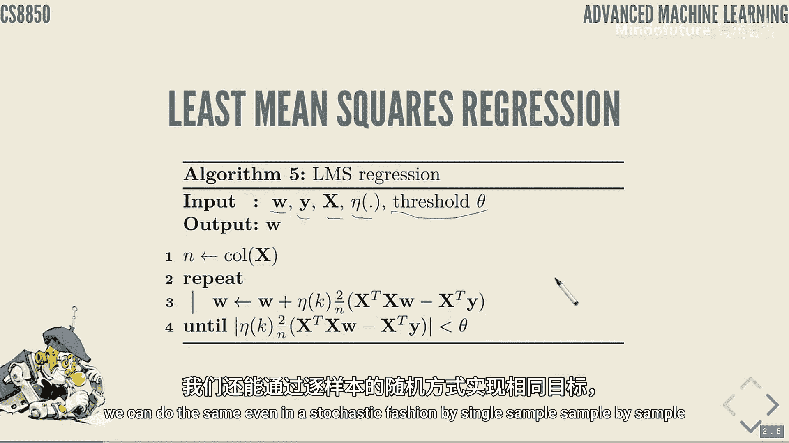

Do the same， even in a stochastic fashion by single sample。Sample by sample。 And remember our。

Let me try our objective。 the least squares objective was something。

Like Y I minus W transpose X I squared。So if we different it。Oh。先估计这。FW with respect to W。

Then what we will get。So we have Y I squared minus2 Y， I W transpose X I。Plus W transpose X squared。

Just opening up the square。This thing doesn't affect us at all。 Now， derivative of。

This with respect the W。Will be-2 I， I X I。I back there。Plus2 W transpose X I X I。Okay， make sense。

 W and X R。啊。あ。The vectors， so。Then， what we get is。Why I。Mus Y， I plus W。Transpose X， I。是嗯。

But since we want to go in the negative direction。We can rewrite it as。想不 you。Well， that why I。

 minus W you。Spo。是。Yes so this is our gradient。 and that's what we're using for a single sample。

 So we're to solve this square method over just。Doing great in the sun。嗯。

Near four updating parametersers of our normal vector。

It's easier said than done because there is a certain int in the algorithms and some papers being published。

On that by Bishop， Chris Bishop， as among others。And。嗯。

What Chris Bishops tells us that learning rate in this case needs。To be said。呃，G。

So it's very sensitive to the learning set learning rate。ok 啊。We can solve the squares by。

So the inverse method， we can solve this squares imperatively in a batch or in a single sample stochastic fashion。

And thus， we can。

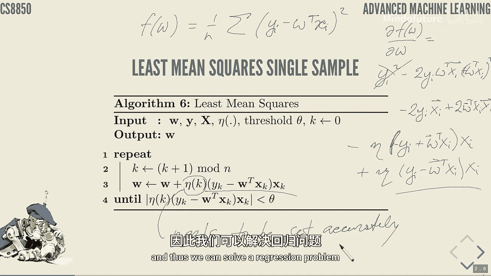

Sove the regressionggress problem。Okay， we one of those three regulationss。Or rather fe。

Listening square please is the correct one。And I need to。没事。This is a sarcastic。

So the one is what actually people call regressiong。 All of them are listening square feet。In。

There is a strong assumption in integration。Called regression， the traditional cells。

 And the assumption is that there are no errors。In。The variables rather than the dependent variable。

So the errors or uncertainty。Haveapp only in the by variable。 So if your X is a better variable。

 and you have multiple dimensions and next still。AndWe are implicitly maybe not at that。

 but we assume that。This is measureded with。You know， super humanman precision， very， very funny。

 never incorrect。Because if we assume that there is noise。Or uncertainty in the x measurement。

But not the way in this picture， then we have to minimize the squares of residual of this distances from our line。

And we're only considering linear least square。There， of course you can see any kind cover from。

As long as you can have efficientff procedure or you can take any kind of curve even if you have in procedure。

 it will just take forever。Could take whatever or will take much longer。

But both of those cases are kind of weird， right， Why axis no。They are to me， definitely。

 Why do you think that those access are。Acces in which the process generates the data lives。

The axis are a sort of anthropological construct， we created them by thinking of say how to measure the value of y and it could be in temperature。

But real model is coalizing and moving in。They may prefer totally different access and physical process will be described by a totally different access。

Not the Y and X， maybe its a rotated axis， maybe it's or maybe that then we know second the process is totally one dimensional。

There's only need size and the rest is just。Uncertainty of registration。Well。

Casesbound it could be this could be that。But given a cloud of measurements。

 maybe the best line that fits is the line that minimizes the distance from this points to itself or almost always line。

 you can generalize that to a hyper plane。So this is the。

This is maybe and they're all orly square feets。Our pseudoverse resolution is called ordinary least squares。

 by the way， we can generalize it by adding noise coherence。这。I a function to read about elsewhere。

This is coordinately squared on y。 This is coordinate least squared on x， and this is called。陀螺。Or。

The subject of a further lecture。E aフ Let's call easy a for now guys that's what I do。

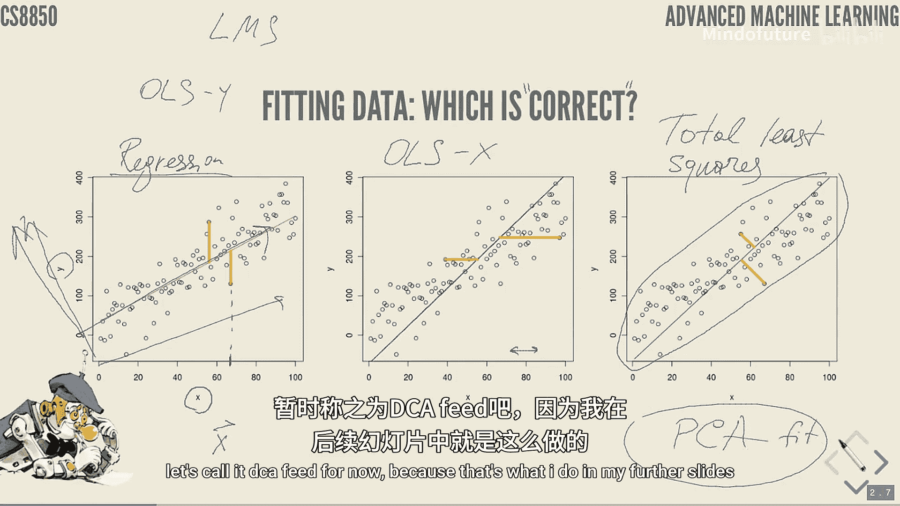

Any my further slides。So let's play with it with data。

 I will make this code available with this lecture。 I wrote it exactly for this experience。

 so you don't。 Well， the purpose of this exercise， one of them one of the purposes is to。

Show you hopefully that you you need to be not dogmatic。

 don't try to learn one's definition and think that's all it means that's all there is to it。

Like if it secretion， that means we do that and we always do that because other people do regressionion in similar cases。

Yeah， pattern matching is one ability of intelligence。

 but I hope your intelligence is better than just pattern matching and you will actually think about what problem you're solving and you will generalize beyond yourself。

So red line is Y feet， blue line is X feet and green line is the BCA feet。We're just speaking。Allign。

To the data that we collected。 and here I specifically generated so that the noise uncertainty only in the Y axis。

So you can see slight differences。 I personally don't know which one is better。

 They're all look the same when uncertainties and X access。Green hardly moves。

 theres two slightly white angleangle here。And when we generate。

Samples from a 2G Gaus and distribution like that。That they generated。That's easy。

 so far so good no difference。 I don't think I can miss anyone listening for either of the three methods which want to use。

 But let's look at another problem。 and the problem comes again from。

Our measurements of the world and our access that we assign to when we measure the world with actual physical sensors that are tuned to measure particular physical coerency。

 that's one gate， but when our。Uber megapixel high spec camera is collecting according to everything。

How do we know which access are preferable within that data and one of the statements I'm going to make。

Is that。We almost always are sure that the data that we're collecting is not as informative。

All of those pixels that we' were measuring。Because implicitly。

 we are know from prior observations in our universe。That。The processes that generate。to later。

Are entering a lower dimensional the data itself。Oh that's good were to talk about that。Human faces。

Which could almost all be reduced down to genetic composition of a particular human。For example。

And any other processes that usually are on a manifold of a lower dimension。

 it doesn't have to be a hyperplane， doesn't have to be a linear subspace。

But some lower dimensional space than what we have collected。这嗯。And we don't know the ISis。

So for that case。I run the following experiment。 I generated。One dataset。

 it's exactly the same dataset set in all this hundred little snippetspl。

 and I am slowly with each picture。Reising it。Yeah， Im going。Very slowly。As you see。

 but eventually going on full circle here。This point is。I。I makes it three out that。

And look what happens， observe what happens to the x line feet。Especially here。

 and there was what happens to the wide line feet， especially here。 So this one。Classical aggression。

 as defined， assumes that all uncertainty is just in the way。And。

What I want to demonstrate with this or maybe you think of it。呃。The data here has some intrinsic。

Frame reference。For our coordinate system。Our space， linear space。

And this framework of reference is rarely the same as we are。Measuring the data in。

It allOur measurements are always in this frame of reference in this linear space。And。

Depending on the alignment of our measurement space and the interesting data space。

The results and thes are totally different。LikeThey could be argued like this。あね。

But look at the PCA line PCA line is always in the data。Intrinsic。リト。

So why would that be interesting？If you have limited experience with。嗯。B data。

 collecting large rounds of data and。You have some experience with physical experiments。

Carefully controlled precisely planned。And carefully set up， so that。

The y is the whole experiment is started in such way that the Y wave of the independent variable or whatever want to see you're trying to predict or to fit。

Is clear。And well it's defined。So P data versus that kind of control settings are really different。

 So imagine our data is on the left here， the G mammoth skeleton。

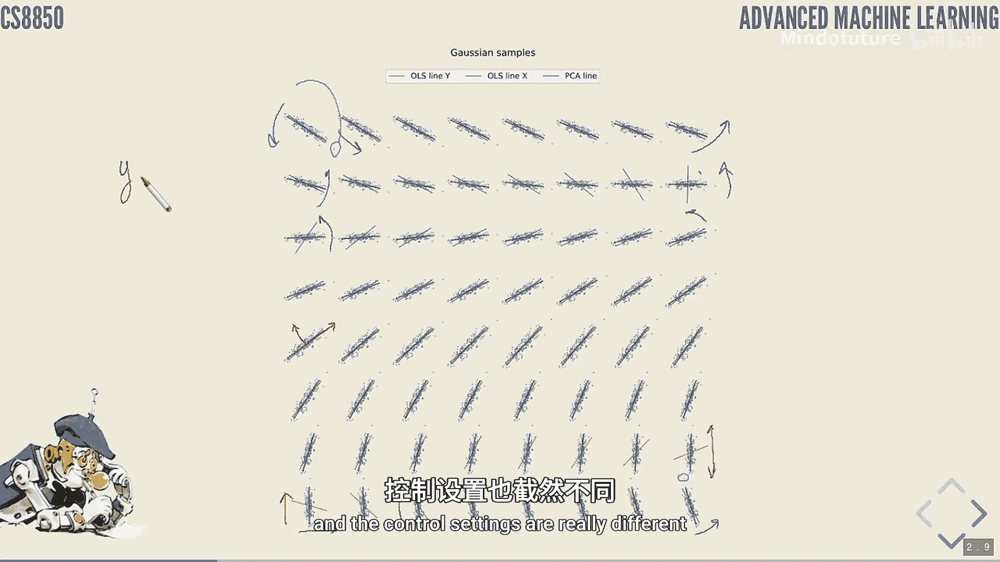

And。Well， we are lucky we can view the world in Sta。

 but imagine now that this wood ma or whatever else the universal object that we don't know about。

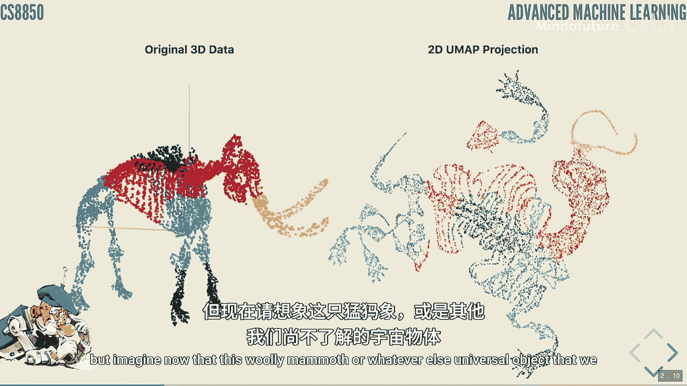

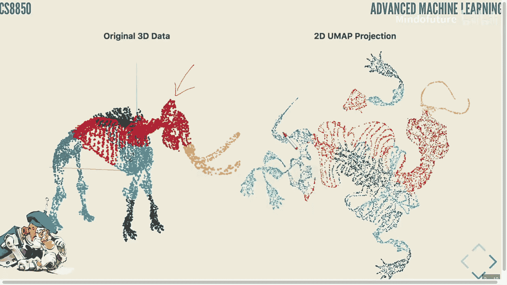

呃。It multi dimensional insteadス of。Oh my dad。Okay。The3D data。Where each one has。エクスワイジー。

Could be multi dimensional data， not just spatial data could be whatever50 dimensional data。

And we'd like to treat the data in a way that we can see some regularities with our naked eye。

 or usually we now simplify the problem by linearizing it by putting the undial object into a flat two dimensional Euclideian geometry and so wouldn't it be better to consider the local patches？

And。Okay I look at them individually and then only make sense at multi dimensions。Maybe the one。

One example would be what if our data is still two dimensional？But。It is。me this points。It like。

And then。By making a fit。Whatever。Nothing fits。 There is no correlation， right， but if we locally。

BBC A lines， we will find。Shape or the circle。And well， imagine that now this is not an easy。

 two dimensional example， but a difficult and more interesting。 multi dimensional example。 So let's。

 let's run another experiment。 Let's consider this example。

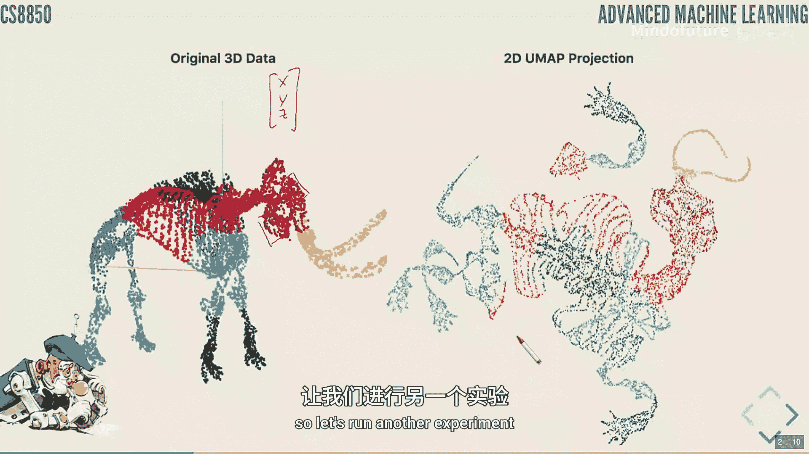

Or an stand I crack it。嗯，所有。

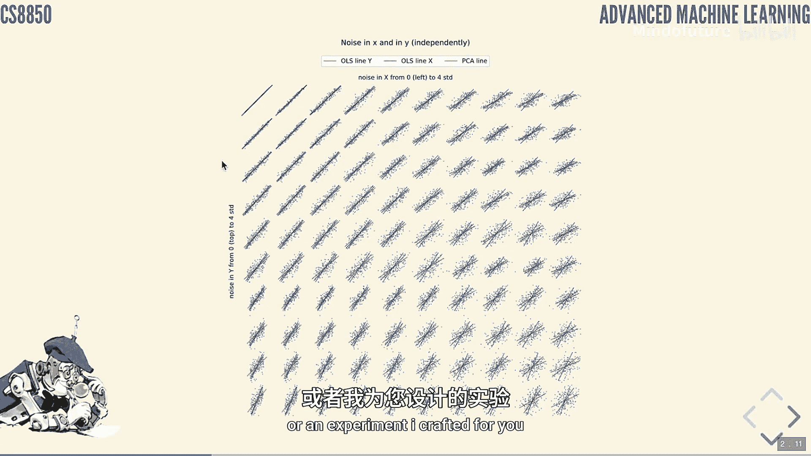

So on why。From 0，0。2 one one。I increase noise only on the Y axis here along this line。

 and then I increase noise on the X axis along this line。

And if you look at this carefully at the green line feet and the red line feet and everything。

 so potentially if we consider this data rectangle。Bread is the best。Here。

 often when you don't know anything。AAbout the data set。

 it does look like a globe with this principal axis and PCA axis just it there the same here for this case when x noises clearly dominating x or ordinary scores is。

But for maturity of the cases， I would argue。Given assets of any other information， PCA feed。

Makes a lot more sense。So here's an eye can see picture for you how the PCA feed。

Will be computed iterly， but we'll talk about the actual details of computation in just a bit。

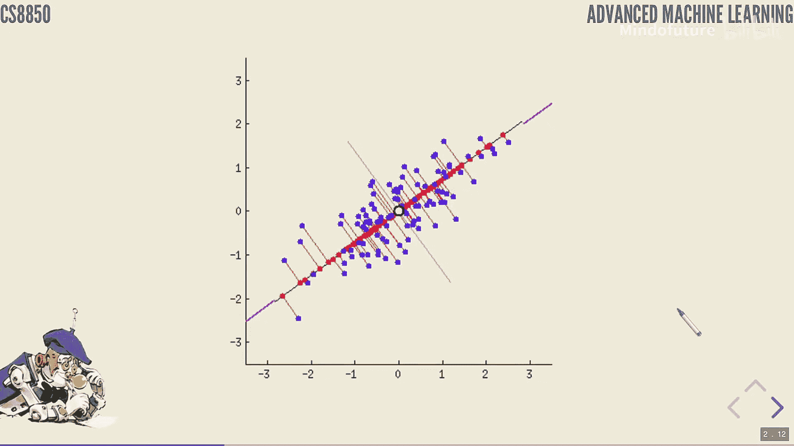