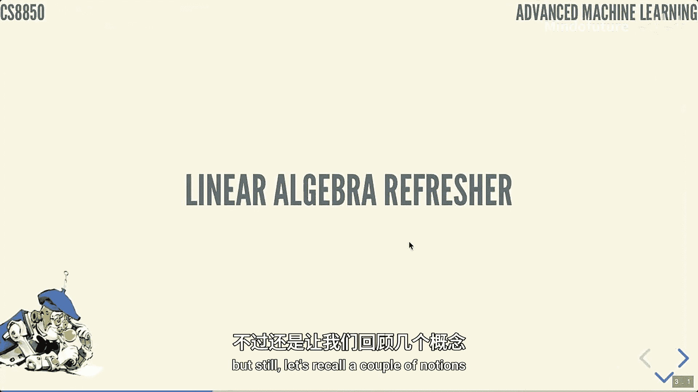
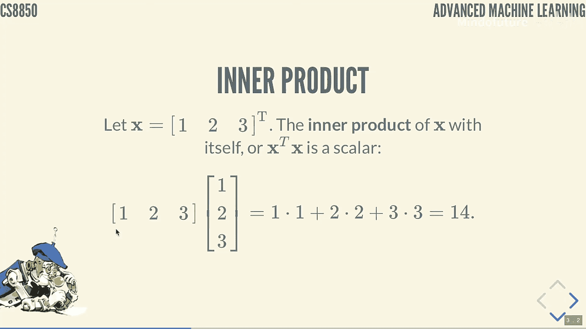
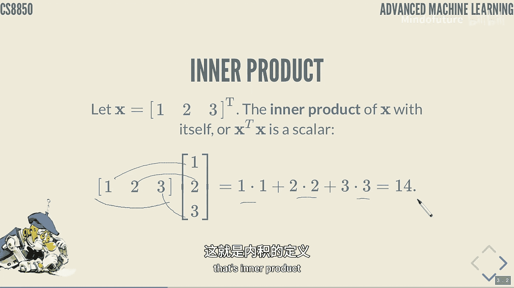
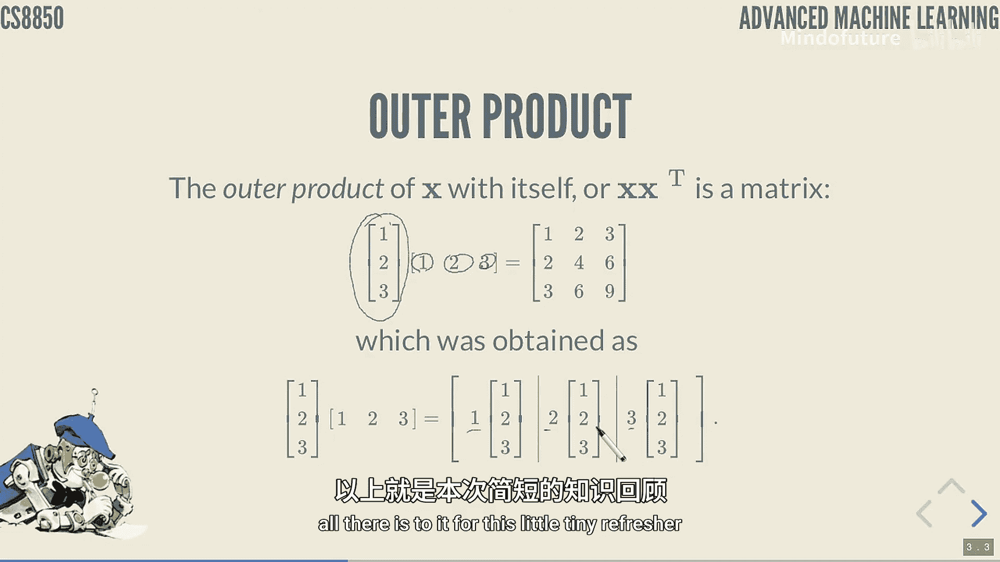

# 高级机器学习主题-CS8850-｜-Advanced-Machine-Learning-p19-P19_线性代数微型复习--BV1sapPz4Ewx_p19-

Before we continue， we need this quick linear algebra refresher。

 I know you have just watched three blue or one brown and other beautiful videos。But still。

Let's recall。Couple of。

Nots，1 is the inner product。 So if。X is a three element vector，1，2，3。And。

The inner product of x with itself or x transpose x is a scalar。And just。

Slowly sort of chewing this for you。We take。X transpose。

And multipleply corresponding elements。And get x transpose x。Square of the L norm。 that's in product。

Projection。Outer product of X with itself or X X transpose is， on the other hand， a matrix。So。

This is the result of the otherer product of detector 1 to3 with its up。What in effect。

 is happening is we are concodnating。The copy of。The same。

Or a copy of the untransposed vector weighted by the elements of that vector。

Concateating in a matrix。嗯。Yeah， that's。Oh， there is stood for this little tiny。

Very refresher。