# 高级机器学习主题-CS8850-｜-Advanced-Machine-Learning-p20-P20_谱定理--BV1sapPz4Ewx_p20-

Let's。Consider or discuss。Spectual。Theorem。

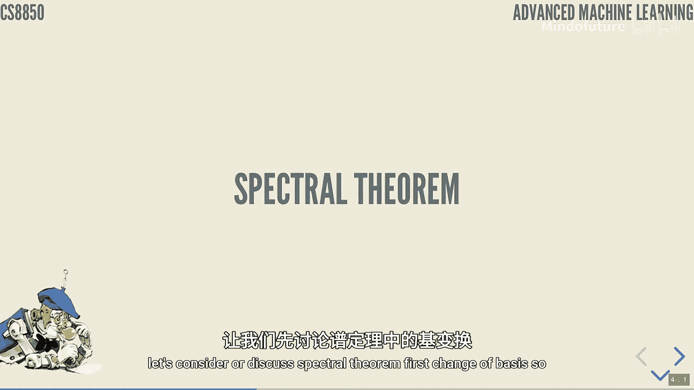

First， change of basis。So we have a linear transform B sub B。And it's inverse。Pingers身。

Which map a vector back and forth between its representation in the standard basis and its representation in the basis speed。

You have U， which is represented in。The standard basis， which is nothing but。I remember。21 a2 and。

So on for the dimension of the vector E。Deotes one in the first。Position。And zero everywhere else。

 a to the it's one in the second position。 zero everywhere else。 standard basis。

 So from standard basis to the basis。B。😊，Apply。P of B。And to go back。

From user representation in base B， we apply the inverse。JustTo put what I just said in writing。

 to put this diagram in writing and in yours is。This。

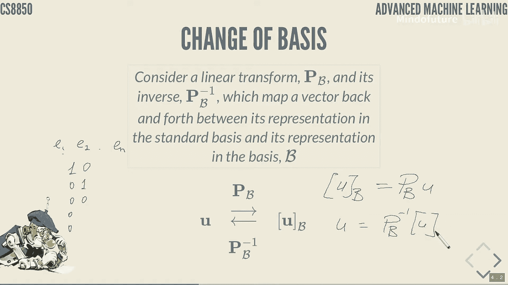

Okay， that should be clear。

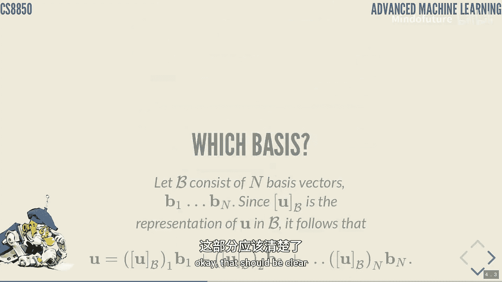

呃 the。So which basis should B consist of n basis factors？

B1 through BN since U sub B representation of U and B。It follows that you。Is a weighted sum。

Of basis factors。And the B。And they're weighted by。诶。Components of。UB， that's。Yeah， that's。

 that's true。For your standard basis， but。It's， it's also true。As you see here， right？

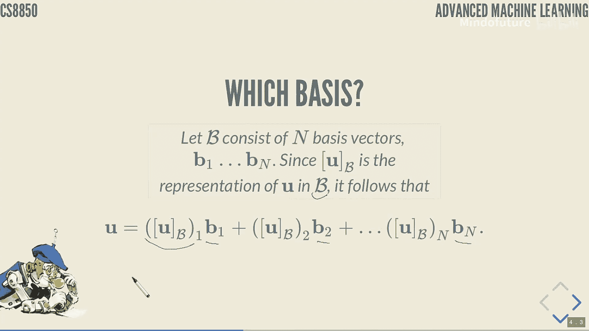

And this is nothing but a projection。Ma you expect their product。Which we just wrote， and I。嗯。

Justly definedfin。So B， the matrix B， which we previously called P sub B projection into B。

Is nothing but。The basis columns， the standard basis columns。

Concatenate it together or not the standard basis columns。 Sorry， the basis columns。

What the basis vectors。Set as the columns and concate it together into a matrix。对。This。

Paseis of the linear space B。顺nce。Forms B back into the canonical basis。

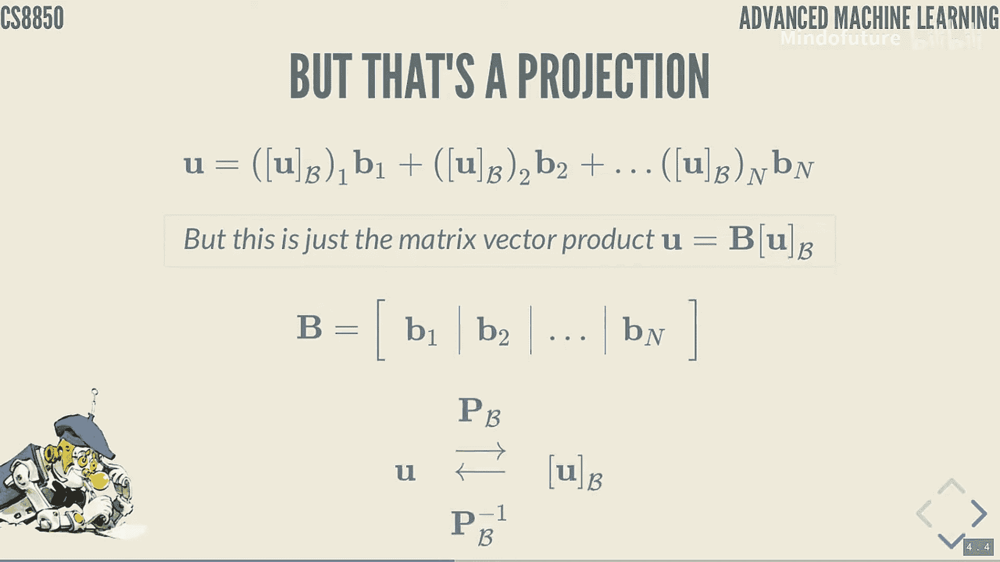

As really already established。

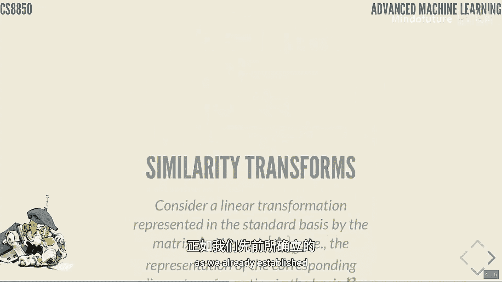

So。😊，Similarity transforms， what are they considered line transformation represented in the standard basis by the matrix A。

So。Before。We were saying， okay， we have some bases。And we have a U in standard basis。

 How does U look in this。New bases。Now， we're saying， okay。

We have a transformation A in standard basis。For example， this transformation。Ctates everything。

I don't know， 20 degrees。How does this transformation look in this basis？So we are。

 we want to go from transformation in the standard canonical basis。

Into transformation that has a equivalent effect。When everything is represented in the basis P。So。

 here's。What do we do。Transformation。In the standard basis， when applied to U results in AU。

We can take。Yeah， we can take this A U。And。Transformant or projected。

Into the B basis by multiplying with B inverse。And。We， we have this transformation as well。

 We know that from you back to be。From U in the B represented in the B basis back to canonical basis is just applying B。

We want to know what is。A and B。Or。The transformation。That takes。

Transform version of U and turns it into transform version。

 Trans version or representation of A U in the。In the B basis。Okay。

 you may already see what's going on。How。Can we represent， Just think about it。 How can we represent。

And let me change the color。Using those three matrices。We can represent this transform。

Can you guess from the arrows here， how to do it before you pause the video and try to derive it yourself before you continue。

 but here we go。

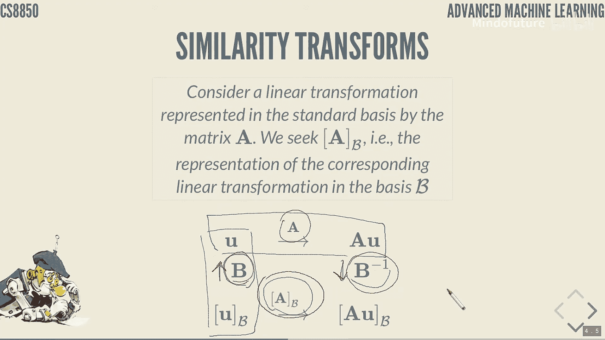

Similarity transform。Just to repeat。The matrix we seek maps U B into A U sub B。Tda。

 you were right when you guessed on the last slide。That's what happens。That is the transform。And。

The way we arrived it。Yeah， well， this is called a similarity transform A B and a。Are similar。

With there respect to this basis speed。And if you take this。And applied to you。B。You果是。This。

Gives you a you。And when apply a。givess you A U。And then where I D minus。1。

 which gives you A U in A U in the P basis。Perfect， similarities transform。You know。

Now what it is and how it works。😔，So beyond the homework。

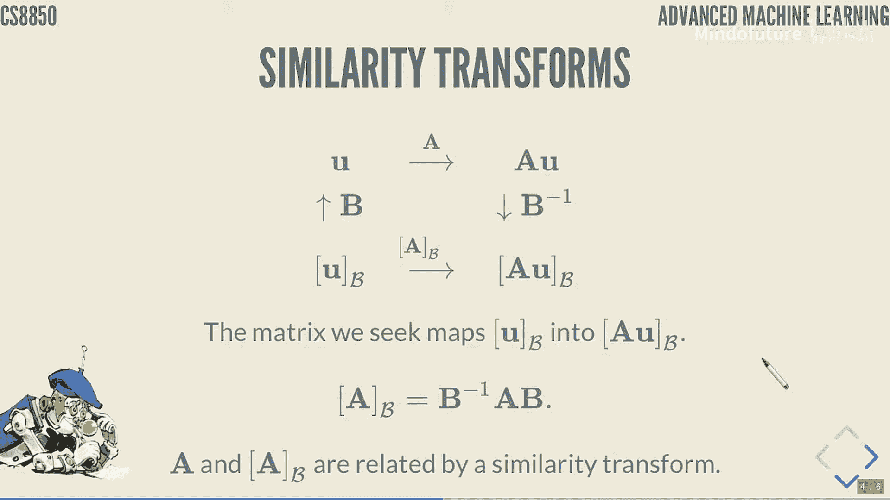

So but。Now let's think about the following， let A be a representation of a transform in the standard basis and let the columns of x be the eigenvectors of a。

So， a is symmetric。Then， x and x transpose。Because they are。唔。

X transpose for the basis of eigenvectors。Which are。嗯， orthogonal。

X transpose is the same as x andverses。Because x transpose。X for orthogonal basis is identity。And we。

 we go from a basis。Of eigenvectors， with an inverse。

From a canonical basis to a basis of eigenvectors of a。

With x transpose and back from basis of eigenvectors of a into canonical basis with x。

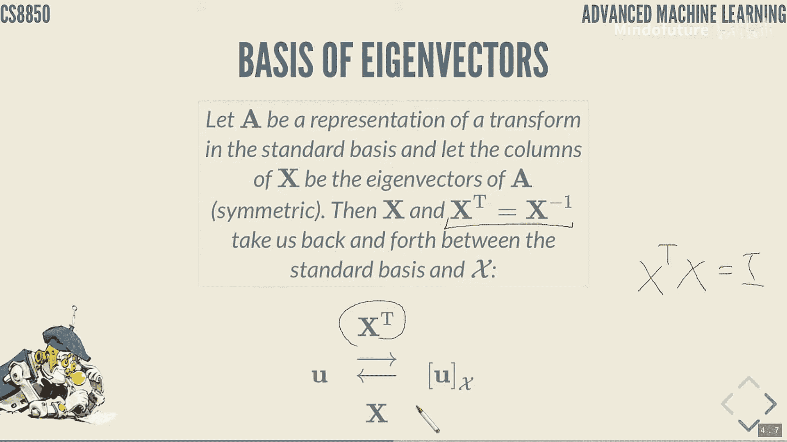

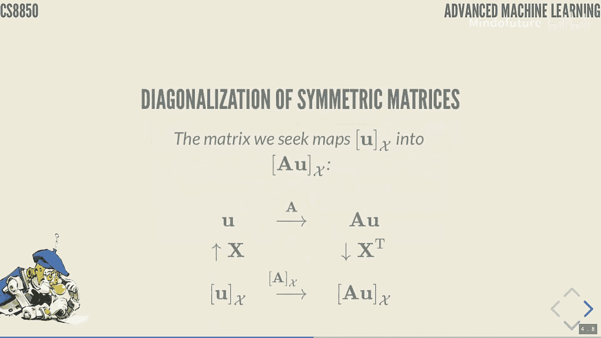

So diagonalization of symmetric matrices we So the matrix were Si maps。

And a presentation of factor you。In the。Eigen basis of a。Into a。You in its own in A's eigenbasis。

Okay。Well。You already figured out what it is， right， X transpose。A X。带的。Was right？With。

They there with an interesting。Property。

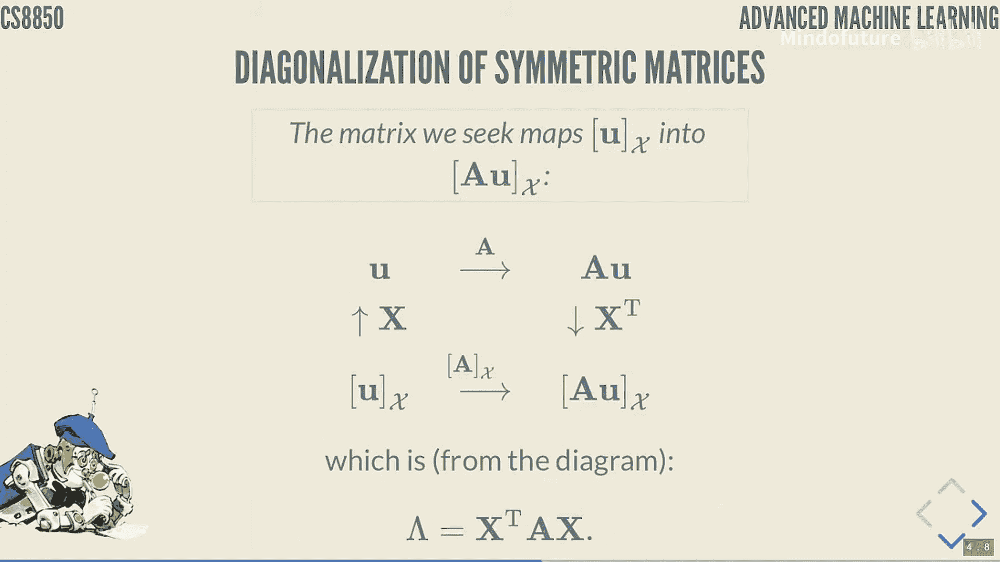

spectral theorem for symmetric matusees， any symmetric n by n matrix A with n distinct eigenvalues can be factored as follows。

You see here， because。Those matrices， as we wrote。On the page before。

Are related by similarity transform。And the matrix lambda is also n by n， and it's diagonal。

X and x transpose are。And by N matrices and the I column of x equals to the I throw x transpose is an eigenvector of a。

What does it mean to be an eigenvector。Here's the definition。 all that a does to the vector。

It just scales it by。Some value or， some specific value。

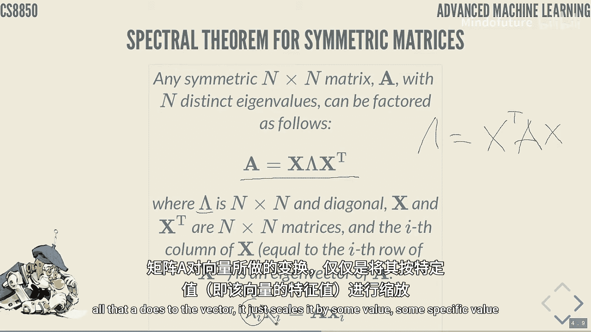

The the eigenvalue of that vector。

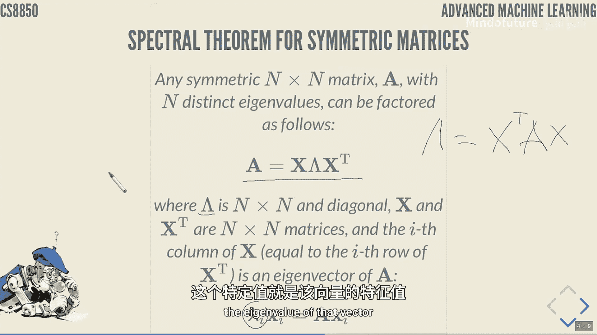

So note that X I is orthogonal to Xj when I is not equal to J。So。For any I J。

Element of this product or this matrix factor product。Telta I J is either one。

 if I equals to J or 0 otherwise。And， in other words。The Xx transpose equals。Identity。

 and as we said， x transpose equals x inverse。Easy inverse for orthogonal basis。

 This property gives us this does。

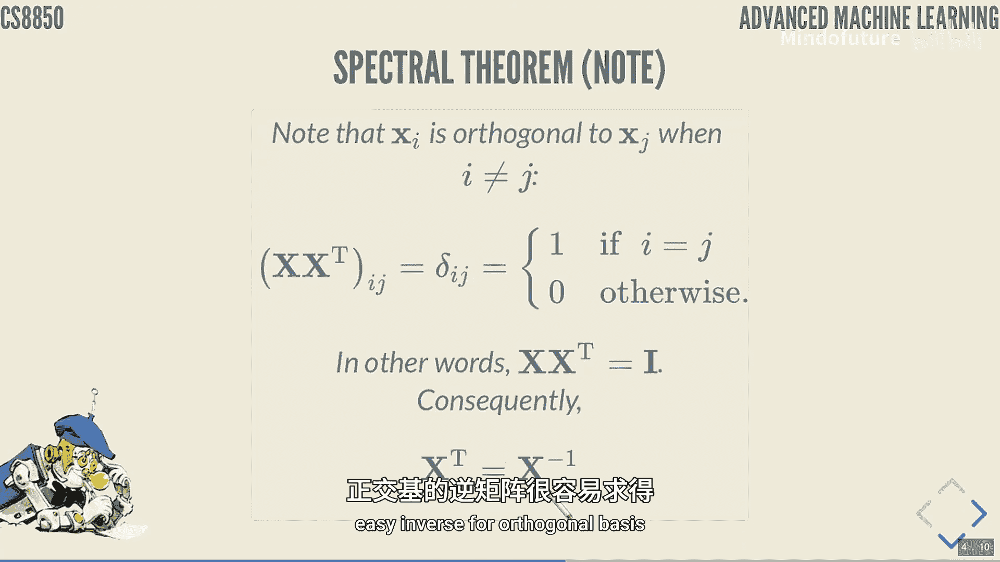

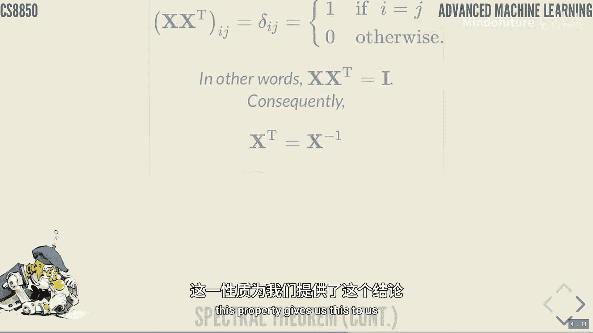

So， let's rewrite。A equals x lambda x transpose using definition of matrix product and the fact that a is diagonal。

Now， the fact that landda is the economic。So。Just using a component wise notation。We're only going。

스럽게게。So I and J stayed the same。This is the I。Rrow and the J column。Of x transpose， I of x。

And just scaled by K by K。For I Jth element。诶。The trick is， so。I'm just writing this expression。

Or one specific element。哦。The a matrix。Just using definition， or just simply。

Multiplying component wise。Its。Bar with me。So， X。Is just vectorctors， x1， x2 x and eigenvectors。

Concateated it together。 He， X1。Next to。X， M。That's how we get matrix X。诶。Lambda Kk is the eenvalue。

That corresponds to case， iconve。Which is ordered here。 So it's a corresponding itemvalue。

Re beating with we just so。Just。Look at it and think about it。But， no。哦。Let's rewrite。

Using the fact that I。Oh， yeah。 we can。 We can rewrite。The same。Expression in the following way。

 What is， what is。What is the。This matrix versus that matrix， when we do the。

Product when we compute the product。Just so you can see what we're doing。So。

We we take first eigenvector zerocellular。Second element。Ice。嗯。Or rather， let's call it case element。

Okay。我玩。And element。And then， the same for second。The same。I'm just writing exactly this thing。And。

What we're basically doing。We take a case。诶。Yeah， I I messed up with the notation。It's called I。

We fixed the eye。It's fixed。也行。But we go through each of the eigenvectors。So， we're multiplying。

This raw of x matrix。By the corresponding Js column。Of the x transpose matrix。

But that's equivalently we're fixing the element in these eigenvectors， either I or J。

And just going through all of the eigenvectors。And multiplying them。By the corresponding eigenvalue。

But， that is the same。As。Multiplying。X K vectors。In an other product and then taking I J's element。

Of this multiplication and summing all of them。So go through that slowly when you get a chance。

And do the algebra。 But practically what we have here。And that's important。

To compute this IJS element。We系。An outer product of the same vectors。

Wighted by corresponding eigenvalue。And then we take a corresponding of。Element。

 I Js element of this outer product。And just sum up all of those IJs elements because IJs element of this matrix。

Yes exactly。This expression。The important part。Is that we always multiply。Eenvector。To itself。

 So the outer product here doesn't go across evectors its。

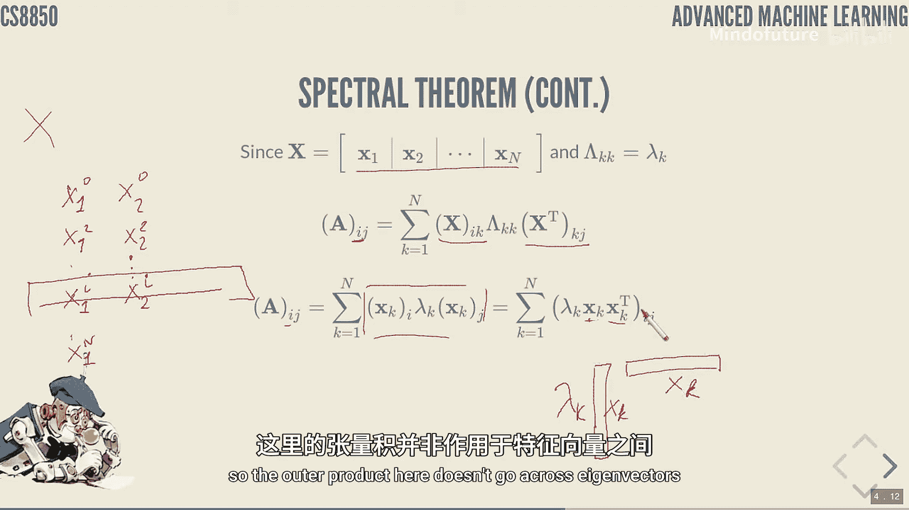

It goes through all eigenvectors， but then。With other product， the eigenvector with itself。

And scale it by the corresponding eigenvalue。Now， the fun begins。We took our。

A regional symmetric matrix。And represented it。As a weighted sum。Of。Corresponding， ranknk1。Matrices。

So like in spectral decomposition of a sound， when we decompose any waveform or sound waveform into。

Sine waves。With corresponding power。Waited。So we take a matrix and decompose the matrix。

Into a basis of its。Eigenvector matrices。好嗯好烦。Those otherer producted matrices。

 which are all rank one。Waied by lambmbda So a。Becomes a product of a sum of。Those matrices。

 which are exactly the same dimension as a。And so on。So we take an a and decompose it into。

The basis of its eigndvectorors。The otherer product of those。And this is called spectral。

Decomposition。Because， you， we compute spectrum。

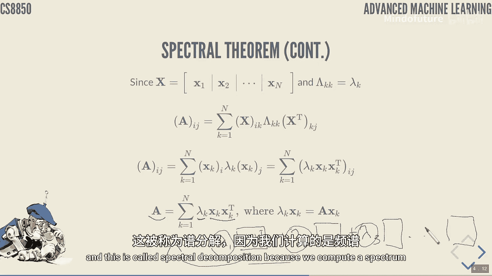

Yeah， that's what I said back in the component form。

 the spectral accelerationization of a is the summation。

And each lambda n times xn then xn transposees a rank one matrix because it's just outer product of two vectors。

If， if we do not。A sub I。呃。Or if it inote each component of this sum by A sub I。We know that。

The eigenvectors are normalized。So they're in their product。Is one。And。We can。 Yeah。

 we look can represent。Yeah， we， we， like if， if you multiply through， this is one。

So that's this part of the a matrix。🤢，That is comprised of。Yeah， that is comprised of。Correspondsing。

Element of the spectral decomposition of the matrix。 and it's trivially。诶。Yeah。

 it is trivially equals to。Rescaling all the corresponding eenductctor。But in the same way。

 you can see。That the。L的。I X， I。Equals， even if you take full。Let's call it K。

 if you take the full matrix。X K X K transpose。But you multiply each of the elements of this matrix by I。

And since。This is 0 for anything。But' K equals I。We see that the。

The effect of the matrix A on an eigenvector is just the scaling。Xi is the only eigenector of AI。

 and its only eigenvalue is lambda I。Yeah， well， of course， it's AI is a rank one matrix。

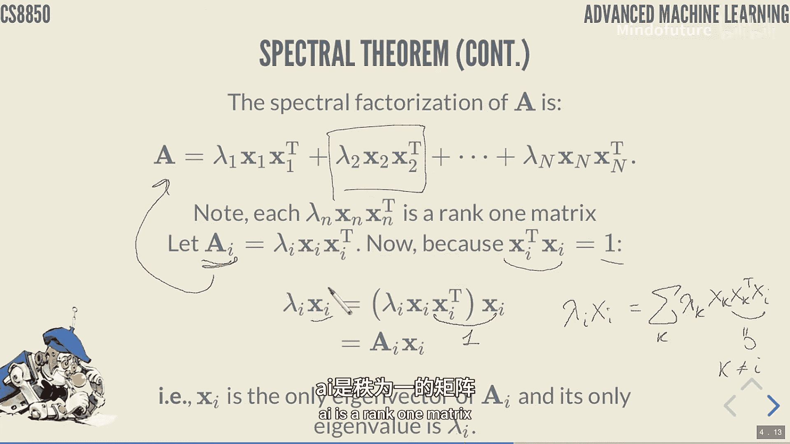

We cannot。Do anything。Okay， so no。That we have。Spectral theorem， nail down。

We can work with principal component analysis， as our next topic。

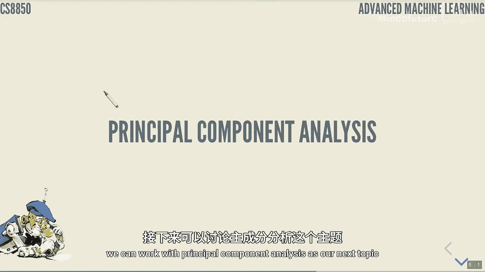