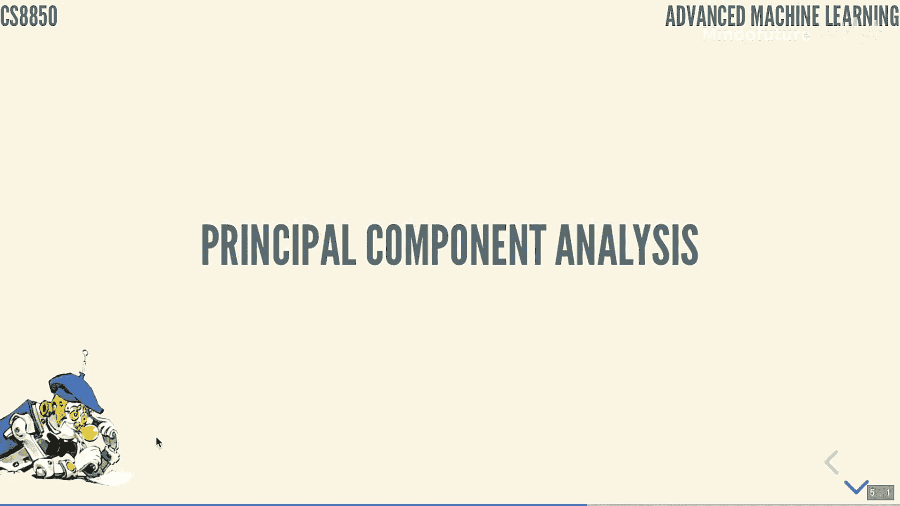
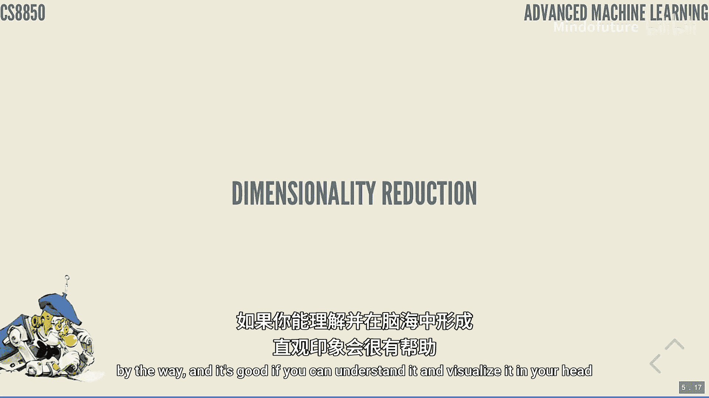

# 高级机器学习主题-CS8850-｜-Advanced-Machine-Learning-p21-P21_主成分分析--BV1sapPz4Ewx_p21-

Yes， the fun part， principal component analysis。

Let's first consider quadratic forms。Willll go slow。

So you will have time to understand what's going on。And for quadratic forms。We have。Function。

 vector function， F of X。It takes a vector as an input and returns a scalar。Like a single number。

 And it's defined as x transpose ax。And a is symmetric。In two dimensions， just。

It goes slowly so you understand what's going on。We have a。

Defined with just four values because it's symmetric B and B are the same。

 And you don't have to be the same。 And we have some vector X and Y。Let's multiply this through。

First， let's compute Am x。And which is this A X plus B， Y， B X plus C， Y， and vector。It's fine。

 But now let's multiply X by x transpose。And we're getting。A polynomial， an X and polynomial and Y。

 whether Isaac。So when a is positive definite， then this quadratic form。It's a paraableoid。

 and the level curves are ellipses。So。Level curves are when this function is fixed to a certain value。

So' when it this。Then。I'll get an notice。And side note， a matrix is positive definite。

 even only if all of its eigenvalues are positive。So let's look at an example。Let's take a， which is。

Sysymmetric。And has the same values on the diagonal。X transpose ax calledic form then equals。

5 x squared minus4 xy plus 5 y squared。Okay， fine。し。But， this is an equation。Of another。And。で？Yeah。

 the interesting part that if you look in x and Y， the ellipse is tiltiled。

But if you look in the Y in the U and V。Priinciple axis of their lips。Then， of course。And it's， is。

It's a flat。Let's look at the multivariate gauss and density。嗯。So here it is。

Expression K the number of dimensions and sees K by K cavariance matrix don't get scared yet。 We get。

Explaining each term。So in the bivariate case。Two dimensional cavariance matrix。Is variances of。X， Y。

 and cross cross covaris of X， Y， and。cross co of x， Y big and。Mation。Note。

Sometimes people write sigma squared， but that's the square。This is already the second order。

It's just a slightly different notation from S squared because we have multidimensional case。

 and I want to stress。Which dimension we're talking about。 So note。

 if C is symmetric and positive definite。Then C inverse is also a symmetric and positive definite。

Can you prove that？Okay， pose here。 try to prove it。Okay， I'll help you if C is。it' sub。Then we have。

This。We can diagonalize。But then， seeing verse。Well。Actually， we can diagonana。

 see if it's symmetric。Now we know that all eigenvalues， all diagonal elements of Lada。Are positive。

Then。See in verse。Is nothing but。Inverse of the lambda and inverse of the lambda lambda is a diagonal matrix。

 is nothing but one over lambda 1，1 over lambda 2。For all the elements。Also， a positive。

 definite matrix， because all of the eigenvalues， new eigenvalues are still positive。

The scale will change， but yeah。So coveience matrix。An n by K covariance matrix x。

 where n throw is the n sample of a Gaussian distributed random variable。This。

Each row is a sample from two dimensional Gaussian， for example， yeah。K equals2。

The dimension here could be any and the number of samples。啊。Correspondly， will require。嗯。

More samples， depending on。Well the dimension， but。Just think about this。 Now we have。

Tate samples from a Gaussian distribution arranged in an X matrix as rose。Coveience matrix。

To go to conveyance matrix， let's think talk about the sample mean of all of those samples。

Sample mean of all of those samples is nothing but an average。Of all of the throws。

And we will assume for now that mean is 0， sample mean is 0。Because if this is false。

 we can always make it true by subtracting new from each of the samples。Before constructing X。

For covalance matrix， I observe that if we take our X。Matrix。And transpose it。

Then each column in x transpose is a sample。And each row index is as sample as before。

But that means we're just taking outer products。Of those samples and summing them up。

This is the same as in spectral decomposition。Now that we know。

That x transpose x is just a sum of all of the otherer products of the corresponding samples would take one sample。

X 1 and Y 1， because we're。In two dimensional space。And as you remember， we're scaled this by x。😔。

1 and scale this by 1，1。坏玩。And that's what they wrote here。Just multiply the vector here。

Multipplayied through。And we do that for each sample from one。To end。Good。So。But。What is this？

For a zero mean vector。Some of all of the excess is nothing but an expectation。

 expected value of the product。Corresponding product， but expected value of the product。Is。

 by definition， or covariance。哦。Vars in this case， and cross variances are。Cross covariance。

In the of diagonal case。So， our。1 over an x transpose x is approximation。

To the true cavariance or a sample cavariance。就时到。So let's talk about isod density surfaces are still in the gaussian distribution and the level surfaces of the multivari gausian distribution。

😔，G of x consists of those points where G of x has constant value。Right。

 so we have a distribution and distribution is not a paraoid。But still within that distribution。

 there will be is surfaces。Or level surfaces or distribution of a constant value。

 just an example for one dimensional case。Of course， and。There will be。A point。Well。

 two points for goes in。But of is symmetric。To have the same value。

 But now let's go into two dimensions。And we'll see if we just put them。Level surface or level plane。

That there will be many points that are。We'll have this in。Probability density。

Value or the same value of the does and distribution。

And it follows that level surfaces are ellipsoids， because if we。

Equate gaps and density to some constant。 and then take a log and rearrange。We will see that。

Those level surfaces as are described by quadratic form。Where the right hand hand side is a constant。

So an ellipsoid has principal axis。For sphere any。Basis。

 any orthogonal basis forms those principal axis。But for。嗯。Geode or kind of squished sphere。

We already have。嗯。Pre selectedlect access。 we can't select anything else， but the thread C axis。

 although A's can be， again， anything you can rotate in this plane and once usequiish。

This I looks like again。Now you have to find all three principal axis because they're not equivalent anymore。

 they're just defined by the geometry of the space。 So principal axis theorem。

 the principal axis of the eoids forming the level surfaces of the multivariate gaussian distribution are given by the eenddne。

Of its caverance matrix。This is Cavarion's matrix of a Gaussian distribution。

And principal axis are eigenvectors。And as usual， we sort in。Discending orders are idealvalue。

And place the corresponding eigenvectors in corresponds。To the second values。

 two dimensional case is easy。So in a two dimensional ghost and。诶。Any level surface。

Well be on that website。And。If we take the largest eigenvalue， it will be here on this axis and the。

Eigenector corresponding to that eigenvalue will define the major principal axis。Of that the ipoid。

 and then the miner will be。Again， vector there corresponding to the smaller。

Or smallest standard the dimensional case。Hgan value。So let's try and diagonize governance matrix。

 That is。Let's try。And find our similarity transform so because the cavariance matrix C is real symmetric and if we have enough samples full rank。

 let's assume that we do。It has K orthogonal lienvectors。

And it therefore can be diagonalized as follows。 Well， we've seen that before。

 where case column of w is the eigenve of C with the case largest eigenvalue。

 And D is diagonal with the corresponding eigenvalues on the diagonal。So DK K is that li value。Okay。

 so we can take C the evidence matrix and。Diaagonalize it using eigenvectors tocom。So k transform。

Kale transform。Its。诶 let me。The KL stands for Carhoin Love。That's true。系。Yeah， I in love transform。

So we can represent the samples of the Gaussian distributed vector。

 random variable x in the basis formed by the eigenvectors。Of its Cavariance magic Sea。

This change of basisis is term Carhoian love transform or kale transform。So。

We can take each of our samples。And。Project them。Into the basis of the eigenvectors。So。Yeah。

 use is a representation of x in the basis formed by the Ivectors， for example。系。

What will we achieve by that， Imagine we have this narrowish conveyance matrix。

 So there is a point here。There is a point somewhere here。And it's expressed by x1， x2。

Coords in the canonical basis。If we project it into the basis。Oh。

The eigenvalues of this covariance matrix， of Covariance matrix of this。These samples。

Then we will have a large x and close to 0 x2， a large x1， or let's call it W1 and W2。😔。

RightIt will be a convenient representation。 Most of them will have non negligible W1 value in a close to 0 W2 value。

 so that's。Okay， it'll transform。And the question is， what is the distribution？

Of the U of the k transformed Gaussian variable。 let's look at it。

It is still multid Gaussian with covariance matrix D now that covariance matrix T。Is diagonal。

 as we know。So。It's easy to see in the bivariate case what happens。So since T is diagonal。

And it's related to our Galence matrix by similarity transform。Each。Oh no。Determinant in this case。

 in two dimensional case， you see is a product of the diagonal elements。And verse is very simple。

 We've already discussed that just a couple of minutes ago。Is one over the elements。Out there。

Dagonal。 and you can verify， multiply through D1 by D， and you'll see youll get an identity。

And so now let's consider gas in distribution with diagonal cavariance。In two dimensional case。

 if we look at the gaussian distribution and multiply through the quadratic form here。That is。

The expression we get for two dimensional gas in distribution with diagonal caants。OhBut wait。

 it is diagonal cavariance， is distribution， but it's still impossible。

 We can just write it as a product of two exponents。And我觉得。

It's thecomposable into product of two exponents or two distributions。Both of them are Gaus。

 that means。高先。With。Diaagonal covariance is separable。

And we can represent it as a product of distribution that corresponds to。

Each of the random variables。Of that Gaussian。But this means。

Since the joint distribution of U and the。Can be expressed as the product of distributions of U and the distribution of V。

 We say that U and V are statistically independent。

And knowing the value of u does nothing about the value of P。So after k transform。

The variables in our Gaussian become statistically independent。So。

Will often use regression test or linear feet for that。

 Imagine here we have nice statistical dependence in this axis or in the spaces。

But then after Kl transform。The variables along the axis for the Gaussian。

Distribution are independent。Okay， what we need to look at is example usage of all of this。L algebra。

 which is fantastic， by the way。 And it's good if you can understand and visualize it in your head。

