# 高级机器学习主题-CS8850-｜-Advanced-Machine-Learning-p22-P22_演示--BV1sapPz4Ewx_p22-

To complete the lecture or sort of the topic of principle component analysis and KL transform and others。

 let me show you some example。what we're talking about。I think we can start with something here。

So I think here that faces data set， all faces and。We can think about vector representation。

If we just plot。Say it's this one is the cars dataset set， I think yeah， car crashes data set。

 so the numbers are here are for the individual cars。And。对。诶。

The numerical numerical values are for features。Speed， alcohol， distracted and blah， blah others。

Just feature values。 So that's your vector space。 We can make this variable categorical。

 and all of those variables will be will live in the corresponding。Subspaces。 That's one example。

 Then， of course， we can look at correlations between subspaces between different features by plotting their scatter plots like that。

 But I will make the code available。 and you can look at up what exactly am I doing there。

 But that's， that's not that interesting。 let's。Think about， like。

Higher dimensional spaces here we the each feature had a name。 We knew what we measured。

 But let's look at 4096 dimensional space of human faces。Each phase is represented as a 2G image。

 And let's look at two specific images in that space。 This is a 4096 dimensional space。

dimensional point。Or rather， a point in 4096 dimensional space。

 And this is another point randomly picked in that same space。Well。

 the only difference from a real space here is that we can say， well。

 gray values in each pixel are within some reasonable。Re regionion or。

We also say to relaxing that to outside of the cube or to some kind of continuous space。

 we can say that the gray values are likely to be。In some region。Some point could be super high。

 some point could be super low。Anyways， where in this 4096 dimensional space do human faces live。

 Well， let's take those two。 And let's just walk on a line。From。1 point to another。

All I'm doing is just literally working on， on a line in this 4096 dimensional space along a line and。

Ploing what I see all of the points with some interval。You can say， hey。

 but that's just simple linear on the interpolation。 But what is linear interpolation if it's not。

Walk along a line。the multidimensional space， that's all we're doing， that's linear interpolation。

 let's take two actual phases because the space could be vast and this point could be super far away from this phase or any of the phases in this dimensional 4000 dimensional space。

But the faces themselves may be clustered close， close together。

 although we will talk about in our next lecture in person of dimensionality about。How compact。

Are spaces of large dimension。You， let's walk on a line in the phases space from one face to another。

And interestingly， while we're doing that work。None of images or none of points look like random noise like that。

So if we take two points which represent phases in that multidimensional space and walk along the line between those two points。

 everything on that line also looks like a faith and then we kind of morphing one phase into another。

 but all we're doing here is just a linear interpolation。

We can also illustrate transpose operation etc。Continuously algebra refresher。

 So I put the square on the face and I transpose the face and look at some rotation。

Because if it was a rotation， the square would begin here。

That's just an illustration of the transpo operation。But now look at the matrix inverse。

 Another matrix separation。 Not the following。Those are two spaces that are dual of each other。

 and the space of inverse is sparse while the space of the face is dense。

And when the space of inverse is dense actually the reverse will hold it similar stuff。Other。

special decomposition and other bases when the spaces are dual of each other。

 we have talked about how sparse an independent representation of a Gaussian becomes when wepose it into or transform it into the space of its a eggin detectors。

So now， okay， ignore this failed experiment。 Let's look at the following， let's。

Take our matrix and our data matrix of all of the faces。 And although I'm doing SVD here。

 all I'm interested in。Is in finding eigenvectors of。The Cavalance matrix。

 So I could first have computed eigenvalues and eigenvectors of the cavalian matrix。

 I could first have computed。Covalance of x。 And then I'm plotting the eigenvalues。

 And what I'm seeing。I'm assuming all of my phases are sampled from Gaussian distribution for now。

 just for a second so you know。And I'm seeing my principal axis of the ellipoid of the Gaussian ellipoid。

Have importance that widely varied。Right。This is the highest een value。 This is the lowest a value。

 Looks like most action happens up to here， up to first 10， maybe 20。嗯。

The eigenvalues or eigenvectors， principal axis， that's of the ellipoid。

 that's what I was looking for。🤧Mean， if I look at corresponding eigenvectors。

I see this is an eigenvector， I take an eigenvector， which is a point in space， it points somewhere。

And I plot it here and those eigenvectors， especially when we plot with faces。

 when play with faces for fun， I are called eigenfaces so that those representative。

Or principal axis of the face space。 Let's plot。First。

 16 eigenphas that correspond to the highest eigenvalues。 So this is our highest eigenvalue phase。

 and then we're getting various phases。

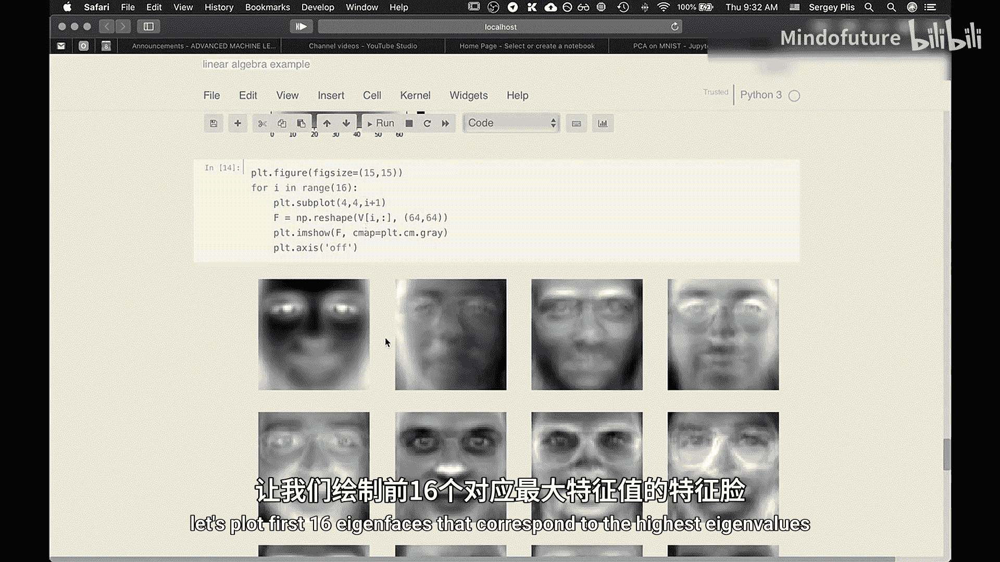

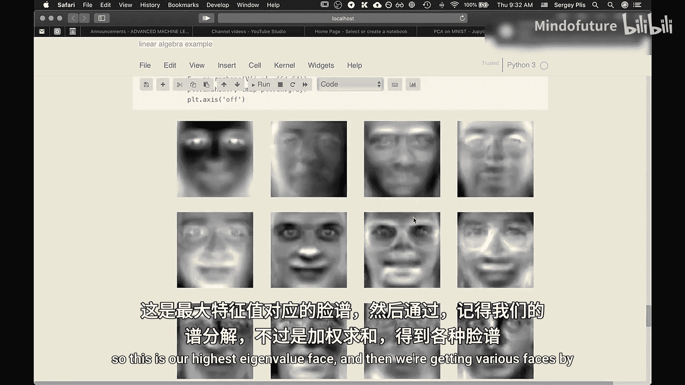

By。Remember respectful the composition， nothing but a weighted sum by carefully representing each phase as a weighted sum that's what k transform does basically we represent each phase as a weighted sum of those eigenvectors of those eigenfaces。

 we can reconstruct any possible phase but。

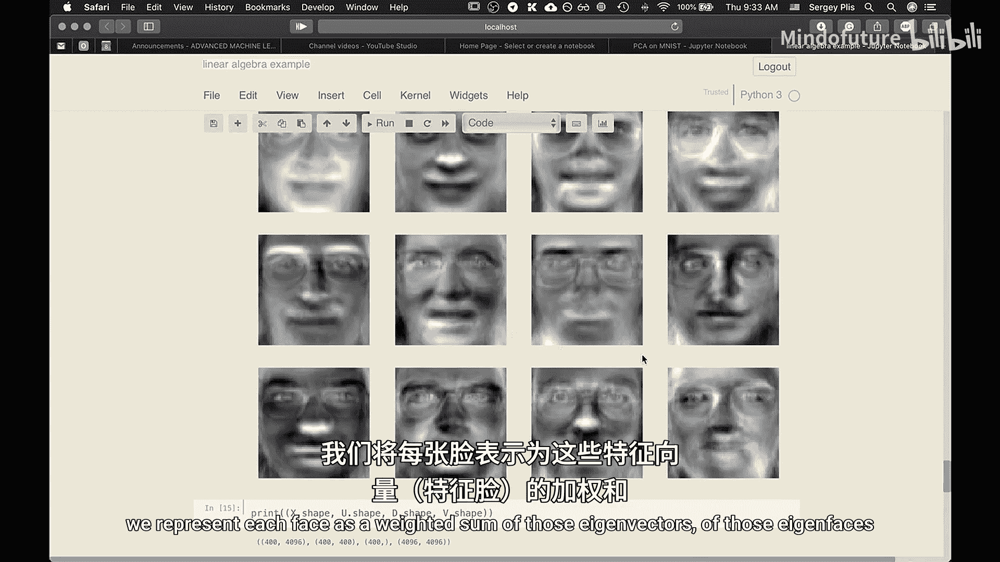

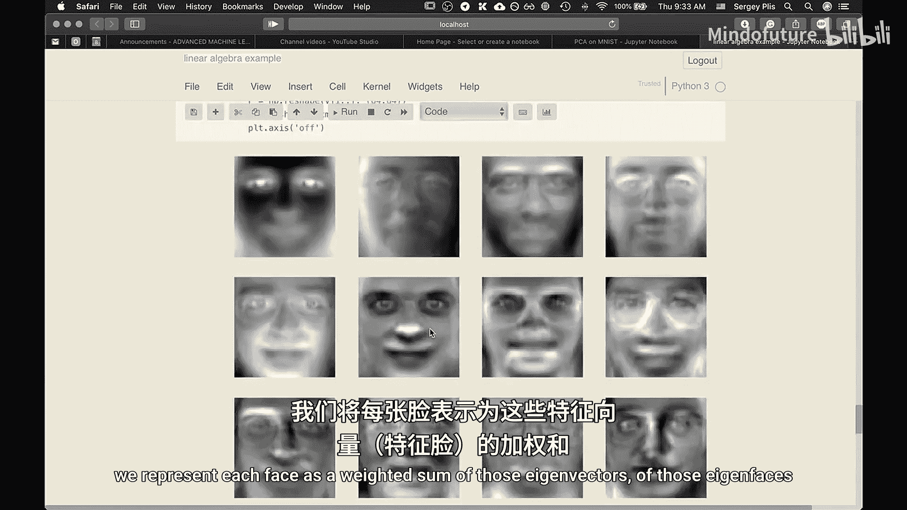

The another point of。PCA and the exercise。

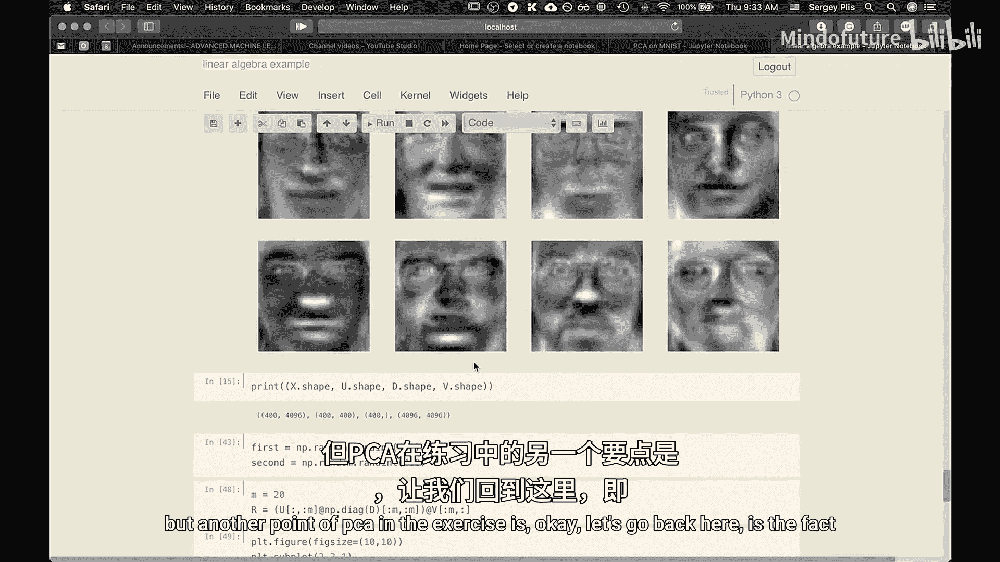

Is okay， let's go back here。It's the fact that there's lower eigenvalues。

 the eigenfaces that correspond to those lower eigenvalues may be not as important for our task and for recognition。

If you think in forna system。嗯。The eigenvalue on the sta end correspond to higher frequency components。

 so very finer detail of the faces while eigenvectors and those eigenvectors that correspond to the eigenvalues are。

Eigenfaces that correspond to the larger eigenvalues。They encode the bulk。Features of the face。

 So let's make sure and let's look at that。Let's take。Yeah。

 I will need to pause the video and rear around this notebook so we can play with it just a second。

Okay， let's look at this two random faces。no， I don't like they kind of hope to similar。很气。Ignore。

 don't pay attention to what I'm doing yet。 I will explain。

 I just need to find a set of faces that there。Not the same this is even enough。Same person。

那个 sort of different。诶。Let's try to find。Franandomly， I'm just randomly。Selecting a pair of faces。

And8さ。To demonstrate the point。A lucky， this guy has glasses and appeared。

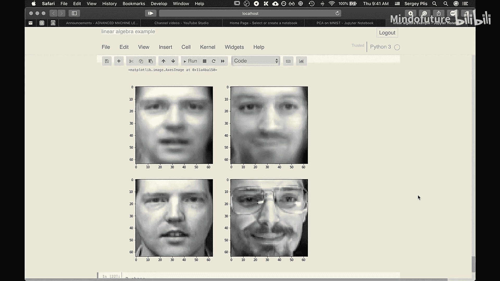

Let's look at this two phases。 So what we're doing now is let's take only the first top two eigenfaces。

And let reconstruct this。Faces that you just saw was using just top two eigenfaces and their corresponding great values。

But we're trying to reconstruct。This 4096 numbers is just two numbers。Okay， with two numbers。

 the compression is too severe。 There are some differences but they're still very。

 very unlike those people。 So let's strike 10。It radically increased five times。嗯。Each face。嗯，我。No。

 with just 1 numbers。 We can compress using PCA。Its just 10 numbers。

The faces already look different and maybe similar， recognize。Let's put it to20 numbers。

20 eigenvectors。Or 20 principal components。Okay something。Be， let's jump to 15。Okay。

50 is already pretty good， pretty goes， so。4096 pixels。Can be reasonably represented with。50 pixels。

 but of course， the quality is not as good as GpeEC compression of the same images。

 but we're not doing JpeG compression。We're just doing。你 algebra。And 150。

 where it is super recognizable。 Tonons of high frequency features are missing。

 There seem to be like。Hello and glasses for this guy。But still， look concluded this was just。

150 numbers。 That's actually how compression， even J compression works， but。嗯。

Vaseis functions or eigenfaces are different。 So each within。

Each of us can have the eigenfaces stored on our hard drive。

And we can just send around the coefficients to each other and we can start those phases。

 that's one example of compression how PCA can be used。But mostly， we assume that higher frequency。

 So 4000， right， Let's just take 1000。And 500。There is no， well。

 because we didn't have enough faces for that。The number of examples。 the number。 Well。

 maybe there were 500 faces 400 is the max。Okay。Because the number of phases in the data set is low。

We cannot。嗯。Use large number of eigenvalue。😔，Okay。With just 300 numbers。

We can reconstruct the faces almost perfectly and。With 200 numbers。Just， for example。The very good。

 reasonable quality。 The same we can do。 Another example here with the same we can do with。

Mni  hundredwritten digits。So I'm interpolating or just walking along the line and the。

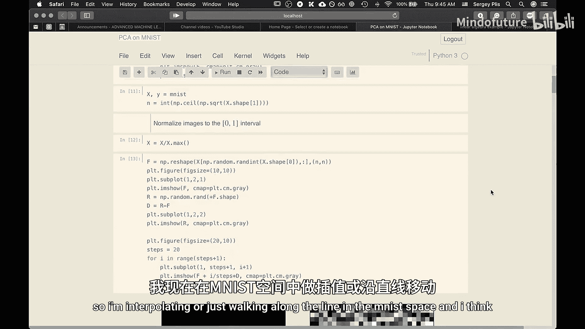

Mni space。 And I think it's 700 plus the dimensional space。

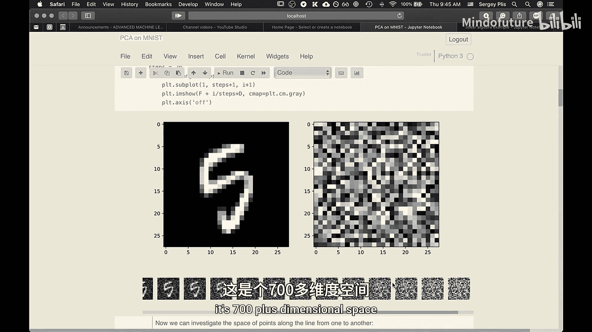

I'm making this code available for you as well。

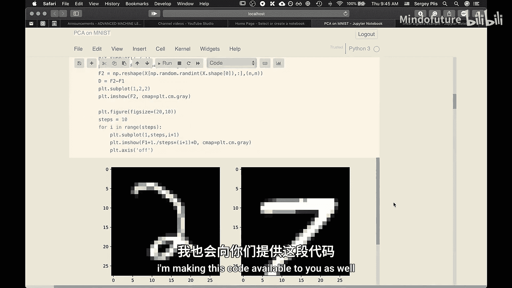

Showing the same results。

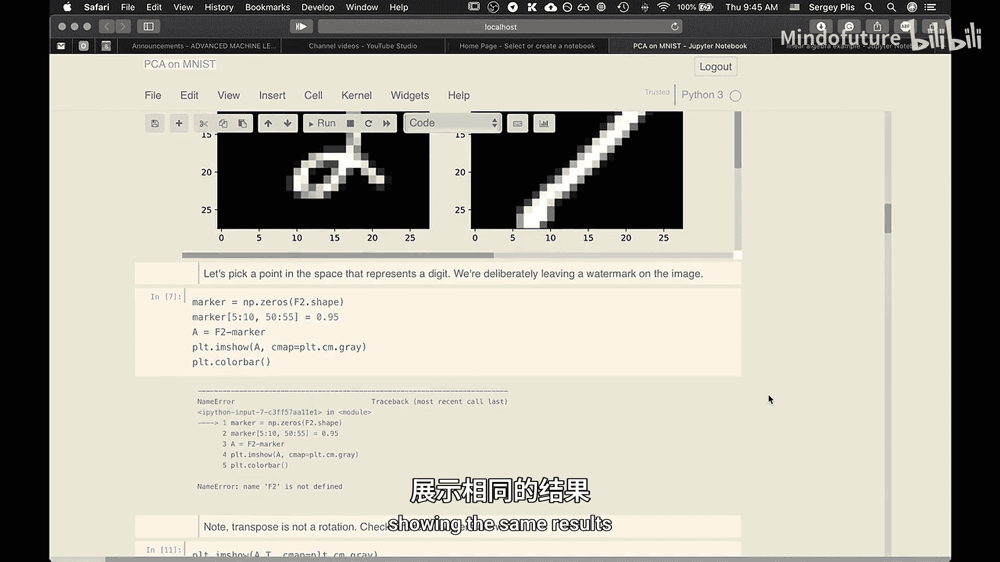

The eigenvalues for M Nist look quite different。This is log space， and this is Aospace。 They Oh。

 well， this is log on X， but by 100。Well even by less than 100 by 50， we had it。

 we have everything that we need for MN 18 digits， and those are principal components or eigen numbers now。

 not the eigenfaces， but eigenfaces of MN。

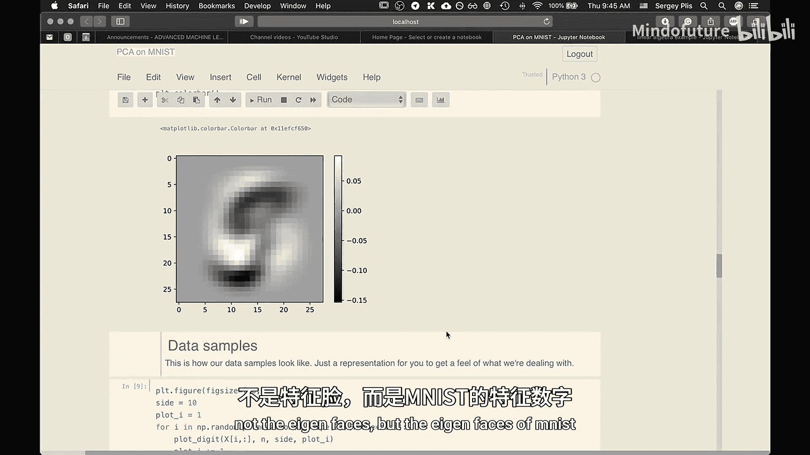

So if we draw a random sample of them yeast， and then those are eigen digits。

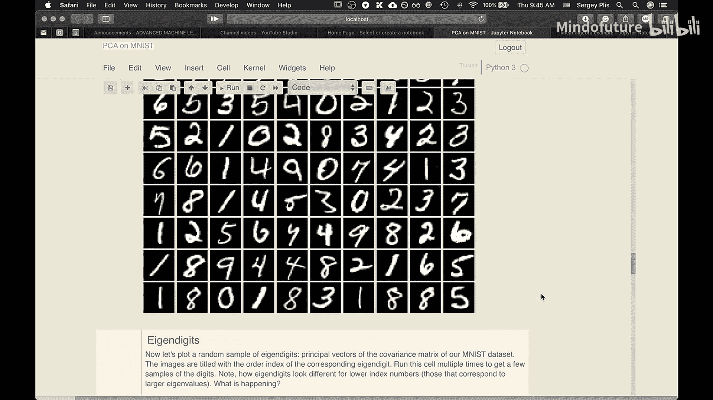

Nice right。So you can read about this， I wrote some comments for you。

So same exercise of trying to reconstruct a number with just 30 top components。And。Well。

 just a little of topic。About。Yes， so if we take。几时。And if we take principal components。

Two more two principal components。Or two eigenvectors that correspond to the largest eigenvalues。

And make them an X and y， like we can display the full 700 dimensional space。

 let's just choose the principal components of this matrix and plot all of our data here。

 all of each point is an Ms digit and I color digits those points in correspondence with the digits that they represent。

And as you see， the ones are sort of clustered together。

 if we look in this projection in the PCA projection。

 just a two dimensional cut in the 700 dimensional space。But。The rest doesn make sense。

 So there are other methods that we're going to cover in the manifold learning that can represent this whole 700 dimensional space into D。

 such that。And this is not supervised learning。 This is just projection of the data into 2G。

 but it's a non nonlinear projection such that all all those digits。Cluster啊。

Together because in that 700 dimensional space， as you so as spaces。

 they all kind of live nearby and by linear interpolation by the neighborhood in that linear space。

 you can see the actual semantics of your data。Okay， that's enough further demonstration。

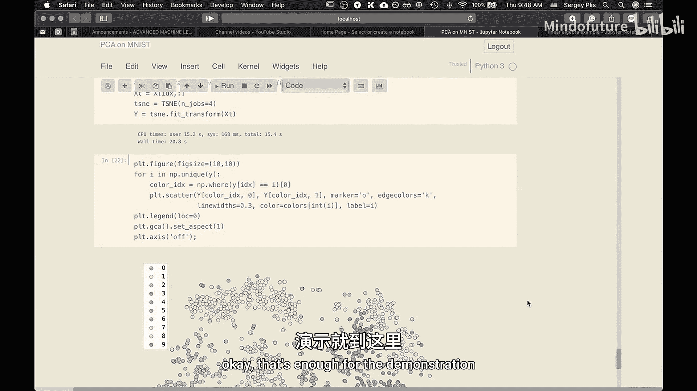