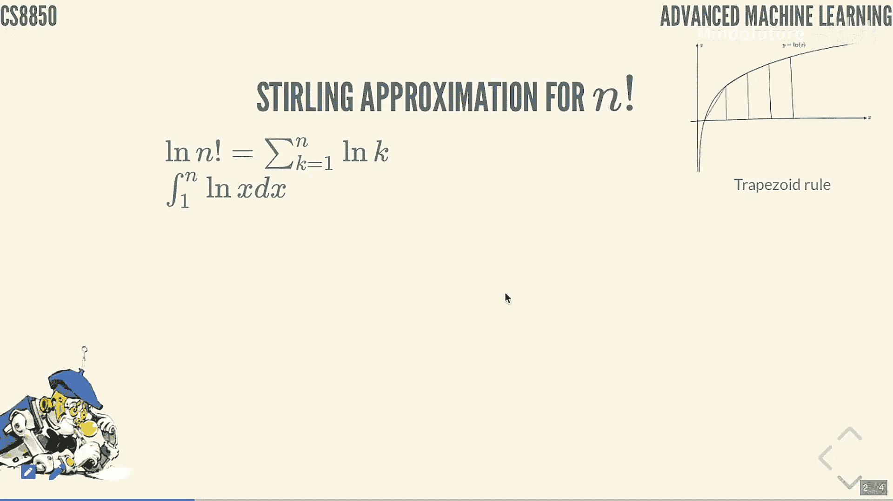
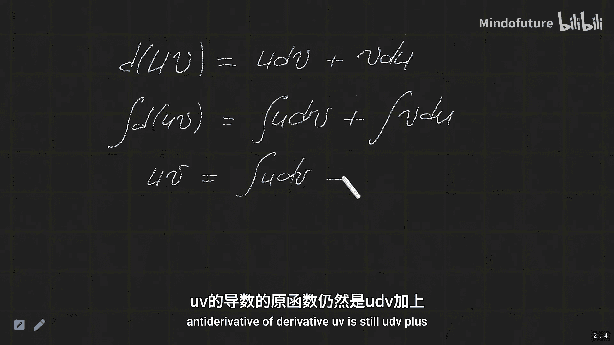
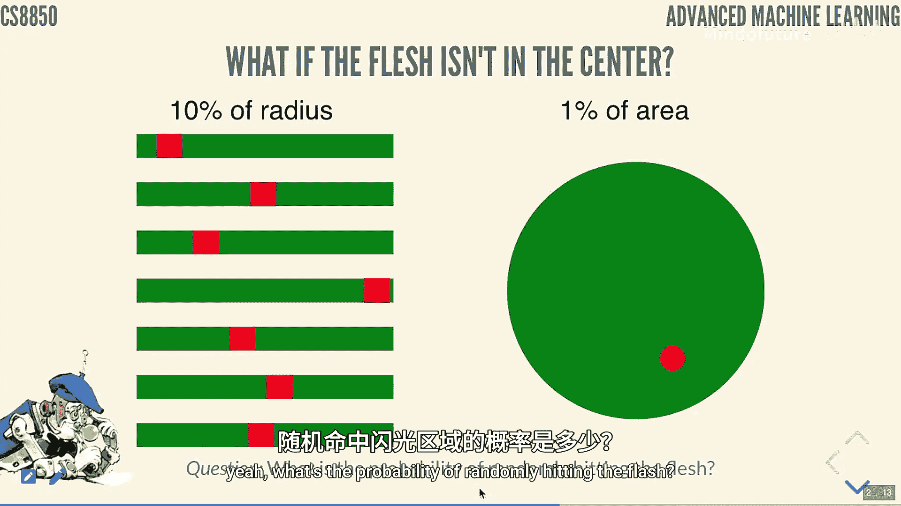
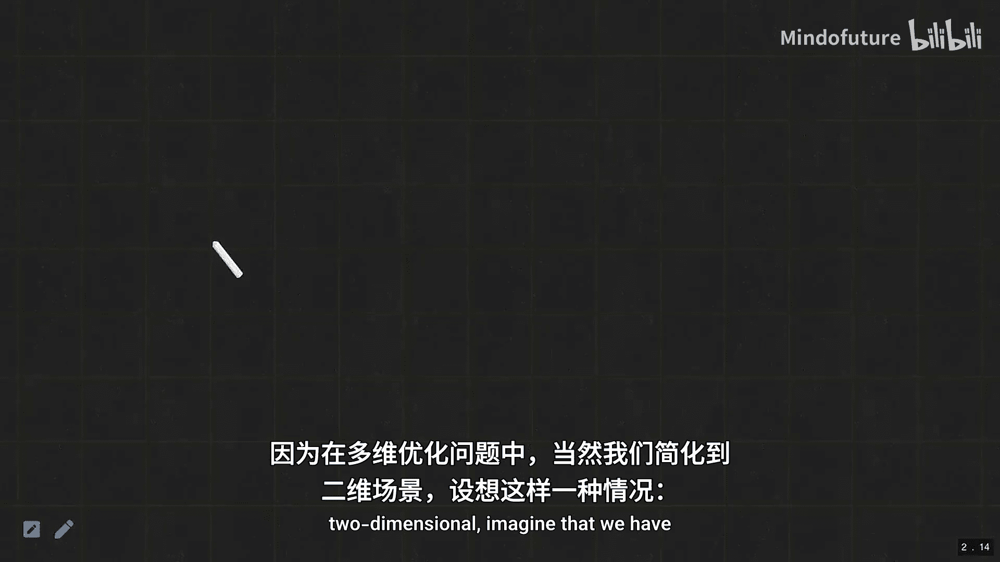
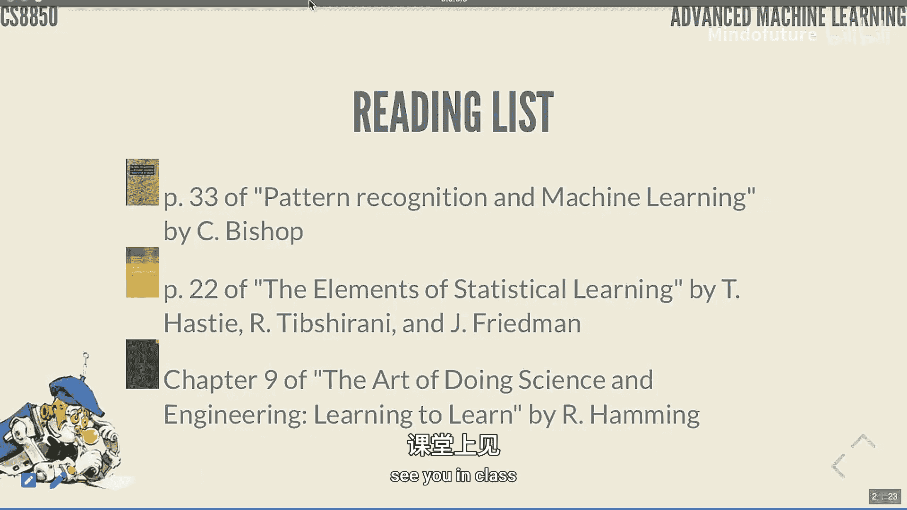

# 高级机器学习主题-CS8850-｜-Advanced-Machine-Learning-p23-P23_维度诅咒--BV1sapPz4Ewx_p23-

Hi， this is lecture number seven and。It is kind of short， but it's kind of narrow in the scope。

We'll talk only about one problem that's called curse of dimensionality。 But in general。

 we just will talk about。High dimensional spaces。This topic is important， I feel。

Because it's all over the place anytime you work with the data or anytime you。Solve any problem。

With multiple parameters and multiple things to tweak or keep in mind or to change。And yet。

Usually this problem is kind of only briefly mentioned。And most of you。

 I'm sure have heard of it before， and some of you maybe even think that you fully understand what's going on。

But this hear or say， cursory look is one thing， but solid understanding and intuition is another。

 So in this lecture， I will try with some help to go through。

The details of what is the nature of the problem。So you may understand better when you are applying your classifiers or。

Dimenssality， producers or other algorithms。Cluster in， for example， to your multidimensional data。

As I said， outline of this lecture will be just one topic curse of dimensionality， spooky。And。

You are you can see my lectures online already my slides as I shared them。

This lecture is in part based heavily on chapter 9 of the art of doing science and engineering by Richard Hamming。

The last slide of this slide deck contains direct link to Amazon for the book and this blog post in Russian。

 sorry， but I've translated the parts。Let's look at this。 tasty。Re， watermelon。You're in a market。

 and you want to buy some watermelon。 And you， of course， don't want much of this。Not so tasty， R。

 And you want more of the red flesh。So which strategy should you use。

 how to choose a watermelon that has more flesh than ri？Let's first look at this。Beautiful。

 one dimensional watermelon slice。And this slice right now is here。

 So what if the rind is just 15% of the radios。 So this is our center of the。Watermelon and 15%。

Of the radius ri。 So 15% of the radius。If we buy not a one dimensional watermelon。

 but we buy a slice a two dimensional watermelon here。

Then 15% of the radius of Ryan turns into 28% of area。But in three dimensional。Watermelon。

 that 28% of the area is 39% of the volume。 So when you're buying watermelon。

Almost 40% of what you're paying for is something that you're going to throw away is the right。

So even though your rind is very like in the slice， this thickness is very thin。

 It's just 15% of the raius。那只。The total volume of the whole weather molon。

Consist of the rind and increases just increase the rind just a tiny bit。

 and you probably are buying more Rnd than the flesh。

So that's an example of what happens maybe counterintuitively， but maybe not， we'll see。

In multiple dimensions， Let's now consider this example。 Let's go slow。

In order for you to trust the paradoxes or the conclusions of this。

Yeah where our lecture will lead us。I am ready to go with Richard Tamming。

 who goes step by step and step in his explanations。So， let's。Also， start from the basics。

So let's look at this diagonal in。Para people or in a cube， multidimensal cube， some structure。

 so test diagonal。Connects。There's two points。And it's D2。How do we， And we know X， Y and Z。

 How do we find the length of this diagonal？ Well， basically， first with one D1 and D1， as we know。

Is a square root of x square plus y square， just thethagorrous theorem。Into D， but then。

D2 is nothing but。Square root。Of the1 squared plus z squared。Which， together。Is simply， simpler ex。

Pres。As a sum of squares， right。So。Let me simplify x squared plus y squared。我 see。Square。

Suppose that video， and think about。Home in multiple dimensions and further dimensions。This diagonal。

 the distance of that diagonal is nothing but。Some of all of the dimensions squared。Each of them。

 each of the high dimensions。 that should be clear， but we better look at it。From the basics。

 So if it's not clear， make a pause and then continue to the next slide， so。For the next slide。

 we start from。哦。Somewhere unusual。We'll start from steering approximation。4 n factorial。

 And we'll use trapezoid rules for that rule for that approximation。

 We will derive it from scratch so you know。Like， you're not。Afraid of it。So。

When we work with n factorial。It's kind of unwieldy multiplying all of that numbers and then trying to analytically manipulate it is a little annoying and hard。

 so let's take a log of factorial and then we can write a log of factorial as just a sum of logs of page elements。

In the product。So。Just intuitionly。Some is related to integrals。

 Let's look at an integral and see what we can do， instead of。The sum of the logs of the number。

 let's look at an integral， definite integral from one to n of log he natural logariths。Wエ。

Now we want to integrate that logarith， let's see we can integrate this sarith using something called integration by parts。

So this is a tedious lecture we want okay， I want you to see every step so you trust this completely。

When you see the conclusions， you don't say like， oh yeah， that's an interesting magic。

 but I don't know where it's coming from。

So。We will have to start from somewhere， though。And。Let's start from assumption。That。嗯。You know， the。

Product rule for derivatives， right to U GV。This。你见油。Then。嗯。是。申请 like。Now let's integrate both parts。

嗯疑。えこ。Is when we integrate both parts。We can see that， well， anti derivative of derivative。

U is still。Here我。

EGU。And from that， we can see that U DV equals U V minus integral F B D U。

So we derived the formula approach for integration。By bar。Here， and with this in hand。We can。

Use it to integrate。This。Log X。Let me think for a minute。

Just reproducing that UGV equals U P minus integral V to U。😔，So， in。In this。That off， isn't。

Fully working。嗯。I guess yeah， I didn't。Alright， thats fully。let's say that， are you。

That are you here as s。X and。唔知。Hes just the。And then。If。2B then。Thanks in。🤧你要。Is one over X G。想邀成。

This formula， we can just plug it in U times V X log。X。我你。Inte girl。Of烦。

And we know that we're doing the definite integral one。😔，So end。So we get and this is one0 n。😔。

If we plug one， this is logo of 1 and0。 so we will get in。Log in1。N plus1。I believe so。 Let's check。

W not， yes。So， we integrated。This definite integral and we get this expression。Now。

 let's look at this integral。Different。 Let's try also integrating it numerically。And numerically。

 we will integrate it using trapezoid rule and trapezid rule goes like that。

 so we are like this is a trip piece。And we know， or you can quickly derive that。There is a。

Plus B divided by two times H。 So H。 So this length is a。 This length is B。And。嗯。So if this is one，2。

3，4， and so on。The page， the height of our。Tpioid is one always。Get rid of that。

And each trip is it is one half。Hello， high， plus1 of。嗯。I plus1。But then the next one is 1 half log。

 I plus 1。And so on and so forth。 And that's why those sum up。At the end。Don't sum to the whole logs。

However， this is zero because log of one is zero。And for this。

 we add a fetchdge factor to both sides。Yes。And rewrite。The logism。In the form that we just obtained。

So the integral of the log X we just calculated。And then because we added one half log n to both sides。

What we see that on this side， when we did so， we just have some of all the logs。

Equivalently because log of10 and this is zero， it will be the same。And we got。This formula。

 this expression。Beautiful， let's now exponiate both sides。And once we expentiate both sides。

Look at this。This is nothing but n factorial， and it's proportional to the following expression you can follow through by。

Exponentiating all of those elements here。And this factor C is actually the。诶。

This error that accumulates because of the trapezzooid rule it's not matching the log completely。

 but we can show that it asymptically approaches a number。

 so we're not going to derive here that number just let's save time。

 but this number of square root of2 pi。And we got our ceiling。Approrxiation formula for the。Fctorial。

So how does that formula work and how good is it？So let's look at the first 10 examples or first 10 numbers。

This is what Sterlings formula。Gives us。And this is what is the true value and for you for convenience。

The ratio between approximation and the true value。Isn in this column， Not that as an。Gross。

The ratio。Gos the one。But at the same time， the difference also grows。 It keeps growing。Yeah。Well。

 so the difference becomes larger and larger yet the approximation becomes better and better。

We can look at an example。Similar field to get a similar field if we have F of n equals。

And plus square root of n。And G O and。Thank close。And。三。As N10 towards infinity， the difference。

Of F of n minus g of n。Grows indefinitely， yet the ratio goes to one as well。Pnt。When n grows。

 this ratio goes the one。ok。😊，No。We will need commmo function。

So just a note before we continue with gaa function and everything。We。

 like what I'm doing is I'm leading you through every step that will。Further。

 all of the steps will combine so you're not surprised where gamma function comes from。

 how we derive it。Why did we integrate by parts and what what happened， So let's。

 let's look at gamma function because we'll need it for the volume of a sphere later， but。

As long as you understand what I'm showing you in the moment。

Please be comfortable that will all make sense further in the lecture。

So commo function is defined as this definite integral from0 to infinity。

Not just that the integral integrates over x， but gamma function is。functionction of n。

So we can actually。Try and integrate this ourselves。 And I think after Sterling's approximation。

 you get a feel of how to do that right should be easy。That's integrate by parts。

Yes by this slide you are already a professional integrator by parts and of course I'm not making fun of you。

 you all have learned it previously in your calculus classes， but must have forgotten by now well。

 or there are some heroes。Who practice integration by parts every day， possibly， but okay。

You don't need to remember anything it just must be clear we just derived this formula right so you're super comfortable。

And for that， let's denote U is x power n minus-1 Dv is this whole expression E power x power minus x T X。

 and then in this case， D U is just differentiating this。X4 n -1。

 and V is minus minus A to the minus x。With this in hand。

 we can clearly rewrite this or integrate at least partially this definite integral。

As's the following So okay。Okay。If you plug zero here。Both of the part。

 like this turns into0 when you plug 0。Because。X is0。 and if we plug infin， this turns into 0。

Because one over infinity。哦。是。Just。Yeah， if you plug。Infinity， well， I'm faking it， of course。

 because it's the limit of this expression when x goes to infinity minus E minus X。Yeah， now。

 my calculus gears are lubriating。 and I even recall some of it。 Yeah， so limit of that tend to 0。

 just trust me that。 So this part goes to 0。 and we have this expression。

 Some kind of weird and is looking familiar。 Yes， it is familiar。 What。Look over here。If n is n -1。

Then it's a commma。Of n -1， right this integral， nothing but comm of n -1。And， indeed。嗯。

This function is gum of n -1。 and we got sort of a recurrence relation， gam of n。

There is nothing but gu over n minus1 times n minus-1。With a。basease case of commma 1 equals one。

That gives us correspondence that Gamon is factorial of n -1。Okay， we derived a gamma function。

A useful one。 The advantage of gama function for our purposes is I'm not going。

 it's not amatic mathematics course， and I'm not going。Into details of all of the derivations。

Our proofs of consistencies and everything。 But the importance for gamma function is that it can calculate all of the factorial numbers。

 but it is also。Continues。 It can。It's probablybably wrong， but I can calculate。fractional。

Factctorials as well， not just in futureature factorials。

 and we will need an important fractional factorial for our。

Next story is gamma of1 half how do we compute gamma of 1 half。

 that's why we need it actually because the trick or technique of computing gamma of one half will be important in the further exposition。

Just plug1 hand， remember what was here。Sorry about that， to remember what was here， gama a minus-1。

 we plugged1 half。And this became x -1 half。 So that's how we've got this integral。

 You know probably what's coming， right， We're gonna do some substitution and。Make it interesting。

 So if we set X。To T square， then the x is。The differential is 2 t timesgt。

And then we can rewrite this integral， the top one。As2 goes over here。X is t square。 So we plug it。

 So it basically plug。T square instead of x in both places。And plug the plug the X or two times T。

 D T， instead of。The x into here。There is three places that。C square places。

Let get this expression as a results。Okay， I hope。You can pause it and do it on paper。

 but this is simple algebra， you can do it。I'm sure it's not even like。Ouse or whatever elementary。

 it's not my point is that you can easily plug it in and compute for yourself。

But now see what is happening。 This is two definite integrals from0 to infinity。

But it's the same as an integral from minus infinity to infinity。This in this case。Because， well。

 first one。T squared， so。All the negative numbers here will have exactly the same value as the positive corresponding positive numbers。

So now what is t squared， like what does it remind you？T squared can be expressed as a。嗯。Circle and。

This gives us a circle， right？Sort of constant。Rdius from the center， which is。子咁。

So let's do the following trick or apply the following trick。Let's。Multiply the integral by itself。

 basically。 So we're squing it， but we're squing it in。Two different dimensions，1 is in X。

 and one is in y。That's how we replace T squared by。Filiar equation of a circle。No。

We need to integrate that。 How do we do that， Well， first notice that this looks very similar to。

It reminds us circle should remind you of a polar coordinate system when you have a circle expressed as x squared plus y squared equals r squared or T squared。

 you can always。😔，Express it。And polar coordinate system has the radius and。Cta the angle。

Thats how it will look。Still gamma squared of1 half。

Will be a definite integral full circle from 0 to2 pi。 So we're integrating from 0 to2 pi。And。诶。

Me is converting it to a polar coordinate system。😔，We have a。Turned。We have turned this。

Expression into r times E E to the minus r squared。So。Outer integral is easy to calculate。

RightIt will be two pi with the full circle。And interestingly， the inner one is also。

Easy to calculate。And。You can do it yourself， but。😔，So what is anti derivative of E R。Okay。

 what do I have here， let's。G， let's calculate this so we can easily。Calculate this。Mti derivative。

 because if you differentiate。Thus you will get 2 minus2 r over 2 E minus R squared dr。😔，But。Okay。

 and that was this minus plus plus， blah， blah。 and that's how you get。The sport。That's here。 So。

 okay， we now know that it's -1 half E。R squared。 Yes， sorry， baby steps， but I don't want you to。

 that it's like always useful when you're doing something to start from scratch。😔，To get a feel， and。

Conviction that this is actually what's going on。And then。If you plug 0 here。

 then it is minus-1 half。And if you plug infinity， it goes to 0。 So minus1 half0 minus minus1 half。

So， you get one half here。And。Inteegral， the outer integral is just two pi。

 So then gamma squared of1 half。Just fine。Right， I hope I was going slow enough。

So gahanma squared root of12 is pi and gamma10 is square root of pi。😔，But it with me。

 we're getting somewhere。So now we know what gamma of and half is。 we know。

 and we're totally comfortable with what gamma is。😔，And we're ready。

To calculate the volume of a hypersphere。So。😊，If we start thinking about the sphere and。ちな。

We by analogy with the cube， right， It's easy to。I hope it's easy to generalize that。 Okay。

 if we have。One dimension cube， the volume is one。 If we have two dimensional cube， the volume is。

 well， let's call this。Dimension。You guys。Ce of。Characteristic dimension 1 is always one， but。

Let's say this is R。 And then in。One dimension hits R part1 in two dimensions is R part2 in three dimensions。

Is our third power， and it's easy to see that the more dimensions you get。

 you just get our power N right that's for the cube。 But what happens with the sphere。

 So with the sphere we。Can sort of intuitively guess that it also depends on radios。Power N。

 but with some constant。In front and think about one dimensional sphere。So what is this fear。

 first of all， fears is。And like it all pull ends。That are equi distance， equiist。

From central location， some central location。 So if our central location here in 1 D。

So all points of raius R。So as you can see， C1 equals2。And then， we know。That in two dimension。

It's pi， so a volume of this sphere in two dimension， which is just an area， is pi r squared。

Volume of the sphere in three dimensions is4 pi over 3。 But what is。

The general form of this constant， What is it。Let's derive it。 And let's start with。

The following intuition， approximation of a volume。

 if we need and imagine this is a multidimensional sphere。

 So the volume of a multidimensional sphere is nothing but a sum。Of areas。Of the shells。

All of the shells。 So we're going。So if this。嗯。Increment is infinitesimal。

 Then some all the areas of all of thepherical shells， and you get a volume。All of this。Se。But。

 that means。That。Spherre area。Is because it's an integral， right。

 area of the sphere is nothing but derivative of the volume。AR。

So if our surface area is derivative of the volume。嗯。Look at that。And we know this is constant。

 and it's independent on them。It's independent of R。But we differentiate with respect to R and。

Simple rule n times C sub n， R power n minus-1。 This is our surface area。Now。

 when we know the surface area， we can write an element of the volume。As。

The infinitesimal element of the volume of it as。Divative of the surface of the volume。

 So surface area times the R。So this is our element of the volume， but then。Let's do a little trick。

In our。Garma in polar coordinates， when we calculated gamma 1 over two， remember。

 we had R E to the minus R squared where basically。RDR was our element of the volume。

 The volume in this case was two dimensional， so。Thats pardon me。 anyways so。一つで。Are squared。

RDR was our element of the model volume， and this we're replacing this element of the volume。

Because now it's n dimensional， it's not two dimensional our polar integral absorbed all of the dimensions remember or absorb the two dimensions so our dimensions are absorbed here。

 we're integrating still from zero to infinity， but now our gamma of 1 half is power n and since we know gamma。

Squared or comma was up。Square root of fine。Now， when we。Crazy to power。

 and we get what we get just that。No going。Step by step。AndWe know that J which of the volume。

Is our surface。Which is here， whoops。So， let's plug this into。Here。Take the constants out， rearrange。

 And what happens here， we also make some a substitution again， as we've done before。

 we substituted our square with T。So when we substitute our square。With tea。啊。2。这这走。And minus-1。70。

 that's how the and over2。inus1 comes because of this substitution。But then。This substitution。

Go with T。 That's clear。嗯，那个。And oh， I'm just， I was just thinking where。See in。And number two。OK第七点。

That's the R。Substituted with Dt。 That's where we got one half。Okay， so after。This substitution。

 we a new integral still。Should equal the same value。 But then we observe。That this integral。

Is nothing but gamma of n over2。That part。Since this is coming over of and over2。C N of N over2。

Come off hand over to。But this is the same as you know， as G off n over two plus one。😔。

That's where this come from。Well。W did we do it， Well。

 we knew how to integrate the gamma function of one half。But， we also。

Knew that surface and volume are connected， and。Both include surface of a sphere and a volume of a sphere are connected。

 and they both include。This constant C over N。 Now， when we have this expression。

 we can derive or just rearrange and compute expression for C sub N our constant。

Of which we need for the volume of a sphere of hyper sphere。So then our hypersphere volume。

 just rearranging of what I wrote there。Will be this and pay attention just to this now。

 So we have an analytic expression of this constant as a function of dimension。

 So let's go for a few dimensions for10 dimension and look what happens with our coefficient of the volume of the sphere。

 So this is our flat sphere。 This is our circle。 This is our ball and。4 dimensional。

 five dimensional hypersphere。 Look what happened first。It grows。But then， it starts falling down。嗯嗯。

This is the maximum somewhere here。So， our constant。Volume of sphere。Changes as follows and。

Eventually， we'll figure out that for even numbers of dimensions。

 it's nothing that pi to the k power over k factorial， but as k grows， it goes to 20。

That for a fixed are not surprising that with fixed str sphere。With growing dimension。

The volume of the sphere tends to 0。Think about it。

You're just increasing dimension by increasing dimensions。You sort of adding more room。

But as we just derived， and you can recheck back all and each every step that we've gone through。

The volume of a hypersphere goes to 0。Surpris， if we。He write， for any arbitrary are。

If we write n has 2 k。哦。And like。You can see here that no matter what r is for any fixed R as k goes to infinity。

The volume of a sphere also goes to0。R doesn't have to be。哦。Like R can be anything。

So in a general hypersphere or hyper watermelon。The ratio。

Between the roundnd and the total volume is the following。 So let's look at this。

 So we have the internal raius in external raius。 and let's normalize our。External radios。Or。

Let's compute this part。 This part is nothing but。R times 1 minus epsilon。This is our。Smaller ranges。

So， then。We have two spheres and or two volumes。 we one one we do。 so this is the outer sphere。

 this is the inner sphere。And normalized by the authorerspher。So that's how this formula is derived。

 C and R to the N minus C。And's see， in。R 1 minus F 7 to the N。Right， for n dimensional volume。

 But that's how we get this formula。 So C ends。Go away。As well as art bar。And the ratio。All。呃。

The the。Volume。Of the outer shell。To the volume of the whole surface of the whole sphere。

Is the following Not a paradox or sort of counterintuitive。So R here is the same epsilon。

 and it's their ri in the watermelon。Notice that no matter how small the R is。This number is， always。

It'Smaller than one。So， we're getting。1 minus。 Well I don't know， something。To the power N。And as。

 and。Dense infinity， or just gross。R。嗯。Volume。our。Volume of that outer shell。

Equals to the total volume or in other words， all of the volume or most of the volume。

 almost all of the volume of a hypersphere。Is located in the outer shell。

Is concentrated in the outer shell while the volume inside is empty。So。To。Paradoxes， well。

 you can see the same， this is proportion taken by a Rnd。诶。In percentage of radius， right。

 So this is when Ryan is 15% of radius by dimension 90。TheThe round is taking up。What do you think。

 95% of the hyper watermelon， but if the Rndine was 50% and quickly it taking。

 it is taking almost all of the volume of the hypersphere is taken by the Rnd。

First paradox was that volume of hypersphere goes to zero。As dimension grows。

 and I hope it's not a paradox。 You just saw it yourself， we derived it。

But the second one is in large multidimensional spaces。for诶。

Almost all of the volume of the hypersphere is in the outer shell。We can look at the。

A different plot now。Volume fraction as a function of。This。

Radius of the function of the thickness of the outer shell。 So if our outer shell。

 if our dimensionality is 20 in an outer shell is just 25%， it's already taking up all of the volume。

 But if say our dimensionality is 5， even just5 for 5 d。If you're。60%。

Of the thickness of the outer shell，60% of the radiodius are taking up all of the volume。

 So this other 40%。Don't matter。That's one， how does it translate to something closer to Earth？Well。

 all of this multidimensional spaces is where we do research and you should understand that this is very relevant to any data processing or data planning or multidimensional。

诶。Prameter optimization or any problem that you're solving that involves several variables。

 Several factors will exhibit those effects。 So Gaussian distribution。

 you've seen this in our PCA lecture。 This is multidimensional Gaussian。

 The paradox is that almost all of the。When dimension grows。

 it's totally unlikely for a spherical Gaussian。To fall。Into the mean， Gaussian sort of has a mean。

 right， And when we。In a one dimensional Gaussian， the mean is most likely。Place for。嗯。

A sample to be drawn from。But if you go into two dimensions。And if you take。

Or recall definition of probability。That it is， actually。

An integral probability mass is an integral of your probability density function。

 So if you integrate two dimensional probability in this outer shell。Around。

Most of the probability mass is in 2G is concentrated Traous。

 and this is a Gaussian with unit variance and xamine。At the ratioius of 0。5。

And if you go into 20 dimensional shell， then most of the probability density is concentrated in that shell。

Away from the mean， around 2。So it doesn't mean any point here is like any other point。

They're totally or very different because there are many more options。

 but they're all concentrating around the shell in this multidimensional space falling into the mean is super。

 super， super unlikely。And mean is our average case， right？嗯，去。Look at this。

 What if the flesh isn't in the center。 Let's go back to our watermelon example， I guess。

 because it's tasty and it's easier to talk about watermelons。 So what if the flesh。

Is at a unknown position with a know where it is， and it's only 10% of the redius， the rest is ri。

 What is the probability of randomly hitting the red point。Well， it's 0。1， right。

 if that if you randomly sample。In诶。Like randomly throw a dart here into one of the boxes。

 the probability is closer to 0。1。 so but in 2D。It's the same。

 what is the probability of randomly heating the flesh if most of it is bad and only one place is good。

 but if we don't know where this good and tasty flesh is。

Where what is the probability that will actually hit it by uniformly sampling within this area？

Of a circle， right， It's 1% of the area。 when the R or when the flash is 10% of the radiodius。

 it's just 1% of the area。 So your probability of randomly heating。The sweet spot。This circle is 0。

01。Very， very low probability。 why is it important or why should we care？Yeah。

 what's the probability of randomly heating the flesh？

Because。In multidimensional optimization。Of course， we resortd to just two dimensional。

Imagine that。 We have。We're running our gradient descent which we already discussed and spoke about and there is this ball of sweet spot and if you start randomly with random start anywhere else when the function looks like that。

 you will end up with a bad solution in a local mini。Well。In。In 1 D case， say this is 20%。

And the probability of hitting this is one， yeah。About5% one at one years。嗯。

If you randomly sample one fifth of your starts， so throw。In one dimension。

 through 100 randomly starts uniformly random in the interval ball and1 fifthth of them。

20% will converge to a good global optimum。 But if you're。In the same situation。When in2G space。

Great。It's much smaller number。 So as we saw， the correspondence for 10% is。Yeah，玩玩了。Well。

 I'm probably messing at the exact number， but you get the point randomly starts in multidimensional spaces where we are always in multidimensional spaces。

In the cases when our local minimum， then our optimal or global minimum is like like。

Taking up a basines of a small volume， those random restart are hopeless。I hope that's clear oh。

I don't know if you' convinced or not， but。Let's look at another example， there are way too many。

And we still need to go through a couple。 Oh， I guess this lecture is not so short or not too short。

 but I hope it's definitely easy to follow and interesting。 So if we look in high dimensional spaces。

 then。Let's consider。Diaagonal， remember， in our pythagore theorem， we had。

Theyre gonna between twohu。So可。生过蚊。We had diagonal between to furtherthest point。 So basically。

 we start the origin and draw a line。Or vector。To this point。So， if we。Compute。诶。很难狗。

Of this line is any other lines with any other axis lines。Like， there are two。In this case。

 so cosine of that angle， it's。嗯。I think I have the cosine of the angleangle will be one over。こアロドバ。

It's because the length of。Access aligned。Vectctor is one。

While the length of this diagonal is square root of n， right， this is from。

From the general asythagoras theorem。 So as n grows， cosine theta tends to 0， that means。

The factors tend to be perpendicular， but。There are， yeah， like it's， it'll be。Almost perpendicular。

 but it's not quite， but it tends to be perpendicular。So let's now look at another。😔。

Very interesting case。 Let's randomly draw vectors。

From this distribution Richard Humming in his chapter 9 of his book derives this equation。

 but for us， we'll just assume that you all know that inner product of two vectors normalized by their length。

诶。X and Y， the length is。In this case。The shortest distance from the origin。Well。

 usually the length is short as distance as defined by something by the metric of the space。

 but we'll see that in your homeworks tomorrow， I guess。

 so cossine is defined as inner product normalized by the product of the weight of the distances。

So let's now sample。From specific specific vectors， they are all vectors of ones， but。Signs are plus。

And minus randomly。 So we have about two to the power n of those vectors， not about。

 but exactly sorry，2 to the power n of those vectors。And what we can show。

Is that take two random vectors。Of this sort。And as N dimensionality grows。There will be this ratio。

 the cosine。And this n is xy because those vectors are all plus 1 minus1。

 all of their length are square root of n， and when we multiply square root of n by square root of n we get this n。

So cosine theta between any random vector， any of two to the n random vector。

Will almost surely converge。20。And then goes to infinity， so for in larger dimensions。

 almost all of those vectors。Or large， large， large number of inspectors will be perpendicular。

Surprisingly， take random vectors。And they will likely be orthogonal， perpendicular to each other。

Or at least perpendicular， almost perpendicular to each other。To illustrate that example。

Look at 2 G in 2 G， we have。You know， a small tolerance of our precision and vectors that are almost perpendicular to the vectors in this on this line。

 just a few。In 2G， the vectors that are perpendicular to this line grow。

 and you can continue that intuition for large。 And there is just a vast number of vectors per perpendicular to any vector that you take。

 You know， like in in linear algebra in theory， they tell you find an orthogonal basis。For。Any space？

But once you found one orthogonal basis， there are almost two to the power N or two to the power D。

Vectors that are also almost perpendicular to all of those vectors。

Even though you kind of fix the basis。 So in theory。There is absolute perpendicular basis。

 but in practice of linear algebra， as soon as you don't have infinite precision。

Everything becomes very， very tricky because， because of this problem。 So that's another paradox。

 Here's， here's how to。 how we else we can look at it。 So probability of orthogonology。

 the pi over two is about。Somewhere here。And in two dimensions。有。

Almost all vectors are distributed like the vectors are distributed at any random angles。

 all of them two over0 over from zero to2 pi2 pi。But as geodimenality grows， it's far， far。

 far more likely。For any two vectors to be orthogonal for dimensional of 50， look。

 everything is concentrated。In orthogonal space。Another example is imagine that we need to estimate a probability distribution。

 so to estimate a probability distribution。In。This dimensional space。

 So what's the minimum number of samples we need to estimate the dimensional density in a cube。So。嗯。

If we have。Say one。Sample。Bur饼。That's the minimum that we need so。If we're looking here。

I'm trying to fake 3D。I'm being too creative， sorry， but that means a sample。

 so how many samples in total do we need here in order to estimate probability distribution one number of beanss to the D and1 and2 right so number。

Yeah， for， for characteristic dimension。 So here it was， let's ignore this。 was three samples。

 Here it's 9 samples where N is。N is now our discretization step。Or let's call it H。

So H to1 and h equals3 in this whole example， this H2 will be 9， but this is 27。

And for higher dimensional space， we need。More and more samples。

 So imagine what how many samples do we need in 50 dimensional space to reliably。 Well。

 we're not even talking about reliably， just the minimum number of samples to feed to。Heat each bin。

 So that's what it's called usually cur of dimensionality that。诶。

The required number of samples that we need grow much， much， much faster。

And we can collect those samples。And then another example， just to。啊。And of push that agenda further。

 that orientation， totally failing us in multidimensional spaces。嗯。Look at this simple drawing。

 it's a four by four square。And divide it into four squares and inscribed when we inscribed those spheres。

 their radius。Ready are one。So those are raous one spheres。

 so what is the raius of this little sphere？Well。What is this length， this length。Is。

Square root of G or square root of n， right？So， for two。This， this length is a square root of two。

And。The raius of the smaller sphere。Yes square root of n minus1。No matter how large is ours。

 dimension， how large is this N。The ra of the inscribed fears are still one they don't change。嗯。But。

Yeah， look what happens for dimension。2。R。2 equals square root of 2 minus-1。Which is0。4。Blah， blah。

 blah， and so on。For3。It's square root of 3 -1。Just些 points。So3 and so。And。

What happens for square root of 10 for dimension 10 in dimension 10。It's all rag greater than two。

Look。Rradius of this sphere is greater than this dimension。Well。

 it's easy to imagine because if those spheres。Tends to。Corners。With dimension growths， of course。

 this sphere that touches them。Pushes out。But。That's not how how air intuition works right for multidimensional spaces and converting this flat picture into the multidimensional picture。

Not just that。So， from that。Just a couple of more points。呃。Everything， all those paradoxes。

 they happen with Euclidean space， the distance as defined in Euclidean space and a sphere as defined in Euclidean space。

 we can define a sphere differently。 we can define a sphere using L1 distance， which is just the sum。

Of absolute values of all the coordinates。 and this is L1 sphere， again， by definition。

With respect to L1 distance。The。Distance from the origin to each of those points is the same。

 It's exactly the same。And we can take Chebyer distance or L infinity distance when the max of the two absolute value or the max of each coordinate values is taking。

And then this is the L infinity sphere。 Each point on this sphere is equid from the origin with respect to this distance。

 this distance， both of them。They fit to。Different situations， for example。

 when we compare people with each other， we just use L infinity。

 usually just one prominent feature who is hired than who just take the max or I don't know。

Any other。A prominent feature。When we deal with more sparse values like in binary code。

 L1 is a really good metric。In what is a metric， like when we can use a distance to replace L2 when。

 when we can still define the e space or space's。When。

A distance or similarity is a metric and there are a few conditions that it's good to know about what is a metric so a metric has to follow the like has to be always not negative。

No negative that means zero or higher， also it has to obey this identity condition such that if the metric is0。

The the value of d of this distance function is0， that means x and like that means x and y are exactly the same that they are equal to each other and only only then it can be zero only when they're the same another one is symmetry so。

Distance or between x and y doesn't is the same as distance between y and x。

Another one an important one is triangle inequality。I is， well， you remember triangle inequality。

 the third side and triangle can be longer than the sum of the other two。And。The last story。

 the practical story about。嗯。All of that。 So like。How do we actually encounter the multidimensional spaces？

And。Make mistakes。Because we incorrectly think about them。

Yeah is the story from about 1950s so after the World War II。

 there were still a lot of wartime planes left。没呃啊。

Air Force noticed that too many incidents and accidents were happening outside of the war fight。

And they hired a statistician。To study that。 So the warplanes fighters were built back then。哈。

From average。Measurements of humans。Of of the pilots。So lots of pilots were measured， average height。

 average weight， average hand size length， and that's how the ergonomics of the cockpit was designed。

And。Well， the statistician， and I didn't have the name now done the following experiment。

Kind of irrespecively of the hof planes first。 And because of that experiment。

 he was hired to do the job。 So that was at Harvard。So you imagine back in the 50s。Wealthy。

 white male students。 So he recruited 250 Harvard male students and measured 250 hands。

And I was trying to find a typical hand that is the average hand。

And no single hand among 250 was typical。It's like we can calculate a typical hand。

 but we cannot find it and we now but in this lecture you already know why。

 because all of the volume of multidimensional distribution Gaussian distribution is concentrated in the shell in the outer shell well almost all to be technically correct。

 with a lot of it。So for the warfighter， for the warfighter planes， what he did。

 he measured just 10 features of 4063 pilots， and those features included height。

 chest circumference， sleeve length， anything that。Yeah， any， any， anything that would fit。

The conditions or tasks of building the cockpit that they use for building the cockpit to make it comfortable for an average human。

 So for this 4063 people。The researcher was trying to find how many people for how many people all features。

Fall within 30% range of from the mean。From the average range。How many people？ How many did he find。

Right， zero。So this average metrics， I like。Of average。

Cockpits built for average pilots were built for no one and they were uncomfortable for every pilot。

 basically。Okay， so well， congratulations， every one of you is unique and no one here is average。

 and if we happen to find an average person， this will be also a very unique event and this person will quickly become。

Unique some of the literature that I used to prepare this lecture is here and my bad。

 it wasn't so short， but I hope it was a light lecture compared to the others and I hope you enjoyed the paradoxes of multidimensional space。

See you in class。

