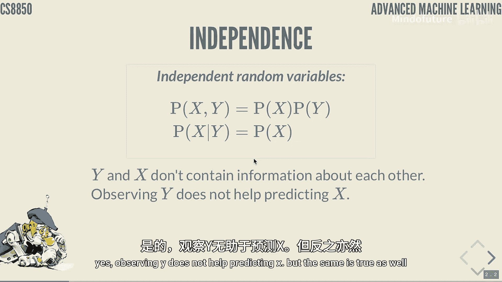
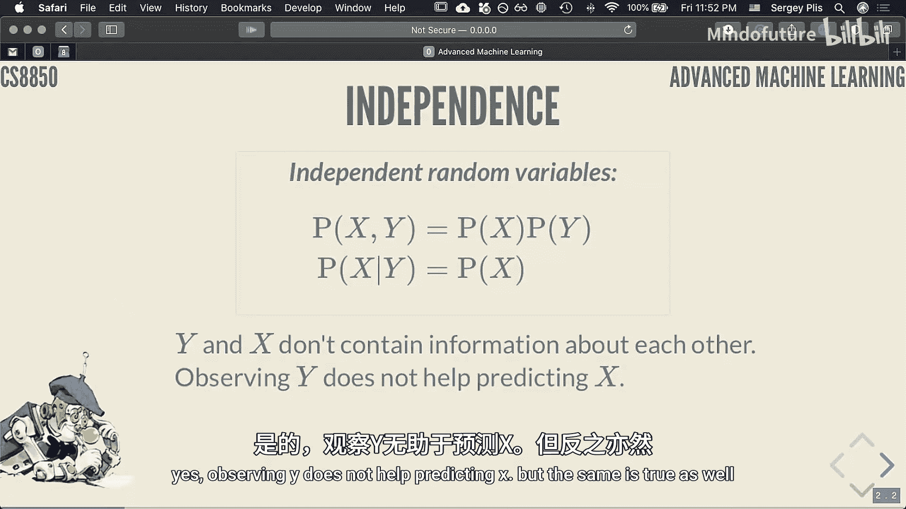
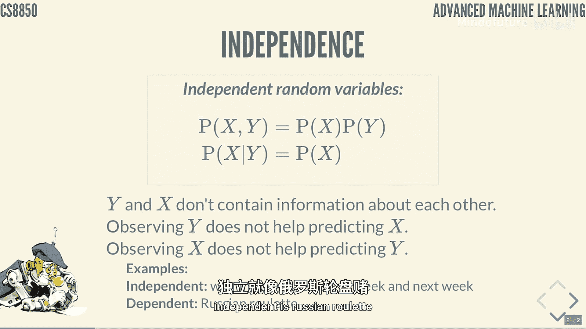
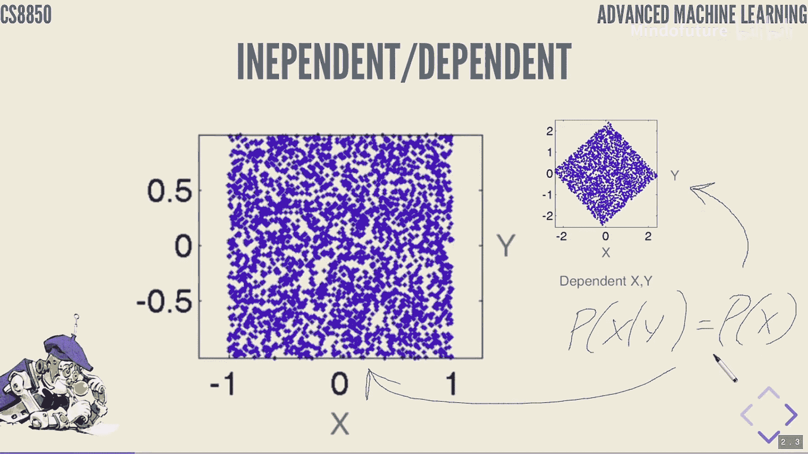
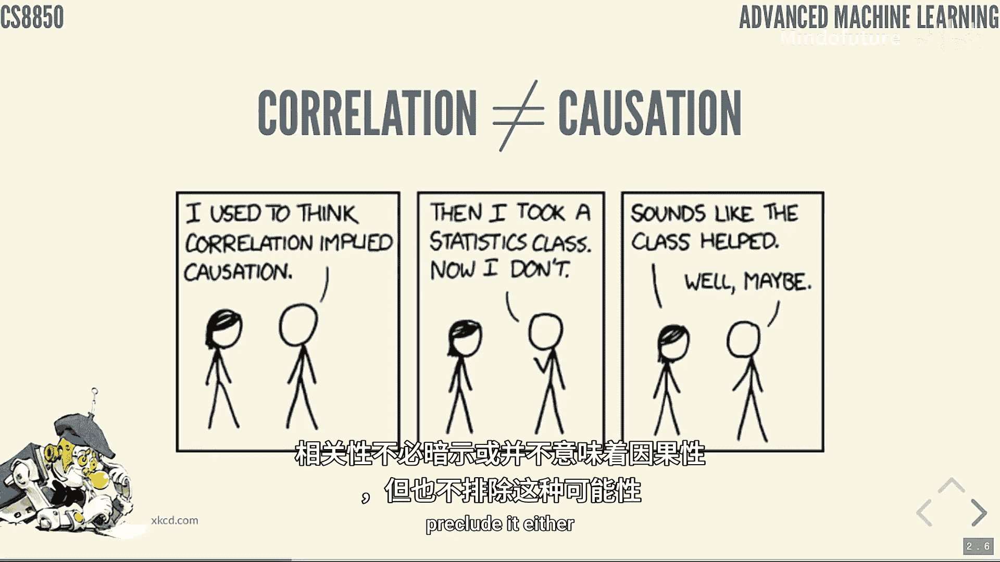

# 高级机器学习主题-CS8850-｜-Advanced-Machine-Learning-p24-P24_独立性--BV1sapPz4Ewx_p24-

Hy， everyone。This is lecture 9。And in general， it's about estimation， but let's focus this one。

 not a tiny topic， tiny but important on maximum likelihood estimation。In this one。

 we will only talk about。Small idea of independence。Small idea with large implications。

And then about the core the heart of this lecture， parameter estimation via maximum likelihood estimation。

Let's going。And the balance。Well， the issue of independence。

Or the definition in probability at least statistical independence。Is defined as follows。

If you have a joint distribution of two variables and it factors in the product of their marginals。

Then x is independent of y。 The variable x is independent of variable y。

An implication of independence or sort of another definition is that conditional。Distribution。

Of x conditional on Y is the same as。Marginal of probability of x。Marginal distribution effects。

So both of those statements， equations on top mean that Y and X don't contain information about each other。

That's basically all it says。Well， it's clearer in the bottom line， right， Basically。

 it says no matter what y is， no matter what we say， the value of y or set the value of y 2。

Probability， density or probability distribution of x doesn't change。It was probability of x before。

 and it is still probability of x after。AndYes， absorbserving why it does not help predicting it。

But the same is true as while observing X does not the converse is true。

 Observing X does not help predicting y。For example。

Independent events beginning on Roette this week and next week。They're independent。

And dependent is rationally。

So what do we see。嗯。On the left。Our non informative variables。

 the joint distribution is just the product of marginals。X and Y。If you know value of y。

 the distribution of x doesn't change。 It is the same for any value of y。

The distribution is the same， but here on the right， the variables are dependent。Yes。

 if you know that value of y is 0。You don't know much about x， it could be anywhere。

 but if you know that the value of y is 2。Then。You pretty much know where the x will be。

 or you can identify the eggs。 So there is a dependence between。The value of x。And the value of y。

Or there is。Each of them。Has a predictive power about each other。Of course。

Depending on what this value is。And。Be in these two examples illustrated with the conditional。

This holds。For this joint。But it is not all。For this trend， because knowing Y does change X。

Some more。Interesting points。Is conditional independence。OfWhen we。Talk about pure independence。

It's whatever the variables we observe。But when we talk about conditional independence。

 we're talking about。Probability， joint probability of X and Y conditioned on Z。

Whether it factors into conditional distribution of x given z or conditional distribution of y given z。

If it does， then knowing Z makes x and Y independent。That means。Again。This。Will not hold。But。

Conditionally， they are independent。And again， C is a common factor if we draw this graphically。

And both x and y。Depend on the。 But if we don't see Z and only observed。And only observe。X and Y。

Then they are not independent。 There is information。In x about y n and y about x。

 and that information， this bit is whatever Z is adding n to x。Or whatever Z is adding into y。

So for example。Depenent shoe size and reading skills and kids。

There is a clear dependence and we can measure that。Shoe size。The larger this size in kids is。

The better the reading skills are。And that's a stronger relationship。 you can always rely on it。

And converse as well holds if the reading skills of a child are quite good。

That means the shoe size will be larger。 You can count on that。I mean。

' it's not a deterministic relationship， but the probability is very high。Well。Let's look at the。

TheThe common cause or the variable that causes both of them or that they are both conditioned on is the age。

Shoe size and reading skills given the age， if we know the age of a child or if we fix the age。

 then there is no dependence。Well， the point here is， of course， the older charm。

 usually the better they read。And so once we know the age of feel fixed age。Sa， I don't know。

 four year olds。Or。7even year olds。And with within that fixed age。

 we compare relationships between shoe size and reading skills。 There won't be any。 another example。

Again and again， scientists。Analyzed the data and looked at it。

 and they could confirm with highly statistically significant correlation P value way less than。0。5。

Correlation exists between stroke population and human birth rates across Europe。

What else do you need to have proof that stalks deliver babies。That's， that's total truth。

 That's absolutely correct。 That's what the data tells us。More storks， more babies。

No one can argue with this。Until。You realize that you forgot to normalize by the countryside。

You just look at。Every country And look at population of stocks in each country。

And look at how many babies are in each country。 And， of course， the larger the country。

The more storiess。And more babies。 So these are examples of conditional dependence in causal learning。

Something aside for this class in causal learning， we call。Common causes， we call Z variable。

 a common cause of x and y。And when you fail to observe。Coon cause or fail to account for it。

Then there is unexplained correlation between x and y or。You create an explanation for it yourself。嗯。

Sttors deliver， babies。Another example of conditionally。Independent events。London taxi drivers。

 a survey has pointed out a positive and significant correlation between the number of accidents。

And wearing coats。Think included that codes could hinder movements of drivers and be the cause of accidents。

 A new law was prepared to prohibit drivers from wearing those coats。Until。People realize that。

People wear clothess。When it's raining。And when it's rain。

 the roads are slippery and there are more accidents。So that's another good one。

Because correlation does not equal causation。Like this X K C comment。呃。Witily points to us。

 I used to think correlation implied causation。Then I took a statistics class。 No， I don't。

Sounds like the class help。Well， maybe。The point being。

Correlation doesn't have to imply or does not imply casation。But it doesn't preclude it， either。

