# 高级机器学习主题-CS8850-｜-Advanced-Machine-Learning-p26-P26_MLE作为KL散度最小化--BV1sapPz4Ewx_p26-

And my story couldn't be complete without talking about the connection between MLE and K divergence。

When I was， I will assume nothing about you knowing。Either well， by now， you should have watched MLE。

 What is the maximum likelihood estimation， And I will introduce some of the K divergence。

Prior information in this subsection。So。First， let's talk about how to measure information。

In communication， we exchange signals to convey message。 Notice information is a very vague word。

 It's just an intuitive notion。So intuitively a message。

 one message is not always equal to another message， right， so if we speak colloquially。

 like when we invoke theorems that we don't understand。Our theories。 So we just say。

 one message conveys information and this information is， how can we measure messages and。

Necessarily， we have to make very。Thoughtful smart faces when we speak about that。

 so no one asks us about what information is and how to measure it。

But if you think about for some time， well， maybe quite some time， it took humans。

 researchers quite a lot of time。To figure out how to measure information content of messages。

 but I'm sure if you spend enough time on it， you'll arrive at the following requirements。Based on。

Were following assumptions。拜拜。Yes， and under the following assumptions。

So messages are strings of characters from a fixed alphabet。That's important。

The amount of information contained in a message should be a function of the total number of possible messages。

And if you have an alphabet with S symbols， then there are S power L for messages of length L。

Let's clear， think about it。The amount of information contained in two messages should be the sum of the information contained in the individual messages。

The amount of information in L messages of length 1 should equal to the amount of information in one message of length L。

That's clear， right？So those are requirements。What can we do What。Like。

 what can we use to measure this。Information content， given the simplified settings。

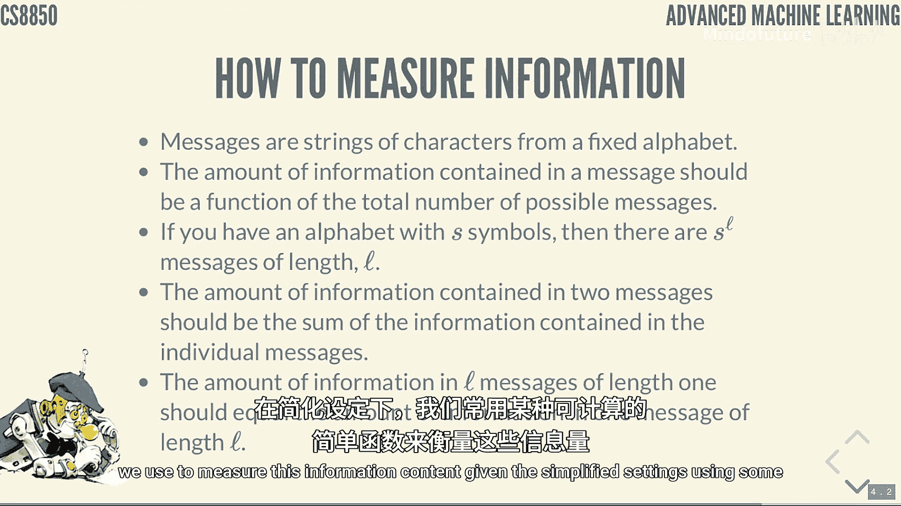

Using some simple computable function。

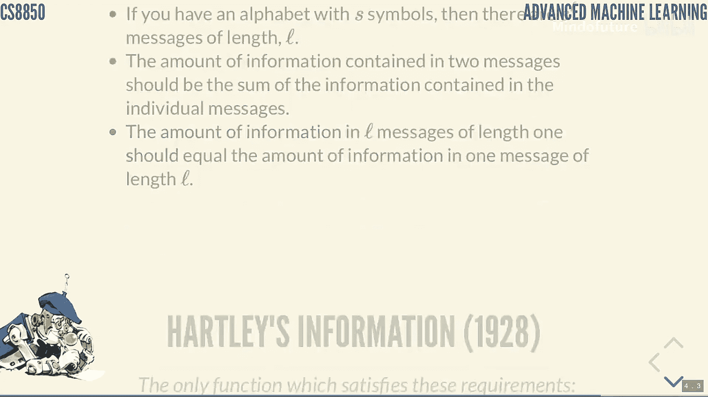

In 1928， Harless's information hardlyley suggested the following measure well basically he claimed and we now agree that the only function which satisfied all of these requirements is L log S。

Or log L S power L。 So S is the number of symbols in the alphabet， and L is the number of。

Is the length of the message right length of the messages？

The only caveat with his suggested information measure is that it works for。

Or kind of implicitly assumes that all symbols are equally likely。

It's like when all symbols are equally likely and in a message， then。

This information works quite well， this measure works quite well。

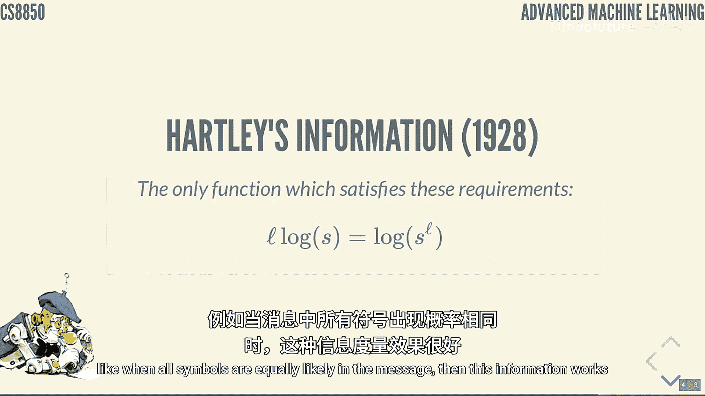

Shannon， 20 years later after that， went a little further。

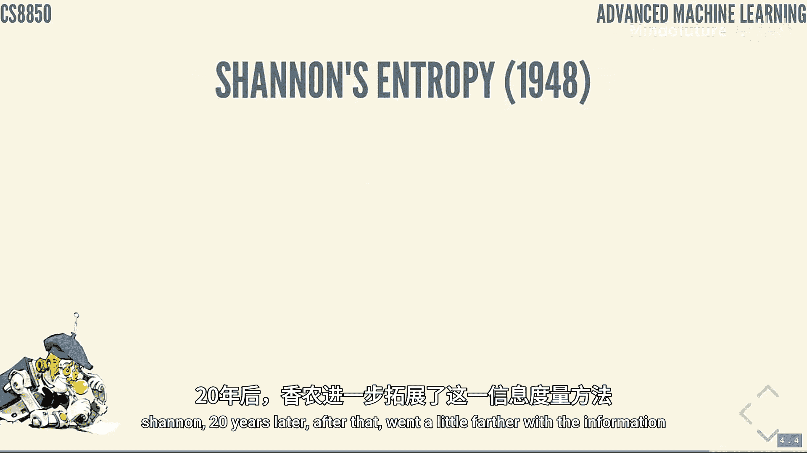

With the information measure measure and the settings is slightly different what if the symbols have different probabilities so let x be a discrete random variable with n outcomes。

 those are our n symbols in our alphabet x1 through xn and the probability that the outcome will be x sub I is probability of x sub I。

Here。

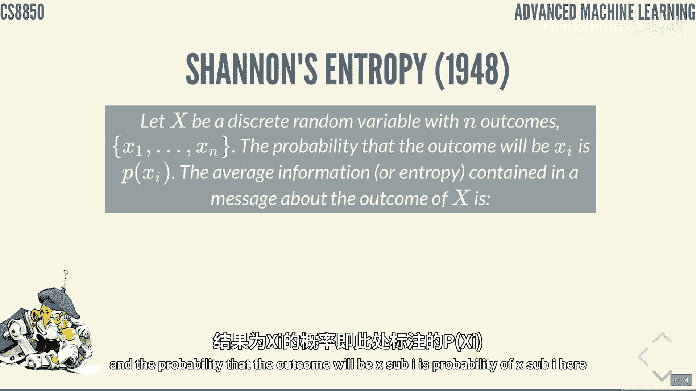

The average information。Contained in a message about the outcome of X。Is。This or。

The same could be written。In differential information form。And when we do that。If we do。

I don't want to copy all of that， but you get the idea of P X and I。This actually is。Expectation of。

B x。Well。This is a slight stretch， differential entropy。 the continuous form of the entropy is。

Has some nasty behavior at times， but it's a good matter， nevertheless。For continuous。

For discrete definition or for discrete signals， discrete alphabet x this。

Is how Shannon defined the information measure。嗯。So as with heartley information measure。

 we're still。Using the log of the log function。To flatten out。To flatten out。Some variations and。

Otherwise。Also， in the case when probability density is uniform。 So each X I。

 each symbol is equally likely。 We arrive at Harley information。

Okay， oh， wait a second。

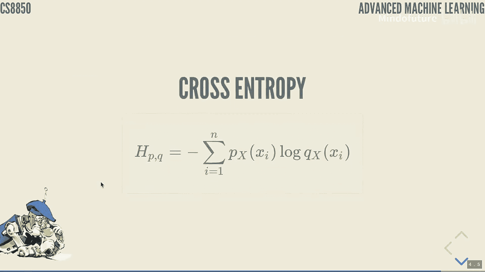

So one thing we're talking about information。Why entropy， Why do we call it entropy。 Well。

 think few people。Waltzman first， the physicist of thermodynamics fame。And then， Gi。

Another thermodynamics physicist。And then， John Van Neyman。

Who knew what Shannon is working on and suggested。In his word， the following suggestion， basically。

 Fon Neeman told Shannon the following words， you should call it entropy for two reasons in the first place。

 your uncertainty function has been used in statistical mechanics under that name。

So it already has a name in the second place and more important。

 no one really knows what entropy really is， so in a debate you will always have the advantage。Okay。

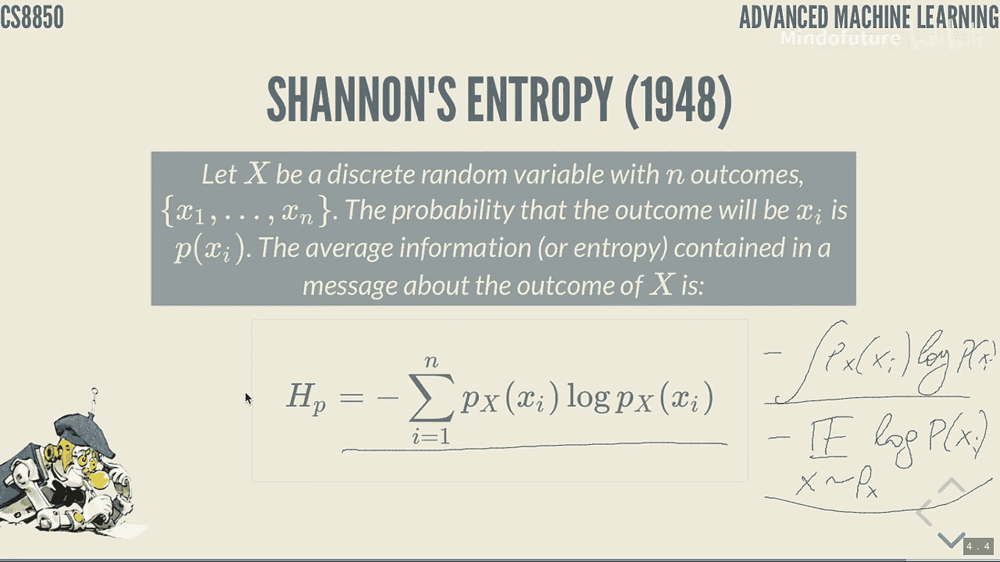

Entropy， but what if。The signal。That is incoming or the signal that is being generated。

Is generated according to。Probability X， but we encoded with the optimal code constructed for probability。

Q， probability distribution Q。We measure the number of bits needed to send a message containing singles drone from probability P with the use。

When we use a code that was designed to minimize the length of the messages drawn for probability queue with cross entropy。

Again， number of bids needed to send a message。Containing symbols drawn with probability P。But using。

Code。Designed for symbols。Genrated with probability Q。Obviously。Since Q。

 since the code was designed for Q is subopmal， It is submal for P。

 and cross entropy is higher than if we used。If we used。The optimal code for P。

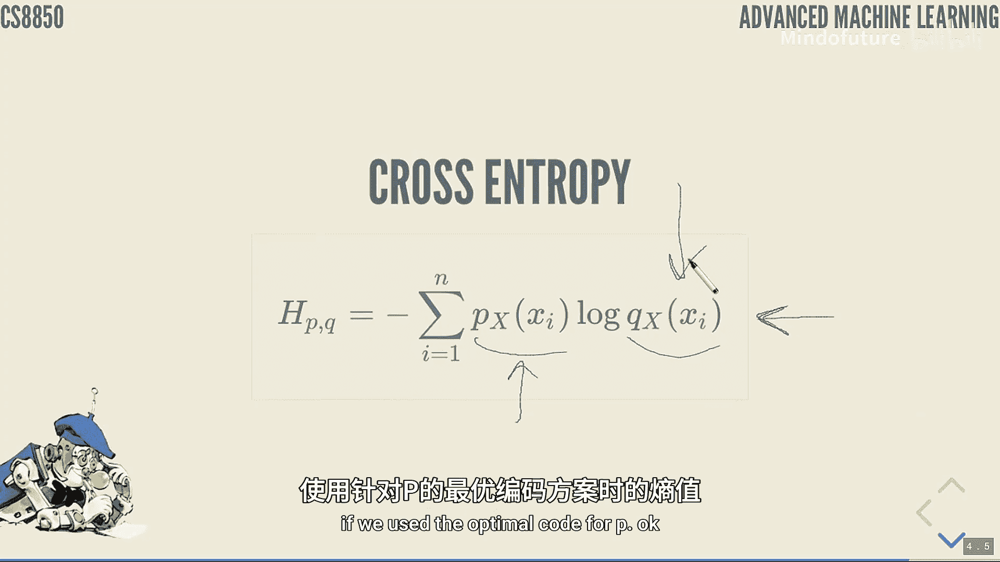

Okay。Now we have everything we need to talk about。Coed by colder divergence， kale divergence。

K that k divergence is defined as。And expectation。With respect to probability。B。😊。

Of the log of ratio of probability P and Q。Or this integral so。If you want to compute。Divergence。

 not distance， but some kind of measure of。Disimilarity。Or similarity， right？Well。

 it's actually dissimilarity because when k dive is0。Well， plug B instead of Q。

You get log of1 and K divergence is0。So the nice property of K divergence is non negative。

And the minimum is at zero。But the bad property of kdirgence is it's not symmetric。Well。

 but if you look at just this part。So it's an integral with this with。

Probability of x over all possible values of x， which is nothing but an expectation， as I said。

Of x with respect to probability P expectation of this log of this ratio。Under probability B。

NotG divergence。 but if we rewrite that。No。Log of ratio is nothing but log B minus log Q。

 and then linearity of expectation。 Well， integral of a difference is a difference of two integrals。

Nice。Then we have two quantities here。And。From this， we， we see that。

Hal divergence could be interpreting。As measure of an extra number of bits needed to send a message containing symbols drawn from probability distribution P when we use a code。

That was designed to minimize the length of the message drawn for probability distribution Q。

 in other words。We have。Cross centpy。Of P and Q。Winus entropy of P。So。This is minuscentpy of P。And。

This is。Cs山之笔。Of P and Q。As you can see from verify from definitions of cross en base。So。Because。

This code is suboptimal。When P is not Q or when Q is not P。Then we know this is larger。

Than the entropy， the cross entropy is larger than the entropy。

So now you know what k divergence is and you see that if we switch P and Q places。

It's not going to be symmetric。 so if we swap this。The result will be different， So it's worth。

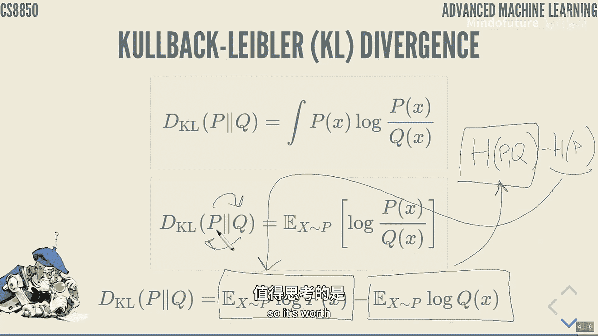

Thinking a little bit about what。Will the difference be， And this one is from。The deep learning book。

By。Good， good fellow， Benjo and。Corville。Chapter 5。A nice illustration。So the point is。

 when we are computing。The normal notion of k divergence or the most frequent， I should say。

 what we're trying to minimize or maximize， we're trying to fit and then say we chose a totally wrong functional form for Q when we minimize k divergence again as before we were thinking that our Q is parameterized by some theta。

 some parameters。And to minimize scale divergence。The distance between those distributions。

 we are optimizing with respect to theta we are changing those parameters such that to change Q for k divergence to be minimal。

To find such a cue in the family of all cues that minimizes the in this case。

You will try to occupy as much place as possible。 So as much。Place where P is positive as possible。

So it will sort of stretch in the bimod case， but if we swap。P and Q。

 then the optimal value or the value where K divergence will push the Q star or the。

Q that we optimize for。えと。Push it to one of the modes。In order to not make any mistakes， like。

This swapped or a mirrored scale divergence penalizes the places where P is 0 or very low while Q is high。

Heavily penal those places。 So when you optimize in。Quote， unquote， incorrect well。Yeah。

 when you optimize， let's leave at that quote unquote incorrect k divergence。

 you're not capturing the full P distribution， but you're making sure that your Q is not producing false positives。

like。第一。Generates high probability for something Q generates high probability for something that is actually low probability。

And correct or incorrect is relative in the technical world。Because everything。

Should be thought about， considered and used in。According with your problem， if your problem。

Calls for the use of correct scale divergence。 Please go ahead and use the。Okay。

 qua andqu or more conventional scale evidence notion， but in some problems， this is fine。

And it's again， think about false positives or false negatives depending to the tasks that you're solving。

Relative to the task that you are solving。No。Why did I tell you all of that about what was it about and how it is related to the main point of our lecture。

 maximum likelihood estimation。

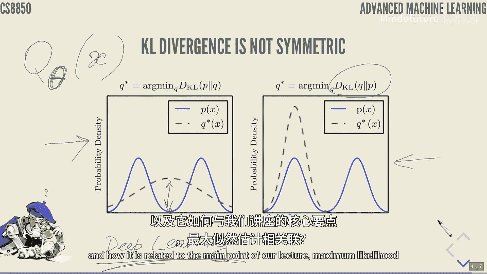

Well， maximum likelihood estimation， in fact， is scale divergence minimization。

I'm goinging to see it now， really quickly。Remember， our estimate MLE estimate of theta。Which is。

This。Another way to draw it so this and those notions I could just write。The same with Q。

Pized by theta， that's both those two ratings。Basically refer to this is our Emily maximum likelihood estimation we want to find such data which maximizing the likelihood。

 which maximizes the likelihood。Because we are assuming our data set D is drone IID。

 independent Ially distributed。We're saying that it's equivalent to the product of individual our likelihood is egg equivalent to the product of individual。

Samples and imagine when n is large， all of these values are less than one and the product of many numbers less than one is hard to handle because of the underflow errors and things like that again。

 please check this paper。What every computer scientist should know about voting point numbers。

 but in any case， numerically。It really。And desirable notion。 And so to correct for that。

 we usually instead take a log。And when we take a log， log is monotonically increasing function。

What will change is the actual value of the function。 So say， for example。

 if our function was like that and then there was a maximum here。 And of course。

 I'm totally an illustration that's not how it will look。 But imagine that if we took a log。

 it'll be。は。g， exactly the point I'm trying to demonstrate。So if we took a log。The maximum。

Will be different。The maximum value will change。 It was here。 It will be。 It will move there。

 but the location of the maximum of。This function。And that function wont change。

 they will be the same， so theta MLE。That maximizes this expression will be the same。 So， okay。

 we introduced log。 Well， I hope it now becoming coming to look starting to look familiar。

 Not just that the X is。The data is drawn according to probability distribution P。

While we're measuring。The probability or likelihood。Whats cute？嗯。Makes sense。Yes。😊，This。

It's pretty much similar or the same as this we are taking an expectation。

Of log of Q with respect to P。What is that negative cross entropy， right？So when we maximize。

This quantity。When we maximize this quantity， we minimize we are minimizing kale divergence。

Between the true the data distribution and the distribution that we're trying to fit to the data。

 Imagine that the data was。Generated from the same family of distributions。

 like the data was generated from BQ theta star。And we're starting with。비。ARundom fadeta。

So what we're trying to do is we're trying to minimize scale divergence between those two distributions。

 which pushes。Our estimate of theta towards theta star eventually to 0。

 because that's possible in this case。 but that's a neat connection and an explanation maximizing。

Likelihood or ML estimate is actually。Minimizing scale divergence。

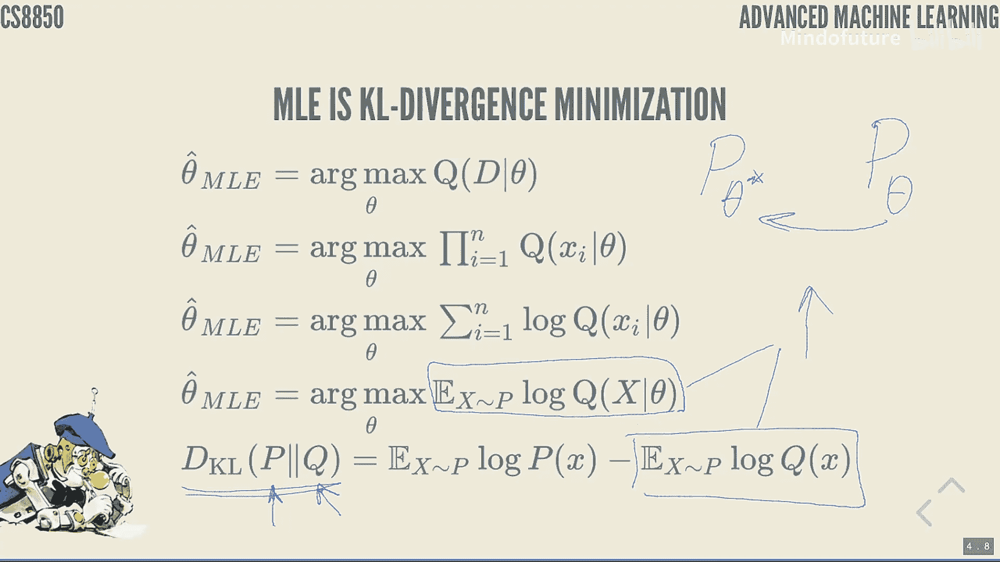