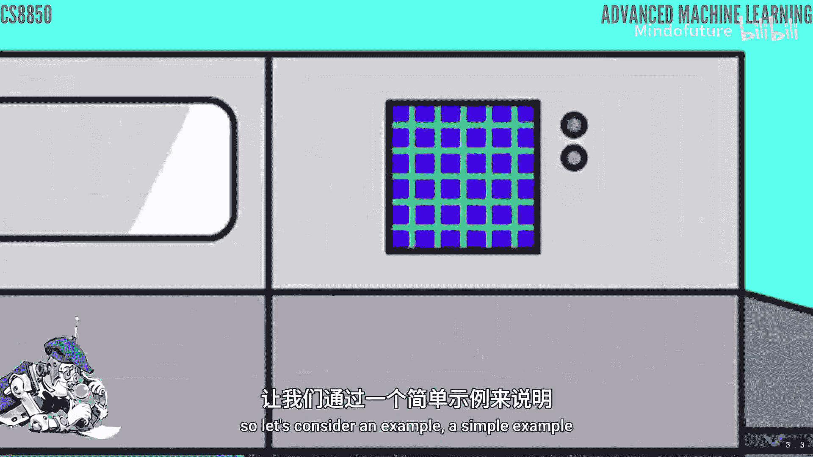
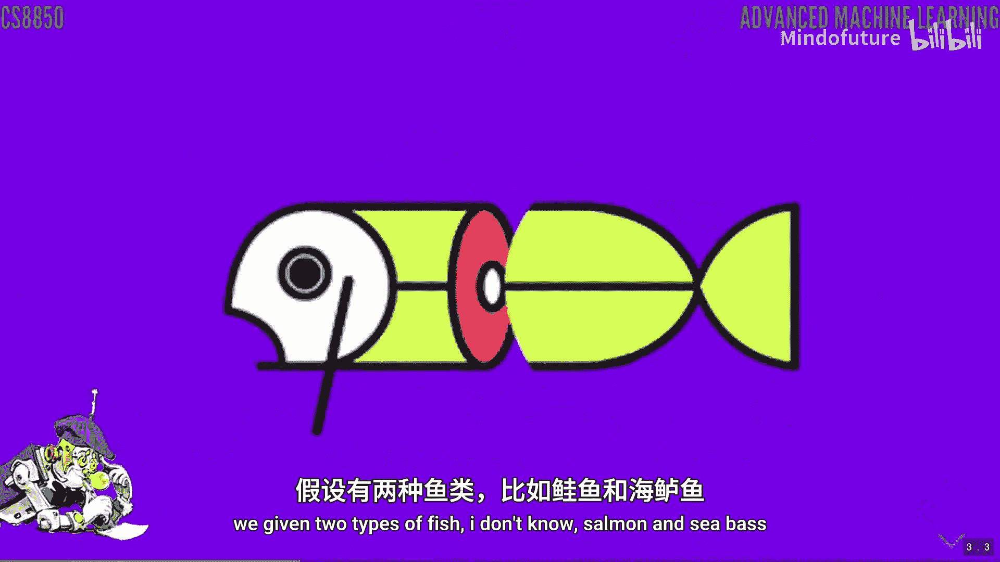
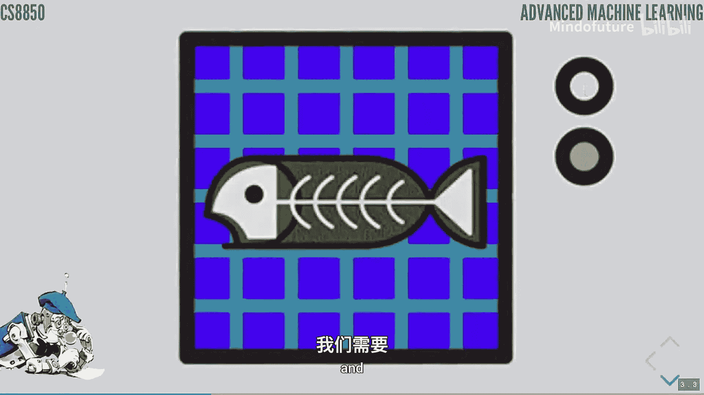
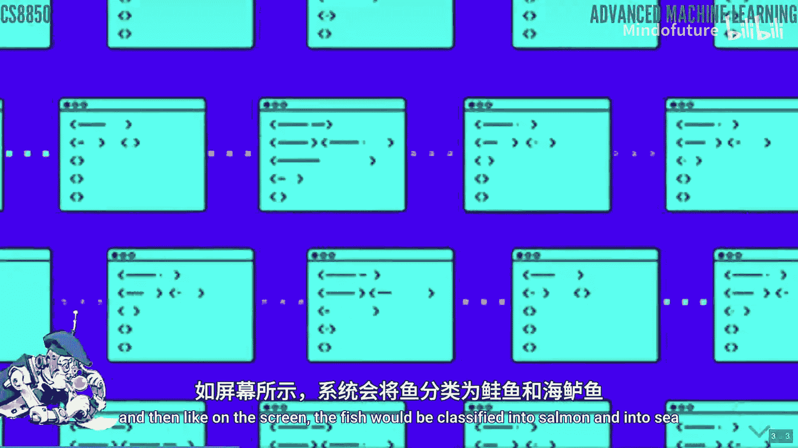
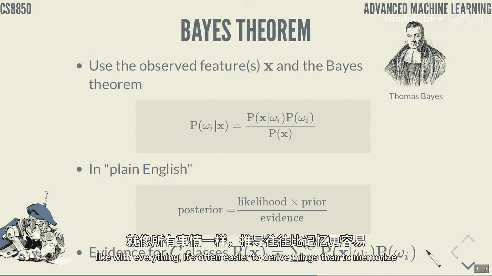
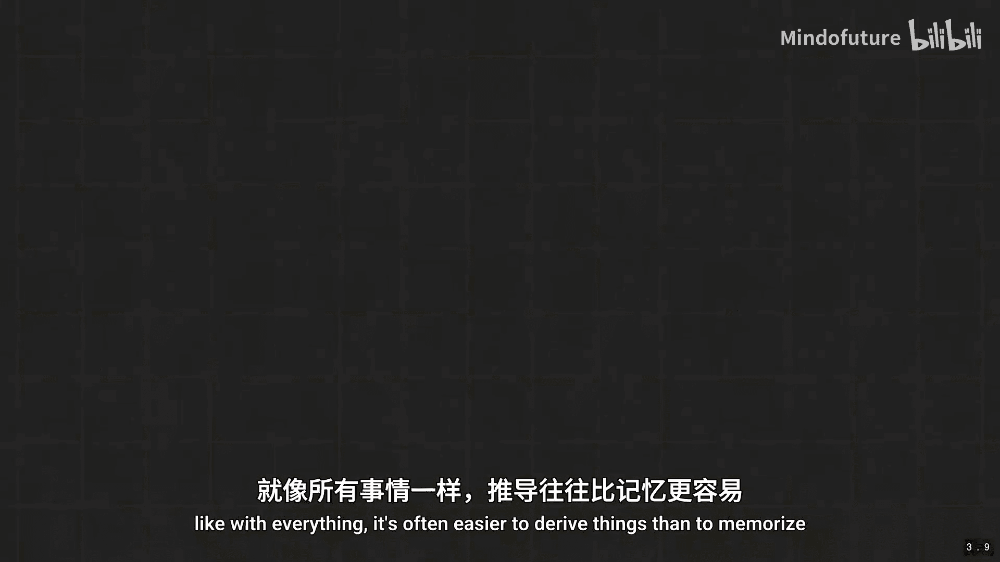
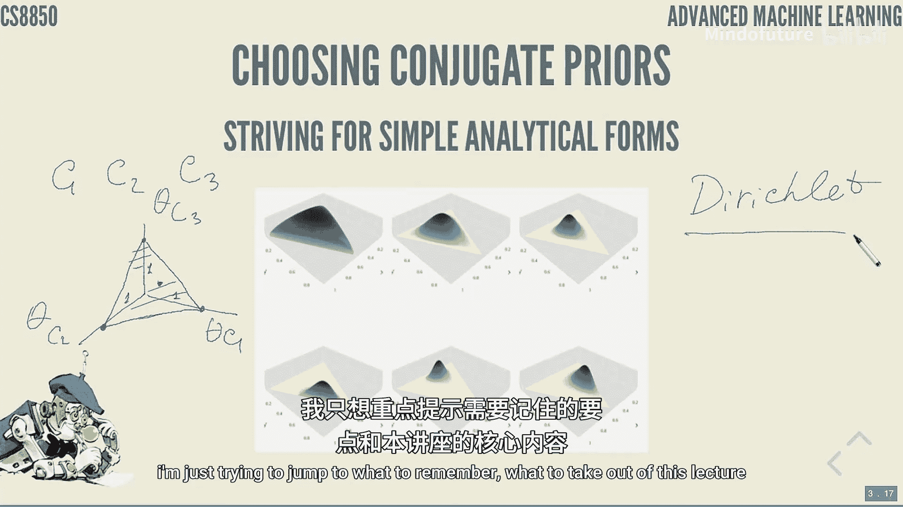

# 高级机器学习主题-CS8850-｜-Advanced-Machine-Learning-p27-P27_贝叶斯决策理论--BV1sapPz4Ewx_p27-

哎有刘文。This this is our lecture number8， Bayesian decision theory or Bayesian。A。Excuse me， I。

So we'll skip the print limitities and we'll make the。Lecture towards Su and also important。

 So the Bayesian view of the world we have talked about in your algebra， we have talked about。

Linear classifiers， And we have talked about talked about。嗯。Emirical risk， minimization and going。

To prediction。Or。Cllasification。Straight from data from the training samples that we have and trying to。

Stay agnostic to the type of distribution。Basing。Approach is quite different。

 We want to be as much explicit。As we can about the distributions， and we want to。

Not only admit that we're dealing with the world。That is probabilistic。

 but we also want to put a probability distribution。On everything that we deal with。

 because nothing is certain。 So everything is uncertain。That means everything， every parameter。

 everything that we deal with has some probability distribution attached to it。

 So often we assume the shape of that probability distribution rarely we know it。

 but there are tricks。How to quantify even your uncertainty about the probability distribution。

To make life easier。So let's go。 So what is Bayesian decision theory。Well。

 there is this amazingian worldview about。Uncertainties， but based in the seven theories about。

How to use this worldview in order to make。Decisions or to make to take some action。So。

What is Bay decision theory？It's on the screen definition quant the trade offs between various classification decisions based on probabilities and the costs that accompany such decisions。

And it comes with few assumptions。 The decision problem is posed in probabilistic terms。

And all relevant probability distribution values are known probability values are no。

So let's consider an example， a simple example problem is a fish factory。

会。Given two types of fish。

I don't know， salmon and sea bass。And we want to automate the whole process。 We want our。

Fishermen just dumped the fish into a。receivingceiving device and then on the screen。

 the fish would be classified into salmon and in the sea bass and the price tag will be attached in the end to each one separately based on that classification。

 so how do we do that？

我。First thing， imagine that。We have some prior knowledge about what those fishermen Ted are receiving device when they come in the evening with a catch。

So men are prior。Comes from this W or rather mega around the variable fish type。

And the random variable Amega belongs is a。2 category random variable。 it can。

Be either salmon or sea bass。I may get one is salmon， and I get two is sea bass。Probability of omega。

1 is the a priorityi probability that fish is a salmon。 So for short， jargon。

 we call those probabilities priors basically， without knowing anything without looking at the fish without looking at。

What ended up in the catch today， we know。Or。Somebody told us， I mean。

 maybe it comes through fairy tales or we've been on the job。🤢，For decades。

 and we know what is like what's the proportion and what is proportion of Cs and what is the proportion of salmon in the catch。

 That's what the prior probability， something that comes。

Outside the problem like you already know before looking at the problem before entering。嗯。

The process or the game。The same。Is a probability of omega2 probability of a fish being a sea bass？

So， Eve。This is all。We know， right。This proities prior probabilities give us knowledge of how likely we are to get salmon before we see any fish。

 that's what I was saying。If all we know and all we can use。Is。Prior probability or our priors。

How can we construct a decision rule to decide。Whether a fish is salmon or a sea bass。

Without looking at the fish。So。Imagine we're building our。呃。Adomated factory。

 And we wanted to start working working right away without even like when we just started So sort of our minimal working factory。

 what would it be， We haven't better than anything。 We haven't installed any。

The cameras yet or whatever sensing devices， measurement devices。 But we already， well， I mean。

 the fisherman。Bring the fish。 We have to do something with it。What we can do。

Is decide based on this rule。If the probability of getting a salmon is higher than probability of getting a sea bass。

 just decide salmon all the time。Or if the probability of C bias is。

Lower than probability of now probability of salmon is lower than probability of CB bass。

 Dec C bass all the time。 Just classify all of the page。As。

Either one or another based on your prior pro abilities。继续。嗯。Interesting decisions。

 so if this is all， you know， the prior probabilities。

You will minimize that way the probability of being incorrect is on what you know。

And you can prove that。UAgain based nobody you know。 But it's kind of a weird rule， right。

 It's more jokingly。 This is a holistic assassin from Turkey gently。It's if you meet a person。

 you kill him。 That's it because it's the probability of meeting a person。

When you meet a person is hired than probability of not meeting a person， right？Well。

 but that gives you an example of a how Bayesian。呃。Worldview works how the baists think。

So decide based on just the prior。 If the prior probability of salmon is way higher than probability of sea bass。

And willll be it right most of the time when decided about。Well class to classify as fish。

But if they're equal。😊，That's practically a random guess。

 So we will be wrong in half of the fish half of the。Fishes allow me to say。That we glify。So。But。

With this information， as I said， no other decision rule can yield larger expected probability of being right。

Unless you have the other information available， so let's see have what we can do。

 what we have available。We can actually look at the fish。Yeah hard to imagine， but we can。

 and then maybe we'll get some additional information about the。

 then improve our classification accuracy or decision making。

So if we know class conditional probability densities。

 if we know what's the probability of observing some features given the class。

 then we can make better decision。For example。Let's say X is the observed lightness of a fish。

So see there。呃。Light or dark， great。Like the。Daarker。And imagine one fish is darker。

 One fish is lighter， but。If we knew that it a sample like。Like listen just go back。If we knew that。

This fish。A salmon。Then we know how how often or how likely。A salmon。To be light， right？

As it darker fish， Yeah it relatively darker fish， so paradoxically。We want to figure out theomega。

 We want to figure out whether it's a salmon， or。see bus。But all we know if we knew。

 like take all of the salmon fish that we looked at or so far and we can extract this probability。

 Okay， if it is a salmon， then probability of this feature is that probability of lightness is this and the same for sea bass。

 how can we。Turn this upside down because we want to look at the fish。We want this。Given a fish。

So sett of features of the dish。 What is the probability of。

Thatad fish belonging to a specific class。好。Base theorem helps us there。It's review。

 I hope that is a review for everyone。So let's first do whatever I have in my slide and then I'll give a little informal。

Intuition about what's happening in the basis base theorem。

 So we use observed features X and the base theorem and the base theorem。

Sometimes called inverse probability theorem， because it allows us to go from the。

This probability distribution， which is called likelihood。嗯。The third probability distribution。

 which is called posterior。From probability of observing certain features。

 when we know the class to probability of the class we have observed certain features。

And it has an interesting form。Likelihood times prior。Divided by evidence， equals posterior。So。

And evidence for C classes is。This。对。Quote unquote， complicated format。 So what is going on here。

 Of course， most of you， if not all of you， No， bythereum， you've seen that formula before， but。

Memorizing it's very hard。Sometimes。Like with everything。😔。

It's often easier to derive。

Things then to memorize， let's try to derive based theorem what what's happening。

 And I'll use a little bit con example。Well ignore all sigma algebras and everything。

And we imagine that we have a two dimensional。Domain。Say。

It's called this variable X and this variable Y。And we have。Some。嗯。

Interesting joint distribution of those variables。Okay， so one thing， well。

 an interesting historical fact， of course， that。The expression of the Bay theum。That is known to us。

Was not introduced by base。It was in Tra variety here Simonman La plus。Rather。嗯。

The Ra base was talking about slightly different things。And namely。

 he invented the condition probabilities。But from conditional probabilities。

We immediately get what we need。So。😊，If we have。I join a distribution like that。We can integrate。

And note。The， the fact。That the。This is a joint distribution on this rectangular domain。

Allows or informs us that it integrates to one， so if we will integrate integrate this probability density。

We know that It's warm。So we can integrate along x。And say。Get this density for y。You see。

 we will execute the integration of x and we'll still leave the Y。 Once we've done that。

 we have obtained probability。why。So starting with probability of x and y。We're integrating over x。

In。夜啲。嗯。Probability of what。 So we're， we're throwing all the weight of the probability。

Joint private distribution。Onto the margin。 Onto the y margin。And getting a marginal distribution。

Margiinnal distribution。Through a process that。Uns surprisinglyurprisingly called marginalization。

 the same we can do for x as well。We can marginalize why out。Or push all of the mass。To eggs。And get。

I'm drawing something。 I'm not looking at my CD picture， but that that should give you an idea。

 So this is marginal distribution of X。Since the joint。Integrate the one marginals。Also。

 integrate to one。Because the probability of mass remain。Now， what do we do if we want to find out？

For a fix。For fixed X。This value right here。What is the probability distribution of fly。

 and that's what。Rverend wasted。열 to。So， we have fixed a to some。Constant value。And we want to know。

It's this distribution。right。Well。That's eat， right。 Take care， join。

Replace your X with C and leave the Y。And。有儿。Distribution that you're looking for。

 so calledled conditional distribution。Because we condition on X， because。

Given a condition that x equals C， what is the probability distribution of y？嗯。All good。

 But now this is not a probability distribution because it does not integrate to one。

 integrate to one anymore。 It's just a small subset。So how do we， how do we make it integrate。

 How do we make it to integrate to one。what we need。Is to normalize the screen distribution by。

It's integral。But， we know that。Marginalization。Along this line。Is already here。 It's the value。Of。

Probability of x。h， let's reconstruct this。Proability。jo probability。With a fixed text。No。

This is the conditional probability distribution。It is normalized to one。It is。嗯。Excuse me， yes。

 it normalized to one。And it represents probability distribution， proper probability distribution。

 and it answers to the question， what is the probabilitybabil distribution of y when x equals C？嗯。

Beautiful。It's。Its the color。And rewrite this again。 So we started。With a simple sort of quote unqu。

 geometrical argument。Probil to Y given an x， let's drop the C。

 as we're assuming in conditional distribution， we're always assuming that x is fixed。

As soon as we change x， it stored a different probabilitybabilities distribution now would be like。

They have nothing in common with each other， right？I hope。It is。Its so clear。

Where this comes from now。Nothing to memorize。It's just。Derived from basic principles。Without。

My further argument， you can immediately see。And if you don't pause the video。

 think about it for a second。But you can immediately see that symmetrical situation holds。

So we know what is probability of Y given x。And we know what is probability of x， given y。No。

I don't have to clear this， okay。To continue。We have。Just arrived。Simply from basic principles。Okay。

嗯头先。I say x from that， we know that probability of x y。Is for view to y。Funditional times a marginal。

And from the symmetric case。Just the writing for your convenience here。😔，It。回脑。Yes。But。

It's just the same。そう。Well know。That this is just a joint probability distribution。

 when you multiply。The conditional by the prior。And。And now we're sort of treating it as a function。

 but。That's a value。Then。I take this。Part。And。I felt right。我识鼻声。😔，Forulation。And， of course。

This is not like。Fooly， mathematical restricted strict。And anyone can find holes。Here， corner cases。

 this and that what about。Infinite domain what about this， What about that。

 But the basic principle is this。All of the corner cases you can work out and what you see on the screen holds。

And allows us to enjoy a lot of the benefits。Probably of。Baesian statistics and Bayesian worldview。

Let's see which ones。So we can use Bayesian formula and we can use it in Pra。因为你。

Situations to work out our intuitions。And。Like。The example that we have。On the screen right now。

I didn't put。I think Cod example and Covid testing， as you know， it often gives。

Negatives and positives are false negatives， false positives。嗯。Nothing is ideal。

 Everything is probabilistic。 Remember， today we are in the probabilistic world， thanks to。

Bsian statistics。So one person is what is known to you again from statistics from the prior。

Observations， one person is 200，000 has a particular progressive multifocal。Lukcoentphiopathy， PMl。

There is a diagnostic test for the disease， and it is correct，99% of time， not battery。

Your test is positive。 You went and tested it。You it got tested and the test is positive。

So the question is， what is the probability that you have PML？So， what we have is that。You know。Yeah。

 what we want That's。What we want is when you get a positive test。

 what is the probability of having a PML， You know， that test is positive already。

So that's why we're only looking at this value。Test could be positive or negative。

But once it is positive， it's fixed。So。😊，Our x is worth it。We have tested positively this x。

And our probability of getting a positive test， when there is PM L。Is 99% of the time or 0。99。

Our probability of getting a positive test at the same time。When there is no camel。

It's just the compliment。One person。And probability of the occurring of the device or of the disease sorry our prior probability of PML is just one in 200。

000。The failure rare disease， Very precise test。99% of the time gives us what we。My correct result。

So， well， but from that， it follows that。A probability of not having good tests。

The DM ML is also very high。 It's 2000 minus-1 over 2000，200000 minus-1 over 200000。

So then if we use all those numbers and baing formulaly to invert。The probability。

To invert this probability。And the adverseverse probability is only 5%。

So you've gotten tested positively。And you start to panic。Is it。好。It's a big stress， but don't worry。

 the actual probability that。Even though the test is positive。

 the actual probability that you're having a disease。That particular is only 5%。

So very powerful worldview， you can invert Bayesian you can invert。

Invert probability distributions and。Make decisions when you only know about。

When you know the likelihood， you can figure out。And we all thanks to the theory。

And figure out what's the probability or what is the best in our case。

We still have remember we are under contract。And so we're liable。

 we have to finish building our fish factory automatedimated。No， more no less。

So to finish building the fish factory， what we want is to。Deal with the posterior。

 because we want all of our machinery， all of our devices， absorb， measure。

 somehow otherwise collect data about every fish。When it comes through about the fish and just be able to stay。

It's a sea bass。Aomega2。Red on a screen or a salmon， black on the screen， A mega1。

If we plot the bestil。Bils。Even un normalizedized。We can build a decision rule that if if given that same X。

Same fish。If the probability of。Conditional probability of omega1 of the first class higher than probability of omega 2。

嗯哼。As in here。嗯。And in here。Or reity。In this region。I maybega one is higher。Deecclare my go one。

In this region， a go one is higher， but it will be summon。And。In other words。So and。

We are looking at。We comparing the sts。Reverse holds， as well。But we already marked those cases。

I make it do。And make it， too。So。And if we follow this rule。Then our probability of error will be。

The minimum out of the two probilities。 What does that mean if we are。딱 싶은 분。Here。

We observed lightness of the fish。Equals 10。5。Then at this point， we know that。It is a salmon。

 with this probability。But with a smaller probability。Out of the two， it still could be a sea bass。

So it two。Could be wrong with the probability that is smaller of the two by following this decision。

내 시즌으로。But。The interesting part。If you actually know。Exact posters。

Or you can compute them at the point。This is the optimal decision rule you cannot do better。

No average。Bai。Random chance， sometimes you can， of course， but on average。Hereく能。

Such as life general based in decision theoryem， let's generalize it。

You have multiple features and x P， of course， not just Lightness and darkness。

 so it's motivated statistics， multidimensional probability distribution。And more classes than one。

A woman or two。And we also。Allow I want to allow actions or refusals to act。

We want to be able to say sea bass， salmon， or I don't know。

And we want a loss function that is more general than probability of error。

 We want to account for how much will it cost if we accidentally sell a cheaper fish。More。

 more expensive。 And then the customer comes complain complaining and sues us。Thanks us to court。

Or otherwise， if we start selling more luxury， expensive fish at the price of lower。

Quality fish or lower class fish， whatever。So let's put that trying to formalize all of that。

So we have amega， the space of all categories that we're dealing with。

And we have x the dimensional feature vectors。Each sample the。We're classifying。

 or we're working with。Remember pixels in our faces examples or pixels in the Emist andwritten digits。

databasease。And we have set of actions。So not just classify into categories。

 but also choose which action to take。We also have losses that we can define outside of probability distributions。

For example， like if you。呃。Given the class， you selected an action。What would be the loss？

And then we have conditional risk。And conditional risk is just an expectation。Over losses。嗯。

With respect to the conditional distribution。And。Or all of the classes， right？

And then we have total risk when we marginalize over not just the classes， but also the actions。So。

That's that generalize in based in decision theory。So。Yeah， this assignment was fun when we had。

Real in class interactions。 But think about this problem。

You have two gas and probability distributions。Here's your。Cheach it for one dimensional goesian。

And our conditional our likelihoods， conditional distributions our likelihoods for class 1 and class 2。

Are expressed as。C and distributions with mean 20 and variance sequence4， another one is 15。

And to in our prior for each of the class feed each of the omega here。Is one third and two thirds。

Exxively， so we have one dimensional space。We have origin， somewhere here。Then we have 10 and 20。

And 15。诶。Your task。Is。And that's a homework。By the way， I'm not solving it for you。

 It is in your homework。 This problem。 Your task is to classify。X equals 17。

 and also draw the posteris。Oh， no， draw the priors。 you can draw the priors。

You can draw the proceduresors。 The best thing， of course， is to draw。

To observe the following that if you draw。The mixture model。B X。嗯。

Just trying to give you a hint for the homework without actually solving it for you。

What I'm trying to say is that。You need to draw。Some go sense。Such that theyre normalized by。

Like plus conditional distributions。Then in effect， you will be drawing the posteris。

Like in order to classify this。Class 17， right。You need to draw the vests。off。아에 그 원 게。Exus 17。

And I be it， too。Give a next。And use our。Decision rule。Here。In order to decide which class。

Each point 17 in this case， belongs。So that's that we can do。And then。Maximum epiiies。

 So we're going to talk about。A maximum likelihood estimation。I it's like next lecture。

But maximum amioity or map is。The poor man the poormans。Base for a reason。

 because we're talking about Bayesian distribution and theory and Bayesian worldview and Bayesian statistics as everything is a probability and it's like。

 you know， it's an interesting abstraction。 It's like any in。Unix， or actually。

 plan 9 took it to extreme。 Everything was a file in truly object oriented programming languages like small talk。

 Everything is an object。 So in Bayesian。Statistics， everything is a probability distribution。

 So we only accept answers as probability distributions， but maximum a postiic gives。

The answer or ananwer as a number。And that's why it's sort of not based。 It it will look at the。

Bteor distribution。And。Instead of giving the full distribution as an answer， we give。

It's maximum value， as an answer。So the example here is about coininos。And。The coininos。We have。

Number of heads。 and number of tails。And total number of coin tosses。And depending on。嗯。So。

 probability。Of hits。Given our coines， they said。Its broke the basin。Beijing or。

The L of observing this particular data set。 So what I'm showing you is。A beate distribution。

They are very。Get a。Bster。I crash that。Let me。Okay， it's better to record the lectures。No， at night。

 but at night， it's quiet， of course。So what we're trying to say。For cointos， we have only one。

Probability， right。 And let's call it probability of heads。For。Because the other is1 minus theta。

So we have a coin and we're throwing that coin。And we want to figure out what's the probability of it。

 given our data。All the coin to。So。What is the probability of absorbing this particular sequence of coin to。

A probability you've had this data。Time having that probability prior on data。And just in general。

 regardless of the was the probability or integrated across all possible status。From zero to one。

What's the probability of observing this particular sequence？So。The posterior and the prior are。

In the parameter value space。 So it's data。And。So we need a prior。Such that it is limited。

did they mean from0 to one。The so the probability is the theta can only belong to 0 to one。Right。

 either 0 probability of heads or one or anything in between。

 And if we choose a specific probability distribution。For in this domain， for this parameter。

 then we did。诶。As a result， we will get。A simple or similar， or。The same probability distributions。

As an output。S。The， basically。If we have some likelihood。And in the case of the coin to us。

This likelihood with the parameter theta probability of heads is Bnoli distribution。

And we have a prior。What shape of the prior shall we choose to handle easy。Easier。Thebaian。

Scientists， businessiness。Aazing，ly soldiers came up with a trick。你。If you choose so called。

 conjugate prior carefully。For each of the distribution of the likelihood or for many。

At least in the exponential family， you can find a prior。Such that。

When you use it in the Bayesian formula， your posterior will get the same shape as your prior。

So if we choose beta distribution as our prior。For the probability of heads。

 our posteror for the probability of heads will be also greater。So just repeating again myself。

 potentially。We can know all there is to know about probabilityul distribution。

 but in maximum of aiity， we decide to go with a single parameter estimate and。嗯。Again。

 if we can evaluate this distribution at a single point。

It doesn't mean we can just plot those distributions that may not be possible。

 but since we can evaluate。🤢，We can sample。And create a lot of samples from our posterior distribution。

 so。What is the maximum epiiary？It just tells you probability of class， given the observation。

 It's the highest probability。 But if we sample from the from the posterior。

 we can also figure out uncertainty and we can figure out uncertainty in various different parameters。

 say we are certain。In lightness， but we are uncertain in weight and many， many other useful。

Characterization so far decision making process， Sta decision making process。

 So this conjugate prior concepts is。We want simpler analytical forms and we want to choose an analytical prior such that our posterior has the same form。

And of course， we do that based on the form of the shape of the likelihood， if likelihood， as I said。

 is Bernoli， which is beta。If。Likelihood is po on which is come a distribution。

 and there is a whole set of like we've discovered。Whole set of probability distributions。 So for。

Bomial heads or tails。It's the beta。 But what happens for categorical when there is more than one classes。

 in this case， we choose。接 clip。So we choose they。Distribution。And that is basically defined。

On a simplex， because if you have。Plus 1， plus 2， plus 3。Let's say class 4。

The probabilities of each of them。啊。1，0， and one。And。Or rather， they have to sum to one。So。

Each point in directly layer here and this probability distribution on this triangle。

 think about this。This way， plus 1， plus 2 plus 3。But the ws are here， Theta。

So all of these three thetas have to sum up to one。 where will that happen， It'll happen on。Syimpx。

 this unit simplex。This is length 1。And any point on that simplex guarantees that the sum of the x and y and z coordinates or theta c1。

 c2 and theta c3， sum up to1， and then we set the distribution which combinations of those parameters are likely。

 and this directly it generalizes that to4，5 and other dimensional。Distribution， so that's。Quick and。

Somewhat intuitive， somewhat bru introduction to the Bayesian decision theory。ratio of posteriors。Or。

Low ratio。Let think about。The following， I'm just trying to jump to what to remember。

 what to take out of this lecture。 So if we have posterior distribution， aomega。

That's third class， right， week working。So we're comparing two classes。

But when we were comparing them。嗯。1 and another。 So in the places where one is larger。Then the other。

 we select the blue， where the blue is higher。 and we select white or white is higher。

 If this is kind of tedious this or that back and forth。Can we just simplify， Remember how in our。

Well was， you know。Thanks to mathematicians， they tried do to make everything elegant and simplified when we had similar situations to when we had perceptron Lx transpose。

Could be either positive or Wx transpose could be negative。 And then if it's a positive class。

 we mis characterizeer it how to simplify， which is multiplied by the labels。And then， we're making。

But this was correct and negative was incorrect。So can we do something in our case here instead of comparing what is higher。

 can we just like set up a universal criterion， Yes， we can。

 We know they are non zero and sum to one。 We can look at probability the ratios。

As long as they are defined in the same domain， and we can compare it with one。If they're equal。

 it will be one。 if probability of class 1 is higher， it will be less than one。

 And if probability of class 2 is higher， if it will be more than one then。

That's not quite everything。We can。Simplify it further， because。A ham， another trick。 Remember that。

Each of those distributions。 And I'm trying to feed you with。Everything in one lecture。

 So each of those distribution is nothing but probability of x given aomega 1， probability of omega1。

 and then a nasty quantity probability of。Ex， like， we have a normalization factor。 That's hard to。

Obtain or find， or do even。Need to calculate that。 But not just when we take the ratio。

This thing cancel the evidence marginal of egg cancels。

We can also go further and take a log of this ratio。

And then compare it to 0 because logo of one is 0。So， that's a take home。

Message and the conjugate priors， is it a concept。That you need to know， then。Basically。

 decision rule。For which。Clsses。To which class does a sample belong to。Baesian probability。

 Bayesian formula or inverse probability formula， the intuition I gave。Please。

Make sure that you understand where things come from and remember how the formula works If you don't remember learn how to derive or you're having trouble to remember。

 learn how to derive that formula quickly on the test or just memorize it Okay suboptimal without understanding but it will help you as well。

 So that's it for the day for the lecture Thanks for listening。

