# 高级机器学习主题-CS8850-｜-Advanced-Machine-Learning-p28-P28_MAP估计--BV1sapPz4Ewx_p28-

Hey， class， this is our lecture number 10 naive base and。Maxum ateriia estimation will will focus。

Some of each because you need to understand we need one to understand another。

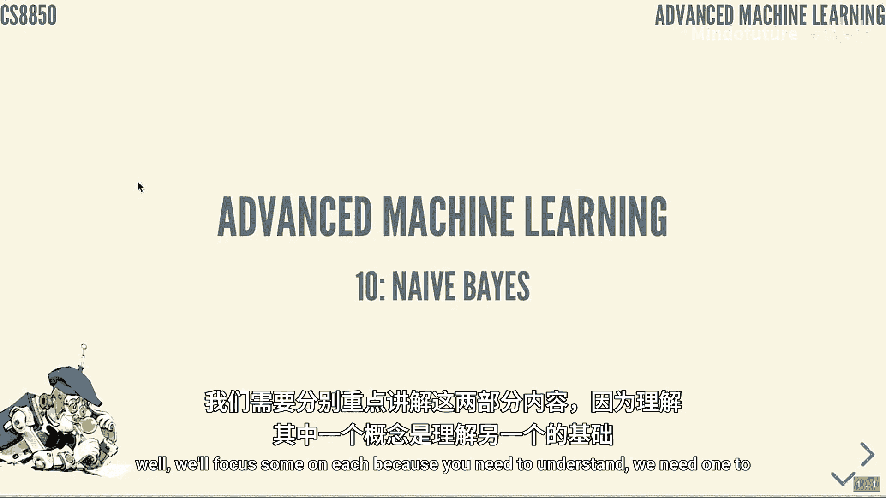

Outline his map estimation， maximum epiteriary estimation。And the naive base classifier。

Let's see how that goes。 Let's start with the map estimation。

 So let's say you suspect the coin is biased。 then what you do。This tale is。

Excellent likelihood as before。Will it give you the correct estimate？Probably it will。

 if you throw the coin enough times， right， because it does converge to the true mean。 But what if。

You only get to see a few throws of the coin and what can you do then？Yes， can you use the knowledge？

In this estimation， can you use the knowledge that they already have。

That is the question in maximum a theoryio， everything was determined by the data your data would give you an estimate。

Of the parameters or the amount of data。 And as we estimated， sample complexity。

 if you want to be within certain levels of。Confidence， then you need to collect。

Certain number of samples in order to be within that level of confidence。

That may not be always possible。 that when it may not be always desirable。

 So if we have some prior knowledge， we can minimize that， right。

 What if we know something already can be weave in that knowledge into the process into the。

Estimation process。 So， for example， we know that。The coin is close to 50，50。 What can we do now。

 So this kind of notion of being close to or being uncertain is the whole crackux of Bayesian approach in the Bayesian view of the world。

We don't know anything with certainty。And so we must quantify that uncertainty of our knowledge or uncertainty about every parameter Probabilistically。

 So if we know or if we suspect。That the coin is close to 50，50。 How can we， How can we express this。

Suspicion。Or。嗯。Believe our prior billion and。Basianists suggest that it's best to use probability as the logic of science and。

嗯。Basedase everything on that。 So let's follow the Bayesian way。 So let's follow the Bayesian way。

 Follow the Bayesian way。Rather than estimating a single the。

Or a vector of all parameter silver distribution or likelihood。

We will obtain a distribution over possible values of theta。So， they did。Is parameter。

For our likelihood。Here， well， this is actually byerator。

But data is parameter for a likelihood that is not on the board。 I will put it on the board for you。

 So our likelihood。

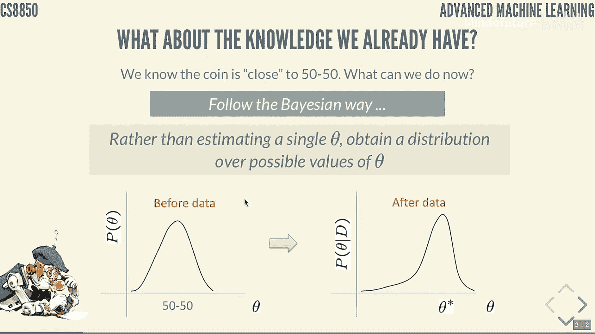

Givenive， given the。parameterrameter for this family of distributions， so fixing a distribution。

 what is the probability of observing that data that's a likelihood so and theta is a parameter here？

When we talk about 50，50 split。Or theta for the coin is one of for the leap coin。

 I said theta is a vector in our case that we're considering now as an example。

 theta is just a scalar value。And if we are。Viian， and if we are also。Reasonable。

About uncertainties in life。We would not say that。Our probability。Of data being one of is one。Right。

We maybe would say， well， I'm pretty sure it's one half of 5050 chance for header tails。呃不。

Then some uncertainty， And it could be a little lower， little higher， or maybe you've。

Seen how this coin was just minted， and。YeahIt just fresh from the start。 And the balance is。

Christine， so you are。More precise and more sure about what's going on。 but still。

 you leave some uncertainty about this value。Because we're in real life and anything could happen。

 And you're not absolutely sure at anything and ats all fuzzy and warm。

 But then when we do an estimation of posterior。So remember， we do want to know then。Value of the。

And this is our prior。Expectation of what this parameter is。Before seeing any data。

And remember the fish example was salmon and sea bass。But for posterior。

The distribution could change because our data will modify our prior beliefs。According to。

The actual process in the world that is happening according to that。Ex。

True probability of true value。Of data。 Well， and again， E Bayesian。

A hardcore agent would probably say that。Only distributions are true， and there are no actual values。

 and it's all fuzzy fuzzy all the way down there。

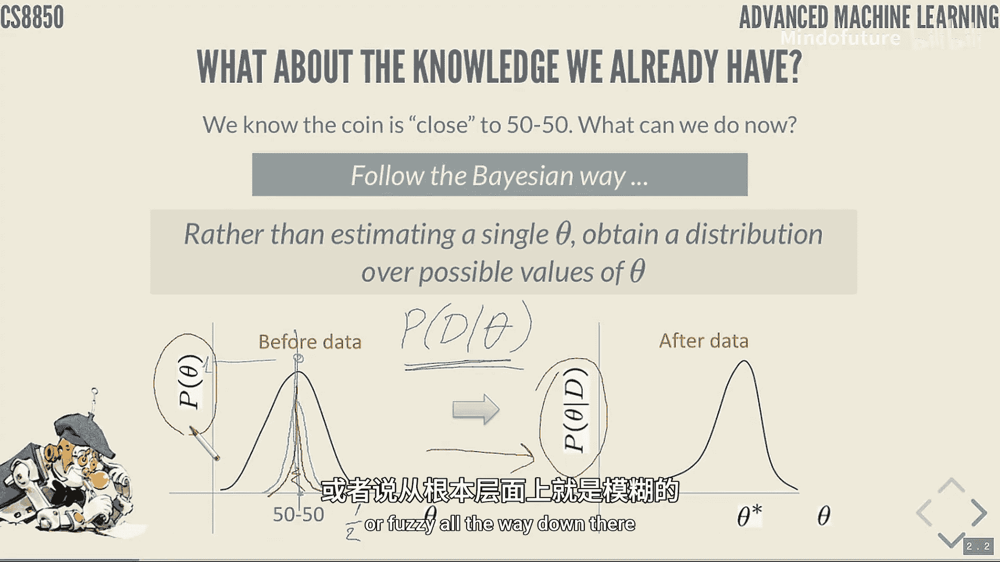

So prior distribution， What kind of prior distribution do we want to use， Think about it。

 how to come up with one so。Philosophical approach to this says， well。

 we want a prior distribution that represents expert knowledge。 So we want to be able to represent。

A knowledge of an expert or our own knowledge， in this case。In the form of probability density。

 And that's a philosophical approach。That's probably when we will get the best results too。

Another approach is engineering or pragmatic approach， we want to pick a prior such that the form。

 the shape of our posterior is simple to deal with and that we can work with。And one of such priors。

 well。One of conditions。Would be， well， can we pick up prior that。When we know nothing。

 can we quantify that， can we encode that？诶。So those' few conditions。

 one is we want simple posterior form。And we want to follow engineering approach when we can。

Just to simplify our lives or a philosophical approach simplifies our lives。

We can start with philosophical philosophical approach， the philosophy of pragmatism。

 but then that's that's just the first。Condition here。

But another one interesting is what if we don't know nothing and then we want to be an informative prior。

 So for。Theta， in our case， we lucky。Because we can pick。Aninformative prior。 that is a proper prior。

 proper density， probability density that integrates the one and any everything。Yeah。Yeah， so。

This is a uniform prior， basically we're saying， okay， I don't want to assume。

I just want to encode my。Knowledge of lack of it as a prior distribution。Butum。

Few interesting things connected to the to the uninformative prior。

 So often we can write down probability distribution of data with some parameter lambda。

 And then we want to say。Why didn't I just take the parameteral Lada and just。

Set probability of this parameter。An informative one over Lada everywhere or something like that。

 or one over the range， but some of their sometimes the ranges of those parameters are written。

And like Lada could be anything in your probability distribution。Would integrate to infinity。

 it wouldn't integrate to one if you just simply set this value as uniform。哦。Or。The same everywhere。

 So those priors where。So when you use a non uniform prior。

That doesn't integrate to one or can no in principle be normalized to integrate to one。

Can you use it and it turns out you can。Ifve。The resulting posterior。

Is proper distribution normalizable and those thing can happen。 And in this case。

 this prior is called improper， and people do use those improper。Non informative uniform priors。

Or unformative。So but to get the simple posterior form。

To follow through with our engineering approach。We usually talk about and use something called conjugate priors。

In this case。By carefully picking a conjugate prior。

 we guarantee that we will get a close form representation of the posterior。

 so we will get probability again posterior probability of our theta given data。And we have the data。

What is the most most the。What's the probability of a given data given that data rate。

 and we maximize that the epiioity？And this distribution will be in closed form。

If we choose an appropriate conjugate prior。And conjugate， it means that。Again， in the Beijing。

thereium orbanesian formula。instead。The posterior will have the same form as the prior so。

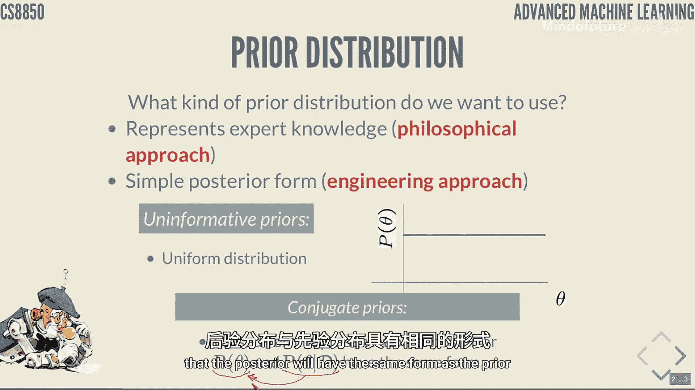

the same functional format list。And everything。Back to， and things to。好。Alma based。

 who published in 1763 an essay towards solving a problem in the doctrine of chances。

 and philosophical transactions of the Royal Society of London。Well。

 what he actually discovered was conditional distribution。But from that。Of course。

The base rule follows。

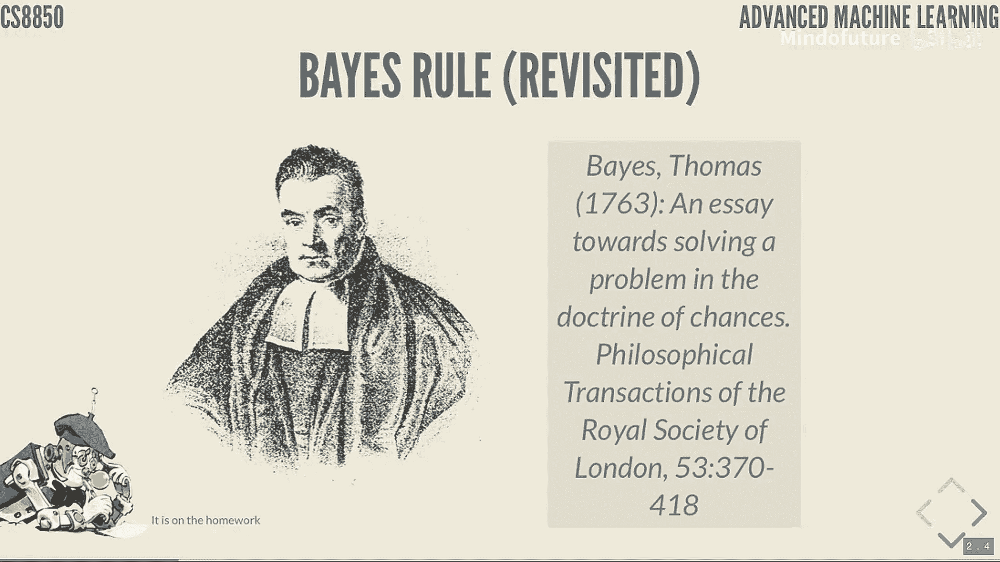

And。Chain the rule of probabilities， or。啊。Base rule， the related。 So the chain rule says， if we have。

A joy distribution。P O x y。We can decompose it as a product of conditional and product of marginal。

And if you visualize my explanation of where does theian theorum comes from。

 you will see that this quickly follows through。Because。A conditional。Is nothing but。

Normalized by the margin。嗯。你对。I hope it's clear。 I hope you can。No， the one。

 the other way around another thing that I would like you。To be clear about that。

When you deal with this。Is that this。Sort of。Ca section of chain rule。Be done indefinitely。

You can condition on the。嗯。Sohall we do this。So let's do this。Instead。

You can condition on Y and Z and get the joint of Y and C。But wait a second。

This itself can be conditioned on C， and。Prior on the point， so we can keep decomposing。

Or distribution。By multiple ways。Conditioning none。做啊好啱。One variable or another。But。你好我。Yeah。

 like basically， what I wrote was this。Okay， you must follow。 Don't fall asleep。

Do this on a piece of paper， so。I， I legitimately wrote this， right， because I can do that。

I am sort of dividing by。呃X and Z O。See， I'm stake and I'm dividing by one Z joint。And here。

But then I can further decompose the joint into project of marginal and the conditional。

And I can do that。Multiple ways。 second condition on X， second condition on Y and Z。

 multiple other combinations。 So and。Once this product is computed， well we get the joint。

 So that's one thing。 But then from this two。We construct the base rule， That's simple， right so。

Divide by P， both parts， you'll get this here and this here。U。

Base rule is important for reverse conditioning property， right So if we know how to condition。

On x in this two variable case， then we can apply by this rule and reverse can condition on y figure out what is the functional form or what is this conditional on y distribution looks like。

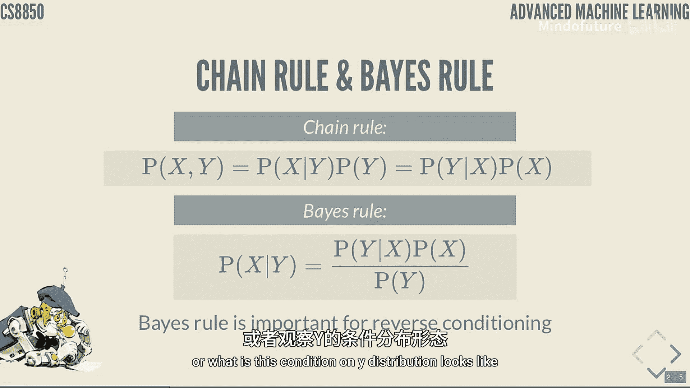

Okay， let's talk about。北京辽宁呢。So when we do Bayesian learning instead of our maximum likelihood estimation。

We have our data。 still。 D is our data as before， right？ And remember D is a set of our samples。

OhAnd samples。 and each sample is either a head or a tail。It's going really slow。

 so you're not confused or。Puzzled on what's going on。

 And this is probability of our data in over all possible。Data outcomes。

Because we want to maximize eventually， we want to maximize our posterior。

 We actually don't care about the normalization factor because you're dividing everything by the same number and the maximum。

Location of the maximum， this theta。Max doesn't change。 It's the same。

 So we usually to simplify matters， prefer to work with。I'm just。

The proportionality likelihood times the prior。And we know that it's likely times the prior of what I just said。

Okay， now what are the differences of maximum likelihood estimation。

 which you all now perfectly understand inside out from the last lecture。

 And what are the differences of Emily E and maximum Ma posti estimate， So Emily。Well， of course。

 you know， although I nailed it。Is choose the value that maximizes probability of observed data。

 So our maximum likelihood estimator。Is arcs of the likelihood。

That's why we went through the trouble of differentiating the likelihood and equating our gradient or yeah。

 our gradient of the likelihood to zero and finding the solution that。

Maximize the likelihood So maximum a postiri or map estimation works the following way。

 choose the value that is most probable given observed data and priority belief。So。嗯。Yeah。

 so observed data is here。And what is the most probable。

Data given most proable value of data condition on the data the data is fixed。What can we do。

 But since posterior ir proportional the likelihood times the prior with introduction of the prior。

We will be able on getting。嗯。Pragmatically useful。Values of our estimate for data。

 even when we don't have enough data。To estimate precisely with。

The accuracy and precision needed for Emily estimate。That's， that's helpful also， to think about。

When Emily and maximum atoio are equal， when are they the same？So when are they the same。

 Think about it。Well， now you see everything in front of your eyes。Re。Innglet or。Ely。

And what we should do。We should maximize log likelihood rather， rate。

Because our probability of data is a product。 So we have a sum or log of individual data set。 Yes。

 yes， the infiniteci idea assumption。嗯。So that Emily Mark's own likelihood theyt。

Like don look like it。Yeah thanks for paying attention。We can do the same trick。Here， again。

 and what we get， we get log E X。我sh。哦。はい。嗯嗯嗯。Arc like。So， when。This equals the that。

Precisely in the case， when this is constant。For uninformative priors， uniform priors。

 when probability of any data is the same as any other data， this is a constant in our maximization。

 and we will still select the same data as maximum likelihood。嗯。过。Easy it， right？So， now， we know。

That we were pretty close。

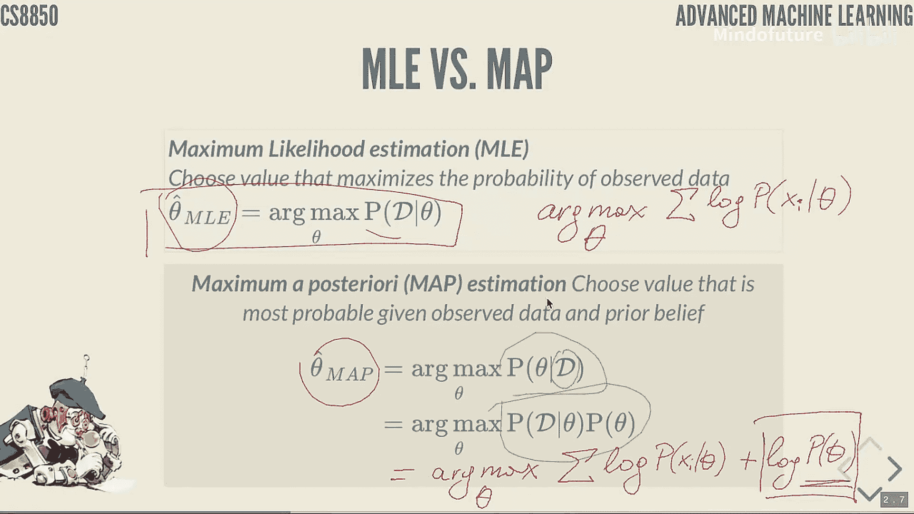

What do we have。We now want to try and actually do it， actually solve our problem。

Remember what we started with， we started with。The coinins and the coininos max of likelihood estimation。

Gave us exactly what they taught us in school or in probability，1 of one classes compute the number。

 the frequency of the heads。And now you know why。 But what if we have some prior distribution。

About what is the frequency of the heads or what is the probability of the coin falling heads。

 Let's try what we do in this case。So we will consider our prior or our likelihood。

We model it as a binomial likelihood， and binomial likelihood is as before。

This is the probability of the coin falling heads and the number of time it fell heads in the series in this。

Data set。And then the number of times it fail tails。 And， of course。

 the probability of tails is one minus probability of heads。

And then we'll just look at all possible ways in this particular series of coin to us。

This outcome is possible， so like we have all possible outcomes and we have one observed outcome。

And the likely is that outcome among all possible outcomes is modeled by this expression。

So this is a likelihood。By no male likelihood。If we choose the prior。As beta distribution。

 or we will choose beta distribution as our prior。Then the following magic happens。 So first of all。

 what is beta distribution and what is prior。In。Every prior。Is。Defined。On the range。

That the parameter is taking， so our theta can be anything from 0 to 1。Well。

 zero and one would be highly unlikely， but I guess possible， right？嗯。So， this is。Or theta。

 it can take any parameter， a new value between 0 and 1 and beta distribution models exactly this situation。

Where。Yeah，They they hear。是。Okay。The beta distribution。Is defined。On。Theta exactly on the parameters。

 Every prior distribution on the parameters is defined。On the range of those parameters。 Yeah。

 coincidentally， the beta distribution looks similarly to the binomial， but。

What's more interesting is that。Although it is parametermetized by two parameters。

 beta heads and beta tails。It is。Quantifying or encoding our belief or our uncertainty about the parameter itself。

not about the。Probabilities over data set and things like that， so。Normalization factor。

 everything is normal。 So look what happens if we use beta distribution as our prior on theta。

 that is we compute posterior。As this product。Where。This is beta and posterior。Of likelihood。

 sorry is binomial。 What will the posterior look like。Well， the postior is also beta distribution。그。

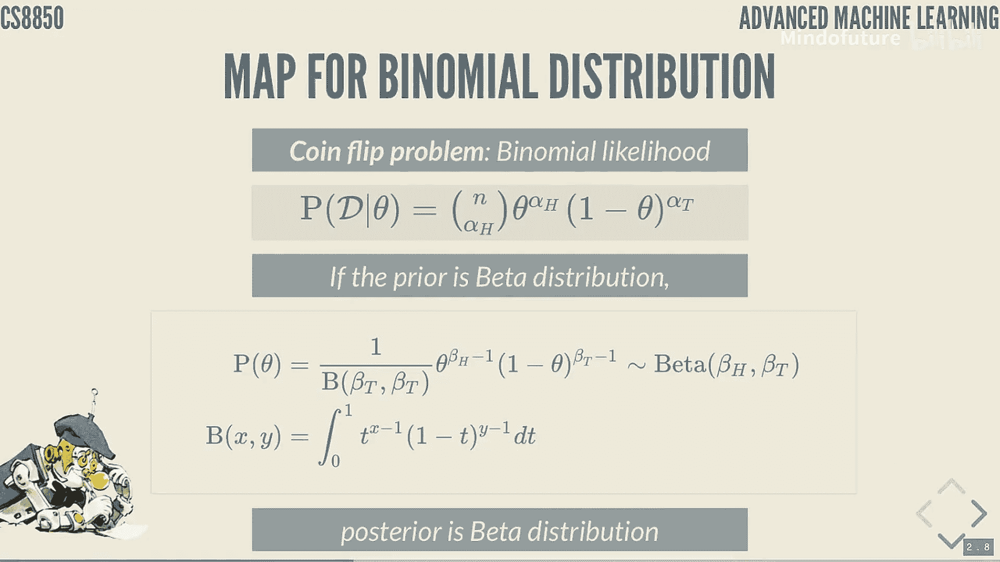

Yes， as I said， posterior is better distribution。And maximum epiiity for binomial distribution will look as follows。

 So we have binomial likelihood on the left。Right here。

And we have beta prior on the theta on the parameter。

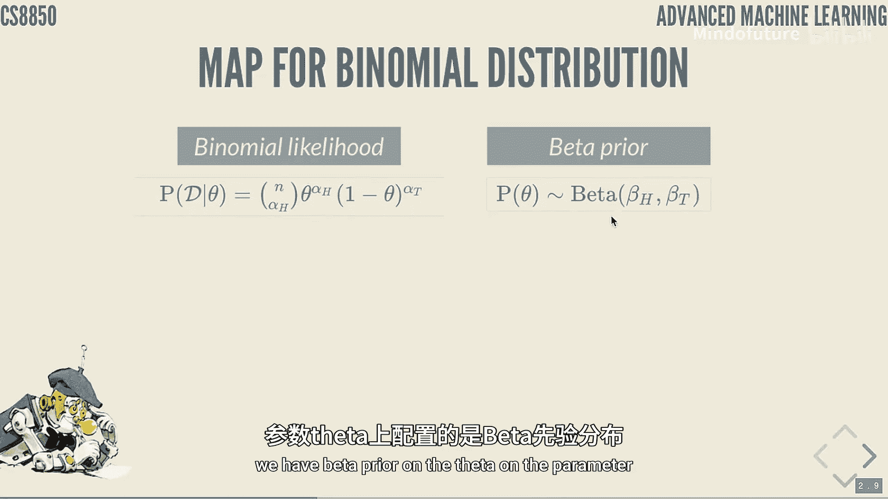

And then， if you。Multiply them through， you will see that youll get beta posterior。Distribution。

 so as expected， we picked the prior。Weho picked the prior executive with this。Intenion。

 pragmatically。To have the bestilor to be of。Manageable form。

 And the interesting part to note is that after。You can do that as a homework after the actual multi multiplication of multiplying through。

 you'll see that the beta parameters become your。Parameterters includingting your prior beliefs plus。

The actual。Batterment， what's in the data， How many heads， how many tails。And this is your belief of。

Frequency of heads and frequency of tails sort of that could be interpreted like that。And。

Since our prior and placeerior have the same form。It's just a。

Demonstration or proof that is conjugate。Prior。And in this case， maximum a postiity distribution。

Becomes the following。 You can also verify that for yourself。But well see now it's almost。

 it's not anymore as MLE。 It's not any more frequency of heads。

And you notice your prior information plays the role。Out fire。Beliefs or prior knowledge。

 expert knowledge and expert information plays a role。

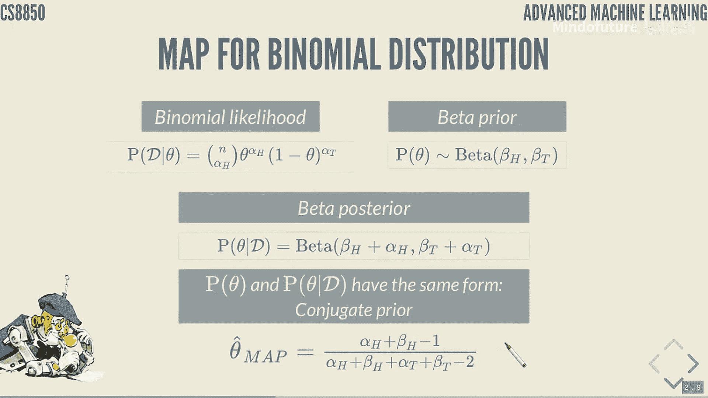

So let's look at how be the distribution。Looks like so beta distribution。

 those are different examples as before it's defined on the range from0 to1。

 this is your data and this is how you expect which value of data is more likely for alpha and beta。

Butmeturs。本呢。Abusing the notation， right。On the previous slide。

 we call them be the heads and beatit the tails。It's the same as alpha and beta here is to follow。

So the lower they are， the less concentrated the distribution is。And。

The higher those parameter alpha and beta are the more the more concentrated distribution becomes the distribution over prior。

 So beta conjugate prior again， let's look at our posterior。

 which is beta distribution now and look what happens with this distribution。

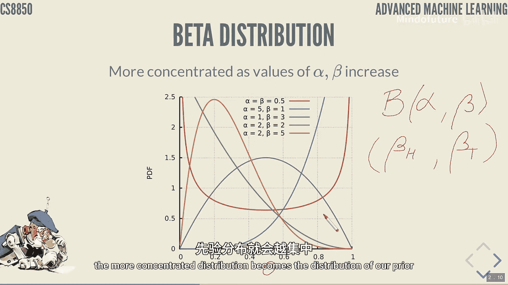

As we sample more data。 So when we start。And we say our belief is that the coin is。Fair。

We put beta heads and beta tails equal to。 and that's what we get。 That's our prior distribution。

1 half is what we expect for the parameter theta to be。

 But then we start something and beta H and beta T stays the same。 There's still two。

As we keep throwing more tosses as the number of tosses increases。We get。

More concentrated distribution。 And basically look here when alpha H and alpha T are large。

This tiny values，2 and 2。 Imagine we've done 300 tossses，300 of throws。 And we got 1，20。

 I don't know， in 1，80。For heads and tails。诶。122 versus 120 when you have 180 and 182。

It doesn't doesn't much matter anymore。 The more data we have， the less our prior matters。

 and we kind of。Leaving an opportunity for learning， yes。

 we had some knowledge we encode it in our prior， but then we're learning through the new data and we're changing our beliefs。

 This is called Bayian learning and basically the prior effect of prior washes out。So。

 it helps to regularize。For the problem。Well， one one side side note side comment when your prior is improper and you have no data。

 then of course， your posterior will not be proper to either it won't work but once you start having some data。

 even with an improper prior， you can correct and get a proper bartheior as a distribution which is a nice property of Bayesian learning so for small data you can correct the lack of the data with your assumptions and still be able to act and make decisions if。

We are enco a robot。Into the process。 But for large data sets， you are。

K of liberate it from the fear of being wrong because you made wrong initial assumptions because the data will help you to change your ways。

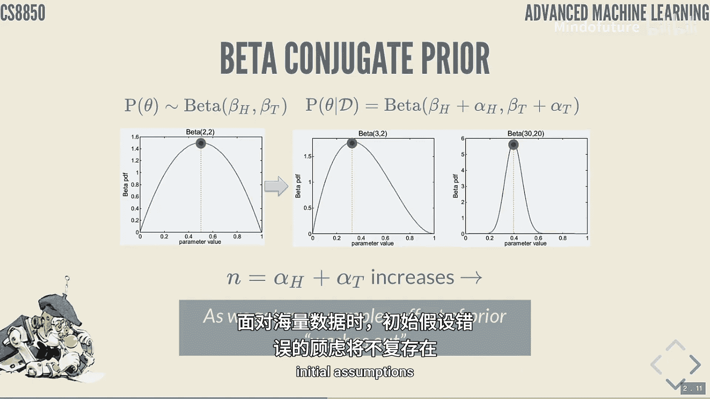

Another distribution of a similar sort is multinomal distribution instead of flipping just one coin。

 what if we are throwing a die， What distribution will be there for the categorical variable with6 outcomes and this is the multinomal distribution。

 So let's do denote our likelihood as multinnomal it。

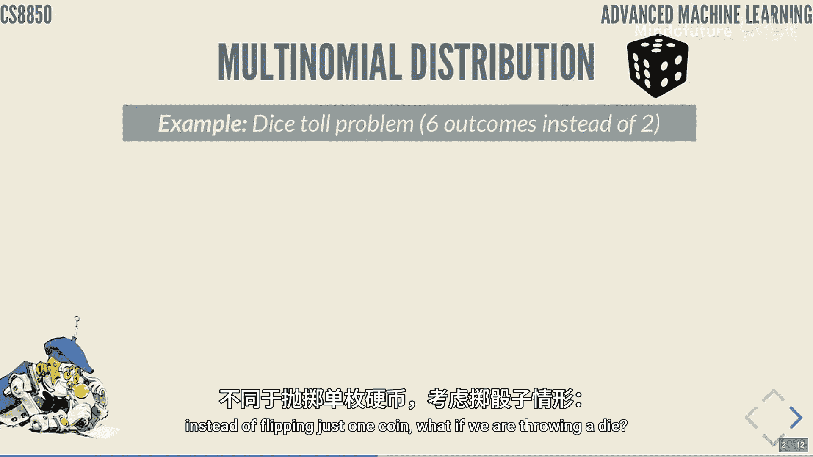

A parameter per outcome。呃，power啊。The number of times this outcome。Appeared。In the series of Toas。

 So this is our multinoial。Distribution。So， now， we want。To find a map estimate of those parameters。

 which distribution shall we pick so that it's easier to deal with and what will it look like。

And if we pick directly distribution as our prior。Which， again， is a product of those。

Prirameterters power of beta I -1。Approply normalized。 And if we do that。

 then our posterior is also analytically a distribution。With this nice， convenient property。

Of our prior belief of the number of outcomes of this category。In our actual measurement。

 So a similar effect。Will happen here。 will come through that the more data you have the。

Bless your prayer。can will matter if your prior was correct。From the get go。

 then you're only reinforcing you believe。 But if it was wrong， it will eventually wash out。

 And so just an example of what this typically prior is， it's again， defined on。The on the space of。

Prameterters， so imagine。LikeWhat is genetic clear prior？

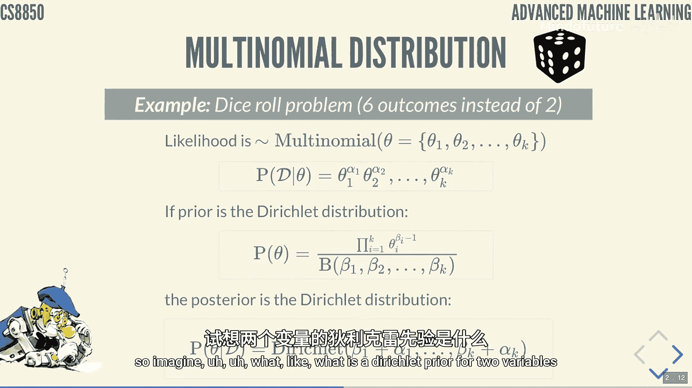

For two variables， directly prior， basically is。嗯。A distribution， defined on a。This line。

 because you want。Your theta 1。Theta 2 to sum to1。 So you want all of those distribution。

 all of those parameters。呃，就是。The sum to one。Right， you want probability。Of。

Those categories2 sum to1 and the distribution will will be defined on this line in this three dimensional case。

 it will be defined。On the simplex。 So you have。X and Y and Z。 And you want sum to be equals to 1。

And that defines a simplex， Basically， typically， a distribution is defined on multidimensional simplex。

 this triangle and then later like multidimensional。Facet is called Ss。And it guarantees that。

And in any point that you pick in the direct space。When you decompose it into the components。

They are valid values for those parameters because they all sound to one。AndFor this。

 for the probability。Basically， a nice distribution on the， on the multi category variables。Okay。

 now what。No。

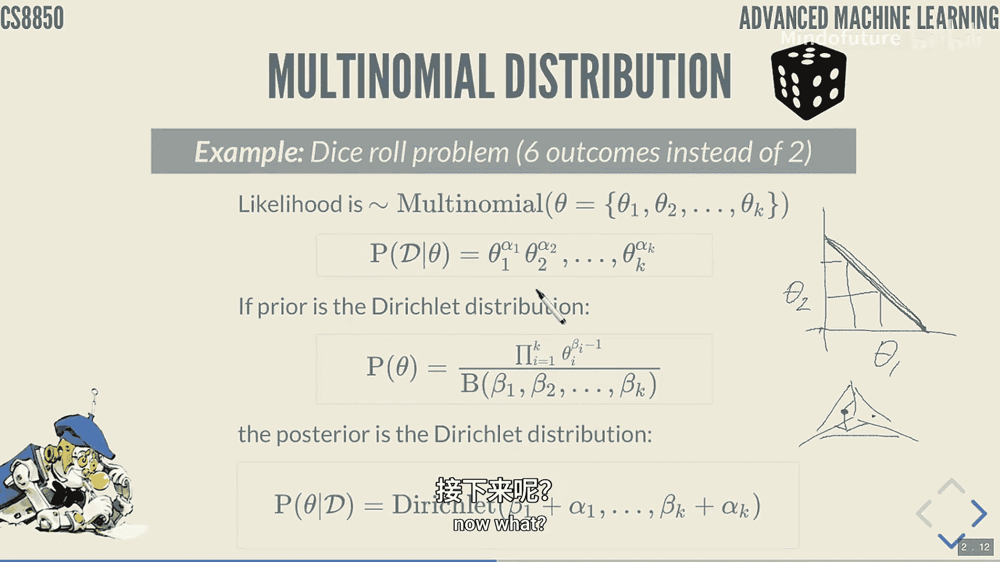

Let's啊。To a little practice。 and let's just give you a bonus by solving your homework problem。

 And our homework problem was about fruits in boxes。

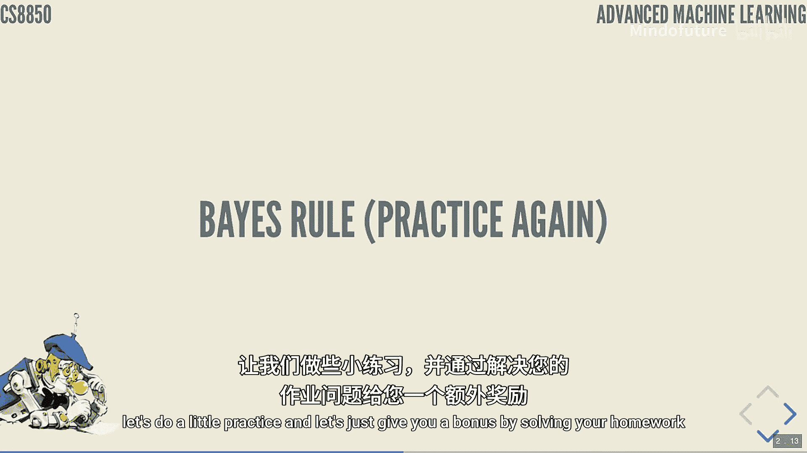

Those are kind of baby steps， but I think you need to internalize that and we will use this just in a moment in the next slides。

 that's why I'm following that with you。And also， of course。

 I want to be able to claim that they showed you how to solve homeworks problems。

 but really it's homeworks problems is your responsibility and need to spend time thinking about them。

Together and discussing them so you better understand the material in the lectures so the problem seven from homework we're given three colored boxes while the number can change。

 but we're given three colored boxes with the following fruit content。Or is the red box。

 Red box has three apples， two oranges， three lines。G is the green box， has two apples。

4 oranges and one line。 B is the blue box，2 apples，1 orange and0 lines。What is the probability， Oh。

 actually， probability of picking each box is given to you as well。

 So probability of picking a green box。Probability of picking green is 0。2。

 Proability of picking red box is 0。2， and probability of picking。Glue box。Is 0。6。

And the question is that we will address now as an exercise。

A box box was selected at random them according to above。嗯。The about is。On a side our slide。

And a fruit was uniformly randomly picked out of it， and it turned out to be an orange。

So what is the probability the fruit came out of the box。

That that's where the reverse conditioning rule。Comes through。 right， That's， that's important。

 So we know those three values， and we know also probability of an orange given。A green box， right。

 and the probability over an orange will be 4 out of 7。I believe four oranges to apples and one lime。

Yeah， and。What else do we need to solve the problem？I think we've got everything。 So the question is。

A box was picked at random。 Yeah， and what is the probability that it's green box， if we know that。

We are looking at an orange with the probability of this orange。

Coming of a green box out of a green box。How to solve that well。Probably let's see。

Orange given green box， probability of green box。probability of an orange。

So that means probability of an orange， given a box。With marginalizing or。

Smming over all of the values of B， right？Oh， all of the books。So that would be， well。

 B belongs to three boxes。 Red， green blue box。 Let's call it X box。And we can easily。

Saw it with all of the information that's available。At least for the top part here， we know already。

 this is47。And probability of green box is 0。2。And for the bottom。

 you just compute probability of an orange given。AGreen and green。Which we have on top。

And then we also compute probabilitybilo an orange given red times red。😔，That's， that's fairly。

 fairly easy， right， And for the orange coming out of a red box， it's one fourth times 0。

2 and probability of an orange coming from a blue box times probability of a blue box。 That's all。

Easy， that's 1 third，0。6。 So then after we sum all of that up， we get probability。

Of an orange marginal probability of extracting an orange with this kind of random process。

And if you follow through with calculations， which I done myself separately， you'll get about 3。14。

Approximately。That's a。Your homework， problem Part A。

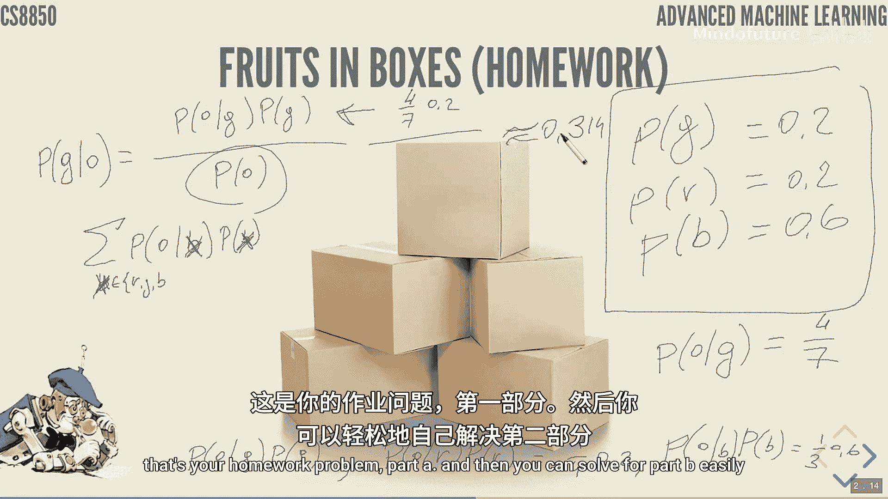

And then you can solve for part B。Easily yourself， no。

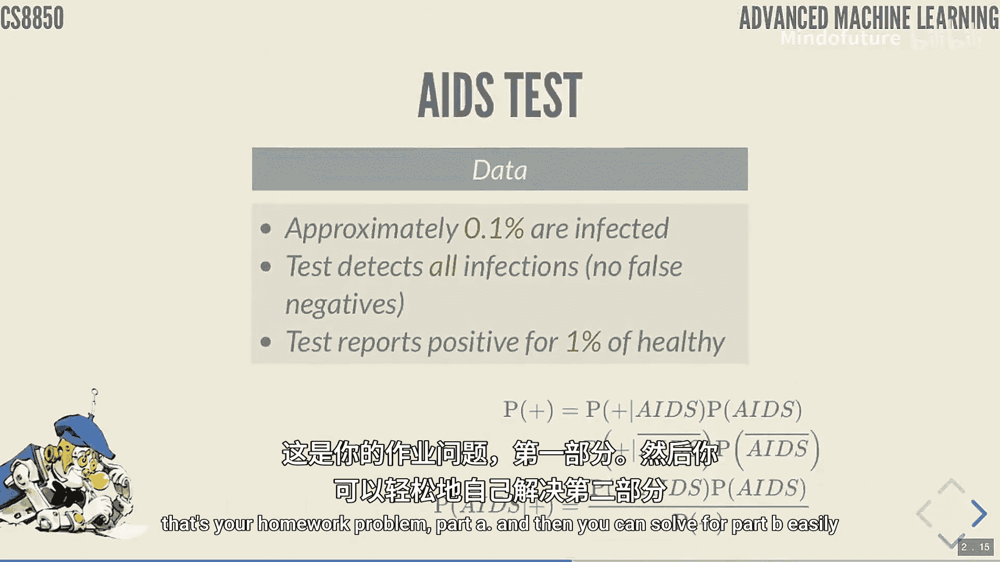

That's probability ba on probability problems because they're useful in our next section。

Imagine we have an AIDS test and for AIDS test， we know that approximately 0。

1% of the population of people are infected。And then the test that we have it。

 the test is pretty good。 It's super good。 It detects all infections， No falses negative。

If there is an infection， it will be detected and the test report positive for 1% of fy health。

Healthy， sorry。 So it can detect。Incorrectly， so it can have false false alarm。

So a fall positive in 1% of the cases。 So I'm writing for you that the we we are using Bayesian。

Rule reverse conditioning。Probability of the test of being positive given。The person have Aids。

Times the prior times the evidence。 And that's how we get the stior。 And our evidence is nothing but。

Joint。The marginalginalized over all possible values of aids。And。There are only two， yes or no。

 And in this case， the test gave a positive result。 What shall we do， How shall we proceed？ Okay。

 probability of Aids。 Let's put an numerical value is。1 of a percent。

Probability of not having it then is a compliment is。999，100 or thousands。Then probability of。哈appy。

Of the test coming like positives， given the As。Is one that test never makes a mistake of false negatives。

But now， probability of test giving us a positive。When the As is not there is 1%0。01。

 So we've got everything。 If we follow through with computation， we will see that。Actually。

 if the test returns a positive result， the actual。Chance of having aids is only 9%。Look。

 this is the best test ever。 like it detects all aids when it's present。 It doesn't means miss it。

 Why is solo， So we need to go back to the lab and spend billions of dollars or another test or can we do something。

嗯 something。Interesting， that is not as expensive and yet useful。 Turn out， yes。

 imagine that we have another test。

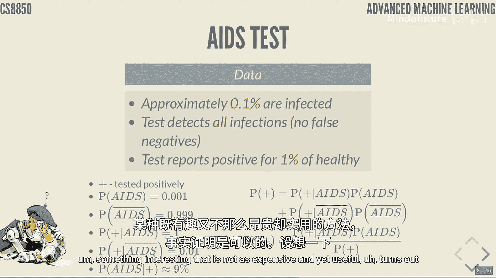

We can use another test a follow up test， for example。And this test， too， is not as good。

It reports positive for 90% of infected， so it misses 10%。So 10% of false negatives。

But it also is worse。 in the other respect。 It reports positive for 5% of healthy people。 Remember。

 the first test was super good。 No false negatives and only 1% of false positives。

 This one is quite an inferior test。But let's try to use it。

Together with the first one or rather independently， but on the same person。

So in order to compute probability of。N aids， if both of those tests give us positive result。

We would need to use Bayesian formula again and Bayesian theorem， again， Bay theorem。Likelihood。Of。

Those tests。Turning up positives。When there is。And when the person is really having aids。

ThisPrior and our evidence marginalize out of all the values of Aids and just get the test。

 So the trick here is。嗯。Well， just let's look at this。 We tested positively what we're gonna do。

 Well， we know a couple of values。 We know that probability of having aids is 10 of a percent and not having aids is 999 thousands of of。

99 sorry，999。9。Percent。Then， we need to compute。The probability of both tests turning。

Positive given aid。But what we know， those tests。It't depend on each other。They are a。

Dependent on the like the outcome， their value， of course， depends on presence of Aids。

 but they don't depend on each other。 That means。As before， that our。Test1。

Joint conditional distribution。Is product。아。Is this product？The tests are conditionally independent。

 given the outcome， so we can easily compute this value。Because we know the first one。

 the probability of test turning positive， given。AidD is one。

 and the second test probability aid of test turning positive given As is 0。9。So this value is 0。9。

And then， the second。Then， the next part is。Probability of。

Both tests turning positive when there is no aid。He is also conditionally。Independent， right？

 It's also， well， conditionally independent variables so we can use the same。Factorization。

So probability of first test turning positive when there is no aids is。1%， right。 So it is 0。

1 and probably with your second test turning positive when there is no age a 0。05。5ive%。Whi is。Yeah。

 that's about。We store。可以。Okay。Okay， so we got it and can move on。 And to move on。

 we've got everything that we need。 We can compute the marginal， and we can compute。诶。TheYeah。

 we can compute our likelihood time best。 So I've。Down the calculation for you and got probability of As if both tests aren。

To be positive is 64%。Amazing， right， so if we use only one test。Super good， perfect。

Like almost perfect， just 1% of error。The posterior of having a test if this test is positive。

It's only 9%。 But if we use two tests。Each of them is not perfect， and one is worse than another。

 But we still increase our confidence。 We increase our detectability， So of say。

 of the disease by a lot， like almost。10 times well， slightly less than 10 times。 So in this case。

 our outcomes are not dependent， but test one and test two like the outcomes are not independent right if one is likely if one test is likely to be positive。

 the other one is likely to be positive too。But。算。Like that is a conditional。ItDe on those two tests。

So， here's a。1 million question。Why not use the same test twice。Think about it。

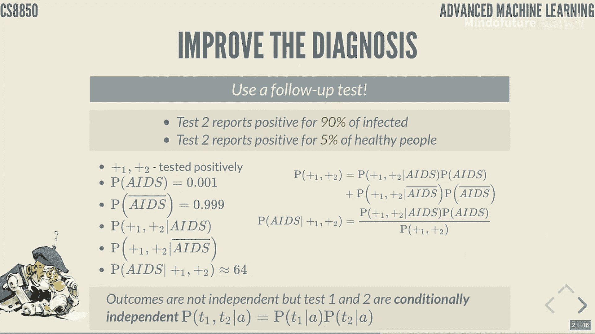