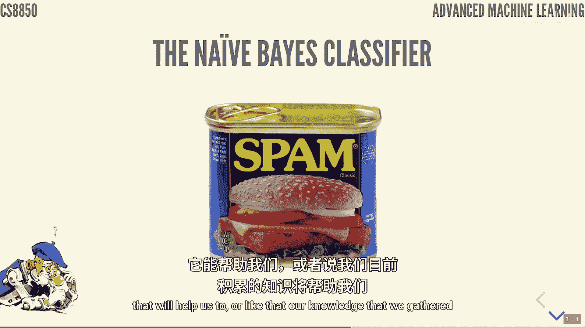
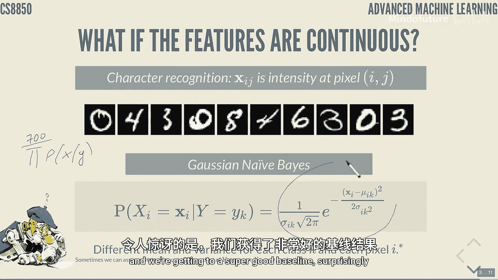
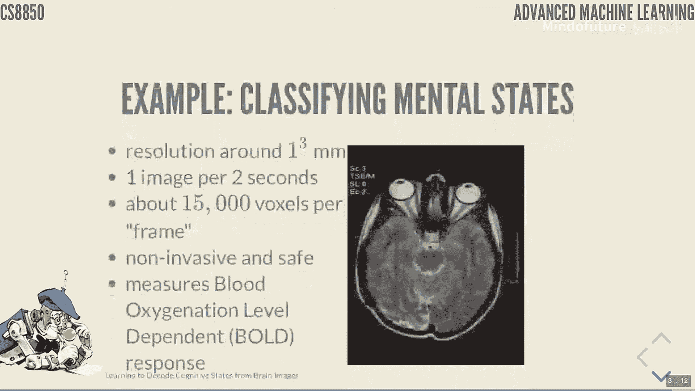
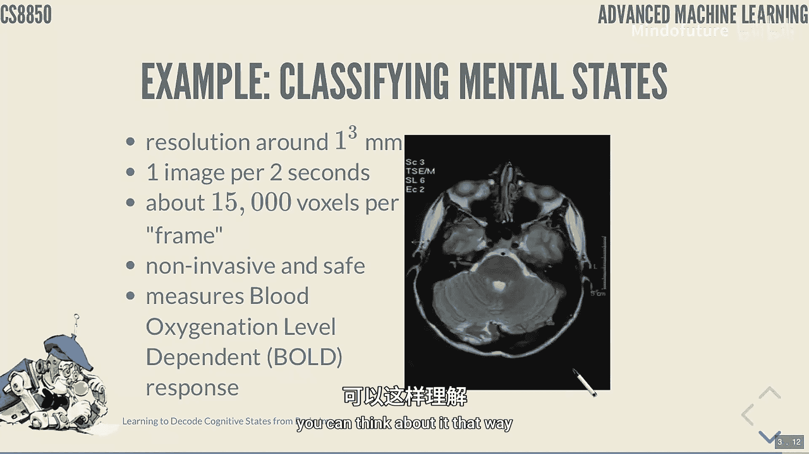
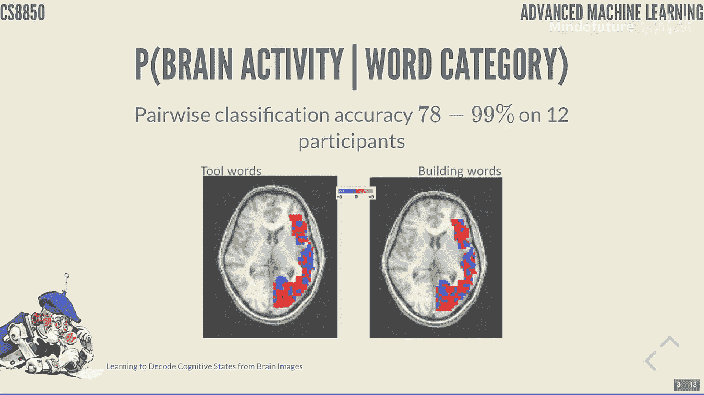

# 高级机器学习主题-CS8850-｜-Advanced-Machine-Learning-p29-P29_朴素贝叶斯--BV1sapPz4Ewx_p29-

No， to the naive base classifier。And we're gonna have a lot of spam。 Oh no。

 we're gonna classify a lot of spam with naive based classifier。

 which is extremely successful at this or。It was so。Until recently。

When everything is handled by deep learning， but still。Very nice， very understandable model。

That will help us to。

Or like。That our knowledge that we gathered or accumulated so far will help us to understand。

Really easily。 So detector for spam filtering。 This is your project。

 Say you need to detect weather an incoming。Message。Is a spam and all you have is some features。

 state time， recipient path， IP number center and causing many more features， or as we'll see later。

 you can just use the full text of the message without all of those features。

 But now assume that some features that are and。For every incoming message。

 we need to quickly say whether it's a spam or not。How do we do that。Let's make。A few assumptions。

Let's make that all of those features in a spam or mail are conditionally independent given the class label Y。

So， let's say。Presence。I don't know The， the time of the day when the email came is independent of。

The length of the email， if we know the class。And if we make that assumption。

 we then see our familiar conditional independence。Of our features。So this is feature y of feature I。

 and it could have multiple values。 And feature J would have multiple values of its own。

 But the class Y is once it's fixed。Those features are independent of each other。And。

we've seen that examples。In the beginning of this lecture in the beginning of the last lecture。

 I think。On the maximum of postter。I know， that was Emily。Yeah。

 in the beginning of our Emily section， you've seen a lot of examples of conditional independence。

Or quite a few at least so in this case for multiple features。

 we can represent this conditional joint probability of those features and those are all features that we will decide to use to detect our spam。

😔，They could have different values， depending on the values that they have， they。ya。

Could have like they would have different probability。 So this probability distribution。

Conditional probability would say， what is the probability of X I having some value given the class？

Given。The class， saying no spam or spam。What is the probability of date being greater than certain date or the time or the date being either morning or afternoon or noon or evening。

 like for each of them， this will be our。Probability with the feature value， rate。

 So we need to be able to evaluate this probability distribution plugged in here。Say plug in morning。

For the time of the day that email came in。 and this particular time of the day， probability。

 conditional probability， distribution should return us some value。

 And then we go to the next feature， plug it in and。Get another value。So。We can estimate likelihoods。

Independently at each point。 and also， by the way， we can have the priors as well here。We can have。

Yeah， we can represent our joint probability distribution， so they are jointly independent， but。

We can represent joint probability， distribution， and talent will be。Well，This will get it。

 So now imagine that our。Numbers are。Either in or out， either present or not。

 So X is a binary vector where each position encodes presence are and so a feature。

 And so y and also y had。As x classes， so x is binary， So each X is is a0 or1。

 How many parameters do we need to estimate if we are to model this probability distribution right So for a binary vector we need to estimate。

Probability of。Those parameters will be probability of each possible settings of those x， given y。

Pro binary variables to to the D number， the length of those features。Well。

 minus1 for the degrees of freedom， because if we know probabilities。Of everything。

 but the last element， we can compute the probability of the last element as the sum of all of those probabilities as one minus the sum of all of those probabilities。

But then we need this kind of distribution for each value of K of class。

 So that's why I'm multiplying by the class。And that is， if we don't use this。

Conditional independence assumption。 But if we use this conditional independence assumption。

 we only need D times k。Vs。Comparare two poverty。Times k versus D times k。

A hugeuge savings number of parameters to estimate that this number of parameters to estimate reminds us of the course of dimensionality。

系。And。Yeah， that's basically it when were in a binary space。

 we are in a binary hypercu and just need to。Estimateimate those。Ororers of that。

Hyber cube for each of the corner of that hypercu we need to estimate。

The parameter and there are two poverty of those。哦。

Once the important part is once we made that assumption and represented our。嗯。

Class conditional distribution， conditioned on class。😔，As a product of。

Class conditional distributions for each feature。 We're free to choose any form of likelihood in prior that fits the job。

 right， We could again， remind you， we could have a prior here and we could。

Choose any functional form here that would like。So。Here's how the classifier would work。

We have a class prior and then deco conditionition independent features。Given the class label。

Given the class label， they are supposed to be or we need to assume that they're conditionally independent and for each feature。

For each if for each feature I， we have conditional likelihood。Probability of I given why。

In this case。Our decision rule for our naive base classifier。Ha。Will be the following。It's Arc max。

 so return on y for which this product is maximized class conditional likelihood of the features times the prior or with naive basic compositionposition。

 it's a product of all individual feature class conditional distributions times the prior。

And this returns as the most likely class。A class that maximizes。啊。

Maximizes this joint probability of。The observed feature。And。The the class。

Because this here is nothing but X I。😔，Well13。可话喂。So from this you already can see the advantages and problems from well I hope you do。

嗯。From here。So the advantages， as I already said， exponential improvement。

 exponential decrease in the number of parameters to estimate this。The problem。

Immediately here we're dealing with very small numbers and we're taking a product of a lot of features。

 If we have lots of features， then it'll be very hard to deal with this quantity， but。Of course。

 we know。To always take a look。And still maximize this。嗯。And get get the same solutions。

 So this one is easy， but let's see what else， what else can we do or what else happens。

 So the naive base for discrete features， just as an example。

 Imagine that we have a set of training data。An example and a label。And this is。

A sample index in our dataset set。And each sample is a feature set。

 X1 through X D number of features。Yes， so and the dimensional features plus class labels where n is the size of our data set。

 and we have our decision function for naive base。Which is maximizing。

Maximizing our joint distribution of late。And and。Label send them。Teachers。

 but in effect it's maximizing the posterior， as you remember from the first part of this lecture because。

What sitting there is nothing but probability of why。

When we maximize this probability of y given all xs。Is proportional to this posteror。 Basically。

 it's a posterior distribution when we're maximizing。horror。B knife base。

Maximizers gives us a maximum of postteriary estimate of the class。So。For discrete random variables。

We can estimate everything。😔，Just using maximum likelihood estimation。So individually。

 we can estimate the values using maximum likelihood， but then we can apply those estimation。

Estimated prior and conditional。In a amazing way， so class prior will be estimated simply among all of our data samples。

 How many times does this class come up。So， for example。

 is class if class y equals 0 comes up under times out of thousand。

 So we can just count all of the documents。 Look at the y。

 like go through all the I all of the J samples。 Look at what。each ones。

Our class zero and just count those。 that's what that's what this is。

 that's how we will estimate the prior。For the conditional。

 we will just estimate the joint and normalizedize by the prior， estimating the joint is also simple。

 go through all of the documents and at each document of class Y。s。see了。

Look at the value of feature I。And。If that value equals， say， again， if all features are binary。

 we will have。嗯。WhatsWhat's the count， how many times this feature is0 and how many times this feature is one。

For this class。So we will count this and normalize by the number of total instances。

And then we will divide by prior on why that we have already estimated here。

 And that's how we'll get。Yeah， and that's how we will get。Our。Pararameter estimates。For。

For those discrete features， okay， that I hope that's clear。

The notation here is a little bit confusing， but it's precise， so that's good。So basically。

 just look at the cocurres， count cocurres。And normalize to get the conditional。s one thing。

One thing to note。No， okay， we will come back to to what to watch out for in this case in this case。

 But the important lesson from this slide， at least。If you want to work with naive based classifier。

 first you need a training data set and the training process of naive based classifier is estimating those distribution functions。

For discrete variables， the estimation is just getting the counts。

 just getting the frequencies basically because that's the choice you went with multinormal distributions。

 and that's just the count。Imagine it's a six sided eye， you throw it。You roll it multiple times。

 and then。Out of all of the roles， you just count how many times six came up。Right。

 and then normalized by the total number of times。 So that will be how you calculate the classes。

 but then。Some other features are there， so you estimate them differently for example。

 let's look at a concrete example text classification we may want to classify email as spam not spam and I will show you how to do that nor how it's easily done。

嗯。Are there ways more precise， but we're not going to touch it。

T those example to classify articles into topics。 So what are our features X in this case， well。

 let's just use the complete text of email for example each email or each article How do we do that well first let's do it naively and one is actually not intended。

 but anyways， so let's fix max length of an article or in an email and encode each position as x1 through 1000。

 So imagine we will chop all of our articles or while Ms by 1000 words。

And encode code each position as as this factor。 So x 1 is board at the first position X2 is board。

 Which word is at the second position And x 1000 is。

Word is at 1000 positions since we want to allow shorter emails。

 we will add to our vocabulary and no word lack of lack of a word。

 So X I is a word and that's what I explained， but X I can take any value from0 to D where D is the size of the vocabulary or dictionary。

 say we have total of 50，000 words， but it could be easily 100。

000 for an English typical English dictionary。Then probability of x given y will be a large like the parameter space to parameterize that we will need to estimate in this case。

If we go with the joint probability， we need to estimate K K times D power 1000。

 where G is the size of our vocabulary and K is the number of classes well for spam non spam。

 it's just two for。Opics and categories for articles there could be many。I don't pan。Well。

A very large number of parameters。 So we will need。

Astronomically huge data set to set to even like have each parameter instantiated。

 So instead of doing that naive base to the rescue。 So what would naive base do， as you know。

 we can just represent probability of class， given each word。

Or each position actually probability of J at position I for class y。응 응 응？Yes。

And I'm now overloading that J C， Bill it's not a sample anymore。

 Jay now is one of the words in vocabulary。 So if our fifth。If our vocabulary is 50，000 words。

 we need to estimate 50，000 times D times 1000。parameterrameter is for naive base， because。

What are we estimating。Okay， that's a typo。That should be K。Number of classes。Yeah。G times exactly。

Let me think。Yes， so。Each of the conditionals for each of the features。Given the single class。

 we have。50000 parameters to estimate。Because that is the number of。

Values this word that this position can take。 And then we have K classes。 So for each of them。

 we need to estimate this。 And then we need to do it for each position of the of。

For each position in the email thats。Better， much better than this monster， but still not quite good。

 It's a lot of parameters to estimate。 So let's make another assumption。 Let's sort of。

Clearlyly assume that word order and positions don't matter only presence。That was text。

 and especially with。Her speech and our communication， the order always matters， right。

 at least in a long， long long term， but that。Complicates the things。

 So let's assume the order awards don't matter。 Like doesn't matter what the word awards。

they are arranged within the email。 We only look at the presence。

 If a word in in the dictionary is present or not。 So our vocabulary or dictionary is 50000 and X is a binary vector。

 So we take an email and。For each of the word in this mail will flip a bit。In this binary vector。

 if a word is present in this binary vector， the bit will be on。

And for those words that are not within this binary vector， it will be off。 So now we have 50000。

Dimenssional feature vector for eachml。 And it's mostly spars。 We just now need to estimate。50000。

Times K parameters。And D is binary， and then。The in this case。

 for the degree of freedom 2 minus-1 so thats that's what we have and I see the assumption that works really。

 really well in practice for spam and a male classification gets to accuracy crisis of 86 and above percent the first successful spam filters were built like that using this bag rewards model。

AndAgain stressing bag of words because we just take coherent。

 linearly organized order text and throw it in the bag and costs。Mix and。Creer。You know。

 I mess of the words， but it doesn't matter because all we're looking at。

So whether a word is present or not。In this text。 So there is a problem with this whole approach with the base na base classifier。

 because what if you never see some particular value for some feature。

And some class what if in the training dataset some combination is never present。

 which is not surprising， for example， if we never in our training dataset see word luxury for no spam class so imagine in our training dataset set no one used that word a normal email it was only seen in this spam email。

 so if that is the case。Then。Probability of seeing luxury bit in this vocabulary length were。

Picer vector。Probability of seeing it one together with no spam class 0。

Using the naive based assumption， we're saying that probability of seeing word luxury given the class spa is also zero and in this case。

 see what happens in that case。In that case。We have this joint distribution of all of the features in our likelihood。

 and we decompose it using our。Nive based assumption of conditional independence。And， look， this。

Weve never seen this as a training data。So this is always 0。So no matter what the values are。

 just because we have not seen this particular combination of this feature and。This class。

All of our predictions will be 0。All all of our probabilities will be0， so we will never count。

For anything for this glass， no spam。So now what。Well。There are a few ways to address that。

 and one way is called bloodlash and smoothing。Basically， when we do the counts。

 we artificially add one。For each possible feature combination。嗯。

So for all of the possible features given a class or not possible feature combination， feature value。

So。Even if we don't see this in our training data set。We still add one to the count and say。

 if we had， without slip less smoothing for binary variable， if we had。I don't know。

 let's call probability。 like count of ones would be count of zeros plus count of ones。

For a binary variable。 But then what we do by adding one。To each of the features。I think like。

All of our counters initialized to one， initially。And we are just。嗯。

Correcting our estimates by this factor because we added one to this end to that from the start。

In a multi category。Case。It will be sort of cardinity of our variable。numberumb of。Possible values。

That's called bloodla and smoothing。当时。道。Doesn't improve our estimates。

But at least allows catastrophic collapsing of everything to 0。

Allows to avoid catastrophic collapsing of everything to0， sorry。哎呀 okay。

We can classify text using bag awards。 Now， we can minimize the number of。

Pararameterters to estimate by using naive based assumption， very simple classifier。

 very simple estimate。 Just compute count from the training data。 And what are the other properties。

 Yes， the count seem confusing， right， but it's a consequence of our choice of the likelihood and prior。

 we can choose anything we want and estimate those probabilities。

 the likelihood and prior as appropriate for our choice。So yeah notice naive based classifier only。

Governs the form of conditional， conditionally independent。Maxon epi poststerior istectomy。

 What is P of Y， What is probability of Xi given y？Is your choice。 And you decide。

 depending on the difficulty of the problem， as you will see in a。Micro projectject in your homework。

So。Conveniently estimated everything relatively to individual prior individual points， yes。

 that becomes really easy compared to estimating a joint feature space。

 we just work with one feature at a time。AndJust watch out for M labeled feature combinations and the data usually less smoothing。

This product is also a product of numbers of less than one is killing us because the larger。

 the pro the larger。The number of features that means the smaller individual values。

 we just use log probabilities instead。That's naive base， but what if the features are continuous？

我的是 then。Can we use use naive base or naive base is only good for。

Disreet features and for spam filtering。Well， the， as I said， likelihood and prior。

In a face could be of your choosing， And you can just。Modify， according to the task。

So for character recognition， like in this MN character set。

 we can take our features to be pixel intensities at each point。And then。

Use Gaussian distribution for the class for each pixel would be now probability would be modeled as a Gaussian。

And depending on the class。So for each class， it's a different Gaussian with different parameters。

 and we can feed those parameters for each class， each pixel， So10 classes。

700 and something plus pixels that will be our product of the。Pixels， so I said70。Something。

And probability of that pixel continuous value of that pixel given class。

Will be modeled as a gaus and distribution。And again。

 just look at your data set and individually consider each pixel in each of this image as samples and fitta gausian you already know how to compute maximum likelihood estimate of。

To simplify on our life in this case for each pixel， we can。

Sometimes I assume that a variance is independent of the class or is independent of the feature。

Just so we can estimate the variance based on the full data set， regardless， or we can just。

I assume the variance is independent， both of the class and the feature and estimate the variance。

Just jumping together all pixels size of one dimensional distribution。Okay。

 that that's how we can classify those pixels。 And the accuracy， I believe。

 will be around4 M least will be around 86%。 Can you imagine。Yes， with convolutional neural network。

 you can quickly get the way above 90， but。That just that simple Gaussian distribution。

 one dimensional Gaussian。 That's all we have here。 and we're。Getting to a super good baseline。

Surprisingly。Okay， but what do we do with more complex data。

 Let's classify mental states also possible with the simple maximum posti assumption and conditional independence。

 So let's take。

Brain with resolution around cubic millimeter， one inch per two seconds， about 15。

000 voxels per frame， voxel is a three dimensional pixel。And。Containing gray values。

 same as the images here has unknown invasive， safe measures， blood oxygengeration level。

 dependent response。Hemoglobin concentration。 You can think about it that way。 So if we do that。

 then we can get to accuracy of predicting brain activity based on word category of what a person sees。

 A person is demonstrated。

嗯。And the image of。Some object from the category and。

The algorithm needs to predict from the brain activity just from boxs。

 each boxel is assumed conditionally independent from the other the same way we did for MN。

And the accuracy on 12 participants gets from 80 to 200%。Surprisingly， well， maybe not anymore。

 but such a simple method and such a good result。 Nice， that concludes our naive base。Exploration。

 I hope that's。Folun。We'll come back to some。嗯。Some useful tools。For further work with naivepa。

 because you need to be able。Well， one thing to internalize is you are the one who is controlling the shape and。

Functional form of。The likelihood and the prior。 So it choose it wisely。

 depending on what your problem needs and depending on how easy it will be to estimate and deal with。

 But if it's continuous， if the random variables are continuous， you can always。

Either go with some parametric form like Gaus and estimate it from the data for each pixel box。Or。

You can go with non parametric form。Whi is a topic of one of the next lectures。And then。

 you still can use。naive by decision rule。And select a class。P predictredor and nonpometric。

Estimates are not so bad。

Okay， until next lecture。