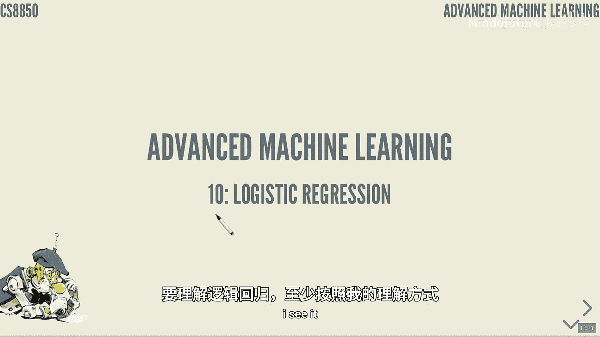
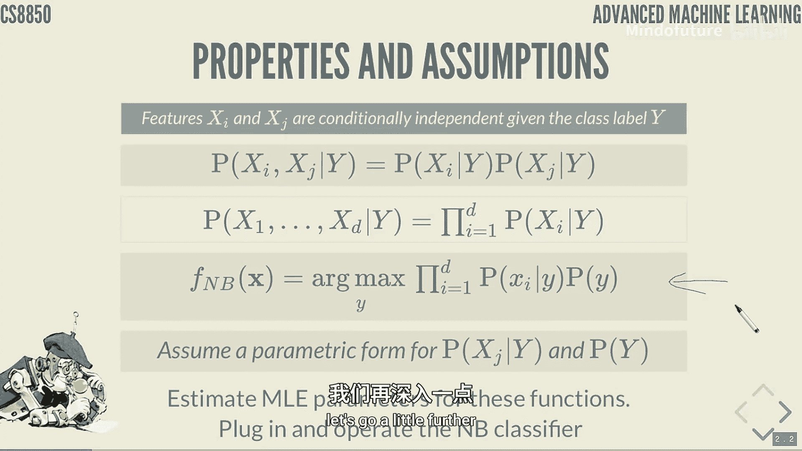
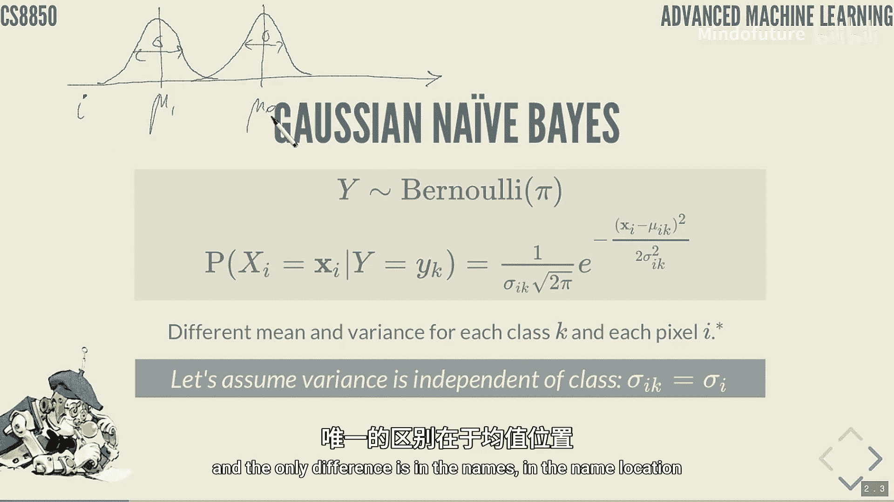
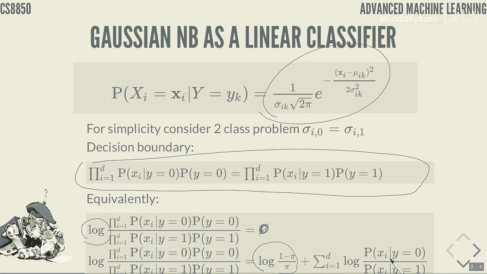
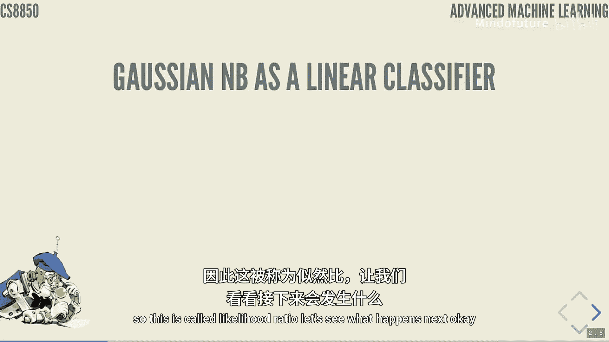
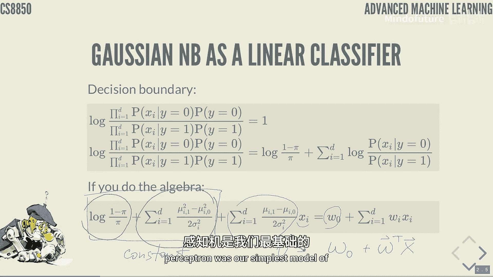
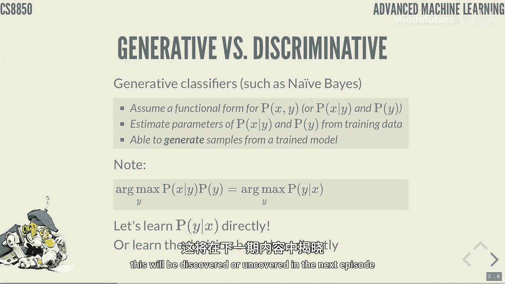

# 高级机器学习主题-CS8850-｜-Advanced-Machine-Learning-p30-P30_NB到LR的介绍--BV1sapPz4Ewx_p30-

Today's lecture is on one of the important models of all times， according to my personal rating。

 of course， it's about logistic regression。Yes， it took me some time to put the lecture together。

 So all the bits and pieces are clear。But here we are。In order to understand logistic regression。

 Well， at least to understand that the way I see it。

I think we need to。Take a slightly closer look or a different look at naive base。

Which you all are professional in right now。And then we need to define logistic regression and then solve it。

Usual， easy to define and then solve。 Let's go。 Let's start with the naive base。As you remember。

Nive base。comeses with the following assumptions。The drag， the following properties。

The assumptions are the following features， X， I and X J are conditionally independent given the class label Y。

For a two class example。On the， on， on the slides here， if we。Well， only have， I mean。

 two feature example， not to class X I and Xj。The joint conditional factors into the marginals marginal conditions。

 So features are conditionally independent。Sorry， just reminding you from the previous lecture。

 you all remember that quite vividly， I assume。But that's the major assumption， So for example。

Feature， we mail coming our。Sm coming in the morning or in the evening at a certain date time is independent of the presence of work luxury in that email as another feature in the spam or mail。

Given the class， right， the same class。In a slightly more general term。

 what we mean is for all of the features， the joint distribution of all of the features。

Given class or class conditional joint distribution。Factors into product of。Class， conditional。

Feature distribution per individual feature the eyes feature。Yeah， again。

And decision boundary or the process of this， not decision boundary。

 but the process of deciding the algorithm for。My face is just to。Pick a Y。

 Pick that class that maximizes the posterior or product of the likelihood and the prior。

 This is the class prior for all of the wises。 look through all of the wises and look compute the posterior。

Probability of this particular class， given the data。Blah， blah。Well， you know。

And pick the why that gives maximum。For this value。That's how。Naive base hyper rate。But。

What is that and what is that， Well， just assume some parametric form。

For the conditional and for the likelihood and for the prior。Easy。Just a reminder， just a recall。

Had like but but。Another point is， well， you assume the barmetric form。

Parametric form means that there are some parameters here or some parameters there。

 What do you do with them when you， all you got is data。

 Remember our data data set is that said that I was just。Right Xing。Set up and samples。Well。

 you just estimate maximum likelihood use maximum likelihood to estimate parameters for these functions。

 this parametric forms for the likelihood and the prior。

 and then just plug in those MLE estimates and operate the naive base classifier by this formula。嗯。

Okay。Are you comfortable with that recalling where that's coming from and how that works。Great。

 let's go。

A little further。教成呢辈。Yeah。Gus in need base is when we assume。我高兴。Bometric form。For the likelihood。

This is our likelihood。And we're saying that， well， assume that given the class Y our distribution。

Of X， I feature I is just this one dimensional goes。 and it has。Collss specific variance。

And of course， class specific and feature specific mean。Additionally。

 we will assume that the class prior is just Bernoulli。

 so with probability pi for two class Bernoulli of course， but for multiclass， we can use de gl。

下先 go one send到 mail。冇钱两量。Not directly， directly， it's just the conjugate for the multi row， but。

That's not complicate things， or to classes。By the。Pro build of pi that y equal 0。

 probability build in 1 minus pi。 That y equal1。这一首。呃。We can have as well。

 we should have otherwise it will be harder to distinguish different means for each class and each feature and also different mean and different variants for each class and each。

Feature。Okay。😊，That's really right let yellow搞。3000 distribution for one dimensional available。嗯后你在。

No what my notes。Here。But let's assume now that variances are independent of the class。

So variance is just a feature specific that doesn't matter。

Which class the feature belongs to What that means graphically is that say each feature。

 say feature I。Okay， that's so inive。 Yeah， feature I。For class one。It's one Gaussian。

 And for class 0， it's another Gaussian。So the sigmas。Should be the same。

And the only difference is in the means in the in location。

 let's make that assumption for simplicity that will be useful for us repeating just so you'll see it on the slide。

Likelihood is one dimensional Gason， but now the features for two class problem are variances。

For two plus program。The same for each class， what can happen， Well， what is decision boundary。

 the decision boundary for this problem is or for any absolute problem。Is the。

The set of points at which。Poerior。For one class or for all classes is equal posterior distributions for all classes are equal for the two classes。

 this is posterior distribution for class zero and this is posterior distribution for class one or。

In our form， the way we decided to write per serial distribution and to model it is the likelihood times prior。

Thanks to Bes there are normal normalization constants。

 but they don't matter they cancel out and so the decision boundaries where they equal the number we I had one dimensional case。

 okay， they're equal here， this is decision boundary， one class。

 another class in two dimensional case， this boundary could be more interesting could be less interesting Lucy。

And。うんうん。In this case， equivalently， test equality。 I can write just as the ratio。Well。

 when they're equal， the ratio is one。That means the log ratio is0。So I can control。 I can decide。

W whichhich class my sample belongs to by looking at the log ratio of posteriors and if it is greater than one。

Then it's class 0。 If it less than one， then it class then it is class 1。Rather than。0。

Respecttable for the log Tra and。Less than 0。Perspectively for the low ratio as well。 So。

 but now let's take。Our calcium distributions for the likelihood and our beno the distributions for the priors and plug them in into this log a log ratio。

That includes our decision boundary。Immediately， the priors fall out。

This is the our log of our prior load ratio。And。We have a sum of log of ratio of probability likelihoods。

So this is called lighting iteration。Let's see what happens next。

Okay， this is a little bit more interesting。Or clear form。Now。If we follow through with the algebra。

And plug in the actual。Page form of our likelihoods for class 0 and class1。Specifically。

 relying on the fact that the。啊。Vances are the same。For呃或。Class independent。

Then after doing the algebra， we will get the following。 This is our prizes， Bernno。

This term falls out and it doesn't depend on the data。

 it just depends on the intrinsic parameters of the likelihood distribution。

That which shows us that this is a constant zer。Independent of the independent of the data。And。

Only this part depend only this part multiclly affects the data。

 if we combine this constant into a single constant here， we'll see that oh， look。

 what we are getting by。Plus。In your term。Gousson。Nive base。In the case of。

The same variances for class independent variances。Hes a linear classifier。

 the decision boundary this gaus of the gausian9 base in this case in the assumption of sigmas to only dependent feature。

 non' dependent on class。其实呃。呃。呃， linear function。So when it's zero。

 it's right at decision boundary where when it's above zero positive class。

 when it's below zero and negative class， and you can relate this now back to your。

Perceptron homework question and everything that you learned about perceptron in the previous lectures。

哦，There's什 was our啊。Simpst model of linear classifier。 Okay， let's go next。

Genrative classifiers versus disc classifiers。 Now we're ready to talk about it。

Generative classifiers and naive base is one of them examples of such classifiers。

 they assume a functional form for the joint distribution of data in the labels or equivalent equivalently functional form of likelihood and prior prior times the likelihood。

Yeah， it the joint。I if we don't normalize it by the evidence。 but okay， well。

 then we estimate those great generative classifiers。 Do we estimate parameters。

WellBecause we assume the functional form。We have parameters。 Theyre different。

 This is just a placeholder theta for the corresponding parameters of those distributions。

 Now we can estimate parameters of the likelihood and the prior from the trend data and。

But after doing so， not only journalists of classifiers can classify。

The data into classes that they were trained on， but they also are able to generate samples from train model because we can randomly sample from this distribution first。

Which class it is， then plug this class into the li and sample the data。

According to the distribution， given the class that we have just sampled。So， this is our。

Grative process。 we， we kind of assuming。好。What in the world。

 how the world operates to generate the data we have collected be it。

Samples of a N handwritten digits data set or coin to us as whatnot generative classifiers。

And know that arc marks of。诶。Prior times likelihood is the same。

The y that maximizes prior times likelihood， but is the same y in the same class that maximizes posterior distribution of data deco。

Of the class， given the data。 So why don't we learn instead。The posterior distribution directly。

Rather than。Learning prior and likelihood separately。

 So why don't we learn the decision boundary directly， Because posterior distribution， basically。

I our way our step towards the decision boundaryga。

 so why don not we our decision boundary directly as we used to do。With perceptron， remember。

 perceptron was learning the student boundary directly。

 but perceptron didn't assume any kind of probabilistic model behind the process while generative distributions and naive bias naive base。

 sorry。I assume makes those assumptions。Can we stay within。

An interesting probabilistic framework and still learn the decision boundary directly。

 This will be discovered or uncovered in the next episode。

