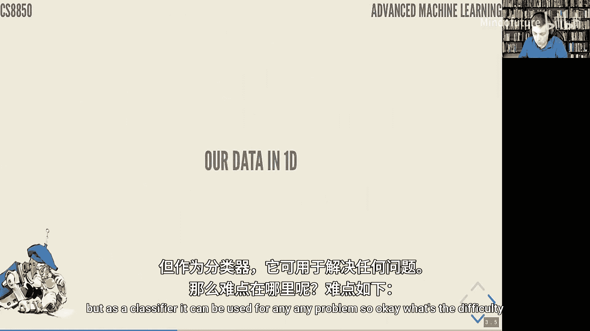
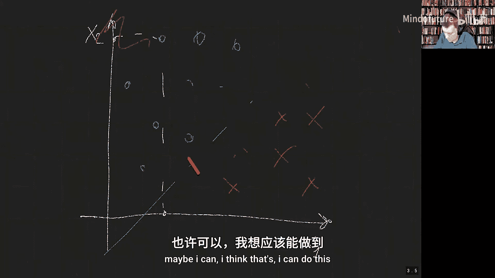
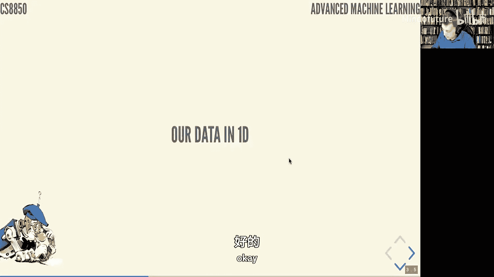
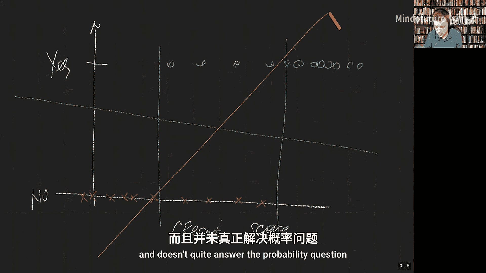
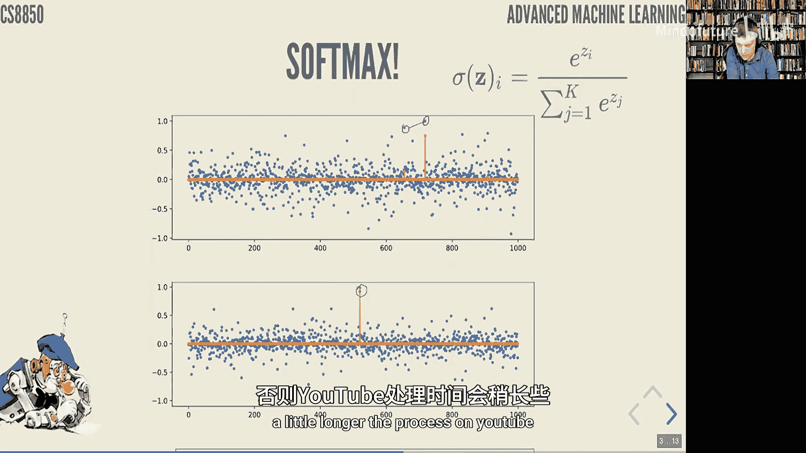

# 高级机器学习主题-CS8850-｜-Advanced-Machine-Learning-p31-P31_定义逻辑回归--BV1sapPz4Ewx_p31-

Starting recording。

Hoping that'll be less lonely。For all of us。So。Nive based generative classifier。Logistic regression。

 let's define logistic regression and see where it's coming from that's an interesting case of a probabilistic homecom。

And yet。Lal coifier。呃。This is more of personal experience quite long ago。When wrote the tool。

 the slides will be available for you you can。Use them。

Maybe 10 years ago I don't remember exactly but we wrote a tool called Peliififier I started it and then my group picked it up and then our Ojo is the current maintainer you just can peep install it and the idea was okay we have SKL and we have multiple classifiers in SKLn but then there is a lot of manual labor imagine you've got a new data set and you want to figure out if this data。

Even has a signal about one class or another about discrimin ability allow me to come up with this sort of class one and class B。

So you don't want to see there and fonts with different parameters of every classifier and look for which classifier will work so what are the two policyifier that would run all of them and generate a report。

And it will generate a report with area under the curve for training and testing。

 or if you wish F1 score， if you don't know what those are。

 there will be a couple of lectures on model selection in this class and you will become professional because this will be on the final exam anyway。

 but the point is there is an output on the screen from a few actual rounds that a graduate student in my group run last year。

 or。Yeah， I think last year。The squared is the simplest classifier ever。

 which I would not expect to perform as well as it does is logistic regression so logistic regression is very simple linear classifier。

 especially here look how close it is like to the top maybe only in those couple of cases。

 but what you're seeing is a particular example of particular case of data there are four different data sets。

 there' are all brain imaging data sets， but in other in genetics and everywhere logistic regression would perform surprisingly well on par with random forest and well neural networks stuff like that so that was interesting。

And I think it is underrated in every machine learning data scientist or whatever you're calling yourself。

I should understand what's going on， when it's so good。

 how it works and have it in your arsenal of tools that you're using when you approach a problem because it's super simple。

So and this is coming from Brandon F's channel， there will be also a link。

Imagine all you have is credit score of people and then you know that those people went to the bank and the bank is a black box doesn't open the door for you。

 you don't know what's going on inside who makes a decision and how and somebody sits there and approve some of those and doesn't approve some of those and all you know about them is credit score so you want to figure out like。

I don't know， you want to open up a consulting firm and you want to charge people money like saying oh。

 the probability， don't go to this bank， the probability that you will be denied is high。Okay， so。

How to do that or what's difficulty or why not？Why not do that in some kind of an easy。

 simple process？So well in any case， the problem that logistic regression seeks to solve is well we want to model the probability of an event occurring depending on the values of the independent variables which can be categorical on America notice again I've started that logistic regression is a linear classifier well I also showed you that na base can be a linear classifier in the video that you can rewatch later in the first episode。

So logistic regression is a linear crifier yet we want to model probability in perceron。

 we didn't model anything at all， we just were searching for a linear boundary for the class separation boundary。

 but here our goal is to model probability of an event。

And then we want to estimate the probability that an event occurs for a randomly selected observation versus the probability that an event doesn't occur。

 so again， given a new observation， we want to be able to return a probability estimate。

Then we want to predict the effect of a series of variables on a binary response variable that's just reteling the same in different words and then of course we want to classify observations。

In the classes approved and not approved for a loan or。Interestingly。

 yeah the loan approval is a classical example for logistic regression that you can see online anywhere you see logistic regression introduced。

 but as a classifier it can be used for any problem， so okay。What's the difficulty， Well。

 the difficulty is the following。

Before when we were working with perceptron。Or the Papaye example， we had feature one。

And feature two。And we had a couple of classes。Which is。combinationation of this feature。

 each sample has some value of feature one and some value of feature two， right？Okay， that was okay。

So we had two classes and another class。And what we were searching for is a boundary that separates this two classes。

That's for the。And then youre classifier， that's what we usually do。😊，And the data came Okay。

 the data came as x1， x2。Subai for each of the sample， we had a couple of features in this case。

 so okay blah bh blah blah blah。Imagine I quickly erased all of that。 Maybe I can。

I think that。This。Do you know that if you still see the screen， screen Sha has stopped？

There's a thunderunder with yeah， let me to share the screen。😔，So far， okay。

Do you see the screen now？😔，Yes， no yes。Right。

But now with a lo example。All we have is。Approved。嗯。诶系了吗。Youre not。And we have credit score。So。

 we have。嗯。Some measurements， some people that already went through this particular black box model through this bank。

And。呃。呃，那 no no。That's what I wanted to do。Ignore this。And I'm recording。

All of this lectures so fine I will I have to edit this out。

 but since it's a live performance that is much simpler now so what we have is another lab。

There is an overlap of the recordings of the credit score scores。And。What we want to model is okay。

 probability of。Being funded and probability probability being denied and probability of being funded。

 But we also want to model that probability right here。 And if we use our。Being a classifier。😊。

Well probably need to put the line right here right and fit this line with this kind of weird arrangement。

 but if we want to use probability modeling how do we model continuous values rather than discrete one class or another we can use regression for example and regression will happily do this it'll beat a line the orange line on the screen right there and that's not a solution that we're seeking so because it doesn't separate the classes and doesn't quite。

Answer the probability question， so what do we do？

that's the actual problem， but why not SVM I got that question like SVM can do everything It's a good classifier let's use it Well the problem is that SVM and logistic regression are quite separated in time when people started asking this probability and loan prediction problem they were like back in this Mar Mac F for those who don't know in 955 checking out a newspaper and surprised how far back he got but Sir David Cox in 958 actually introduced logistic regression and so if Mar stuck there for just three more years he would be happy because no SVM is needed all you need is logistic regression to solve exactly the same problem and even more because you can now say probability return probability not just a classifier。

So as the science develops， there little aside。We usually taught didactically how。

A question arises and then somebody comes with an answer and here's how this answer fits the question and so on and so forth what actually happens is like with this problem with this slidening jar this is a classical problem of how science develops and again I I should have said in the beginning of this class I guess in my lecture number one or here all opinions expressed in this classes are my own but I go I assume that goes without saying so structure of scientific revolutions is actually what it happens so a lot of people going around around chatting and forming cliqueeks or sects and thinking about the same problem so there was one sect back in the day interpreting the electricity you know the ancient Greekeks used the electricity and discovered。

With amber steak and a cat electron comes from the Greek name for amber and so on and so forth。

 but no one knew what it is， so there was one sec that practices this belief of electricity is a liquid。

And so guided by this incorrect belief， they hugely influence all of our language about electricity。

 current and everything that we when we talk about electricity， we still use their incorrect belief。

 but their incorrect belief。LE to correct inventions surprisingly and then the belief was corrected when the old people died and the new generation came but what anyways。

 that's an like they invented a jar。For containing electricity because they thought well electricity is liquid let's contain it in a jar and they came up with a capacitor that's the first capacitor light in jar which actually did contain was able to contain electricity。

 although it wasn't liquid as we know now so the same with。Logistic regression。😊。

People were just trying to solve the problem like well we know how to solve the linear classifier problem can we just fit a line there and answer the question of probabilities well fitting a line to the scores loan credit scores doesn't work what can we fit a line to it's our usual mode of vibration we have a hammer so we go around and looking for nails and it often works no matter how people reicule this approach so in the case of logistic regression in the case of predicting probabilities from the credit score。

Probbilities is kind of hard to fit a line to why don't we feed a line to something more with a larger range and more interesting value。

Let's feed a line or try to work with odds。So 50， 50， 90 to 10。999 to1。

So those corresponding probabilities and corresponding odds。That's already interesting now we have。

Numbers that live in sort of this positive quadrant， they go from zero to infinity。

 you can have any number of the large size and you can try to fit a line to it because we can fit the line。

But the problem is it's not symmetric， it's kind of like， well， it can be very small。

 can be very large， but it's kind of just on the one side。

 can we have both negative and positive numbers。And yes， we can for the same if we。

 instead of odds the ratio of you know， the numbers of success or what you bet for success versus what you bet for failure。

If you take log of the threshold， then you get a much more interesting distribution for probabilities。

 you have negative numbers and you have positive numbers and you know you can you can now so when your ratio when your odds is one。

 5050 probability 0。5 that's the cutoff point， everything above higher than 0。

5 has positive log odds， everything below has negative log odds。

So now we can work with this interesting。Arrangement， and it's not。Basically。

 we arrived at this thought process and it took a lot of time since 19th century through。

Trying to find an easier。Mechanism of dealing with problems like the loan credit loan example。

 not in the 9th century， but just so you know， so what we're doing now we're saying， okay。

 we have the value of log odds。Let's model this value with a line。This is an equation of a line。

 right， one dimensional。In a binary case， the probability is either plus or one of like either one class happens or another right it's one class over one minus another that's clear not if you agree。

No， no， ask questions。Thank you clear。😊，Multidimensional case we have this right those are vectors in our product the bias and everything。

 this is our equation of a general hyperplane now we're saying okay can we model the response？

With a hyperplane those are our variables credit score or add many more variables that you want to account for so for credit score example。

I can give you a function， so you have W and you have。

The parameter let this parameter be either credit score or let this parameter say a salary so you can understand what we're talking about if this is the person's annual salary we or monthly salary let's do monthly we want to have we want to disallow the person。

A like decline alone if they by paying it monthly， they will go below a certain amount that we think they need minimally to live in this area。

So this is our baseline we cant go lower than that and then we add some coefficientient。

Multiplied by that and this coefficient I don't know will go three times high three times higher than the salary just in case and then there is another coefficient that。

Could account for whether you have children or not and things like that。 So now we can model。

Log odds with this function， but the problem is usually especially in the discourse that I just given you the coefficients would be given by experts okay well where do we take this number it's taken from cost of living in this area where do we take this coefficient that's because those experts told us but our goal is to estimate those coefficients from the data and again this is still aligned if we come back to our。

Created score example， the line。Should go somewhere there and below and above would tell us whether we should approve or disapprove the loan。

收。Converting this to probabilities， the class conditional probabilities or posterior probabilities in this case。

 so we have。Given the data， what's the probability of a class equal one？

We take a ratio of probability of this class with probability of some random class。

 this is like we're jumping a little ahead into a multiclass problem。诶。

Let me see if my next slide summarizes not， okay， well anyways。that should work。

 something didn't fit right in the slide。But。For each。Log ratio。

 so we have K classes we randomly pick one of the K as our base class against which we will check the log odds。

For first class， the odds ratio， log odds ratio， we will model with one vector。

 for the second class we will model it with another vector and so on until the last class。

You can interrupt me at any time and especially if you want to go on there so what's the probability when we're doing that when we're measuring the log odds。

 what is our density， actually， what are we doing with the density function？

We started with modeling the log odds。Over two plus， this is a two plus example with a line。

Dingalequator so let's take the log of both sides。Rearrange。What I'm doing there， yes。

 multiply through。Letrange again。嗯对。Probability out， and。We get this ratio。

And this ratio is the same。By again， another algebraic manipulation， so we have a function。

Let's just plot here a function of x for given W。This this w a linear parameter。

 so imagine one dimensional case， so w is not a vector here in this plot and x is just a one dimensional variable so w will。

呃。Sttrach this function， this function is called logistic sigmoid sigmoid because it has an S shape。

 people say logistic sigmoid because there are other S shaped functions such as hyperbolic tangent and more。

 but this particular functions called logistic sigmoid then look how nicely。

It models sort of binary distribution from no absolute no there to absolute yes over there with some gray area with probability of whether you will get a loan or not。

 again， a classical example of the loan， I hope。This is clear。

 no questions and I'm looking only at the people with the videos there。So that was a binary class。

 but what happens in the multi class example in the multi class situation？As I said。

 we pick one class as a reference。When the log odds that was off screen。

 they are what happens to this class。Then probability。

 posterior probability of class K given the data。Is expressed as a logistic sigmoid here。

But since we chose arbitrarily， one class as the baseline。We arbitrarily， as well。

Set the probability of that class to one。And。So then we've got a function that all of your modern data sciences should recognize immediately once you see it。

Anyyone。What is that function？ok。Thisis function is softm。

It adds up all of the exponents and for one of the classes for the Bra line， it's e to the zero。

 so z， the coefficientient to zero。And we sum all of the normalized by everything else expd。

So logistic regression introduces your。Soft marks function back in。1958。

And you're constantly using it if you want to look modern and piped up especially in your interviews right so the outputs of course we moved to reallu recently but logistic Sigmoid is still a good activation function for neural networks so what does the softmax does。

For the neural network， for logistic aggress and for all of those cases。

Softm if we took a linear function and apply softm， softm exaggerates the maximum。

 it pushes everything down while it's pushing the maximum as high up as it can。

So it exaggerates the differences and enforces the winner takes all situation。

If you are training your neural network with softs output。Essentially what you're doing。

 you're training a kernel for logistic regression because your last linear layer in softm is a logistic regression。

 so logistic regression is not only a powerful classifier by itself。

It's been consume as this retrovirus in our modern deep learning DNA and it's part of all of our classification models。

 we train it， of course。With。你は。What is the loss when we're using soft masks？Correct， crossenttropy。

But more examples of softm function， I've generated some random lapplian noise here and as you see。

There is this one maximum number here， but it only。

Exextends a little bit and it's not easy to detect at first glanceand among all of the other samples。

 but orange is when I applies the soft max function to all of those letla and noise values。

 then you can see as a delta function。My winner just perfectly pronounced there。

 especially it's visible here。In this case， those two samples are too close comparing to the rest of the mass。

 so softms pushes all of the losers down to zero and just selects and promotes one winner。Okay。

That's let me stop the recording for this episode， I want to keep them separated because otherwise。

Would be a little longer to process on YouTube。

Of。