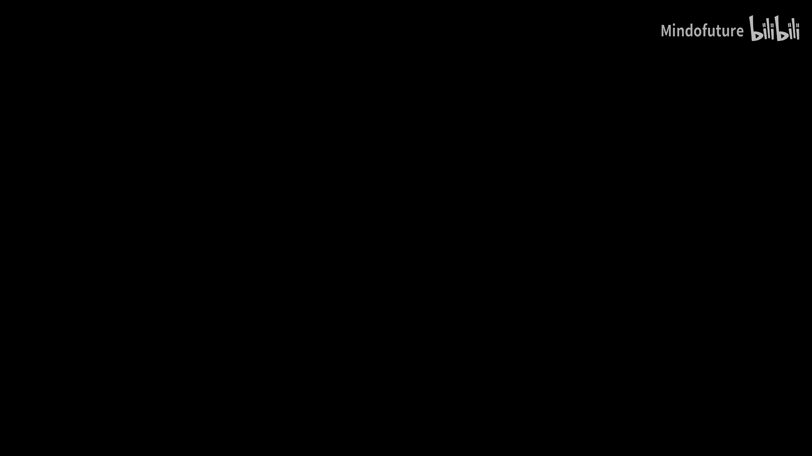
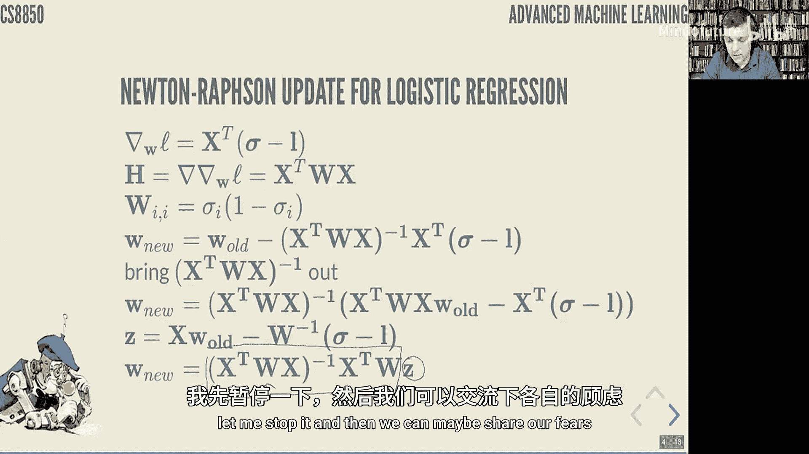

# 高级机器学习主题-CS8850-｜-Advanced-Machine-Learning-p32-P32_训练LR模型--BV1sapPz4Ewx_p32-

Go on this computer。 Yeah， so now once we have。

Formted the problem。How do we find those W？All those coefficients， we have a formulation。

 we know that it models probability distribution， although we started by modeling like implicitly by modeling log odds as a linear classifier。

Were actually estimating probability distributions for each of the posteriors。

 probability of class given data。So whereas naive base， also a powerful classifier。

 which can be linear， can be made linear。Goes generatively models prior of the class or estimates from the data prior of the class and then likelihood。

In logistic regression， we directly model。Poometrically。

 we model the posterior or the decision boundary。So an alternative perspective on log odds。

 I kind of dumbed it down and ridiculed in the previous part of the lecture。

That all we wanted to do is to find a way to fit a line and model， like imagine if our arsenal。

 like there is only one weapon in our toolbox is how to fit a line。

Then we figured out how to model probability distributions with the scope of fitting a line。

And we were in a very specific setting， but what we are in a general settings。

 we know nothing about probabilities and we don't model like this is just your standard Bayesian theorem of modeling posterior probability of class1 given x。

Remember our AS test example or our PMl text test example or the boxes with fruits， whatever。

 our abilities and likelihoods here， mysters can have any form。Any form whatsoever。

 as long as their proper distributions likelihoods can have any form。嗯。

Poisterior is conditioned on all of this。Of course， but can turn out to be any form。

So let's denote our log ratio or。Deciion boundary。Remember。

 the ratio of our posteriors is our decision boundary。

 if we denote our decision boundary actual value at this x。As a。

Then we see that posterior is logistic function， it's a logistic sigmoid。Of this parameter A。

Not just the generality。It's like regardless of what is the prior probability。

 regardless of what's the likelihood。Or probabilities of the classes if you do not。

Your posterior ratio， log posterior ratio with a parameter。YourYour posterior well。

This is class specific and this is your solution general。Is the sigmoid logistic sigmoid。

 So that that's that's kind of。Maybe that helps， I hope that helps to emphasize the importance of logistic regression and logistic function because it's so general。

 it's not just， oh yet another method， learn it and use it in your toolbox， all to do， do use it。

Because it's so easy， so Sigm it has nice properties。Again， we have log odds。

 so our decision boundary is actually modeling log odds。诶 s smoid it is呃。嗯。Well。

 it's easy to differentiate in terms of sigmoid and。

Help me there so is it an odd or even function no it's not even it's not even an odd but we can easily express we can easily shift。

I don't know， I need to check this after if the minus sign is there， probably I meant to say。

Because that negative value is a shift by one， but well check after that。

 don't trust me on this specific formula looks fishy。Yeah。If you subtract a half。

 then I think it's odd function。Like I wonder in this expression， if we said。

If there is a plus rather than minus here。Okay， anyways。not too relevant， but nice properties。

 we can express derivative of sigmoid in terms of sigmoid。

 so that's convenient because we can pre computeute sigmoid only once for the forward pass and the backwardro pass of backpro for free。

 almost for free we get the derivative and the actual value。And。Let's try to estimate it。Back to our。

Almighty， all powerful maximum likelihood estimation， so we have our。

Logistic regression posteriors now for each class we know how they are expressed right those are sigmoid functions we are going with the IID assumption that's why the product for all of the samples for each of the sample。

 we want to compute we want to maximize the probability for each of the element in the sample or for each sample x sub I we want to maximize the overall probability of the data set we want to change the values of w。

But there are two classes， class one and class two。

 so let's separate those classes into independent products as we did with Bernnoli distribution。

And if we express our probability as just sigma， you can immediately see， oh look。

 this is a Bernno distribution now with some unknown parameter L1。

Which is probability of heads and Bernoulli， or we' just saying， okay。

 this is the probability of class one the prior。To be consistent with how I。Use my notation later。

 it's the pie like in the other slides， I use the pie there。Very， very simple， very quick。

 but is it clear， clear？Nothing magical there well， we can' deal with those basket products。

 so we just apply the log now we have some of the logs and。After I've applied the log here。诶。

And because of the rearrangement， I got the negative sign in front， So what do we see here。

 we see a function。Or well。Two functions。那他。And again。That have this form， both of them。

But does it remind you， U， you should remember that's back to your question last time？Okay。

Those who don't remember cross entropy。 So now not only。

Thanks to sir David Cox 1958 and Martin Mc Fly for traveling there。

 not only we have our softm function that we still continue to use。

 we also have our loss the cross entropy loss that we continue to use that's the loss that。

The logistic regression using this is the actual probability。

 class probability prior and this is what we're estimating the pi and the sigma。

 the sigma is our function that we want to estimate and we want to get as close as possible to the truth so we're minimizing crosscenttropy loss when we're optimizing logistic regression and most likely when we're training the modern over parametermeized models we as well estimizing estimating。

 minimizing crosscentrypy loss when we're。系啊。Estimating whatever the solving our classifier problem with our learning model。

That said， let's differentiate this。And solve with the usual way， solve it by taking the gradient。

And。Equating it to zero and solving for of solving for。W， remember this is our logistic sigmoid。

 which is parametermetized by the W vector。Blah， blah， it is here。

H work is go from this unconvenient and ugly component form to beautiful linear algebra expression where you can just go ahead and solve the problem in any of your Nai Matlab or whatever you prefer or Julia if you want but us。

The thing is it's kind of ugly we can do better than just solving this and let's try better。H know。

So when we're solving。The gradient descent problem。We're going。

With a rough approximation to the function where we're taking a step along the line that is tangent to the current point and then finding the value at this line after we're taking the step but our function has according to Taylor expansion gradient descent is all like based on Tayloror expansion that's all we're doing we're approximating a function with the tail expansion of the first or term and this is what we're not approximating。

And here's a visual example with gradient descent， we're taking this line。

Taking a step along this line， checking the value of the function。

 but if we can if we can take take a step along the orange。

I think the orange is this when we include another term， those colorful lines。

 each line has more terms of tailor expansion of this。Thiss the third one。

 second one looks like it's zero。Ex。You mean the constant term， the the quadratic term。

I don't see it quadratic。Zhen。But， orange looks cubic。Yeah。That。No， no， no， like because。

Because it is a sign it changes the sign， I think orange is just your flipped parabola or something No。

 it can't be because you can only have one inflection point。

On a parbola or you can only yeah point rather， not inlection point。And this says do。

It's definitely at least cubic， and I'm sure it's the cubic term。Well。

 I'm not sure if it is the cubic term， but okay， the green， the yellow is definitely after its， yeah。

 it has more inflection points。Thenhan the orange， but the point is if we were using the orange instead of the red。

This term instead of the line， then in one step we could be closer to the actual one of the minimum known。

To a local movement then going。By。The line and another important observation is that if you're optimizing a convex function。

gave， depending on maximizing or minimizing。When you're going with a tangent。

You need to make a few steps before you arrive at the optimum。

 but if you're going with the quadratic term with if you're including。呃。

Up up to the second derivative term in the tail expansion， then you can go to solution。

 often can go to solution directly and that's。That process is called Newton Rason method。And aside。

 as always。Almost in 99。9% the things are not called for their inventors Newton has nothing to do with this Newton didn't know calculus that well anyways and he did not invent optimization so thanks to Rasson and thanks to well like seriously the Nquist frequency was just named by Shannon in honor of Nquist but NCst has nothing to do with it and things like that I mean lots of things like that it's its the long tradition yeah it's a long tradition if you if you're thinking of how to name something never name it for a person who invented it so。

Instead of， okay， so we have， we're currently， we have a loss function that we want to maximize in this case。

 well minimize we want the likelihood， the L is the likelihood we want to maximize the likelihood。

We are at the point W and we want to take a step delta so if we instead of taking first two step of Taylor expansion。

 which we usually do for gradient descent will add another one， the quadratic term。

And take a derivative of this with respect to deelta with this expression， with respect to our step。

And set it to zero。 look what happens。This doesn't have deelta， so it's not making it here。

Two and two cancel， we get this easy then express Dlta as a negative ratio of first derivative and second derivative。

And make your step your new value， so you were here at W。And。Make a step。

 but now your step is expressed according to。都嗯。First two components or three components。

 if you count the constant term of Taylor expansion and then it's first derivative over minus first derivative over second derivative。

It's easier said than done because in the multidimensional case。

 when your loss is a function of a vector， it's still a point function and it returns a single scalar value。

And I constantly use loss in our case it's likelihood we want to maximize it。

 but in both cases we want to find an extreme that。Deli equals to zero here。 So in case of。

A vector function that takes a vector and returns a number。We use something called hisan。

 it's an interesting matrix。It's a matrix of second derivatives。

 so we have our gradient and multiplied by inverse of Haesian。诶。

Very interesting method and I want you to see how it works in practice because you already watched the lecture of how would we find the optimal solution for a linear regression。

 not logistic regression， but the linear regression。Remember， when we need to fit a line。

How do by minimizing mean squared error， how do we go about it， so here's our mean squared error。

 we want to find the W。呃。Sorry we want to find this w， given this values。

 we want to find a w that minimizes mean squared error。And of course。

 let's scratch that ugly component wise form， write everything in the matrix form。ComCom。

Our data samples as rows of the x matrix W is a column of our unknown parameters well x is given to us and y is given to us。

 I just wrote the same thing in the matrix form here。Please， follow。Then we'll take the gradient。

 we'll find the gradient。Very easy， just same derivative rules as you would normally use。

And then find the Haitian， the matrix of second derivatives。So if we。Use the Newton rhson method。

And plug in inverse of the Haitian and our gradient times our gradient as our step and multiply through。

诶。Interesting magic happenss， we can get to the solution of linear regression in one step。

In single step， no iterations using newton repsson method we get to。

The estimate that is the optimal solution。Before and this is called pseudo inverse。

 before in one of the lectures I've about which one already talked about the pseudo inverse and how to solve this optimally in terms of least square error optimizing the least square error linear your regression now let's do the same exactly the same for logistic regression。

We'll start with our。Fmulation。We found the derivative sigmoid function and our data that's all we have and then。

Well， this is not one， this is L， the labels。The actual labels， the vector of labels， zero ones。

And sigmoid returns sigmoid function， it's also a vector of the value sigmoid function with given W。

Returning at each of the axis。So it's a vector of values in the01 interval。Minedless。

vectorctor of binary vector of zeros and ones just so you kind of follow me with then。Now， our。

Deative will be。Second derivative， the Haitian matrix will be。

As follows and W is a diagonal matrix now。The diagonal， again。

 is sigmma and those corresponding values eyes。And remember， this is nothing but。

Val of the sigmoid with respect to derivative sigmoid with respect to the parameter。

AnotherAnother fun fact about sigmma it function since it is。

The derivative looks exactly the same regardless of whether you take it with respect to W or to x。嗯。

So now we have our expression of iterations。Of how do you compute W new value for the logistic regression given the old value？

Let's do some manipulations， we're hoping that we'll get the solution in one step。

We'll take this out。Well， get an expression and then do somebody naming。Because we can pre compute。

 we can compute Z separately and we've sort of gotten something that looks like pseudo the inverse。

 which we had before for linear regression。With。It doesn't because it involves our parameters that we optimize so we can't solve it in a single step。

Okay。Or that we cannot solve it in a single step， but still we are guaranteed that this。

More cap of Su the inverse will get us to solution faster， so this is a pretty fast method。嗯。

For solving logistic regression， news and updates。Okay what did we talk about I don't have take home points in the slides yet I will add them for before putting the slides online but the point of this whole lecture was logistic regression logistic regression is highly influential methods on everything that you are using currently and going to be using for machine learning for quite a while and。

It has interesting properties and yet it is super powerful by itself without all this learnable kernel。

 even without the learnable kernel of deep learning that you attach to it。

 but with deep learning of course it is a more powerful method。

 so that's all I wanted to say for the record。Let me stop it， and then we can。Maybe share our fears。

