# 高级机器学习主题-CS8850-｜-Advanced-Machine-Learning-p33-P33_非参数密度估计--BV1sapPz4Ewx_p33-

Hi， let's see if we can try something new。We'll talk about density estimation in this episode。

And let's see。就。Just to get us into the zone， let's recall the topic that we already discussed based decision boundary。

So what we have is two fastor distributions for class1 and class2。

And if posterior distribution for class1。Probability of omega1 given x is greater than posterior distribution for class 2 Then we decide for class 1。

 right。

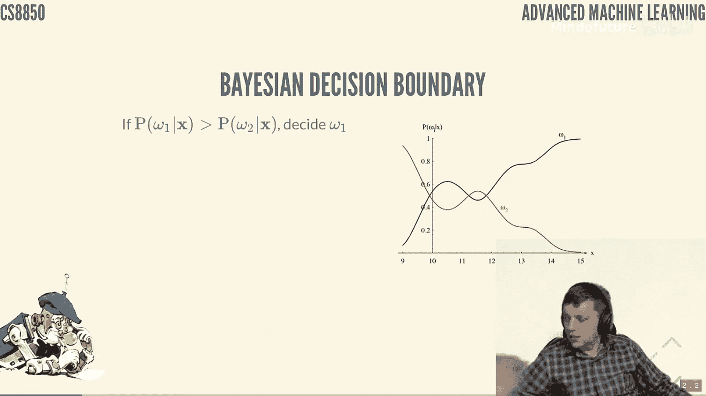

Look at the。plot， so posterior for class2 is the red one。And when it's greater in those regions。

We decide for class for class 2 when。On the other hand。Plus1。No。

I'm kind of reversing what I'm saying and what's。In， in my notes here。But basically。

 if class 1 is higher in those regions。Then we decide for class one。Or one plus2 is higher。

In these regions。Then we decide for cluster for。Well class2。 But what really is happening there。That。

We are。 well， by doing so。Or minimizing probability of。A given data。So Bayesian。

 Romanizing Bayesian error。 We're just selecting for each of the given points。 we're selecting。嗯。

According to the rules above。According to the decision boundary。

 or well we'll see now likelihood of ratio。But we still have an error。Say when， at this point。

We are deciding that this value of the feature。Tells us that this is class。one。There's still。

An error access of error for class 2。And basically what we're doing is we're minimizing the error we're just taking okay。

If we will。In this class， if we predict。Plus in this case， if we predict class 1。Our air is smaller。

 So that's what we're doing。 And in this case， reverse if we predict class 2。

 our air is smaller than。But。诶。What we are actually getting at is the season boundary。

There's those points。Or the curve or the surface along which。

Perors for one class is equal to posterior for the other class。 So this is the decision boundary and。

The decision boundary， when you deal with it， has。Equality of pasterior is kind of hard to use as a decision boundary。

 so what we use this instead is likelihood ratio because you can write your posterior as the product of your likelihood and your prior called likelihood ratio。

 but in fact it's we take a log of this ratio and then we guarantee that when they're equal。

The ratio is one and log is0。 So this is our decision boundary。

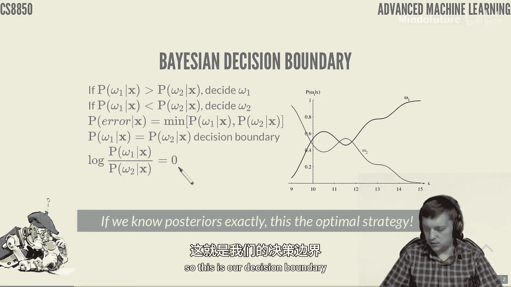

So one parametermetric density estimation so far， we have assumed that either the likelihoods。

We're known。And then we could do the ladyhood gra this。Or at least their parametric form was known。

 and then we could do maximum likelihood estimation of the parameters from the data and still do estimate。

Estimate the decision boundary and。Or do the the likelihood ratio test again。

But what if we have all we have is data。And we don't want to make any assumptions about barmetric form of the distribution。

Or the data is just telling us that barmetric form of this distribution may be too difficult to derive or deal with。

Can we do something in this case， just run the data non parametrically without assuming some form。

Of the distribution of the likelihood。In this case， and well， yeah， that's a challenging。 and well。

 that's an exciting problem。 All we have is the data and we want to estimate the density。诶。

Just using today itself， not using a parametric form of this distribution and loop。

Parametrically representing a distribution like that would be very hard or very difficult。

 or at least it would be difficult to deal with。

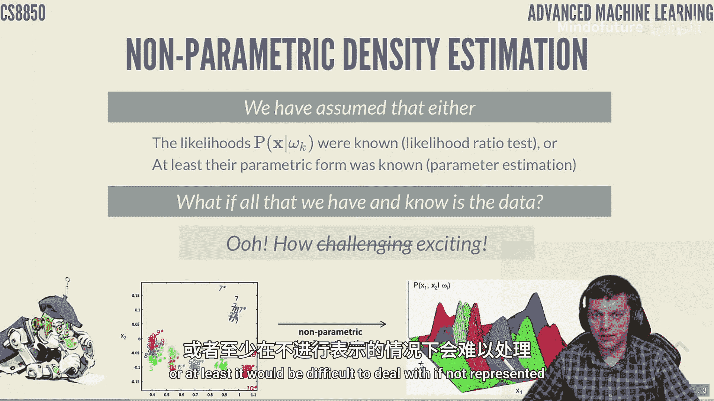

If not represented。So the first thing in the problem like that。

 the first thing that should come to mind is something that you've seen millions of times is histogram right histogram is the simplest form of nonpometric density estimation。

How we do that， how we compute a histogram， we divide the samples into a number of pins。喂。

And then approximate the density by the fraction of training data。That falls into each bin。

 So we have our training sample。 we estimate the distribution as you know for each bin。

 we compute the counts。And then after we've done that。

 we get a new point and use this equation on the board on the slide to compute the probability of this point。

 according to the data that is。Representing the density， the underlying density。

 it's just count of training samples that fell in the same bin。诶。As are。

Sample divided by the bean weeds and divided by the total number of training samples so。

There are variations， the be widths may not be constant and things like that。But。

Just two things to divide。Been with and first， being starting position。No。

That's all we need to define as our hyperpara with those hyperpara， we can now。

Estimate this function。The histogram， the all familiar histogram。

Looks very nice and so comforting in one dimensional case， but。

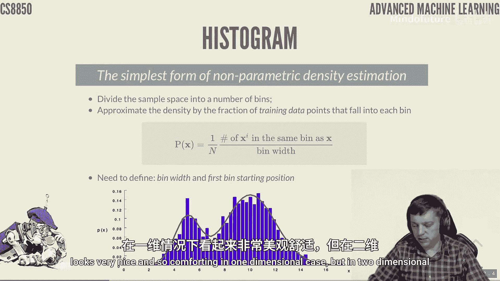

In two dimensional and largest dimensional case becomes very， very problematic。

Few problems with histogram is density estimate depends on the starting beam position。

So depending on where you start。In your in the， in the。Like you're given a data set data points。

So how you carve it。Will give you a different density estimator。

 depending on how you carve this into bins and then histogram has discontinuities of the estimate。

And those discontinuities， yeah， artifact of the chosen bin location， they're not like。

Truly in the data or some property of the data。So and of course。

 the problem that you already guessed when I started talking about multiple dimensions is the curse of dimensionality since the number of beans grows exponentially with the number of dimensions。

Yeah， like we have。Rememberumb figure with 3D。So we have h4D of parameters to estimate for histogram and the larger is the dimension。

 the is the chance probability of any points heating most of the bins so most of the bins will become empty because we will end up empty and we have no estimate of probability density at those positions。

 so histogram is unsuitable for most practical applications that except for quick visualization in one or two dimensions。

Yeah， formal dimension is good， good enough， but so let's leave it alone。

 let's not work with it at all for any kind of interesting serious application。

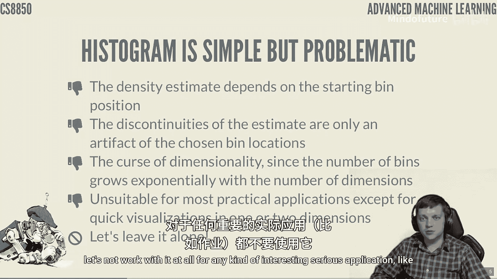

Like your homework well， like your next homework。On naive base。Well， what to do instead。Let's。

 let's instead。Pice something。Different。Nonpometric density estimation。That is not a histogram。

To see what we're trying to do， let's see where we going， what are we're trying to accomplish。

We're trying to estimate or to represent the probability that。诶。X。

Sample from the true probability density。Will fall in a given region of the sample space。So。

 probability of。A sample falling within a given region of a sample space is just an integral of the density。

RightIn one dimensional case， what's the probability that your value falls between A and B。

So you take an integral between A and B of the density。

And of course we're doing the tick mark here because this is the variable of integration and this is the x variable of interest。

So probability of x falling within R is just the integral of the density， good old。

Probability theory， nothing interesting yet。When we have a sequence of random vectors。

We want to estimate probability that k of those vectors that we sampled randomly from the distribution P。

From this one。Will fall in this region。We know that probability of falling inside of this region is theta and outside of this region。

 one minus theta。Now， you see the familiar Bno distribution。 but in a sequence of n。

Drrows and samples， and when it will fall into that region R is that theta distribution。

And the actual probability of falling in that region are or。

The probability of a specific number of the samples falling within this region R is。

The binomial distribution。Here on the slide。All of the possible。

All of the all of the possible combinations。Or all the possible sequences of K samples falling within that region。

In the benoli distribution， So from properties of this binomial probability mass function。

We know that the mean of cave and。Is theta and the variance of K over N。Depends on N。So。From this。

 you can see that as n grows to infinity， variance reduces means stay's the same。

 but variance reduces， and we can obtain a good estimate of the probability。诶。诶。good， good estimate。

Of theta as sc and。

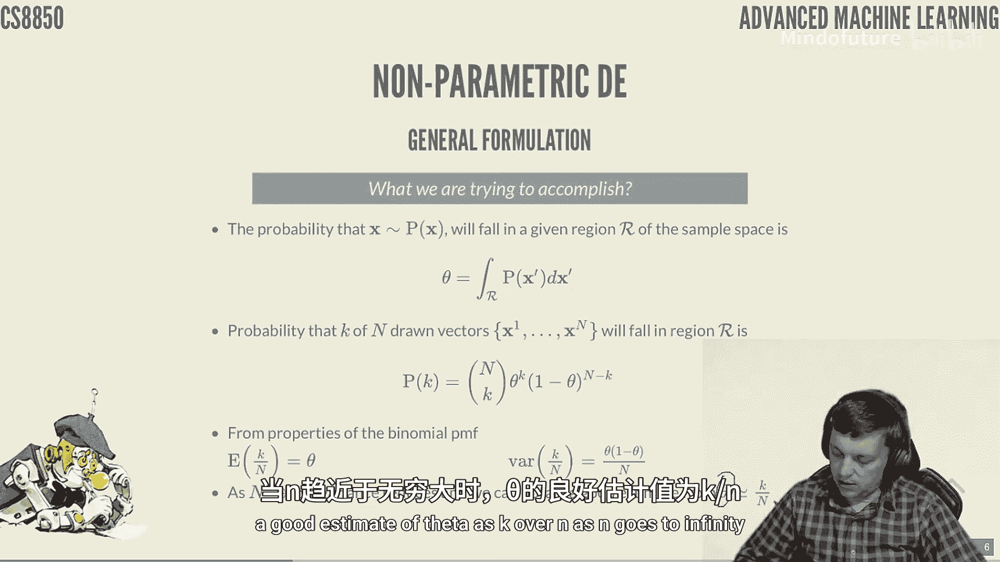

as N， as N goes to infinity。So I assume now that this region is so small that probability density doesn't much change across that region。

So then， in this case。We can model this integral of probability。

 density function as a product of probability。Dity。At x， so。TheX is here， say。We're assuming that。

We shrinking this region。Further such that the density doesn't change。 So at some point。

 this region becomes so small that we can still， we can just assume， okay， this is constant。

 That's why it's just a product in 1 D。 It's the length in 2 D。

 It will be the area because remember what we're computing is the volume。

The integral the volume under this。Denssity under the curve。So then in 3D and 4D and so on。

 it becomes volume same thing。And then now， we know that。诶。As N goes to infinity。

 a good estimator for theta is k over n。But look here， theta equals probability density times v。

And also equals mean。Approximateinated by。K over N， the arranging。We can obtain。An approximation。

The probability density as k over n times V K is number of samples that fell into the volume。

 specific volume V。Out of our random sample。 And N is our total。Size， simple size。So with this。

 we obtain a more accurate estimate by increasing n as shrinking and shrinking V。

 so we need to shrink the small enough but we can assume that probabilitybil density is flat or unchanging within this volume。

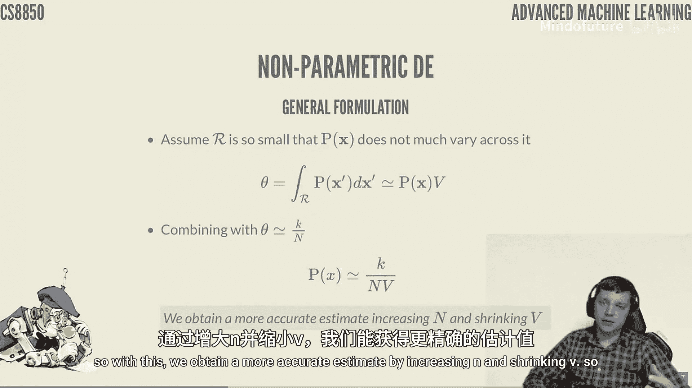

Then we kind of。Guaranteed that we're not too much of here when we're approximating theta or actually when we're approximating this integral。

And yet for this to be a good approximation and needs to go to infinity。

 So v needs to go to0 and needs to go to infinity， and then this will be a good estimate of our probability and。

Proability density of the data。So some practical considerations。As volume approaches 0。

R en clauses no examples。Obviously， smaller and smaller and smaller。 And then our sample is finite。

At some point。It will be harder to find any examples in those volumes， so you have a point。

 a new point that you want to estimate probability let me go back。

 you have a new sample and you're telling me okay， I have x I now it comes from this distribution。

 but what is the probability of x。And then if this goes to zero。

 then and you need other samples within that volume。

 but you don't have any samples around x within that volume。 that's what I'm trying to say there。

So we need to find some compromise for V， but we need to use V such that it's kind of proportional to number of samples so we can have something within the volume。

So。But the general expression for nonparmetric density then becomes as on the screen。Right there。诶。

Still the same as before。It's just， we're separating。

ahead on the other slide we're separating N and V and V is the volume surrounding。诶想证。

That point that you want to。It's actually a cur X。This one。

 but it's affect vector X in a multidimensional space anyways。

 n is the total number of examples and k number of examples inside the volume。

 So for curve convergence of this estimator we need to provide for the following。

The limit as n goes to infinity of volume should be0。

The limit of number of points that fall within this volume should be infinity and the limit of the ratio of k over n should be 0。

That's。That means the number of total samples and the number of samples that fell within the volume。

 They just so small that they can buy。The number of total assumptionss is much larger or and grows much faster。

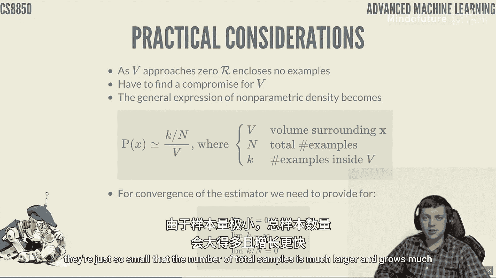

So how do we do that？We can do it two ways。 we can guarantee。

That all those three limits go to their expected values or the desired values。With two approaches。

 One is by fixing volume and estimating K。That is kernel density estimation。

 Another one is by fixing K and estimating volume， and this is the key neighbor approach。

Both are powerful， both can be used for density estimation， both can be used for well。

 and both can be used for density estimation and ten neighbor approach can be also used for classification。

So let's first talk about the examples on this slide。As we go from left to right。

 the number of samples grows like we have only one sample here， four samples。

 and this is our first approach。Colonnal densityy estimation。And。This is our。

Second approach we fixed k to Ken nearest neighbor， with fixed K to square root of the total samples。

And in the volume approach in the KdeE kernel density estimation。

 we fixed the volume to one over square root of n of our samples。And。As are number of samples。

Increases， our K increases or our volume decreases。

 and we get better and better estimates of the probability density function that generated this data sample that we have。

Just a couple of words because I'm not to going go through the Ken nearest neighbor classifier Can neighbor classifier is。

Okay， very powerful， very interesting and。Very simple conceptually， if。We had a lot， a lot of data。

 It would give us very good。Results and it's just， okay， take a sample。

Look at the neighbors at Ken nearest neighbors，00 neighbors， and if they belong。

 the majority of them belong to one class， just to clear that your sample is also likely to be this class。

Surprisingly， when you have a lot of data， how successful this classifier is the problem with this classifier。

 it's non parametric。And it depends on all of your data staying with you。

Every time you do a classification。 So if you， if you collect it。I don't know。

100 million samples or hundred0。Billion samples say you will get really good results that will probably beat any of your other models。

 But all of your samples must be there with you all the time。 That means， okay。Computation。

 it's computationally problematic， and it is also。Privacy problematic if your samples stay relate to your customers to your human customers。

 you have to always have them with you and run the classifier on them by taking a new sample of a product or queryie and looking at surrounding neighbors。

Computationally expensive。It becomes in large dimensional spaces， when you need to。Quickly compute。

Near neighbors， that means you need to quickly search through your whole database of billion examples and find the nearest neighbors。

There are data structures， which you should know from your。Computational geometry classes， at least。

KD3 is one of them。That the。Partitions the space in such a way that it becomes easier and faster to find those nearest neighbors。

 but it's still not fast enough when you have a lot of neighbors and the dimensionality is large so people have done a lot of estimates of approximate data structures for nearest neighbor search。

 but enough for about the King nearest neighbor， just to remember next time you see a problem。

Maybe try simple classifiers first， like logistic regression。

 I hope you appreciated it in the logistic from the logistic regressions lecture and like newest neighbor Ka newest neighbor classifier。

Prry them at least as a baseline and。You can think about whether you're going to use them in practice or not。

Depending on the result， but for many， just remember for many。Or surprisingly many applications。

 can neighbor and logistic aggress will be any of your modern tools。

 so don't start with the most complicated models if you see the problem for the first time and you don't know how hard it is。

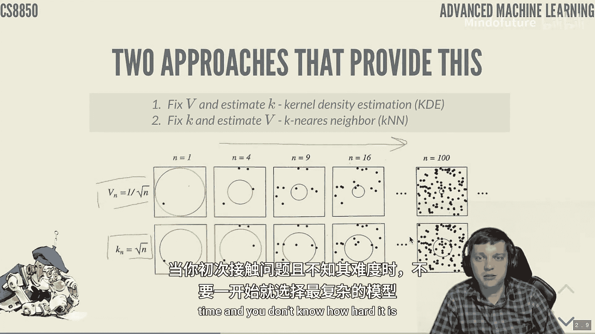

Okay， what do we do next， how do we estimate our density using kernel density estimation。

 what is the kernel in our case， let's talk about the simplest possible kernel。

Arguablyably called Parsed Windows due to ML Paran。

 I believe the name of the statistician who was one of the first who invented it and of course he wasn't the first Rasnbl was the first。

 but the name stuck。So assume the region R en closingsing K examples is a hypercu with the side of length H center do x。

So x is our point of interest。 We are interested in predicting the value of x。

 probability the value of probability density。At X。Here。So let's center a hypercu around this x。

If your're input D， it's just a square。In 3D in the picture， and once it grows。

 we keep adding dimensions， but it's still a hypercue。

So one observation to note about this hypercube is that。The distance to the nearest facet。Any facet。

From the center of the hypercube， it has length age。Is age over 2。Think about it。

 That should be clear。 like you'll get lost if you if this is not immediately clear。

So the volume is also obviously H bar D。 So we just。The area is h square。 The volume is H cube。

 but it's three dimensions And D dimensions is H part D because we're just multiplying。All of the。

Lengths or all of the sides。No they hyper given。So to find the number of examples that fall within this region。

 we define a window function。Also known， also known as Colel。 So Colel K of U。Thanks to you。

And if it's in absolute value， less than one half。We are declaring that。

The point U is within the hypercube。If it's more than one half。Or equal to1 half， it's outside。

Of the hypercurator。 So it's kind of an indicator function that tells us whether the。是。

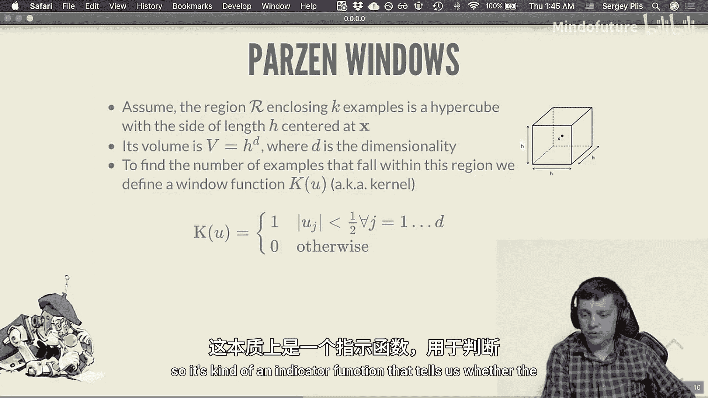

It's an indicator function。That is telling us whether a point falls within a hypercbe or not。And。

Considerd。As written。It does not involve。Any actual dimension。

This kernel function on the slide is dimensionless。

So K of U assumes that the hypercube is centered at the origin。And has side lengths，1。

Then you can see that。 Okay， that's true。 right， If H is one and this is the origin here。

Then the kernel will return。Correct results。But。We are not always interested only in the estimate of the density probability density only at the origin。

Right， we want our probability density。Anywhere and everywhere。Well。

 you see this is done for convenience because this is a parson window or the naive estimator and corresponds to a unit hypercr center at the origin。

 Okay， that's what I said。No。To generalize this beyond the origin。

We use the trick that before passing our function。X。That the x is the center of the hypercube。And。

Yes， X。U N。 so our sample。诶。And the difference。 So what we do。

 we compute the difference between the new standard of the hypercu in a point of interest。

Normalized by the actual linear size， Line length of our hypercu。And this the side。Is age and。

You can see， after this normalization。This number will be precisely U and we'll plug it into this kernel。

And will this kernel will return correct answers。1， if it's inside of the hyper cube centered at X。

With side length， H and 0， if it's outside。That's how we're scaling and translating this kernel。

Anywhere we want scaling， sorry， scaling and translating。实。

Spend some time on this slide if the simple algebra is not clear。

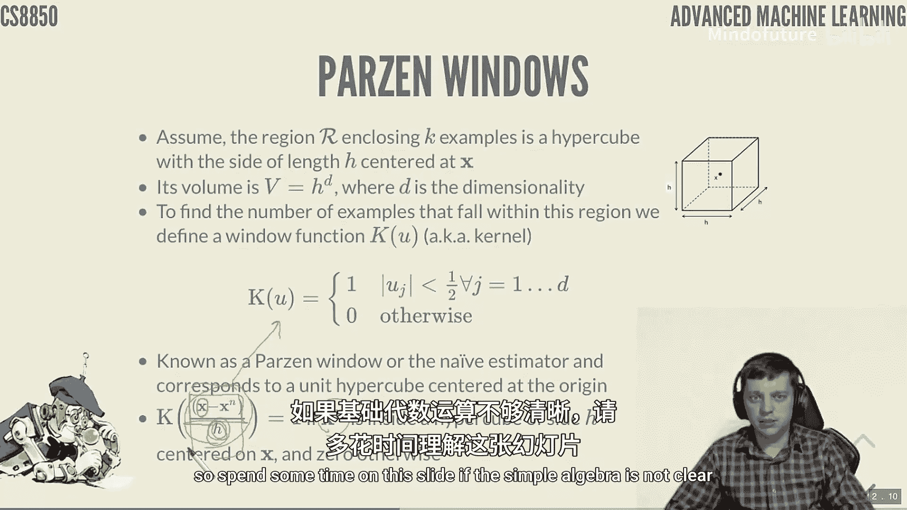

So let's look at an example of how parts and windows work。 So one dimensional case we have。

Few points。 and we want to compute probability at x。 We have point X 1， x 2， x 3 and x 4。

 And at this point， we want to compute what is the probability density function。

What is the value of probability density function， So we choose our kernel。As such， are。嗯。Yeah。

 our our volume is that length that we selected。 And let's see。

 So the total number of points inside the hybrid cube is just the sum。Of everything。And look。

 how convenient it is。We're summing across all of our training points。

But those that are outside of the cube。They will。Return 0， right。

 the indicator function will return 0。 So there are two alternative views on the problem because this is symmetric。

 Remember， our kernel computes。An absolute value。So either we can think of the problem the way said on the first slide as。

 okay， just put a hypercue around the new point that you'd like to。Work with。And a。

Find the nearestest neighbors。Or find the points that fall within this region， within that hypercu。

this one dimensional， so you can see。And then we're done。

 we can just compute the K and then use our estimate。K， worry a。Or。嗯。

Another alternative view is ignore。They need。To find which points are near your new point。Instead。

Consider each of your training points in the set。And this new point。

Whether that point falls within their cubes， then have your cubes。See what we're doing。嗯。That。

 so like。We are sequentially going through all of our training data points and just checking if the new point。

Falls inside， or doesn't。And then we're integrating or summing up the values， so。

It'll give us one here， one here， one here， and 0，4 x 4。And thus， we got our estimate。

For kernel density estimate of the probability function。If， if we do this and for person Windows。

 for person window， it's the V。 So this true， this trick。Compfuses the K。 And as before。

 when we are approximating probability density function at x。As。K over N over V。So。L。Is this and。

This is here。But， K。Is just the number of points that fall。Within the volume， surrounding x。

But often well because of the symmetry of citation。

The limited number of points in the training class。

 It is simple to just go through all the points and check whether the new point。

 the point of interest falls within their。Volume。And just count the number of times when it does。

That' aent symmetric situation。So。Pon windows resembles a histogram， but the。嗯。

binin location is determined by the data now。 So even if you have like histogram。Carves up。

The space sort of in uniformly with personal windows， you have。To have a point far away。

Or at some point， denseor here， Sprser somewhere outside there in the in the in the。

In the domain of your distribution， then you still can compute the probability there despite this non uniform sampling or non uniform densities。

Thanks this。Symmetry property。 So partan use。 What's the role of the kernel function。

 Let's look closer at。

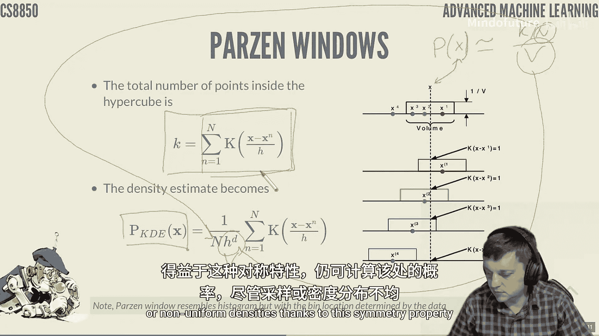

This。So let's compute the expectation of the estimate。This is our estimate。

 This is not true probability， density function of x is。Probability。Dsity function under our process。

 K D E。So what's the expectation， Where does this process converge to。

Under the probability that the data， So what does this mean this means we take an integral with respect the true probability of x。

嗯。Of this estimator。So that's what this notation means。But then if we open up。The estimator。

And by linearity of expectation， integral over sum is sum of integral。

We can write this that it's a sum over expectation of the kernel values。And in the， in。In the limit。

We， we can just。Yes， we can just drop the sum。Because we're now within the expectation。 anyways。

 integrate over all possible。Except N。X， let's write them as X T。

And what we'll see here when we again， expand the expectation。When the variable of integration。

Is subtracted over from the variable of interest。 What happens。Is。Colonel is flipped。Shan。You can do。

The algebra yourself。嗯。That doesn't work as well。 Let's not be too creative。

So if my kernel looks like that and I'm doing this， I'm moving。

 I'm fixing x and I'm integrating over all possible values x minus those values。

 what I'm actually doing is I'm。Lliping。The colonel。

And I'm kind of sliding this kernel along this probability density function。Yes， like that so。

'Sliding it back and forth。Along the probability with the density function。

 So what we see here that the。When we use the kernel。And estimate our kernel density estimator。

 It's equivalent。 It's a convolution of the true density， which we don't know。

 but it's a convolution of the true density with this kernel function。

 That's what kernel density estimator does under the hood。

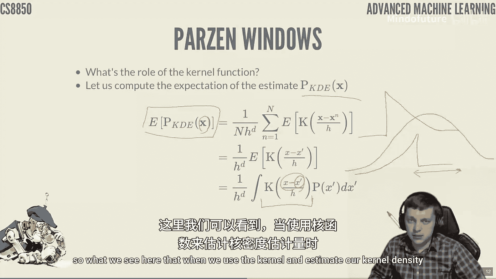

And as our。Pnal weeds。Or the volume， or if as the kernel approaches D Dlta function。

Colonnal density approaches through density。 So as this。Approaches thelta function。

This whole integral is just the integral of the true density。

 and our expectation becomes the earth true density to true value。不。嗯。Let's do an exercise。

 We'll need our pars and window kernel。As a reminder， and we'll need。

Definition of how do we compute or estimate the probability of x。Given our training data， remember。

 that's how we did it。So what if our training data is this。4556。

 whatever this is our data set right you can see it and the task homework well this this one is just so you understand what we're doing mechanically I hope you all already understand and you're watching all of this at two times the speed that I'm telling recording this but anyways let's go through it through this exercise excruciatingly slow but I want you to be comfortable and understand completely what's going on so we need to estimate the density。

Unknown the given by this data。At this places 3，10，15， and。Our parameter are。Volume or。

Hypercuubbe side is four， but since the data is one dimensional， it's just the length。嗯。

The red points are the data from this set。The locations here is what we need to estimate。

 where we need to estimate the probability。 So we go through all of our points。

And just come and just see if 03 falls into the region。 So if we center。Let's compute 3。

 So what we do is。Start from this point4。Length is 4， so。We。2。Yeah。

3 minus-4 divided by 4 for this point。Then 3-5 divided by 4 will。Appear here twice， so。This is true。

 This is one。But then。Even when H is 4。This is 0， because。Remember， we have strict inequality here。

So we've shifted our kernel， and then we go further。 But as you can see。

 there is no need to consider those points， but were cannot do with。Follow the book。 Just exact。

 exact。好给。And compute。Up to this point。All of them are 0， only one is  one， and the volume is。

The length for par 1， one dimensional。And 4 comes from here。And we got a probability。

 density value of our probability， density of our estimated probability density。

 So we're estimating the true one。With。The colonel then suggested me。Well。

 now let's compute the value here。And again， we are going through all of them for all of this。

 it's 0。And even for this one is0。 and for the rest， it's 0。 And that's what we estimated as well。

And then for the last one， the cetation is much more interesting。For this four points。

The probability。The indicator for this four points。15 does fall within the coppercube， hypercube。

 Ex me。And。For this point and the rest， it doesn't。 So we have four ones， all the rest are zeros。

And we estimate probability as 0。1。 So I hope that that's clear how this estimator is used。

 The cumbersomeness or the difficulty is that look all of those points have to be stored and visit it every time you estimate the density。

 So your training data， it's kind of like an ideal memory you don't make any。诶。

This is for those people who love to learn about pattern matching。So， instead of。Understanding。

 I would say， in making inferences and building compressed models。

Colonnal density estimation remembers everything。 and then by pattern matching by comparison。

Finds the correct values。Are they correct。 We'll find out。

 So the the problem with person windows is or all of the cubes。

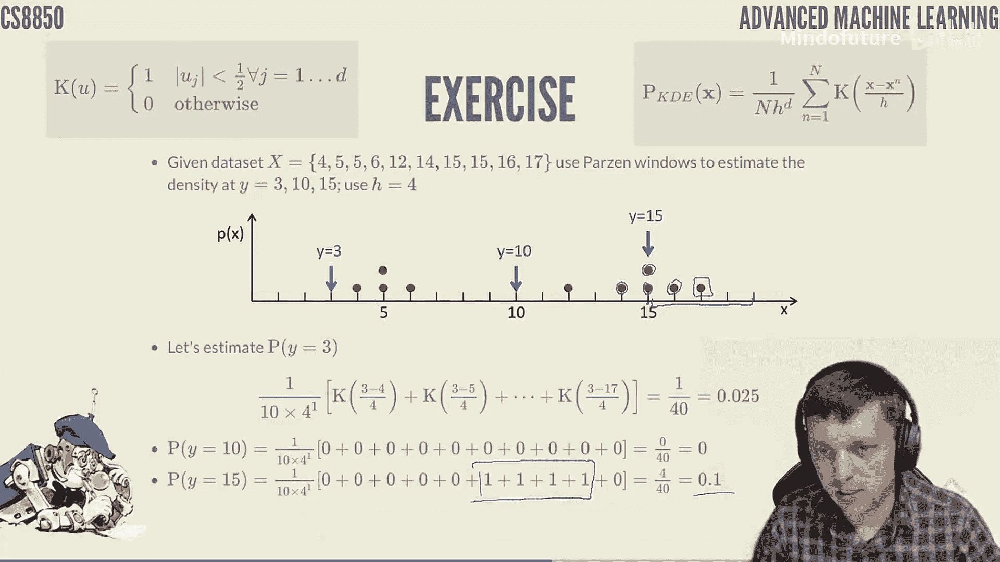

There are a few problems， it's ten estimates have discontinu still， it's a sharp cube， right？

And then another problem its because it's cube and because it's indicator。Like。

 there is a point that。It's right here。 And there is a point right here。

The partisan window doesn't care。 it weighs weighs all of them， both of them。

 both of those two points1 and two sort of equally。

 they are both equally important for partisan window。

But maybe the ones that are closer should be more important than the ones that are farther apart so often we prefer a smooth kernel and often we use a smooth kernel so a kernel to work has to obey a few principles of a few requirements it has to be non negative。

So zero or larger。That's any。AnyAny point， and it also has to integrate to one within。

Within the domain that it's defined on。And usually we prefer this'ts not the requirement。

 but usually we prefer radioally symmetric and unimod。Or also， for example， this raal basis function。

OrThis is just like the gosian without any coveience matrix because of that。

We don't care too much about thermalization manment。Yet we do。 It's nice when it normalizes the one。

 but。In generally， for ra basis functions， we don't expect them to normalize to one。呃。

And then the raly symmetric is that property that allowed you in your homework to sample uniformly any angle in multidimensional space because the Gaussian probability density is raly symmetric。

 so this function as well raly symmetric。But we have just use it in our density estimator now。

 so our kernel。As you see here is no radio basis function。

 So we used to have a hyperc personal Windows  for 2G。 Now we have。

Bll shape curve ra symmetric radial basis function。

 and it also changes depending on the number of samples。

 if you have a smaller number of samples or well， this is just an example of the widths or in the 2D kernel so you can regulate the widths。

By still using H here， the smaller the H， the nu or the function。Okay， and the larger they age。

 the wider function。

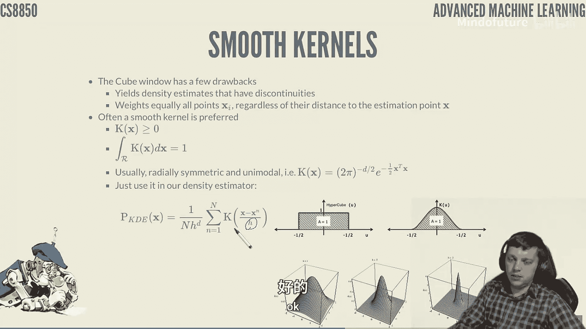

So let's try to think about what we're seeing and what we're doing with it。

 So smooth kernels estimate。What they estimate is a sum of pumps like。

At each point in your dataset set， you put a little bump。

Or a large pump dependingicular your age parameter and then。

Clonnal function determines the shape of this bombs and parameter H is smoothing parameter determines that width。

 you will see why the smoothing parameter。So。Each point in the training sample in your data。

You just put。A be shape curve on top of that， but when you add them up together。

 you get this more interesting curve。嗯。Interestingly。If you。Just a smaller side。

 you can estimate Gaussian with those kernels， you can estimate。Any function。

 or you can approximate any function。The more the more kernels like that you add， you can。

Approximate any function using the basis of those functions， of those bell shape functions。

 And if we talk about those。Both shape functions ass in。Functions。

Then we say that Gaussians are universal function appxiator。

Bais of Gaussian functions functions is universal function approximate。

 we can approximate any function with the Gauss sense。

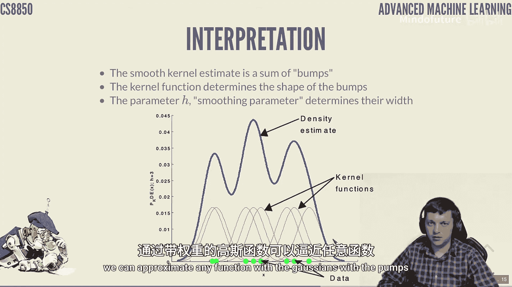

With the pumps。 So another example is。How to set the kernel width。

 we can set it to two or we can set it to five， but as the data goes to infinity。Remember。

 Bayesian learning are prior， whatever we set the kernel width doesn't matter。 they all。

Approach the true density。But the way they do it is kind of weird， right， with one sample。

For a very small kernel， its。Nicely looking function， but。No， it only only looks nice for one sample。

 but then it's。Kin of spiky and delta functional， of course， this is just artifact of plotting。

 If you plot it smoothly with higher resolution grid。 There will be smooth bumps， smooth bumps。

 but still。And the point is that。If you don't have enough data。

 your prior knowledge may give you better estimate like this of the final result。

 but when you have lots of data。Your choice of hyper parameters doesn't that much matter。

 at least in this application。 So how do we select， how do we know when to select larger。

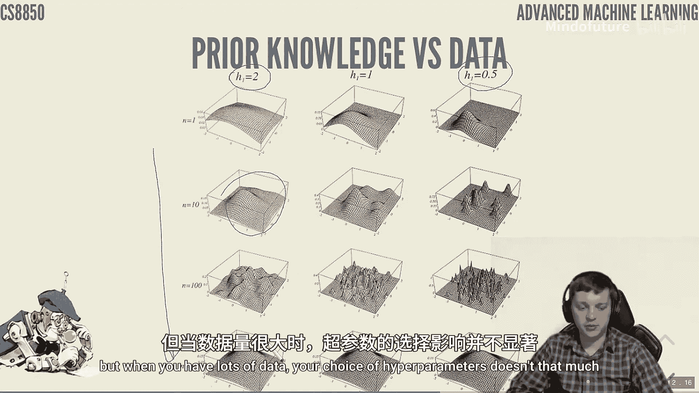

H or smaller H bandwidth of this kernel function。 So smaller H gives you a spiky estimate。

If you choose too large of the。To large H， two large bandwidth， bandwidth that is too large。

 you get oversed estimate， which one is better。So large h over smoothest the density hidden structure。

 well it fights it smoothest out the structure and small yields of spiky un interpretpreable density estimation。

Well， in general， the problem is unsolvable as always， but we can do something in practice。

 so we can pick H that minimizes the error between the estimated density and the crude density。Just。

 just to it。 Yes， we don't know the true density， but we can still assume。

 So let us use a mean squared error for measuring this error。 So mean squared error。

In squared error between our estimate and the truth。If we write it down like that。We can decompose。

They mean squared error。 Well， we can decompose the square。Easily。I think surprising。

Then we can regroup because this is just an integral。诶。And we have three integrals now， and since。呃。

Yes， so what happens here？y。In the girl。Of P X。With respect to something T X。

 That's your expectation。 And when you do。B X with respect to B X。You'll get the B X。That's this。야 어。

It's this。And the same happens with square。Just precisely because。只。Variable of integration。

Goes through all possible values and。This X。I。That x is x at which you want to estimate the value。

 So that's why E of x and P of x squared just fall out。 Okay， that how that's clear。

So then we do some black magic。 We add and subtract a。Square of the。Expectation。

I think changes we add and subtract， but adding。And subtracting。Leads gives us a way to rearrange。

A little bit。 And what we get is。Zimmin。Where our kernel density estimator will converge。

Minus the true value of the probability density of unknown probability density at x。Squat。us。

Expectation of a square over our estimate minus the square of the expectation of our estimate。

An expectation of our square of square minus the square of the expectation is nothing but the variance。

And。This is bias。This is biased because okay， this is where our estimate will con mergege。

And this gives us the difference between that。Poin that it will converge that。And the true value。

When they're equal it converges to the true value， then bias is 0。 well。

 this is a typical example of bias variance trade off and we'll come back to it in later lectures。

 but here's an example of visual example。 So when we have low variance。

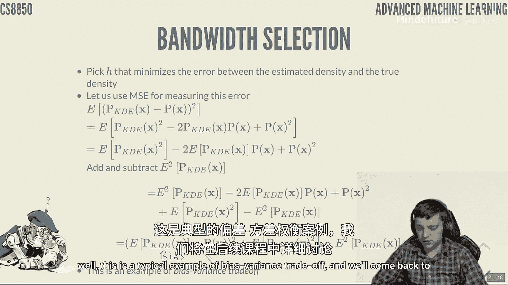

攞诶。The distribution is not diffused。It hit very closely all the time。 You can be。

You can have very low variances， always hit the same point。But you can be completely wrong。

 That is the bias。Or you can have。High variance and be completely wrong。

 Or you can have high variance can be sort of right。 So we sometimes often can add some variance in。

Heat the point more correctly， or like。What Bayesian approach is advocating for instead of being super precise and estimate to one parameter。

And declare。诶。It declared a fake that。Baseds on approach。

 I have the advocates to estimate all of your uncertainties。

 And then maybe you'll be in this situation where you're not so super certain。

 That's why you're smoother and have more variance in your estimator。But you， you will， at least。

Capture。Captured。Your true value that you're trying to approximate， and you will build。

AReer or whoever runs this analysis that look this estimate is uncertain。

 it's like the variance is too high， so don't don't bet on this too much。Whereas this。I buy slow。

 low variance estimates are over optimistic and incorrect。

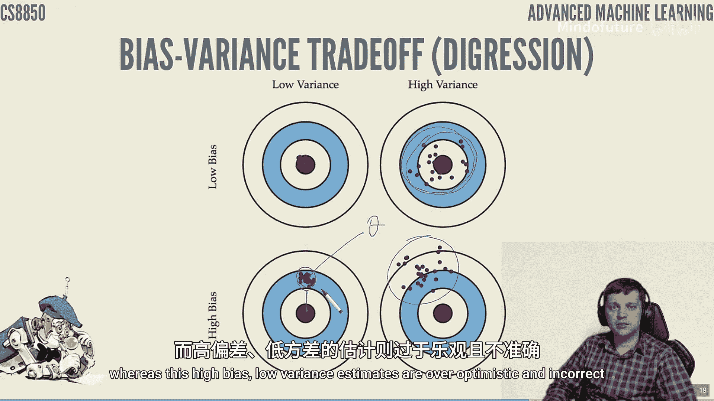

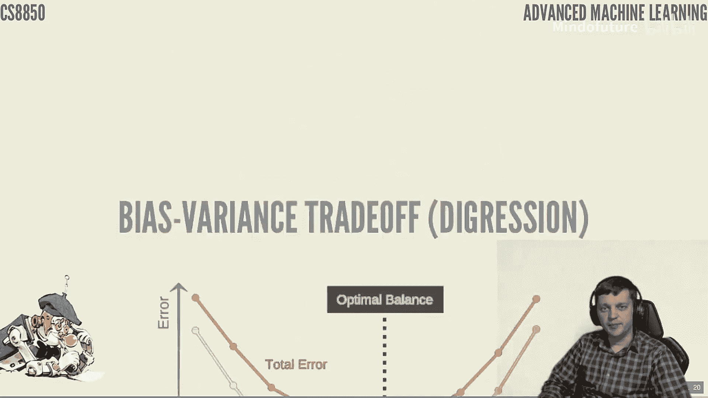

So what it translates to in the model training model selection。

There's bias variance spread of problem。Is that once you start increasing decreasing your bias。

 your variance grows and so。And we will see that with the kernel density estimates in the next slide。

There is some optimal point where the bias is still not too high， is's already not too high。

 it's kind of lowish and variance is not too high either yet。

 so if you go further with reducing bias， you introduce a lot of variance。

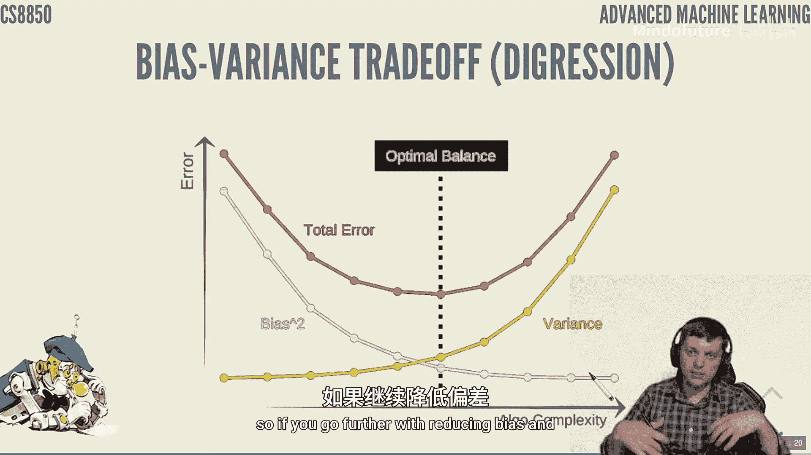

Here's an example， if our kernel。W is too high。We're oversmthing。 We're biased。

The true density is blue and the kernel with two highs。

 so we introduce bias and which mostly approximates something that is not true。

Or if our kernel density， a kernel with too low。We introduce a lot of variances。 Were， we're super。

er。Correct， sort of were unbiased， but we introduce a lot of variance。 So how do we deal with that。

 how to select the bandwidth for the kernel in kernel density estimation。

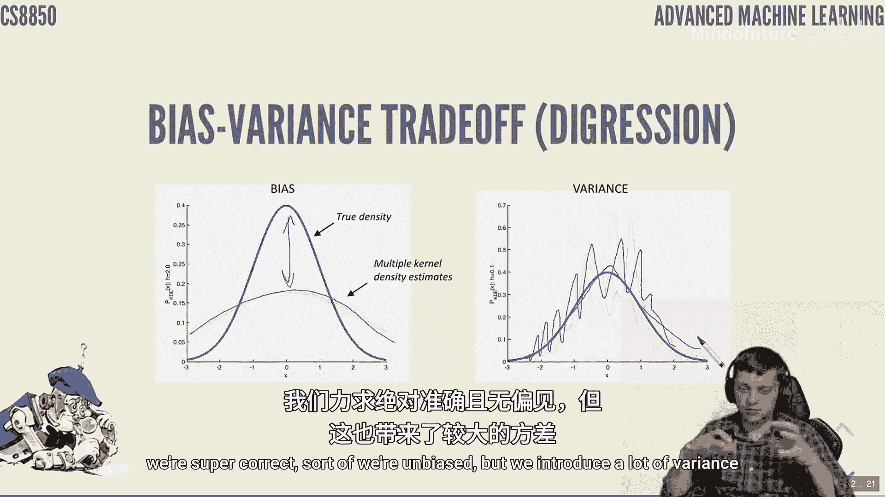

Such that。We at least。Have some guarantees or some reassurance that what we're estimating has something to do with the ground ruless through distribution。

So we can make subjective choices so。I multiple curves and curves and choose the estimated best matches subjective ideas。

 like we can see yeah， this distribution couldn't be that spiky and so on and so forth。

 but this can only be done。And low dimensional data， right。

 not too practical in high dimensional data。 Or if we can assume that our data is gaus and is normal。

 So for gaus and distribution， we can analytically derive multiple things so we can minimize overall mean squared error。

 And if we can do that。For true Gaussian， this minimum argument H star is 1。

06 times the variance of the Gaussian and number of samples。Eive one or five， power， one fifth。

This slide is full of myic numbers。We can obtain better results， if we。Change the magic number 1。1。

06。Into 0。9。And。Use interquantile range。iq r。Divided by yet another magic point number。

 and if we do that， this is kind of rule of thumb normal distribution approximation。

Or Silverman's rule of thumb。 You can read about it in Wikipedia。

 at least rule of thumb of bandwidth selection estimator can fail miserably if your data is non Gaussian。

 by the way， if it's by model， even consists of two Gaussians and again。

 check an example on Wikipedia。

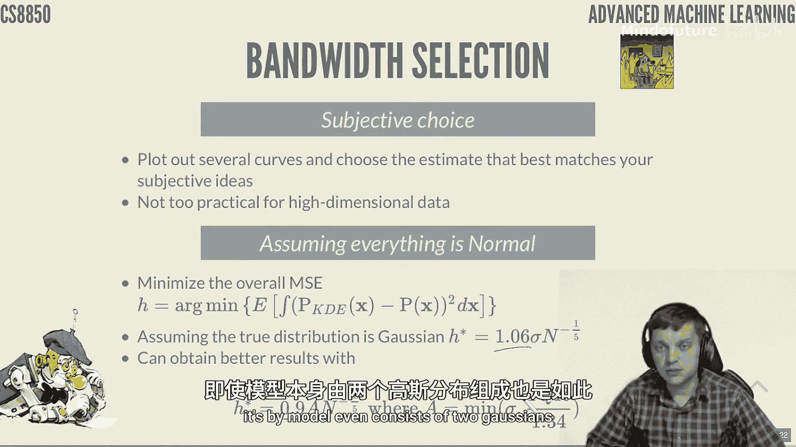

So。What do we do when we have。Multivated densities。So。InWhen you have multiple dimensions。

And use pars and windows， for example， or symmetric kernel raal basis kernel。

 then H is the same for all access， So this density estimate is weighting all access equally。

It's not always desirable， may be a problem if one or several of the features have larger spread than the others。

Like you have larger uncertainty or just naturally a larger variance in one of the features。嗯。

I don't know color of feathers in a parat may be highly variable whereas size of the beak is the same and well things like that so and a couple of hacks to fix this is prescale each axis so we can apply a scalar and force all of the access to be within the same scale we can also pre widen the data that comes from our PCA and kL transform so if we compute the covariance of our data and then compute。

Well， this prak transform rate hour close to and we。Take our xes。For them。Proose。

Of by larger matrix x。And then， do。Compute this X X transform matrix。A and decompose it。We。

 we we we transpose， and that's what this lambda square root of negative square root of lambda。嗯。

Not negative square root of lambda。 It's basically one over lambda。😔，1 or square root of lambda。

H I for the diagonals。 and then we widen the data。 Basically， we rotated。

And scaled all of the eigenvalue rotated in the space of eigenves of the Caavance matrix。영화월 때 달。

And then scaled all of the axis proportionately to their er againvalue。

And then we can estimate the density and then transform everything back by the inverse transform。

Or we can just use hyper ellipoidal kernel that does this all implicitly。

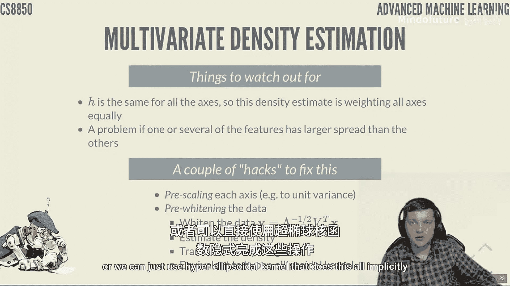

Well。If using Haik solutions is not your thing。Then we can use product kernelnals。

And product kernels go like that。 Okay， we have。Individual kernel parameters。Our larger kernel or。

Incompasing kernel。Contains all of the individual kernels。

But we model this kernel as a product of those little kernels for all of those dimensions。

 all of the separate dimensions。 and， of course， normalizing steel by their volume。

 So it consists of the product of one dimensional kernels。

 but kernel independence does not imply feature independence。 Feature can still be dependent。

 It's just their way to。

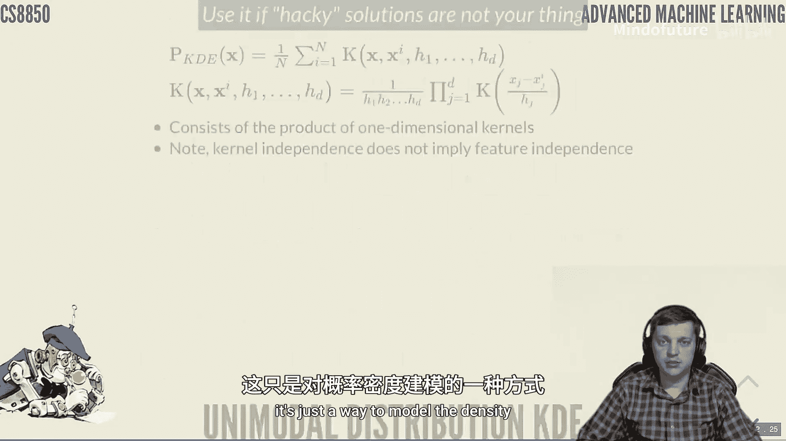

Model the density。 So you model。A distribution example。

 Unimod kernel density estimation with take 00 data points。It's just。

This is a 3D rendition of this 2D。嗯。系。Isod density lines。Conterpl。 So we have counterpl。

 and we have two dimensional plot。So。That'll， little， this is the true。

T sit because we know the functional form， we can just plot it。And then we used。The rule of thumb。

For setting the widths， and we use sort of theoretical Gaussian。Here。

And you can see for yourself which one looks better。

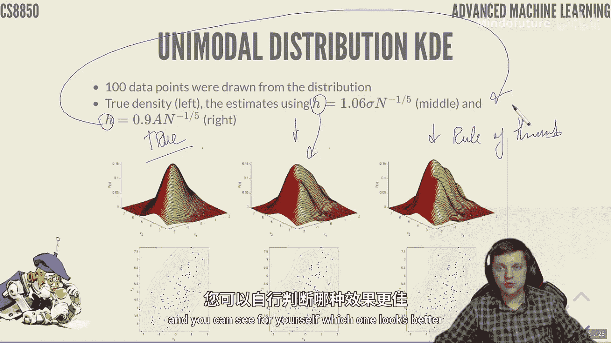

And then for by model， when we have two densities。诶。What we see for by model with the same points。

 with the same settings。Basically， when we assume Gausian what it does。By， this distribution is。

And both of those， well， they're not too different in this case。 Both of them are oversming。

 They're just biased， biased when it's by model distribution。 Theyre both over smooththing。Well。

 I think that's a good。嗯。Sort of shallow introductional kernel density estimation。

 I hope it's practical。 What you need to get out of this。

 You need to understand how to use the kernel estimates and。

The walkthrough examples that I gave you should help you。And。Yeah， that's the main point。

 how kernel density estimation works。How to mechanically sort of use it when you need to estimate your probability density。

Non parametrically without assuming any functional form。

 we will talk about how to estimate what's yeah， what's on the screen right now parametrically as sum of the Gausss of a few Gausss。

Which is not that easy。 We need latent variable modeling for that， which we haven't covered yet。But。

With non telemetric estimation， you just need to understand that your data。Is basically your memory。

 You always have to have your data with you in order to reestimate this density and compute the probability。

 But you can use this approach for regression。 like not just classification。

 Can you those neighbors will give you classification。

But you can also compute regression if you do the same trick as kernel density estimate。

 But just for this one variable of interest， why， and then you can。Given you some new feature set。

 you can predict。Age of a person or any kind of continuous value by using the same trick by using nonparmetric density estimation。

 There are other interesting nonparmetric。Methods that we don't have time to cover in this class。

 but I highly recommend you to look at。 They include spline interpolation and。

Throw into gaussian processes that are also interesting barmetric methods。And。Yeah， a few of others。

But。Thank you。 That's all I have for this episode。

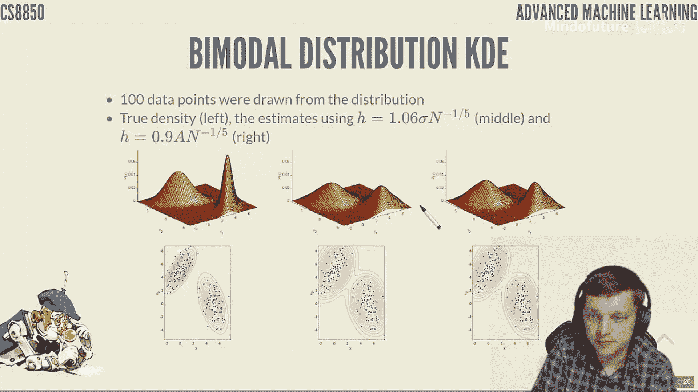