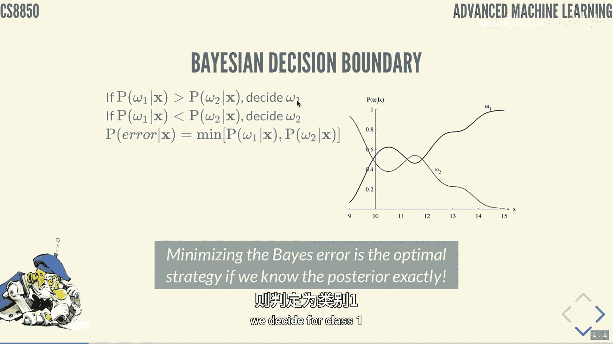
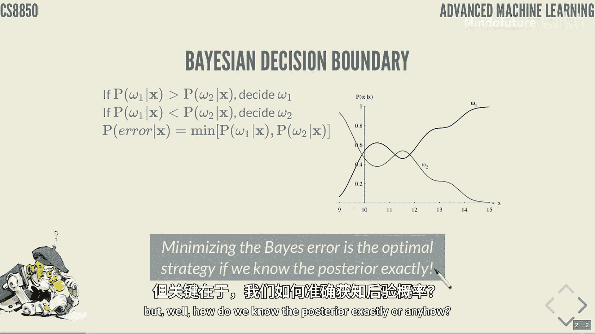
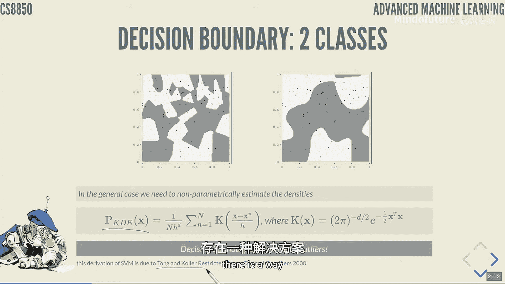
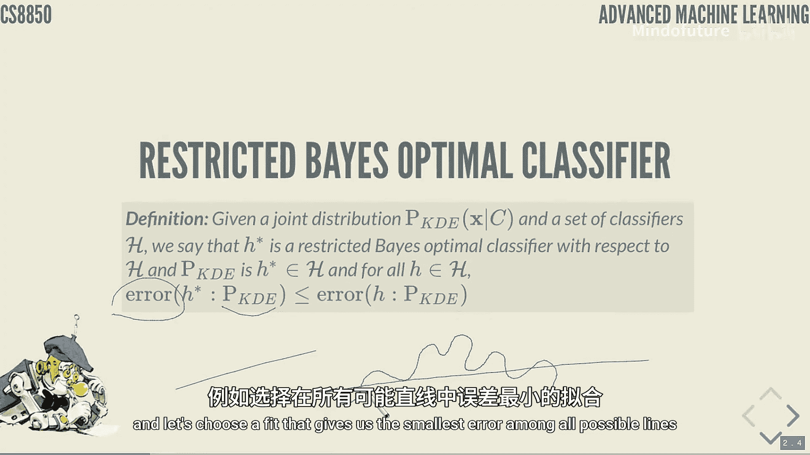
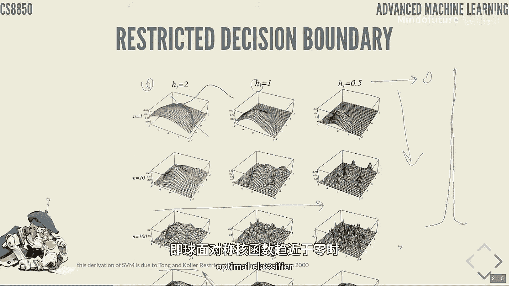
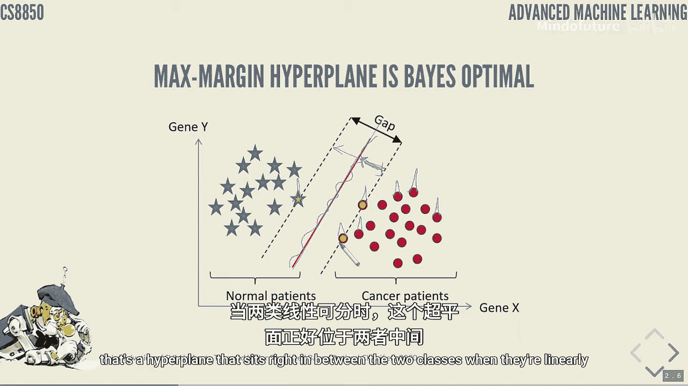
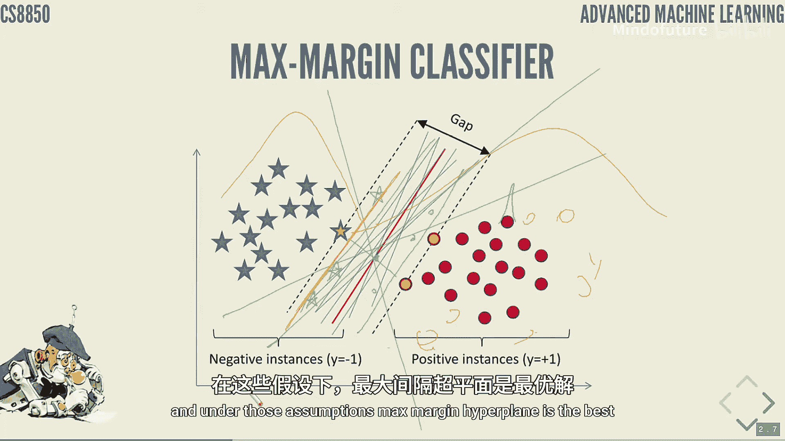
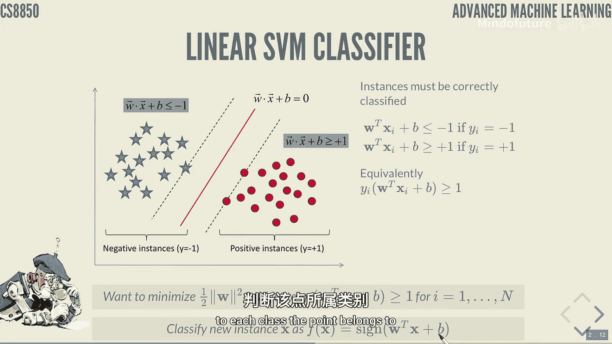
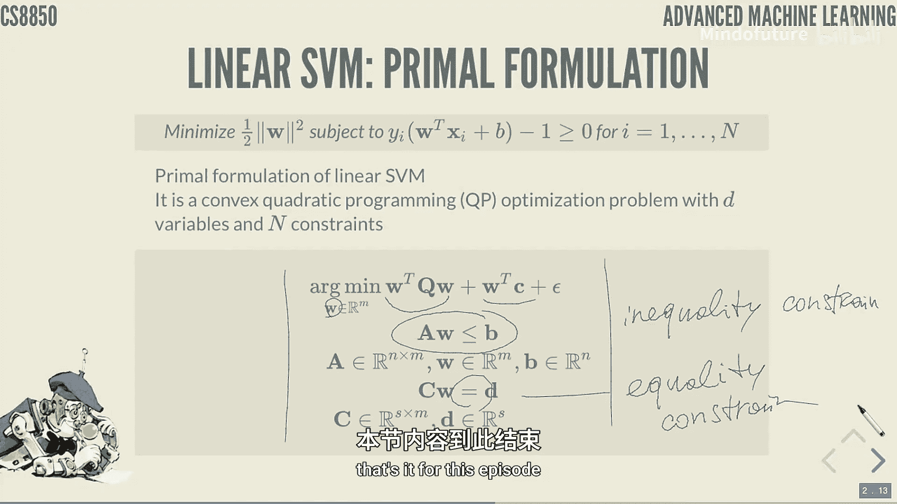

# 高级机器学习主题-CS8850-｜-Advanced-Machine-Learning-p34-P34_最大间隔分类器--BV1sapPz4Ewx_p34-

Let's talk about max margin classifiers。Its what。So， recall。

Our lecture on based in decision theory and based in optimal based and boundaries。

Remember how we have。To posterior distributions， the black for class 1 and the red for class 2。

 That's what you see here on the right。So， and our decision is that if posterior for class one is greater than posterior for class 2。

 we decide for class one and。

If it's reverse case， preerior for class one is less than preerior for class 2。

 then we decide for two。Effectively， what we're doing in this case， were minimizing the base air。

Which is the minimum。 The base air is the minimum of the two of the two posteriors。

So minimizing the base error is the optimal strategy。 if the， if we know the clustererior exactly。

Okay， that's。That's nothing new。 That's what we already covered。But， well。

 how do we know the pasterior exactly or anyhow。

好。Let's consider the season boundary for two classes in the general case。

 we need to non parametermetrically estimate the densities。

And remember from our kernel density stimulation class。Depending on how you choose your。그不字。

The weeds or bandwidth， if it's small or if it's large。

 the boundary changes dramatically here on the pictures。四。Age is small。2。H is your。

Aimeter width throughout and age is。Large， that's what you see here on the right and on the left。😔。

So in the general case， we。Want to be able to estimate。上午好。呃Probability。

First of all all the joint probability really， but say exterioris of each class and our H is that width here。

If you recall。 So let's take a rad basis function， a Gaussian。

Distribution all thousand like symmetric distribution for a kernel。It's a fine estimator。

 The only problem is that depending on which widths you take。AnIntrouction of extra points。Well。

 Apple will have a tendency of。Adversely affecting the decision boundary and some outliers。Also。

 greatly affect the decision boundary。 But just because of the estimate， Well because of。

realal decision boundary。 But just because our estimate is sensitive。To outliers and。

Because we're not。 We do not have。That actual ways。The actual posttheor of the classes。

 we do not have。They base optimal classifier either and our boundary decision boundary is on an approximation。

So the variance， in this case， when we're modeling。啊。Are posters or our joint。

As some estimate of the true bacteria。Our decision boundary is sensitive to outliers。It has。

 in other words， it has high variance。With respect to the data。 So we don't want to avoid。

 We don't want that。 We want to avoid this。Arbitrary fluctuations and decision boundary。

And thanks to tongue and color in the restricted base optimal classifiers。There is a way。

 So what they suggested there is let's define a restricted base optimal classifier in the following way。

Given the drawing distribution。This currentru estimated distribution of the data given class。

And a set of classifiers age。Some coloss of co virus。

In this finite set or in this class maybe be infinite。

 we say that H star is a restricted base optimal classifier with respect to the class H and the estimate of the。

Gla I do have actually yet。Is。Yeah， is a restricted with optimal classifier with respect to H and and T。

And such that H star。诶。Belongs to the class and for all other ages in the class。

 for all other classifiers， the error of that H star classifier restricted base optimal。

With respect to the estimated probability distribution and the error is that base error that we looked at in table slides back。

If this。Error with respect to the estimated probability is less than。

The error for any other classifier。 So we have a restricted。Class。

 instead of actually tracing and drawing the decision boundary。

 the basic and optimal decision boundary， we' saying， well， let's consider class of。

Lingya classifiers。And then we'll choose among all of the possible linear classifiers。

 will'll choose a classifier。That minimizes our Bayian error。

 our base error with respect to the estimate of our distribution。The。

So there is an estimated distribution if we try to phrase our decision boundary exactly with respect to that distribution。

We will have。High variance result and an extra point and everything changes。

 the bound there adjusts and starts wiggling。 If you keep adding points， that's annoying。 And that's。

Not do robust。So instead we're saying， well， let's only consider。On a linear fit to that boundary。

More or less。You can think about it that way and let's choose a fe that is that gives us the smallest error among all possible lines。

 for example。

Think about our again， our previous slide that we well。

 a slide that we saw before in the kernel density estimation。When we have。

Large and smooth estimator with large widths。 Then add another one。In3 here。

 So your decision boundary will be here。Will。Put a link classifier。Somewhere there， right。

 But then hip。Reducing。Keep reducing the width of your。Carlonel。Of your radio basis card。

Such that you get rid of all your prior assumptions。Because your'。bandwidthand H on the screen。

Is essentially your prior assumption about。How this distribution looks like。就 if you。Proush。H to0。

In the end， you will get。Delta functions。On each of the pointss。

So remember this dichotomy that I mentioned at the beginning when we were discussing empiricalvari risk mini an minimization。

The theory of ErM and Baying decision boundary in ErM。The point was to only rely on the data。

 fully rely on the data in Bay decision boundary， we are working with。

Prior assumptions that's why we're working with probability distributions directly for us and in particular risk minimization were working with the points。

 the data points and。Kind of not assuming and we still know there is some distribution of data。

 but we're not assuming any functional form。Somewhere here with a trunk prior where we are assuming a functional form of。

Our likelihood function。And somewhere here， where all of our。

Clonnel functions are so narrow that our probability density basically is fixed at each of the points。

So what tongue and color are shown in their paper restricted baovimal classifiers？

Is that if you take a linear classifier and you have two classes and you push。

The width of our kernel density estimator， are the person window， the spherical。Araly symmetric。哥楼。

pushush it to zero。Your restricted base optimal classifier， linear。

 restricted base optimal classifier。

Becomes the max margin hyperplay。 So if youre。If you consider that。You are estimating the densities。

即。The optimal decision boundary， although it will be somewhere here， but it will be。Right。

There in the gap， such that the margin。This is the gap。 The margin is maximized。好。Then this。

 the margin is right here， so。Just to repeat。We want to get base optimal classifier。

But only rely on the data。 and we also want to reduce the variance of our phase and optimal decision boundary。

 And for that。We。Replace that decision boundary with some restricted form of a classifier。

 And if that restricted form of a classifier is aligned line。Or hyperplane。

Then base optimal is the max margin hyperplane。 That's a hyperplane that sits right in between。

The two classes， when they're linearly separable。

So， let's consider this。Before when we had two classes and we would train a perceptron。

The perceptron would give us。Any solution。RightIt could give us this or that。

Or any of the solutions that would。Separate the classes， exactly。

And that person problem would converge because， okay， problem solved。But base optimal。Boundary。

Tries to maximize the distance between classes， so that。Any of the points that we haven't observed。

And will still。Have some room。To be correctly classified， so。If we want。

A good classifier for linearly separable data， or at least。Restricted by optimal。

Then we want to place our。Hyper plane。Closer to the middle of the separating gap。

Rather than say here or here， those up to any of the classes。Well， you can reason through that。嗯。

Without sort of any kind of theory。Using some common sense that， okay， well。

 there is this strip of no one's land。 Where would you put a border between the classes well。

Let's put it in the middle。If we know nothing else， right。

 if we don't know anything about which classes really mostly。Mostly preval。 And we only。嗯。

We only know that。This points that we have is。All we got。 and they came my I from the distribution。

 We know that that we don't want to make any other assumptions。嗯。Okay， well。

I hope intuition behind how we came to the max margin。

Classifier how we came to the desire of putting hyperplane right in between is clear right there are still questions about base optimal versus restricted base optimal and this is restricted base optimal。

Only in the， in the limit when we refuse to smooth out our distributions。 And when we put our。

Approoxximating kernels of the kernel density estimator right on each point and make it really。

Narrow。And you should understand why， why I'm stressing that out， because if you have， say。

A much smoother kernel。 And you have many， many more。哦佛。The， the red。Poins。Then。

Your distribution will be wider here and not or here。 And in this case， it will make。More sense。

 And the base optimal decision would move closer to the spars or class。Okay， I hope that's clear。

 but we're working slightly under different assumptions and under those assumptions。

Max margin， hyperplane。Its the best。So let's look at this type of plane。 Remember how we defined it。

 We had a bias。 We had。呃。So King add a normal to the hyperplane， then。We multiplied by our data。

 and we had a bias， and。The hyperplane。玩。W and X are vectors B is a scalar Hyperplane was is a set of points where this equation is 0。

 Those points are right on the hyperplane。 But then we also， if you remember， we made an fine。

Transform， we added。We added them。The feature or dimension to x。Of one。 And then in this case。

 we could just try W T， X。For0， because bias was kind of flowen in in W。

So let's consider around the point， just a point somewhere around the hyperplane。 this point X。

 what is the distance R from this point to the hyperplane。 Well， that's exactly the perpendicular。

The length of the perpendicular that you drop from x to the hyper planee。So。嗯。That is。

 that is the length， right。We are computing。Projection。Of X onto the normal of the hyperplane。

And then， we're normalizing。By the length of our。normalormal vector。And bias gives us。

 bias gives us the shit。But because we're commuting the distance。

We're taking the absolute value here。B freedom。Care if it's on one side or the other。

 We just want the actual absolute distance。But we can obtain the same if we use the label for this point。

 because all of the points on this side are positive and all belong to positiveness are positive。So。

 label。Will be plus one， but label on the other side will be minus one。And then。啊。

For correctly classified points， at least this。Will always be positive。Regardless of which side。

A point lies which side of the hyperpoint the point lies。 So I hope。It's clear， please parse that。

Really closely and trace where it's coming from， why is it true？So we have equation for the distance。

And just just another。好好。Just another kind of intuition。If you think about this。

 So we have this point X P， and we have this point X。And we have our distance， right？And。Are x。

Did nothing， but speed plus。The normal vector， normalized。The unit length。

That will be a unit length W here somewhere times R。And so from here， we can。Insides。哦。Okay。So now嗯。

We know what R equals to。 We know what distance equals to。

When we say max margin or maximize the margin， what we mean is。Look at this point。

 what do we want to maximize？We want to maximize the distance to the nearest point。

Do we want to maximize that， maybe， maybe this。Maybe。

 but we do really want to maximize is the distance the thing nearest point。

 So we want to maximize the minimal distance。Just rising the same。This is the distance。

 so we are finding the minimal distance and since our R。But that distance。F。The minimality of it。

 since all of them are normalized by W。 the length of the W， It can pull it out。

 So we pull it out of this minimization。 So we're first finding the nearest point。

 and then we're maximizing。That distance， and。We can only。

Maximized by speedddling with two parameters， W and B。The normal to the hyperplane。And the bus。Okay。

 that's what I wanted to say。Maximize the minimal distance basically with Oh， okay， there is another。

 another。Kind of just a side note actually so when we start with this particular example on the screen in on this slide。

 we will be somewhere here， but then eventually you may over oversot and suddenly at this point will become。

The nearest point， the minimal distance point， but notice that eventually you will converge by fluctuating and you will converge。

Such that you won't be able to push the separating hyper plane either way， because。

Then you will minimize the margin for the nearest point。Like when。You push this optimal line。

 max margin line towards red。Then， yes。The red points becomes closer to you。

But margin can still de maximizeimized， the margin becomes smaller and interestingly enough that okay。

 this is a clear example。Cl a picture on the screen that when you have。Just two points。

 two perpeniculars。嗯。The then it's easy show It easy to show that they are the nearestest points。

 But any kind of point on those。Square。On those parallel lines， any point on those parallel lines。

Will have the same distance。So， observe。First， before we talk about the further graphical。

 I observe first， simply algebraically， that the distance doesn't depend on doubly。

remember how would you find it。We define our distance。啊。Is the label times the。Ling equation。

 right so。The1 is divided by W， the normal the W， the length of our normal vector。So。

 let's scale W by K。When when we're scaling by k， what we're doing is we're scaling this whole W。

Because B is part of W essentially remember are。W x equals zero line equation。 So if we scale W here。

 then scale W and P in both cases。We can take the K out。

And just cancel it and go back to the same distance。 So no matter how you scale W。

 you make it longer， you make it shorter。Sca is whichever weight。If distance of the point。

 the same point， the point doesn't move to the hyperplane is the same。つて。

So that means for free to set。The诶 the value of the the。

Top part here of the top expression to whatever we want。 We can always compensate for that value。

 but by yeah。Changing the W， right， you can always get that value by scaling。So， let's sell it。导玩。

So that you need to support。So our inter point the theplan will be one。Yeah。In this case。

And as you see now， we have two points that on this parallel line。

 So we're starting with the separating hyperflae。W X。Plus， buy。And we're just saying， okay。

 our neatest point， and this is at this solution。When the margin is maximized。

 when the margin is maximized， as we just observed。There's both。

Parts of the gap will be the same length。But because of the sign。

 and since we're not compensating with the y here， it's either plus one or minus1。And we。

We said it arbitarily， arbitrarily。So the gap is the distance between parallel Hyplanes。

 This is our gap。And we we， when we said。The this distance。And this sort of。

Signine distance to 1 and -1。 This is what we get。 But now， let's find the。

Like what is the bias of this new hyperplane since we said what they will be equal to？啊。

So we'll put this one。Here， and we'll get this。 and we'll put one here， and we'll get this。But then。

 our gap。系。鸡。Is。Nothing but1 bias， minus another bias the absolute value of that。

Why is difference to what normalized by。The links of the。W of the normal to the hyperplane。

So this is B1， say， and this is B2。 So get the gap is2 over。The norm of the。

A normalmal vector to the hyperplan。So to maximize the gap， we need to minimize。诶。W。喂。

If we want to maximize this。This needs to be minimal。By minimizing the euclgen or or the length of W。

哦。We can either minimize this or we can minimize one half squared。

 the minimum will be at the same position at the same place at the same value of W。

Regardless of squing or havinglving。So， then， another。

Point or another observation that we want to classify the instances correctly。

Everything on the positive side of the hyperplane of this separating hyperplane。Should be positive。

 greater or equal than to plus one and。Should be negative less than or equal to minus-1。

It is either on the -1 Hyplane。Or less than that hyper plane。

Or if it's either on plus one Hyplane or。In the positive。That action so。Just what I said。

 when the label is negative should be less than minus-1 when the label is positive， it should be。

Greatter or equal to plus one。 Okay， less than or equal。To minus-1 or greater than I equal to plus1。

Or equivalently， if we don't want to separately talk about。Positive class and negative class。

 If you multiply this legal through to both sides and to both sides here。You'll see that。

This follows the。Label times the hyperplane。Equation。

For correctly classified samples should always be greater or equal to one。So， we want to。Minimize。

Because we were maximizing the margin what we got。We want to minimize。The norm好 thew不。

If we want to minimize it， not just arbitrarily placing it somewhere。

 if we me want to minimize that subject to set of constraints。Such that all of our。

 our constraints are here， all of our。All of our samples should be correctly classified。

 they should be。This expression should hold for all of our data points。就。Okay， that's。Yeah。

 and then after we've done that。We work similarly， as with the percept。After minimizing。

 after minimizing this expression for these data points。

We'll just use the sign of our hyperplan equation for classification。To each class。

 the point belongs to。

So this is called linear SVM primal formulation。We want to minimize。哦，到。

We want to minimize the norm of the well the length of the normal to the hyperplane subject to the following constraints。

 and we can solve this problem efficiently as a convex。 It's a。 It is a convex quadraic programming。

Optimization problem with D variables and and constraints。 So that's。ja know。Form of UP optimization。

 we want to find such w that minimize this quadraic plus this linear term as I' known subject to the linear contraint。

And this is an inequality constraint。Oh。And this is equality。And strain。네。熄饭。Okay。

 that's it for this episode。

