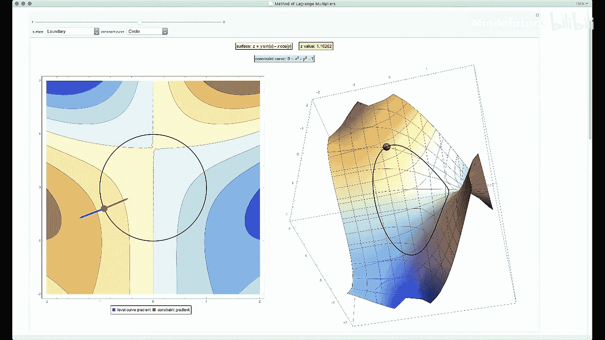
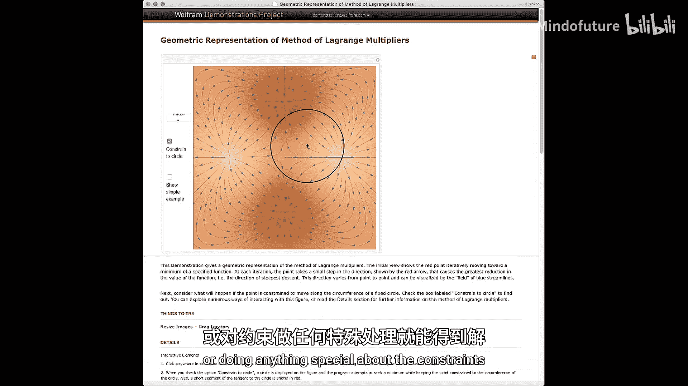
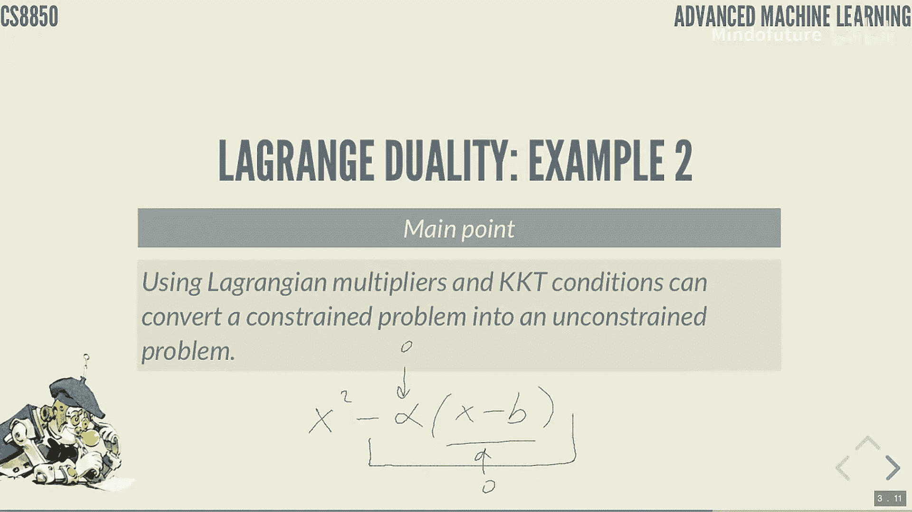

# 高级机器学习主题-CS8850-｜-Advanced-Machine-Learning-p35-P35_拉格朗日乘数--BV1sapPz4Ewx_p35-

To simplify。Some constrained optimization problems。We need to use a method。F down。

Usually called the method of lagrange multipliers。But in fact， that it is more。KKT multipliers。

 because Kauch Kentuckyuckcker。Conditions have。Generalized or extended Laous method a little bit。

But in any case， this， the topic of this episode， small subsection is thanks to。Gselle Louisis。

 La Grange， or。Many other names he went by because of his Italian heritage and then German。

Work in Berlin and then retirement and work in France。

 And so he' is widely considered French French mathematician or French engineer scientist has done a lot。

 including the method language multipliers that we need for our next。Opic and for our progress。

So in general form， if we have。A problem。That is specified in this constraint form。一。The problem is。

 I， minimize some function subject to some inequality constraint。And some equality constraints。

If we have a problem like that。Then。What。Lagrange and others following after him have shown that you can rewr。

Problem， constrained problem on the left into a nonconstrained version on the right， where you。S。

Right thegrian that includes your original variable。 and you have。嗯。New。

Variables called lagre multipliers。For each of the constraints in this picture in this formulation here。

 I have conveniently just named the greater than or equal to constraints with alpha。

 those coefficients that correspond to the greater than or equal to constraint are named alpha sub I。

 each multiplier for each constraint。Lambdas are for less than or equal。

 and mus are for the equality constraint。 But in fact， you just have all of the constraints。

With a corresponding multiplier。That is estimated now together。 So we are optimizing now。

This whole lag lagangian。 and we're minimizing it with respect to x。

 And that is because we're converting this problem。

 minimization constraint minimization problem into an unconstrained problem。 we're minimizing。

With respect to x and maximizing with respect to our lagangent multipliers。

 So maximizing with respect to lagrangent multipliers and minimizing with respect to x and。

That gives us ideally， that gives us a saddle point where they meet and we get our solution。

One thing to watch out。 So， for example， and I'll explain。In next slides。

That when you are minimizing a function。And you have。

A constraint to satisfy that some function of x should be greater than or equal to 0 than when you're minimizing。

And buding。New constraints on the multipliers。That there are no negative will treat me in just a little bit。

Then you put a negative sign here when you're minimizing a function and maximizing with respect to alphas。

But when it is a less than or equal constraint but a plus sign， when you're maximizing instead。

 youve click this goes plus this goes minus。And the trick here is that you can start thinking about for a quality constraint。

 which sign a good。 But in fact， if you。If you take mu out of the picture and allow it to be any sign because it is an equality constraint。

嗯 optimization。Will sort it out。Itself。So necessarily optimalalology condition。

 once we took a constrained problem。Three people different times。Which we will see at the next slide。

Bose。In 1939， I believe in his master thesis。 and then later。그。An Tuer。

Establish that once you reformulated your problem in this way。

 your constrain satisfaction problem in this unconstrained way。For solution， it is necessary to。诶。

Just solve this system of equation when your ingredient with respect to each of the。

The gradient of the lagrian is0 with respect of your original variables and each of the new multipliers。

So then when the conditions， this is a slide from Wikipedia。

 you can go and look it up and read a little more in detail。

 My goal here is to give you an intuition not to just not to derive everything。

 but we'll derive some stuff to gain the intuition。 So basically what we're we're saying that。

So the following condition needs to called or they will hold a the solution。诶。So one， one thing to。

Let me so one I'll show you a demo。 but one thing to understand and look up in the slides。

 I've linked Christopher Bishop's book。 Pf is available online。 look up his appendix E。

 He givess the following intuition。So if we have a constraint。Let's have an equality constraint。

 right？So， we want。To maximize。And bishops。Example。

 maximize some function and we want to have an equality constraint so。嗯。Gemetrically， it's。

Sa if we have some 3D function here， and then。We have an eoid。So we want to find the maximum of Fx。

Which is the paraboloid here。え？Yes。But the maximum。Constrained to GX。

So the maximum will be somewhere here。 But the point is that。The gradient。With respect to G X。

Is always perpendicular。Do that surface。To that。 well， it's a line here in my drawing in my example。

 but the gradient will be always perpendicular。 and bishop gives a nice。Intuition for that。

So we know that G of x equals 0 for some x on this constraint。And。

If we take G of x plus some epsilon。Such that this next step X。Plus。Some epsilon。

It's still on the constraint。 There will still be0。 but now let's do the following。

 let's do a tail expansion of a G of x plus epsilon。Which is nothing but。G x plus。Well。

 because we're dropping all of the other terms， it's approximately equal， but。In those two。

Or equal now。In know see。That the gradient。Is orthogonal to that step along the constrained surface。

Or approximate later togon only if you let Eppsil go to0。The gradient becomes ortho toal。

 and basically。아 그래젠。Of G with respect to x is orthogonal to the surface。

That were optimized that that we are using as a constraint。

 So when we are using an unconstrained like grandur form。And。When。We're doing this。

It's another geometric intuition will help us。Were also justified， because。Add the solution。Wait。

 wait， wait， wait。 It's mean with my colors， wait。So， my。

Radient with a spec G will still be pointing orthogonal to this eipoid。

But my gradient with respect to F。Will be。Or parallel to the gradientaz end with respect to G。

 because if it's not。At the solution at at the maximum， if it's not。

 then say if it's pointing a little bit sideways， then we will keep moving sideways。But when。

There is nowhere to move。 That means they're pulling apart or in the same direction depends， but。你。

The laggrangian multiplier multiplier will figure out the direction of the pool。

 Let's check an interactive demo how it will。First。So， continuing。

Look at this example where we have a function that we're optimizing。And。This function is the surface。

Intricate surface here on the screen。I'm updating it for you and the goal is to maximize with respect to this function。

To to maximize this function with respect to the X and Y， but。Being constrained to this circle。

 sort of projected onto this or an intersection with a cylinder。喂。Part myities。 so。

 but notice the important point。Bread is our。Graient with respect to the constraint。

 With respect to the G。 our constraint is equality constraint of staying on the circle。AWhile。

Optimizing with respect to that function。So， if we move。Slide me。Or not so slightly。Not just that。Gt。

The constraint is still orthogonal。And the gradient of the function is pointing。

Now it's pointing upward because you want to get out of the saddle point of the out into the saddle point。

 but since we don't want to end up here， we want to maximize the function。

So our actual solution is somewhere here。 Let's try to get there quickly。Yes， you see it's orange。

Thisch means it's getting either。and。Add his solution。They will be。Herlinear。

That's the gradient of the function is still pulling up。

But that's as far as we can go in that direction。While still staying on the constraint。And we。

 in this point。We can make our derivative total derivative both with respect to the。

Function and the constraint we can make or total gradient。

 We can make a zero just by fi with the one multiplier， the coefficient that will make their length。

Equal in science， opposite。

Okay， another example is similar example。 This is unconstrained optimization。And if we started。

The poem just follows the。The field， sort of the lines of the gradient and converges。

If we add a circle as a constraint。Then， our point。到。Is constrained to that circle。嗯。Yeah，不走。

Hopefully， get the point。 Yeah， it starts there。And now。The gradient leads it。

Towards this attractor when we， I guess， well， it's hard to say what is here。

 minimizing or optimizing。 But the point is that。It。By solving the laggrangian。

 by multiplying the laggrangian or actually setting all of the gradients to zero and solving for it。

 we're getting to the solution。Without dealing with constraints or doing anything。Special about。

 special about the constraints。

It's going to see an example。嗯哼。は。Very simple， so you can understand what lag do I see。

Thus for us how it helps。We want to minimize。With respect to x。

 we want to minimize this function x squared such that x is greater than or equal to B。

 So when there is no constraint， we know that the optimal solution is here at 0。

And if the constraint is negative。Like here in example， we know that。

It doesn't matter the constraint doesn't change anything。

 we're still at zero and when the constraint is positive， this is the minimum。Right。

 at the constraint。So let's take this example。And rewrite it in the ligrian form。

 So this is a constrained。Form， minimize a function。F of x equals x squared。Such that。

This constraint holds。Re rearranging， we have the following constraint inequality constraint。

X minus B greater than equal to0。 so we want to minimize this constraint and it's an inequality constraint so we can't just let laggrangian optimization figure out the sign。

 So we set another constraint and simultaneously minimize for x and La。

And since it's greater than I recall the constraint。It's mindless lambda。X minus B。

 So when we're minimizing。Yes， when we're minimizing。We want the。

This part to be greater than 0 because if it is less than 0。

Then greater than0 or equal to0 right when this is less than zero。We will not minimize as to0。

 We won't be able to， because we will always keep adding some extra value in this writing when this part。

It's less than zero。Then laggrangian cannot get to0 with respect to x。Because La them。嗯。alpha。

Is positive or non negative rather， well， if lambda is zero， if constrained， doesn't matter。Or x。

 Y minus B is 0。 if it's， if constraint is active， it's right on the。啊。On the constraint， Well。

 the constraint is called active when lambda is greater than 0。Okay so。4。Yeah， for this case。So。

 we' are solving for。We are minimizing for x and maximizing for lambda， but such that lambda alpha。

Such that alpha is greater than 0。And let's solve like here， we don't know what B is。

 we don't care what B is。 Can we just use K KkT condition and conditions and arrive at something sensible。

So how do we do that。We just differentiate with respect x。And we differentiate with respect。Ohf。

And of course， whether we differentiating x squared minus alpha。😔，X minus B。So with respect to x。

 what do we get to x。😔，Let slam the。And with the spec to lambda， we get minus6。Let's be。

And from here， well， set it to 0。From here， we know that lambda equals 2 x。Well。And from here。Ile啲。

So。Yes。嗯。Yeah。Yes， okay， x equals。嗯。A lambda equals to B， but we know that we have this constraint。

 so。You just tried。That's what lambda is， right， it can go negative。So once B becomes negative。

 Lada is 0， just optimize your f of x， just find the optimal of your parabo。And。有。Yeah。

 but when B is positive。Then x equals to be。And that is your solution。So。Another， another。

Way we could have written this。 We could have written first that x equals lambda over 2。

 and then lambda。Would still be maxed。Over to be0。And then， x。Maybe闭。对。Lax of B。0。Like this。

Over here。 And with2。Okay， that's one problem。That that。By just unconstrained optimization。

 just setting derivatives to zero， we found our solution。For a whole well。

Our constant P was there has a parameters for all possible bes。

 but let's look at another example just to get the point。嗯。

Firmly that you understand what we're doing here with Larangerange duality。

 so let's solve the problem of finding the largest area rectangle inside an ellipse。

So that could be this or could be that or。Could be this or could be。 Well。

 we could quickly kind of guess that。The ones are the rectangles that ellipse does not。

Although they are not inscribed into helis， Probably not the largest ones， right， although。Well。

 yeah， I guess there is no point in。Meiing。A rectangle like that。

 it clearly will be smaller than if you just inscribe it。But what it is， which。

 which one is the solution， So let's write this as a constrained problem。

Right first equation of the lipss is here with major axis， A and B。A goes from here to here。

 E goes from here to here， and in this。They call our BCA。Example of RPRPC。Last lecture。

 and remember that those are major access those in those access， we can just。

Represent all of the points of thatlip straight X and Y。 but then。

The the area of the rectangle will be x times y just four times to repeat it。Here。

 so our constrained problem is maximize the area for x times y subject to。

Within the ellipse or on the eipse。 Well， we can see it's an anequ constraint。

 but we already intuitively see that it must be on the ellipse。 It must be equality。 Well。

 but maybe not。 let's solve it right。 So then we write a grandian where we maximize。嗯。

With respect respect to x and minimize with respect to lambda。The function and the constraint。If。

Like what do we need to do， We need to just try it。The system。Well。

 it's with respect to X and Y system of。Oh， again， it's alpha。 so used to lambda。

 It's usually lambda。 Why do they use alpha。 I don't know。 Okay。

 need to I need to change it to lambda because that's what I will continue using when I describe it。

 So with respect to X， what is it for Y minus。2 la a。Squared x。And with respect respect to y。

 it is 4 x。イナ2。诶。B squared。嗯怪。And the same we can do with respect spec2。Lada minus6 squared。😔。

us y squared over B squared plus 1。And set everything to 0。And。

Then we can flip the sign doesn't matter。By multiplying。 Well， let's all with I mean。

Have already it talent for us， I won't burden you with going to go all of the details。 besides maybe。

 yeah， we can， we can just。Go through some to make sure that we're getting what we're getting and express why here。

Which will be minus lambda x over 2。A squared。And when we plug that in， we'll get。4 x minus。

Two girls away。Lambda square B， square， A square。X。Equs to 0。做。Yes。And from here。I see。 that。

 Lambda square is。4 a square B square。11s to baby。And then， well， that's what we're get。There well。

 Okay， so we found。嗯。Yes， we found what to set X and Y in order to get given A and B。

 the major axis of an eoid， what to set X and Y in order to maximize the area of a rectangle。

Inside of the a。 Well， clearly， it's on the。On the ellipoid that's inscribed in it。So interestingly。

 you don't have to evaluate for alphas in general or for lambdas or for Larange multipliers。 Okay。

 I see why alpha is there because。We are in the support vector machine lecture， and。

We love Als there。But it's just any Greek letter would do So basically London doesn't have to be evaluated。

 and you can just solve for your。Variables of interest X and y。 And then it's called undetermined。

Multipliier， for example。But。Okay， active constraint and anactive constraint。嗯。

Oh is another thing to remember。And main point is that using laggrangian multipliers and KkiD conditions。

 we can convert a constrained problem into a nonconstrained problem。And。Again， as in。

This example notice that we can either have this 0， and then there will be。

 there will not be any effect or we can have lambda alphapha 0。 and then there will be。A low effect。

On the optimum。诶。Of all of this fact， this factor。那个。

