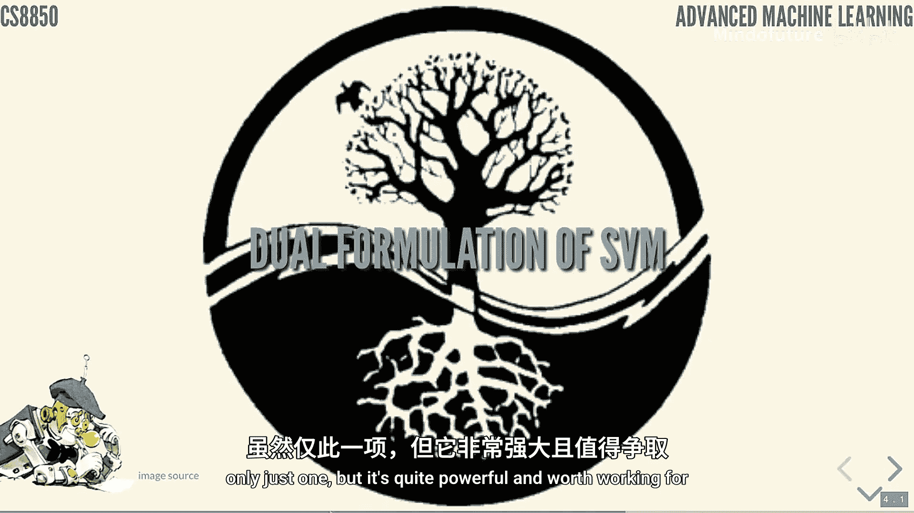
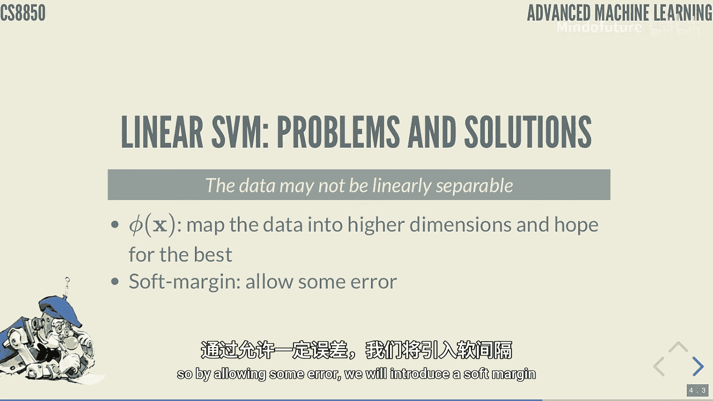

# 高级机器学习主题-CS8850-｜-Advanced-Machine-Learning-p36-P36_线性支持向量机的对偶形式--BV1sapPz4Ewx_p36-

即奇。ち。Now that we know。Everything we need to about duality。Thanks to La Ge and Kaushun and Tucker。

We can get to the dual formulation of SVM。Because the primal is not always easy to solve。

 And because of one additional bonus that we will get。Which is。All just one， but。Is quite powerful。

 and worth working for。

So linear v dual formulation first， let's once again recall the primal。The primal formulation。

 we need to minimize the norm of the normal to the separating hyperplane normal vector。

Subject to the following constraint， basically that everything is classified correctly。

Now it can be requested as a dual formulation。Interestingly。

 the dual formulation is also a convex quadratic programming problem。 QPA optimization with now。

And variables。Wan。For each data point。Let's recast it， and then discuss it。So。嗯。

We can take the constraints。Have you ride then。In the Larange multiplier form。

Because it's an inequality constraint， and we're minimizing。there is a negative sign here。

And we go for each sample in the dataset。Now it is an adequate strained optimization。

 we need to multiply the lagrian。Let's differentiate the laganger and with respect to W and find the derivative。

So as you see here， it's nothing but。So the square falls out， and you just get W。

And if you differentiate this part， you will surely。Get this。Because don only。This part matters。

And in this product， only。they means。So， we equate。

The gradient of laggrent with expect to w to 0 and sul for W。 Now。

 we know that our W is this sum of this element wise product of each sample times the label times the。

诶。哦。Oicient。Yeah， they were like grunge multipliers。So now。Look， we have the W。

Let's take it and plug it back in。Once we do that， the following expression falls out。It's。

 it's still the same。 But now there's no W anymore to solve it。 We need to minimize。The following。

Expression， and this is nothing but。Again， a quadratic programming problem。Well。

 you see the square right here， but you'll see this much clearer in the matrix form。And。Yeah。

 it'll become much clearer in the matrix form。So subject to positivity of La range or non negativity rather of La range multipliers and the sum of multiplier times。

W labels equals to 0。So， since。As we just established， R W is defined。As follows。

Our final classifier after we do the training。Take the following form。X is the new sample。

 which you want to classify。 You go through all of the samples。And。

Compute the value of this expression and take the sign of it。

The beauty of the dual formulation of the support vector machine is that despite the large number of and here of the training points。

 this is not at all like the canest neighbor it's。G you a neighbor you would store on the data as well。

In。嗯。The SVM can support vector machine。Most of the constraints will be inactive。 So basically。

 if you have your separating hyperplane and then。Glaass 1 and class 2。Point here， the constraints。

Min-1 and one。The constraint is inactive here。That is alpha I I zeros。And inactive here。

 the constraint is only active。On the margin and those points on the margin are called supports。

And the number of supports is often sparse。It may not be spars。It depends on many factors。

Your problem， your choice of hyperparameter， we don't have any yet because we only are considering linear case linear SVM。

嗯。And。So， so the only。Factor that determines in this case of the case of linear SVM that determines number of supports is your data。

But usually， it's very sparse， just a few supports。 And that's what you store。 Just your supports。

 your store your。It's like with our eigen faces。In a sense。

 the whole database of faces was represented by those eigenvectors， the eigenfaces。

 but the eigenvectors were。Genenerated， they were synthetic。 They were kind of。诶。

Putting together lots of features of。All of the。The phases that went into the PCA process。

In supports， we just select specific samples， only specific samples and only and use only them for classification after the training。

 because after the training optimization， and we use specific QP solvers or。Some beautiful。

Methods that we're not going to cover。In this class， but you may look them up。

 such as sequential minimum optimization of John Pla。Or。Our soonest method of solving linear VM。

Which are quite interesting and faster than official of QP Sos。 But the point here is that。

Dual formulation of SVM gives us a sparse solution。And despite working in much larger dimension。

Remember， primal works in the D dimensional space， and the space doesn't depend on the number of features。

 sorry， on the number of samples in the training dataset set。

 D does not depend on the number of samples now。Dual formulation is annoyingly dependent on the number of samples。

 So if you're working with big data it becomes harder and harder to train support vector machine。

Because the larger the data， the the complexity of the problem grows quadraically， let me show you。

A different way to write the same。For first， so。We'll consider that in the next episode in the next subsection and it will become clear。

 So basically linear SVM， we have now primal formulation and dual formulation。

 I will discuss some of the problems later as well that are easier in the matrix form。

 which I have another slides in another episode。So the data may not be linearly separable。

 This is linear as VM。 What do we do？Well， there are two solutions。

 One is map data into higher dimensions and hopefully for the breast。With a feature mapping file。

Another solution is， well， just allow some error。 I introduce soft margin instead of hard margin。

 as we just consider the support vector machine formulations that we just considered Both of them are called hard margin SVM。

 So by allowing some error， we will。

Introduce a soft margin。